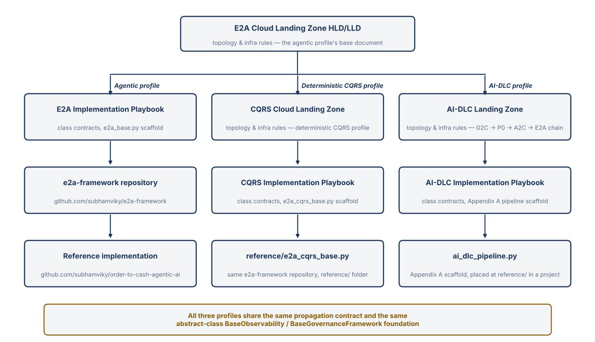

# E2A AI-DLC Implementation Playbook

### Implementation Playbook — Class Contracts & Scaffold, AI-DLC Profile

|                     |                                                                                                                                                                                                          |
| ------------------- | -------------------------------------------------------------------------------------------------------------------------------------------------------------------------------------------------------- |
| Document Version    | 1.0.0                                                                                                                                                                                                    |
| Author              | Subham Gupta, Staff Architect & AI Architect                                                                                                                                                             |
| Classification      | Architecture Reference — Class Contracts & Scaffold Code, AI-DLC Profile                                                                                                                                 |
| Companion document  | [AIDLC_LANDING_ZONE.md](https://github.com/subhamviky/e2a-framework/blob/main/docs/AIDLC_LANDING_ZONE.md) — the infrastructure and topology this scaffold deploys onto                                  |
| Parent reference    | [IMPLEMENTATION_PLAYBOOK.md](https://github.com/subhamviky/e2a-framework/blob/main/docs/IMPLEMENTATION_PLAYBOOK.md) — method signatures for `BaseValidationService`, `BasePipeline`, `BaseObservability`, `BaseGovernanceFramework`, reused unmodified |
| Sibling reference   | [CQRS_IMPLEMENTATION_PLAYBOOK.md](https://github.com/subhamviky/e2a-framework/blob/main/docs/CQRS_IMPLEMENTATION_PLAYBOOK.md) — this document's structure and conventions follow it                     |
| Scope               | Method signatures, propagation contract, and runnable scaffold for `AIDLCPipelineOrchestrator`, `AIDLCStaticPipeline`, and `AIDLCSagaCompensator` — composing G2C's `DeveloperPlatformWorkflow`, P0's `BaseProjectBootstrapper` (invoked inline, never called separately), and A2C's `SDLCWorkflow`. |

## 1. Purpose & Relationship to Companion Documents

This document carries the method-level contract and runnable scaffold for the one class the AI-DLC profile actually adds: `AIDLCPipelineOrchestrator`, plus its two supporting classes (`AIDLCStaticPipeline`, `AIDLCSagaCompensator`) and three new TypedDicts. It is the LLD companion to [AIDLC_LANDING_ZONE.md](https://github.com/subhamviky/e2a-framework/blob/main/docs/AIDLC_LANDING_ZONE.md), exactly as [CQRS_IMPLEMENTATION_PLAYBOOK.md](https://github.com/subhamviky/e2a-framework/blob/main/docs/CQRS_IMPLEMENTATION_PLAYBOOK.md) is the LLD companion to [CQRS_CLOUD_LANDING_ZONE.md](https://github.com/subhamviky/e2a-framework/blob/main/docs/CQRS_CLOUD_LANDING_ZONE.md).

Every framework this profile composes — G2C's `DeveloperPlatformWorkflow`, P0's `BaseProjectBootstrapper` (invoked inline by G2C, never called separately here), and A2C's `SDLCWorkflow` — is reused unmodified. None of their method contracts are repeated in this document beyond the entry-point table in Section 2; read `G2C_Framework_Reference.md`, `P0_ProjectBootstrap_Framework_Reference.md`, and `A2C_Framework_Reference.md` for those.
> **A Note on SDLCWorkflow's Signature**
>
> `SDLCWorkflow` is implemented in the a2c-framework repository (`a2c_base.py`) as a `BaseWorkflow` subclass. `execute(dev_request, config) -> DevRequest` is inherited from `BaseWorkflow` and is never overridden (`A2C_Framework_Reference.md`, Section 3.7). The orchestrator calls it unwrapped, after the `dev_request` has passed `DevPlatformValidationService.validate()`, and hands it a deep copy so the build result is not enriched by A2C's output.

This document also corrects one design gap discovered while writing it. The Landing Zone HLD describes Phase C as running "the first 3 of `BasePipeline`'s 7 stages." Read literally, that would mean calling `BasePipeline`'s protected stage hooks (`_run_static_security_scans()`, etc.) directly from outside the class — which breaks the Single Public Entry Point Rule this profile holds every other class to. Section 6 below resolves this the correct way: a concrete `BasePipeline` subclass, `AIDLCStaticPipeline`, whose four unused stages are overridden as intentional no-ops. `BasePipeline.run_pipeline()` itself — its one public method — is still called exactly as written, untouched.

Two further corrections apply versus an earlier framing of this profile: (1) there are no `G2CPhaseService` / `P0PhaseService` / `A2CPhaseService` / `E2AActivationPhaseService` wrapper classes — `AIDLCPipelineOrchestrator` calls `DeveloperPlatformWorkflow.generate()` and `SDLCWorkflow.execute()` directly, with nothing in between; (2) the `dev_request` handed to Phase B is never rebuilt by this orchestrator via a second `__build_dev_request()` call — it is read straight off Phase A's `GeneratorResult` (`scaffold_result.dev_request`), produced inline by P0's `bootstrap()` because `config['a2c']['enabled']=True` was set before Phase A ran (P0 Sec 2.2 / 9.2).

> **Concurrency is owned by invariant.** A generator build is a long-running, expensive, side-effecting operation, so the risks that matter here are duplicate builds, two builds racing on the same repository or shared artifact, one tenant monopolizing build capacity, a half-finished build being compensated while a sibling still depends on its output, and work continuing after the caller has gone. Each is assigned to one existing class, contract or config key; there is no global concurrency manager, and phase state is durable, not held in memory. The guarantee is effectively-once material effects under at-least-once delivery, never exactly-once. The contracts (`BaseIdempotencyStore`, `BaseTransactionalStore`, `Deadline`, `ConcurrencyConflict`, `AdmissionTimeout`) are defined in `e2a_base.py`; Implementation Playbook Section 2.19 describes them. Sections 5.1–5.5 and 7.2–7.3 below sit beside the phases and the saga they govern, and Section 13 lists the tests.

## 2. The Single Public Entry Point Rule

| Class                        | Public Entry Point                                                                             | Status                                                            |
| ----------------------------- | ------------------------------------------------------------------------------------------------ | ------------------------------------------------------------------ |
| `AIDLCPipelineOrchestrator`   | `execute_pipeline(request, config, **kwargs) -> AIDLCPipelineResult`                             | New — this document (Section 5)                                   |
| `AIDLCStaticPipeline`         | `run_pipeline(config, **kwargs) -> dict` (inherited from `BasePipeline`, not overridden)         | New subclass — this document (Section 6)                          |
| `AIDLCSagaCompensator`        | `compensate(result, config, correlation_id, **kwargs) -> dict`                                   | New — this document (Section 7)                                   |
| `DeveloperPlatformWorkflow`   | `generate(request, config) -> GeneratorResult`                                                   | Reused unmodified (`G2C_Framework_Reference.md` Sec 10.2)          |
| `SDLCWorkflow`                | `execute(dev_request, config) -> DevRequest`                                                     | Reused; implemented in `a2c_base.py`, `execute` inherited from `BaseWorkflow` (see callout above)                    |
| `BaseValidationService`       | `validate(agent_name, state, config, correlation_id, **kwargs) -> ValidationResult`              | Reused unmodified — Tier 1, ahead of this class entirely           |
| `BaseProjectBootstrapper`     | `bootstrap(request, config) -> ScaffoldResult`                                                   | Reused unmodified — invoked inline by G2C, never called here       |

## 3. Cross-Class Propagation Fields

The same six/seven fields from the Agentic and CQRS profiles, unmodified. `build_key` is this profile's own business idempotency key (`generator_key` remains as a deprecated alias for it, and is not G2C's `generator_key`, which is the key of a single generator run) — not a universal field, the same way `idempotency_key`'s origination point already differs slightly per profile in the companion Playbooks.

| Field             | Flow             | Resolved / Minted By                                                                         |
| ------------------ | ----------------- | ------------------------------------------------------------------------------------------------ |
| `correlation_id`  | INPUT             | `BaseValidationService.validate()` at Tier 1, ahead of `AIDLCPipelineOrchestrator`               |
| `tenant_id`       | INPUT             | JWT claim at Tier 0, read from `request['tenant_id']`                                            |
| `build_key`       | INPUT (business key) | `AIDLCPipelineOrchestrator.__build_key()` — `project_name:runtime:build_tool:platform`     |
| `io_config`       | INPUT             | Resolved once from `config['io']` / the `IO_CONFIG` namespace                                    |
| `message_log`     | OUTPUT            | Empty at request start; every phase appends structured entries via `_log()`                      |
| `failed_keys`     | OUTPUT            | Empty at request start; populated with `build_key` on any phase failure                       |
| `trace_context`   | INPUT (additive)  | W3C traceparent if present, else derived from `correlation_id`                                    |
| `deadline`        | INPUT (additive)  | `request['deadline']` if supplied (a `Deadline`), else derived from `request_deadline_seconds`; absent when neither is set. Checked before each phase |

## 4. TypedDicts — Request, Result, and State Record

`AIDLCPipelineRequest` is the unified UI payload from the Landing Zone HLD's Section 4.3, reproduced here as a runnable type. `AIDLCPipelineResult` is its output contract. `PipelineStateRecord` is the row shape written to the Tier 3 Pipeline State/Outbox table — bound to `BaseTransactionalStore`, not a new abstract class.

```python
class AIDLCPipelineRequest(TypedDict, total=False):
    # UI panel: Context — P0's ScaffoldRequest, embedded verbatim as
    # request['scaffold'] when calling DeveloperPlatformWorkflow.generate()
    context: Dict[str, Any]

    # UI panel: Harness — G2C's GeneratorRequest fields
    harness: Dict[str, Any]

    # UI panel: Prompt — merged into the harness/GeneratorRequest at call time
    prompt: Dict[str, Any]

    # A2C SDLCWorkflow activation — Phase B is skipped entirely, not failed,
    # if this is absent or enabled=False
    a2c_sdlc: Dict[str, Any]  # {enabled, project_type, mandatory_nfrs, target_cloud}

    tenant_id: str
    model_id: str
    critic_model_id: str

    deadline: Any             # Deadline or seconds; else request_deadline_seconds

    # Written by AIDLCPipelineOrchestrator — do not supply
    build_key: str
    generator_key: str        # deprecated alias of build_key (not G2C's generator_key)
    correlation_id: str


class AIDLCPipelineResult(TypedDict, total=False):
    success: bool
    build_key: str            # project_name:runtime:build_tool:platform; claimed as aidlc:<build_key>
    generator_key: str        # deprecated alias of build_key
    correlation_id: str
    phase_reached: str          # QUEUED | G2C_P0_DONE | A2C_DONE | E2A_VERIFIED
                                 # | FAILED_G2C_P0 | FAILED_A2C | SKIPPED_IDEMPOTENT
                                 # | SKIPPED_IN_PROGRESS | REJECTED_CONFLICT | REJECTED_INVALID
                                 # | REJECTED_OVERLOAD | RECOVERY_REQUIRED | FAILED_FINAL
    generator_result: dict      # GeneratorResult from Phase A (G2C)
    dev_request: dict           # DevRequest handed to A2C, if Phase B ran
    sdlc_result: dict           # updated DevRequest returned by Phase B
    pipeline_report: dict       # BasePipeline-shaped report from Phase C
    message_log: List[dict]
    failed_keys: List[str]
    trace_id: str
    latency_ms: float
    errors: List[str]


class PipelineStateRecord(TypedDict, total=False):
    """Bound to BaseTransactionalStore (Implementation Playbook Sec 2.16)
    via config['pipeline_state_store'] — put()/get() against the Tier 3
    Pipeline State/Outbox table. Not a new abstract class; a concrete
    BaseTransactionalStore subclass just points it at that table instead
    of at a generic row store."""
    correlation_id: str
    tenant_id: str
    build_key: str
    generator_key: str          # deprecated alias of build_key
    phase: str
    artifact_pointers: Dict[str, str]
    created_at: float
    updated_at: float
```

## 5. AIDLCPipelineOrchestrator — Corrected Scaffold

The composing class. Calls `DeveloperPlatformWorkflow.generate()` and `SDLCWorkflow.execute()` directly — by design, no wrapper classes sit between this orchestrator and either framework's real entry point.

| Step | Action                              | Condition                                                                             |
| ---- | ------------------------------------ | ---------------------------------------------------------------------------------------- |
| 1    | Governance gate                      | Always, if `config['governance_engine']` is set                                       |
| 2    | Atomic idempotency claim             | Only if `config['idempotency']` = `True` (default) and an `idempotency_store` is bound. One winner per `aidlc:<build_key>` (tenant-scoped; the `aidlc:` namespace keeps it apart from `g2c:`, `p0:` and `a2c:` claims). The lease is max(`idempotency_lease_seconds`, remaining deadline + 60 s); duplicates get a typed outcome (Section 5.1) |
| 2a   | Build admission                      | Always. Bounded per-instance and per-tenant wait; a refusal ends the run as `REJECTED_OVERLOAD` (Section 5.2) |
| 3    | Phase A — G2C + P0                   | Always, after the deadline check. Aborts the pipeline (no Phase B/C) on failure       |
| 4    | Phase B — A2C                        | Only if `request['a2c_sdlc']['enabled']` and Phase A produced a `dev_request`          |
| 5    | Phase C — E2A static verification    | Always, via `AIDLCStaticPipeline.run_pipeline()` (Section 6)                           |
| 6    | Saga evaluation                      | In the `finally` block — triggers `AIDLCSagaCompensator.compensate()` if `failed_keys` is non-empty; the claim is settled only after compensation |
| 7    | Observability flush                  | Always, in the `finally` block                                                        |

```python
class _BuildAdmission:
    """Caps concurrent builds: build_max_inflight per instance and
    tenant_build_max_inflight per tenant, with a BOUNDED wait
    (permit_timeout, capped by the remaining deadline). A build that
    cannot be admitted in time is REJECTED (retryable), never queued
    without bound, so one tenant's burst cannot occupy every build slot.
    Idle tenant entries are evicted so the table does not grow without
    bound."""

    def __init__(self):
        self._lock = threading.Lock()
        self._global, self._global_cap = None, None
        self._tenants: Dict[str, List[Any]] = {}      # tenant -> [semaphore, active]

    def acquire(self, tenant_id, config, deadline=None):
        gcap = int(resolve_config('build_max_inflight', config))
        tcap = int(resolve_config('tenant_build_max_inflight', config))
        timeout = float(resolve_config('permit_timeout', config))
        budget = deadline.bound(timeout) if deadline else timeout
        end = time.monotonic() + budget
        with self._lock:
            if self._global is None:
                self._global, self._global_cap = threading.BoundedSemaphore(gcap), gcap
            entry = self._tenants.setdefault(tenant_id, [threading.BoundedSemaphore(max(1, tcap)), 0])
            entry[1] += 1                                # waiter or holder: not evictable
        got_t = got_g = False
        try:
            got_t = entry[0].acquire(timeout=max(0.0, end - time.monotonic()))
            if not got_t:
                raise AdmissionTimeout(f'E2A Admission Timeout: tenant {tenant_id!r} build limit reached')
            got_g = self._global.acquire(timeout=max(0.0, end - time.monotonic()))
            if not got_g:
                raise AdmissionTimeout('E2A Admission Timeout: instance build limit reached')
        except BaseException:
            self._release(entry, tenant_id, got_t, got_g)
            raise
        return lambda: self._release(entry, tenant_id, True, True)

    def _release(self, entry, tenant_id, got_t, got_g):
        if got_g:
            self._global.release()
        if got_t:
            entry[0].release()
        with self._lock:
            entry[1] -= 1
            if entry[1] == 0 and len(self._tenants) > 1024:
                self._tenants.pop(tenant_id, None)


# ==================================================
# AIDLCPipelineOrchestrator — Tier 2 composing orchestrator
# ==================================================

class AIDLCPipelineOrchestrator:
    """The single class this profile adds. Every framework it calls (G2C,
    P0, A2C, E2A) is reused unmodified via its own existing public entry
    point — no wrapper classes sit between this orchestrator and
    DeveloperPlatformWorkflow.generate() or SDLCWorkflow.execute()."""

    def __init__(self, config: Dict[str, Any] = None):
        self.config = config or {}
        self._admission = _BuildAdmission()

    def execute_pipeline(self, request: 'AIDLCPipelineRequest',
                          config: Dict[str, Any] = None,
                          correlation_id: str = None, **kwargs) -> 'AIDLCPipelineResult':
        """Public entry point. Fixed sequence below — never overridden."""
        config = config or self.config
        correlation_id = correlation_id or request.get('correlation_id', str(uuid.uuid4()))
        message_log: List[dict] = []
        failed_keys: List[str] = []
        start = time.time()
        result: AIDLCPipelineResult = {
            'correlation_id': correlation_id, 'message_log': message_log,
            'failed_keys': failed_keys, 'success': False, 'phase_reached': 'QUEUED',
        }
        build_key = self.__generate_key(request)
        result['build_key'] = build_key
        result['generator_key'] = build_key       # deprecated alias
        claim_key = f'aidlc:{build_key}'          # namespaced: never collides with g2c:/p0:/a2c: keys
        generator_key = build_key                 # identity used in failed_keys / DLQ
        tenant_id = request.get('tenant_id') or '-'
        secs = float(resolve_config('request_deadline_seconds', config))
        deadline = Deadline.coerce(request.get('deadline')) if request.get('deadline') is not None \
            else (Deadline.after(secs) if secs > 0 else None)
        store = config.get('idempotency_store')
        owned, release_slot = False, None

        # A requested phase that cannot run is a rejected request, not a
        # build that later reports success without it.
        problem = self.__request_problem(request)
        if problem:
            result['phase_reached'] = 'REJECTED_INVALID'
            result['errors'] = [problem]
            self._log(message_log, correlation_id, 'WARN', 'pipeline_rejected_invalid', detail=problem)
            result['latency_ms'] = round((time.time() - start) * 1000, 1)
            result['trace_id'] = correlation_id
            return result

        try:
            # Step 1 — Governance gate
            gov_engine = config.get('governance_engine')
            if gov_engine:
                request = gov_engine.enforce_governance_gate(
                    request, config.get('io_config', {}), config,
                    correlation_id=correlation_id, tenant_id=request.get('tenant_id'))

            # Step 2 — Atomic idempotency CLAIM (one winner per generator_key;
            # never a check-then-build). Duplicates get a typed outcome.
            if config.get('idempotency', True) and isinstance(store, BaseIdempotencyStore):
                # The lease must outlive the whole build: at least the request
                # deadline plus a margin, never less than the configured lease.
                lease = int(resolve_config('idempotency_lease_seconds', config))
                if deadline:
                    lease = max(lease, int(deadline.remaining()) + 60)
                claim = store.claim(
                    claim_key, config, tenant_id=tenant_id, owner=correlation_id,
                    fingerprint=self.__fingerprint(request), lease_seconds=lease)
                if claim.status == ClaimStatus.REPLAY:
                    self._log(message_log, correlation_id, 'INFO', 'pipeline_skipped_idempotent')
                    result['success'] = True
                    result['phase_reached'] = 'SKIPPED_IDEMPOTENT'
                    return result
                if claim.status != ClaimStatus.CLAIMED:
                    result['phase_reached'] = {
                        ClaimStatus.IN_PROGRESS: 'SKIPPED_IN_PROGRESS', ClaimStatus.CONFLICT: 'REJECTED_CONFLICT',
                        ClaimStatus.RECOVERY_REQUIRED: 'RECOVERY_REQUIRED',
                        ClaimStatus.FAILED_FINAL: 'FAILED_FINAL'}[claim.status]
                    self._log(message_log, correlation_id, 'INFO', 'pipeline_duplicate', claim=claim.status.value)
                    return result
                owned = True

            # Bounded build admission: reject (retryable) rather than queue forever
            release_slot = self._admission.acquire(tenant_id, config, deadline)

            if deadline:
                deadline.check('Phase A')
            # Step 3 — Phase A: G2C + P0. P0's bootstrap() runs inline
            # inside DeveloperPlatformWorkflow.generate() (via the
            # inherited-class generator's own phases 7–8) — never
            # invoked separately by this class.
            g2c_request = dict(request.get('harness', {}))
            g2c_request['scaffold'] = request.get('context', {})
            g2c_request.update(request.get('prompt', {}))
            # The build's tenant and remaining deadline reach every Phase A step
            # (G2C claims, the gateway, P0 and the dev_request it builds).
            if request.get('tenant_id'):
                g2c_request.setdefault('tenant_id', request['tenant_id'])
            if deadline:
                g2c_request['deadline_ms'] = deadline.to_remaining_ms()
            g2c_config = dict(config)
            # One artifact-ownership record per shared abstract class: G2C
            # registers its references in this build's artifact_store.
            if config.get('artifact_store') is not None:
                g2c_config['artifact_registry'] = _ArtifactRegistryAdapter(config['artifact_store'], config)
            if request.get('a2c_sdlc', {}).get('enabled'):
                # Rides through DeveloperPlatformWorkflow -> ... -> P0's
                # bootstrap() unchanged, exactly as P0's own
                # BootstrapAndGenerateWorkflow already does for the
                # P0-only case (P0_ProjectBootstrap_Framework_Reference.md
                # Sec 9, Pattern 3).
                g2c_config['a2c'] = {
                    'enabled': True,
                    'project_type': request['a2c_sdlc'].get('project_type', ''),
                    'mandatory_nfrs': request['a2c_sdlc'].get('mandatory_nfrs', []),
                    'target_cloud': request['a2c_sdlc'].get('target_cloud', 'aws'),
                    'context': request.get('prompt', {}).get('user_prompt', ''),
                }

            generator_result = DeveloperPlatformWorkflow(config=g2c_config).generate(
                g2c_request, g2c_config)
            result['generator_result'] = generator_result
            self.__persist_state(result, 'G2C_P0_ATTEMPTED', config)
            self._log(message_log, correlation_id, 'INFO', 'phase_a_complete',
                       success=generator_result.get('success', False))

            if not generator_result.get('success', False):
                failed_keys.append(generator_key)
                result['phase_reached'] = 'FAILED_G2C_P0'
                return result
            result['phase_reached'] = 'G2C_P0_DONE'
            self.__persist_state(result, 'G2C_P0_DONE', config)

            # Step 4 — Phase B: A2C (conditional). dev_request is
            # surfaced on Phase A's GeneratorResult as
            # scaffold_result.dev_request, produced inline by P0's
            # bootstrap() Step 16 because config['a2c']['enabled']=True
            # was set above (P0 Sec 2.2 / 9.2) — never rebuilt here.
            if deadline:
                deadline.check('Phase B')
            dev_request = (generator_result.get('scaffold_result') or {}).get('dev_request')
            if request.get('a2c_sdlc', {}).get('enabled'):
                if not dev_request:
                    # Requested but impossible: never skip silently.
                    failed_keys.append(generator_key)
                    result['phase_reached'] = 'FAILED_A2C'
                    result.setdefault('errors', []).append(
                        'a2c_sdlc.enabled but Phase A produced no dev_request '
                        '(needs an inherited generator with a scaffold)')
                    return result
                if request.get('tenant_id'):
                    dev_request.setdefault('tenant_id', request['tenant_id'])
                result['dev_request'] = dev_request
                # Validation tier before the workflow (BaseValidationService).
                validator = config.get('a2c_validation_service') or DevPlatformValidationService()
                verdict = validator.validate('SDLCWorkflow', dev_request, config,
                                             correlation_id=correlation_id)
                if not verdict['valid']:
                    failed_keys.append(generator_key)
                    result['phase_reached'] = 'FAILED_A2C'
                    result.setdefault('errors', []).extend(verdict['errors'])
                    return result
                # A copy: A2C enriches its state in place.
                sdlc_result = SDLCWorkflow(config=config).execute(copy.deepcopy(dev_request), config)
                result['sdlc_result'] = sdlc_result
                self._log(message_log, correlation_id, 'INFO', 'phase_b_complete',
                           critic_score=(sdlc_result.get('critic_report') or {}).get('score'))
                if sdlc_result.get('errors'):
                    failed_keys.append(generator_key)
                    result['phase_reached'] = 'FAILED_A2C'
                    return result
                result['phase_reached'] = 'A2C_DONE'
                self.__persist_state(result, 'A2C_DONE', config)

            # Step 5 — Phase C: E2A static verification. Routed through
            # BasePipeline's ONE public method — never by reaching into
            # its protected stage hooks from outside the class.
            if deadline:
                deadline.check('Phase C')
            static_pipeline = config.get('static_pipeline') or AIDLCStaticPipeline()
            pipeline_report = static_pipeline.run_pipeline(
                config, correlation_id=correlation_id,
                message_log=message_log, failed_keys=failed_keys)
            result['pipeline_report'] = pipeline_report
            if pipeline_report.get('status') != 'SUCCESS':
                raise ValueError(f"Phase C failed: {pipeline_report.get('error')}")

            result['phase_reached'] = 'E2A_VERIFIED'
            result['success'] = True
            self.__persist_state(result, 'E2A_VERIFIED', config)

        except AdmissionTimeout as e:
            # Overload, not a build failure: nothing ran, nothing to compensate
            # or dead-letter. The caller retries; the claim is released below.
            result['phase_reached'] = 'REJECTED_OVERLOAD'
            result.setdefault('errors', []).append(str(e))
            self._log(message_log, correlation_id, 'WARN', 'pipeline_rejected_overload', detail=str(e))
        except Exception as e:
            failed_keys.append(generator_key)
            self._handle_error(e, request, result, config,
                                correlation_id=correlation_id, message_log=message_log)
        finally:
            if release_slot:
                release_slot()
            if failed_keys:
                self._send_to_dlq(failed_keys, config)
                self.__trigger_compensation(result, config, correlation_id=correlation_id)
            if owned:      # settle AFTER compensation, so the key is never claimable mid-cleanup
                kw = dict(config=config, tenant_id=tenant_id, owner=correlation_id)
                if result['success']:
                    store.complete(claim_key, {'phase_reached': result['phase_reached']}, **kw)
                else:
                    store.fail(claim_key, retryable=True, **kw)
            obs_engine = config.get('observability_engine')
            if obs_engine:
                obs_engine.record_telemetry(message_log, correlation_id, config,
                                             tenant_id=request.get('tenant_id'))
            else:
                for entry in message_log:
                    logging.info(entry)
            result['latency_ms'] = round((time.time() - start) * 1000, 1)
            result['trace_id'] = correlation_id

        return result

    # ---- PRIVATE — framework-owned, never overridden ----

    def __generate_key(self, request) -> str:
        ctx = request.get('context', {})
        return (f"{ctx.get('project_name','?')}:{ctx.get('runtime','?')}:"
                f"{ctx.get('build_tool','?')}:{ctx.get('platform','?')}")

    def __fingerprint(self, request) -> str:
        body = {'context': request.get('context', {}), 'a2c_sdlc': request.get('a2c_sdlc', {})}
        return hashlib.sha256(json.dumps(body, sort_keys=True, default=str).encode()).hexdigest()

    def __persist_state(self, result, phase, config):
        """Durable phase state, written with a CONDITIONAL commit so a lost
        update (two writers for one correlation_id) surfaces as a typed
        ConcurrencyConflict instead of silently overwriting."""
        store = config.get('pipeline_state_store')  # a BaseTransactionalStore
        if not store:
            return
        record: PipelineStateRecord = {
            'correlation_id': result['correlation_id'],
            'build_key': result['build_key'],
            'generator_key': result['build_key'],
            'phase': phase,
            'updated_at': time.time(),
        }
        cur = store.get_versioned(result['correlation_id'], config, table_or_collection_name='pipeline_state')
        res = store.put_if_version(result['correlation_id'], record, cur[1] if cur else None, config,
                                   table_or_collection_name='pipeline_state')
        if not res.committed:
            raise ConcurrencyConflict(f"pipeline state for {result['correlation_id']} changed concurrently")

    def __request_problem(self, request) -> Optional[str]:
        """A requested phase that cannot run makes the request invalid."""
        if request.get('a2c_sdlc', {}).get('enabled'):
            gtype = request.get('harness', {}).get('generator_type')
            if gtype not in INHERITED_GENERATOR_TYPES:
                return (f"a2c_sdlc.enabled needs an inherited generator in the harness "
                        f"({' or '.join(INHERITED_GENERATOR_TYPES)}), got {gtype!r}")
        return None

    def __trigger_compensation(self, result, config, correlation_id=None):
        compensator = config.get('saga_compensator') or AIDLCSagaCompensator()
        compensator.compensate(result, config, correlation_id=correlation_id)

    def _log(self, message_log, correlation_id, level, event, **fields):
        if message_log is None:
            return
        message_log.append({'timestamp': time.time(), 'correlation_id': correlation_id,
                             'level': level, 'event': event,
                             'class': type(self).__name__, **fields})

    def _send_to_dlq(self, failed_keys, config=None, **kwargs):
        config = config or {}
        queue_url = resolve_config('dlq_queue_url', config)
        if queue_url and failed_keys:
            logging.warning(f'DLQ dispatch -> {queue_url}: {failed_keys}')

    def _handle_error(self, error, request, result, config=None, **kwargs):
        logging.error(f"[AIDLCPipelineOrchestrator][{kwargs.get('correlation_id')}] {error}")
        result.setdefault('errors', []).append(str(error))


# ==================================================
# AIDLCSagaCompensator — Tier 5 Saga compensation engine
# ==================================================

class _ArtifactRegistryAdapter:
    """Presents this build's artifact_store (a BaseTransactionalStore) as
    the registry G2C's DeveloperPlatformWorkflow expects (get_versioned /
    compare_and_set). Records stay in the AI-DLC schema
    artifact:<path> -> {refs, created_by, deleted}, so G2C's registration
    and this compensator's release work on ONE record with ONE identity
    (G2C's generator_key)."""

    def __init__(self, store, config=None):
        self.store, self.config = store, config or {}

    def get_versioned(self, path):
        cur = self.store.get_versioned(f'artifact:{path}', self.config)
        if cur is None:
            return None
        rec, ver = cur
        return ({'refs': list(rec.get('refs', [])), 'creator': rec.get('created_by'),
                 'deleted': bool(rec.get('deleted'))}, ver)

    def get(self, path):
        cur = self.get_versioned(path)
        return cur[0] if cur else None

    def compare_and_set(self, path, record, expected_version) -> bool:
        res = self.store.put_if_version(
            f'artifact:{path}', {'refs': list(record['refs']), 'created_by': record.get('creator'),
                                 'deleted': bool(record.get('deleted'))},
            expected_version, self.config)
        return bool(res.committed)
```

### 5.1 Atomic Claim and Duplicate-Request Semantics

Before the claim, `__request_problem()` rejects a malformed request (including `a2c_sdlc.enabled` without an inherited generator) as `REJECTED_INVALID` with no side effect. The previous check-then-build sequence let two identical requests both pass the check and both build. `execute_pipeline()` now calls `store.claim("aidlc:" + build_key, tenant_id=…, owner=correlation_id, fingerprint=…, lease_seconds=idempotency_lease_seconds)`. The key is tenant-scoped, and the fingerprint is a hash of `context` and `a2c_sdlc` — the inputs that determine what is built — so the same `build_key` with a different request is a conflict, not a replay. Exactly one concurrent caller gets `CLAIMED`; every other caller returns immediately with a typed `phase_reached` and no side effect:

| Claim result | `phase_reached` | `success` | Meaning for the caller |
|---|---|---|---|
| `CLAIMED` | (proceeds) | — | This caller owns the build |
| (pre-check fails) | `REJECTED_INVALID` | `False` | The request is malformed or asks for A2C without an inherited generator; nothing was claimed or run |
| `REPLAY` | `SKIPPED_IDEMPOTENT` | `True` | An identical build already completed; nothing is rebuilt |
| `IN_PROGRESS` | `SKIPPED_IN_PROGRESS` | `False` | Another caller is building it right now; poll or retry later |
| `CONFLICT` | `REJECTED_CONFLICT` | `False` | Same `build_key`, different request body — change the key or the request |
| `RECOVERY_REQUIRED` | `RECOVERY_REQUIRED` | `False` | A prior owner's lease expired or its outcome is unknown; the reconciler decides, never a blind rebuild |
| `FAILED_FINAL` | `FAILED_FINAL` | `False` | A deterministic failure is on record |

The claim is settled in the `finally` block **after** compensation: `complete()` on success, `fail(retryable=True)` otherwise. The key is therefore never claimable while its half-built artifacts are still being cleaned up. A failed build is retryable under the same key, and the retry starts from a clean slate. Duplicate outcomes never populate `failed_keys`, so they are neither compensated nor dead-lettered.

### 5.2 Build Admission and Fairness

A build is minutes of model and compute time, so concurrent builds are capped before Phase A starts. `_BuildAdmission` (private, one per orchestrator instance) holds two bounded semaphores: `build_max_inflight` per instance and `tenant_build_max_inflight` per tenant. The tenant permit is taken first, then the instance permit, each with a **bounded** wait (`permit_timeout`, further capped by the remaining deadline). If either wait expires the build is **rejected, not queued**: `AdmissionTimeout` is caught before the generic clause, `phase_reached = 'REJECTED_OVERLOAD'`, nothing is compensated or dead-lettered because nothing ran, and the claim is released as retryable. One tenant's burst can therefore occupy at most `tenant_build_max_inflight` slots and cannot starve another tenant; idle tenant entries are evicted so the table stays bounded. Admission is per instance, so the fleet's build capacity is `replicas × build_max_inflight`, and `validate_capacity()` should be run with these values.

### 5.3 Durable Phase State

`__persist_state()` writes the phase to the Pipeline State table through `pipeline_state_store.put_if_version`, a conditional commit keyed by `correlation_id`. It runs after Phase A is attempted, after Phase A completes, after Phase B and after Phase C, so a crash or a hand-off to another worker leaves a record of the last phase reached. If another writer changed the record in between, the commit returns `CONFLICT` and the orchestrator raises `ConcurrencyConflict` instead of overwriting. The state is advisory for recovery and reporting; the idempotency claim remains the authority over who owns the build.

### 5.4 Deadlines, Cancellation and Phase Fan-Out

The pipeline resolves a `deadline` once (from `request['deadline']`, else `request_deadline_seconds`) and checks it before Phase A, Phase B and Phase C. An expired deadline stops the build before the next phase starts, is recorded as a failure, and runs the normal compensation for the phase reached. The phases themselves are **sequential by data dependency** — Phase B consumes Phase A's `dev_request` and Phase C verifies what both produced — so this profile has no phase fan-out to bound; concurrency exists across builds, and `_BuildAdmission` is its bound. The deadline is enforced at phase boundaries. The calls into `DeveloperPlatformWorkflow` and `SDLCWorkflow` receive `config`, not the deadline, so a phase already running is not interrupted by this orchestrator; the model calls inside it are bounded by `BaseLLMAgentService` (Section 5.5).

### 5.5 Shared Model Quota

Every model call a phase makes goes through `config['llm_service']` (`BaseLLMAgentService`, the Tier 2b Inference Gateway), so there is no per-build model limit to configure here. Capacity is shared across builds by the gateway's own admission: a bounded tenant-and-pod permit (`permit_timeout`), a bounded token-quota wait (`quota_timeout`) taken inside the permit, and an upstream call limited by the lesser of `llm_max_latency` and the remaining deadline. Quota is refunded on failure and on cancellation. A build that cannot get quota fails as an ordinary Phase A or Phase B failure and is compensated; it does not hold a build slot while waiting beyond the bound. Size `build_max_inflight × expected concurrent model calls per build` against `pod_concurrency` and the fleet model limit rather than treating the two as independent.

## 6. AIDLCStaticPipeline — Phase C's BasePipeline Subclass

Resolves the design gap flagged in Section 1. `AIDLCStaticPipeline` extends `BasePipeline` and overrides only its seven protected stage hooks — never `run_pipeline()` itself, which stays `BasePipeline`'s one untouched public method. Three hooks do real work (static security scan, test suite, scaffold-contract check); four are intentional no-ops, because this profile's own Tier 2 compute never performs a live deploy.

```python
class AIDLCStaticPipeline(BasePipeline):
    """Concrete BasePipeline subclass used only for this profile's Phase C.
    run_pipeline() — BasePipeline's one public entry point — is inherited
    untouched; this class never overrides it (Implementation Playbook
    Sec 2.12: 'PUBLIC | run_pipeline() | Template method'). The four
    stages this profile has no use for (RAG eval, artifact compile,
    dynamic security, deployment rollout) are overridden as intentional
    pass-through no-ops rather than skipped, so BasePipeline's fixed
    seven-stage sequence still runs exactly as written — this profile
    just has nothing for those four stages to do. A generated project's
    own CI/CD workflow (produced by A2C's CICDAgent in Phase B) is what
    actually compiles, DAST-scans, and deploys, on its own first commit."""

    def __init__(self):
        super().__init__()
        self.required_artifact_matrix = []  # nothing for this profile to compile

    def _run_static_security_scans(self, config, **kwargs) -> bool:
        # SAST + secret-detection (e.g. gitleaks) against the generated
        # repository content in the Tier 3 object store.
        return True

    def _execute_test_suite(self, config, **kwargs) -> bool:
        # Runs the generated project's own tests/ directory in an
        # ephemeral build container — not a live deploy.
        return True

    def _verify_scaffold_contracts(self, config, **kwargs) -> bool:
        # Statically asserts the Single Public Entry Point Rule against
        # the GENERATED classes, not this pipeline's own.
        return True

    def _run_rag_eval(self, config, **kwargs) -> float:
        return 1.0  # no RAG pipeline exists on this profile's own request path

    def _compile_artifact(self, artifact_name, config, **kwargs) -> bool:
        return True  # required_artifact_matrix is empty; never actually called

    def _run_dynamic_security_checks(self, config, **kwargs) -> bool:
        return True  # DAST belongs to the generated CI/CD workflow, not here

    def _execute_deployment_rollout(self, strategy, config, **kwargs) -> dict:
        return {'skipped': 'no live deploy in the AI-DLC pipeline itself'}
```
> **Reading the `pipeline_report` Honestly**
>
> Because `run_pipeline()` is never modified, its `finally` block still writes `report['stages']['deployment_rollout'] = 'PASSED_<strategy>'` unconditionally after calling `_execute_deployment_rollout()` — even though that call is a no-op here. Any code that consumes `AIDLCStaticPipeline`'s report should treat the `artifact_compilation`, `dynamic_security`, and `deployment_rollout` entries as inapplicable for this profile, not as evidence anything was actually compiled, scanned, or deployed. Only `static_security`, `test_execution`, and `scaffold_compliance` carry real meaning here.

## 7. AIDLCSagaCompensator — Corrected Scaffold

Implements the Saga Decision Matrix from the Landing Zone HLD's Section 7, with the correction that matters most: it is scoped by the generator's own `generator_key`, and it never deletes outputs vouched for by a settled claim, and it deletes an orphaned shared abstract class only when `config['compensation_delete_orphan_abstract']` is enabled, the caller is the artifact's creator, and the last reference has been released.

```python
class AIDLCSagaCompensator:
    """PRIMARY class — compensate() is the single public entry point.
    Scoped so it only ever reverts artifacts this specific build produced.

    Rule: compensation never deletes an output whose producing step settled
    SUCCEEDED (a P0 scaffold that succeeded, a generated abstract class).
    Those claims would otherwise replay paths that no longer exist. A failed
    build releases its reference on the shared abstract class instead.
    Deleting an orphaned abstract class is opt-in
    (config['compensation_delete_orphan_abstract']) and allowed only to the
    build that created it fresh, after the last reference is released; G2C
    and P0 report a replay whose output is missing as recovery_required."""

    def compensate(self, result: 'AIDLCPipelineResult', config: Dict[str, Any] = None,
                    correlation_id: str = None, **kwargs) -> Dict[str, Any]:
        config = config or {}
        phase = result.get('phase_reached', 'QUEUED')
        gr = result.get('generator_result') or {}
        actions: List[str] = []

        if phase in ('QUEUED', 'FAILED_G2C_P0'):
            # Delete only what no settled claim vouches for: a scaffold whose
            # P0 step did not succeed, and the inherited class of a failed
            # generation (written only if the failure came after the write).
            if not (gr.get('scaffold_result') or {}).get('success'):
                actions.append(self._delete_scaffold(result, config))
            actions.append(self._delete_inherited_class(result, config))
            actions.append(self._delete_abstract_class_if_orphaned(result, config))

        elif phase == 'G2C_P0_DONE':
            # Phase C failed with no Phase B: scaffold and classes are valid,
            # replayable outputs — keep them; release this build's reference.
            actions.append(self._delete_abstract_class_if_orphaned(result, config))

        elif phase == 'FAILED_A2C':
            # Scaffold + G2C classes are valid on their own — keep them.
            # Only the A2C-generated Terraform/CI-CD/business-logic files
            # and the ephemeral Git branch are reverted.
            actions.append(self._delete_a2c_artifacts(result, config))
            actions.append(self._revert_git_branch(result, config))
            actions.append(self._delete_abstract_class_if_orphaned(result, config))

        elif phase == 'A2C_DONE':
            # Phase C (static verification) failed after A2C succeeded —
            # revert only the staged A2C commit; scaffold and classes stand.
            actions.append(self._revert_git_branch(result, config))
            actions.append(self._delete_abstract_class_if_orphaned(result, config))

        self._route_to_dlq(result, config, correlation_id=correlation_id)
        return {'phase_compensated': phase, 'actions': actions}

    def _delete_scaffold(self, result, config) -> str:
        return 'scaffold_deleted'  # object-store delete under the build_key prefix

    def _delete_inherited_class(self, result, config) -> str:
        return 'inherited_class_deleted'

    def _delete_abstract_class_if_orphaned(self, result, config) -> str:
        """Release this build's reference on the shared abstract class (one
        compare-and-set on the ownership record). The identity is G2C's
        generator_key, the one G2C registered. The class is deleted only if
        deletion is enabled, this build CREATED it fresh, and no other
        reference remains; the CAS makes that decision exactly once."""
        store, gr = config.get('artifact_store'), result.get('generator_result') or {}
        path = gr.get('abstract_class_path')
        me = gr.get('generator_key') or result.get('build_key') or result.get('generator_key')
        if not store or not path:
            return 'abstract_class_untouched'
        allow_delete = bool(config.get('compensation_delete_orphan_abstract', False))
        key = f'artifact:{path}'
        for _ in range(8):
            cur = store.get_versioned(key, config)
            if cur is None:
                return 'abstract_class_untouched'
            rec, ver = cur
            if me not in rec.get('refs', []):
                return 'abstract_class_untouched'
            refs = [r for r in rec['refs'] if r != me]
            orphan = (allow_delete and not refs and rec.get('created_by') == me
                      and not rec.get('deleted'))
            res = store.put_if_version(key, dict(rec, refs=refs, deleted=bool(rec.get('deleted')) or orphan),
                                       ver, config)
            if res.committed:
                if orphan:
                    self._delete_object(path, config)
                    return 'abstract_class_orphan_deleted'
                return 'abstract_reference_released'
        raise ConcurrencyConflict(f'could not release artifact reference {key!r}')

    def _delete_object(self, path, config) -> None:
        """Hook: delete the object at `path` from the object store."""
        return None

    def _delete_a2c_artifacts(self, result, config) -> str:
        return 'a2c_artifacts_deleted'

    def _revert_git_branch(self, result, config) -> str:
        return 'git_branch_reverted'

    def _route_to_dlq(self, result, config, **kwargs) -> None:
        queue_url = resolve_config('dlq_queue_url', config)
        if queue_url:
            logging.warning(f"DLQ (compensation) -> {queue_url}: {result.get('build_key')}")
```

### 7.1 Saga Decision Matrix

| `phase_reached` at Failure         | Compensating Action                                                                                                     | What Is Preserved                                                                          |
| ------------------------------------ | ---------------------------------------------------------------------------------------------------------------------- | ---------------------------------------------------------------------------------------------- |
| `QUEUED` / `FAILED_G2C_P0`          | Delete the P0 scaffold only if P0 did not succeed, and delete the inherited-class file for this build; release the abstract-class reference (the class itself is deleted only under the opt-in rule in Section 7.3) | Nothing durable existed yet, or only a partial scaffold — clean abort                          |
| `FAILED_A2C`                        | Delete the uncommitted A2C-generated files (Terraform, CI/CD YAML, business logic) and the ephemeral Git branch          | The P0 scaffold and the G2C abstract/inherited class — valid on their own                      |
| `A2C_DONE` (Phase C failed)         | Revert only the staged A2C commit                                                                                        | The P0 scaffold and the G2C classes; the failure is isolated to Phase C's report               |

### 7.2 Phase-Aware Compensation Under Concurrent Failure

The saga decides by `phase_reached` and acts only on what this build produced. When builds run concurrently the question is what happens to completed artifacts, so each outcome is stated explicitly:

| Artifact | Fate when this build fails | Why |
|---|---|---|
| Scaffold whose P0 step did not succeed, and the inherited class of a failed generation (failure in `QUEUED` / `FAILED_G2C_P0`) | **Reversed** — deleted | Partial output of a build that never became valid |
| Scaffold that P0 reported as succeeded | **Retained** | A settled P0 claim would otherwise replay a path that no longer exists |
| P0 scaffold and G2C classes (failure in `FAILED_A2C` or after `A2C_DONE`) | **Retained** | Valid on their own; the profile's smaller-but-valid deliverable |
| A2C Terraform, CI/CD and business-logic files (failure in `FAILED_A2C`) | **Reversed** — deleted with the ephemeral branch | Uncommitted output of the failed phase |
| Staged A2C commit (failure in Phase C) | **Reversed** — reverted | Phase C rejected it; the scaffold stands |
| Shared abstract class, still referenced by another build | **Retained** | A sibling build depends on it |
| Shared abstract class, no remaining reference, created by this build, `compensation_delete_orphan_abstract` enabled | **Reversed** — deleted exactly once | Orphaned by the creating build as last referrer |
| Shared abstract class, no remaining reference, deletion not enabled (default) | **Retained**; reference released | Settled G2C claims point at the file; deleting it would make their replays return a missing path |
| Shared abstract class that pre-existed (`created_by` is `None`) | **Retained** | Not this system's to delete |
| Artifacts of a build that **completed** | **Retained**, never touched by a sibling's compensation | A completed build keeps its reference |
| Anything from a build that was only `REJECTED_OVERLOAD`, `SKIPPED_*` or `REJECTED_CONFLICT` | Nothing to compensate | No side effect occurred |

"Invalidated" artifacts — ones that remain on disk but must not be consumed — arise only when a downstream consumer is told to ignore a failed build's output: the saga routes the failed `build_key` to the DLQ so the Tier 5 consumer treats the build as failed, and the claim being `FAILED_RETRYABLE` rather than `SUCCEEDED` is what prevents a later duplicate from replaying a result that is not there.

### 7.3 Artifact Ownership and Publication Race

Two concurrent builds in the same repository may both depend on one shared abstract class. Ownership is recorded in `artifact_store`, presented to G2C through `_ArtifactRegistryAdapter` (the store is a `BaseTransactionalStore`) under `artifact:<path>` as `{refs, created_by, deleted}`. `__register_artifact_ref()` adds G2C's `generator_key` (the identity of the generator run, not the AI-DLC `build_key`) to `refs` with a compare-and-set loop (bounded at 8 attempts, then `ConcurrencyConflict`), and the first registrant of a freshly generated artifact becomes `created_by`. `_delete_abstract_class_if_orphaned()` removes the key from `refs` with the same loop and decides *in the same commit* whether the artifact is now orphaned: `refs` empty, `created_by` not `None`, not already deleted. Only the caller whose commit marks it deleted calls `_delete_object()`, so two racing compensations cannot both delete, and a sibling that registered a reference first always keeps the artifact. A completed build never releases its reference, so an empty `refs` means every referencing build failed. A store that does not offer an atomic conditional write cannot provide this guarantee, and in that case the `artifact_store` should not be bound (the saga then leaves the abstract class untouched). Deletion is opt-in: by default the creator releasing the last reference keeps the file; with `compensation_delete_orphan_abstract` enabled, only the creator, after the last reference is released, may delete it, and a non-creator never does. A `G2C_P0_DONE` failure (Phase C) keeps the outputs and releases the reference. Opt-in deletion has a known consequence: after the base is deleted, a replay of its G2C key returns `recovery_required` rather than a missing path, and a new project of the same tenant gets that result for the base until its claim record is reconciled (the claim store cannot reopen a completed record). Leave the option off unless a reconciler exists.

## 8. Config / kwargs Reference

| Key                     | Scope                          | Default                            | Used In                                                                                              |
| ------------------------ | -------------------------------- | ------------------------------------- | -------------------------------------------------------------------------------------------------------- |
| `idempotency`           | config                          | `True`                              | `execute_pipeline()` Step 2                                                                          |
| `idempotency_store`     | config (object ref)             | `None`                              | `execute_pipeline()` Step 2 — a `BaseIdempotencyStore`; `claim()` is atomic and tenant-scoped (Section 5.1)  |
| `pipeline_state_store`  | config (object ref)             | `None`                              | `__persist_state()` — a `BaseTransactionalStore` instance bound to the Tier 3 Pipeline State table   |
| `governance_engine`     | config (object ref)             | `None`                              | `execute_pipeline()` Step 1 — a `BaseGovernanceFramework` instance                                    |
| `observability_engine`  | config (object ref)             | `None`                              | `execute_pipeline()` Step 7 — a `BaseObservability` instance                                          |
| `static_pipeline`       | config (object ref)             | `AIDLCStaticPipeline()` default     | `execute_pipeline()` Phase C — override only to substitute a different concrete `BasePipeline` subclass |
| `saga_compensator`      | config (object ref)             | `AIDLCSagaCompensator()` default    | `__trigger_compensation()`                                                                            |
| `dlq_queue_url`         | config / env `DLQ_QUEUE_URL` (central `E2A_CONFIG` registry)    | `None`                              | `_send_to_dlq()`, `AIDLCSagaCompensator._route_to_dlq()`                                              |
| `artifact_store`        | config (object ref)             | `None`                              | `_ArtifactRegistryAdapter` (G2C registry), `AIDLCSagaCompensator._delete_abstract_class_if_orphaned()` — a `BaseTransactionalStore` holding `artifact:<path>` records `{refs, created_by, deleted}` (Section 7.3) |
| `compensation_delete_orphan_abstract` | config (bool)    | `False`                             | Saga: opt in to deleting an orphaned abstract class (creator only, after the last reference is released) |
| `a2c_validation_service` | config (object ref)            | `DevPlatformValidationService()`    | Validation tier run on the `dev_request` before `SDLCWorkflow`; a failure ends the build as `FAILED_A2C` |
| `build_max_inflight`    | config / env `BUILD_MAX_INFLIGHT`                 | `4`    | `_BuildAdmission.acquire()` — concurrent builds per instance |
| `tenant_build_max_inflight` | config / env `TENANT_BUILD_MAX_INFLIGHT`      | `2`    | `_BuildAdmission.acquire()` — concurrent builds per tenant |
| `permit_timeout`        | config / env `LLM_PERMIT_TIMEOUT`                  | `5.0`  | `_BuildAdmission.acquire()` — bounded admission wait, capped by the deadline; also the LLM gateway permit wait |
| `idempotency_lease_seconds` | config / env `IDEMPOTENCY_LEASE_SECONDS`      | `300`  | `claim()` — floor for the lease of an `IN_PROGRESS` build (the effective lease is max(this, remaining deadline + 60 s)); an expired claim needs reconciliation. Set it longer than the longest expected build |
| `request_deadline_seconds` | config / env `REQUEST_DEADLINE_SECONDS`        | `0` (none) | `execute_pipeline()` — origin of the deadline checked before each phase |

## 9. Error Handling & DLQ Semantics

`execute_pipeline()` catches exceptions from either phase uniformly: it appends the `build_key` to `failed_keys` and calls `_handle_error()`, exactly the pattern every other E2A workflow class already follows. No new exception type is introduced — a Phase C failure is raised as a plain `ValueError` carrying the failing stage's report, caught by the same `except Exception` clause as a Phase A or Phase B failure.

Concurrency adds four distinctions. (1) `AdmissionTimeout` is caught first and is **overload, not failure**: `phase_reached = 'REJECTED_OVERLOAD'`, `failed_keys` stays empty, nothing is compensated or dead-lettered, and the claim is released as retryable. (2) A non-`CLAIMED` result (`SKIPPED_IDEMPOTENT`, `SKIPPED_IN_PROGRESS`, `REJECTED_CONFLICT`, `RECOVERY_REQUIRED`, `FAILED_FINAL`) returns before any phase runs and also never reaches the DLQ. (3) An expired deadline is an ordinary failure at the phase it stopped before and compensates that phase. (4) A `ConcurrencyConflict` from the state or artifact store is a failure that is compensated normally; it is never swallowed.

The one branch that is specific to this profile is in the `finally` block: whenever `failed_keys` is non-empty, `AIDLCSagaCompensator.compensate()` runs before the observability flush, not after — so the `message_log` entries record what was actually reverted, and a caller inspecting the final `AIDLCPipelineResult` sees a consistent, already-cleaned-up `phase_reached` value rather than a dangling in-progress one.

## 10. End-to-End Execution Trace (Annotated)

### 10.1 Full Pipeline — G2C + P0 + A2C + E2A, All Phases Succeed

1. Tier 1: `BaseValidationService.validate()` mints `correlation_id`, confirms entitlement, publishes to the Intake Topic.
2. Tier 2: `AIDLCPipelineOrchestrator.execute_pipeline()` resolves `build_key`, passes the governance gate, wins the atomic idempotency claim for `aidlc:<build_key>`, and is admitted by `_BuildAdmission`.
3. Phase A: `DeveloperPlatformWorkflow.generate()` resolves/generates the E2A (and, for `generator_type='a2c_inherited'`, A2C) abstract class, then the inherited class; P0's `bootstrap()` runs inline and — because `config['a2c']['enabled']` was set — Step 16 builds `dev_request` into `ScaffoldResult`. `generator_result['success']` is `True`; `phase_reached` → `G2C_P0_DONE`.
4. Phase B: `dev_request` is read off `generator_result['scaffold_result']['dev_request']`. `SDLCWorkflow.execute(dev_request, config)` runs RequirementsAgent → CodeGenAgent → IaCAgent → CICDAgent → CodeCriticAgent; CodeCriticAgent's score clears 0.75. `sdlc_result['errors']` is empty; `phase_reached` → `A2C_DONE`.
5. Phase C: `AIDLCStaticPipeline().run_pipeline()` runs its full seven-stage sequence; the three real stages pass against the generated repository, the four no-op stages return trivially. `pipeline_report['status'] == 'SUCCESS'`; `phase_reached` → `E2A_VERIFIED`, `success` → `True`.
6. `finally`: `failed_keys` is empty, so no compensation runs. `BaseObservability.record_telemetry()` ships the accumulated `message_log` under one `correlation_id`. Tier 5's Saga sees an empty `failed_keys` and performs a standard commit — merge to main, tag release, dispatch the completion webhook via Tier 4.

### 10.2 Minimal Pipeline — G2C + P0 Only (`a2c_sdlc.enabled` Unset)

1. Same Tier 0/1/2 entry as above, but `request['a2c_sdlc']` is absent.
2. Phase A runs identically — `config['a2c']` is never set on `g2c_config`, so P0's `bootstrap()` Step 16 never builds a `dev_request`, and `generator_result['scaffold_result'].get('dev_request')` is `None`.
3. Phase B is skipped, not failed — the `request.get('a2c_sdlc', {}).get('enabled')` check is `False`. `phase_reached` stays at `G2C_P0_DONE` going into Phase C.
4. Phase C still runs, verifying the scaffold and the one inherited-class file G2C produced. On success, `phase_reached` → `E2A_VERIFIED` — a smaller, valid deliverable, exactly as the Landing Zone HLD's Section 4.3 callout describes.

### 10.3 Failure Example — Phase B (A2C) Fails

1. Phase A completes normally; `phase_reached` is `G2C_P0_DONE`, `dev_request` is available.
2. `SDLCWorkflow.execute(dev_request, config)` returns with `sdlc_result['errors']` populated — CodeCriticAgent's score stayed below 0.75 after two retries.
3. `execute_pipeline()` appends the `build_key` to `failed_keys` and returns immediately with `phase_reached = 'FAILED_A2C'` (also the outcome when `a2c_sdlc.enabled` has no `dev_request`, or the validation tier rejects it); Phase C never runs.
4. `finally`: `AIDLCSagaCompensator.compensate()` reads `phase_reached == 'FAILED_A2C'`, deletes only the uncommitted A2C-generated files and the ephemeral Git branch, and leaves the P0 scaffold and G2C classes untouched — per the Decision Matrix in Section 7.1.
5. The result is routed to the DLQ; Tier 5's Saga sees a non-empty `failed_keys` and takes the compensation path, but the repository is left in the smaller, still-valid G2C+P0 state rather than a half-built one.

### 10.4 Duplicate and Overload Examples

**Duplicate build while the first is running.** Two identical requests arrive together. Both call `claim()`; one gets `CLAIMED` and proceeds as in 10.1. The other returns at once with `phase_reached = 'SKIPPED_IN_PROGRESS'`, `success = False`, no phase run, no compensation and no DLQ entry. When the first completes, a later identical request returns `SKIPPED_IDEMPOTENT` with `success = True`.

**Tenant over its build limit.** A tenant already running `tenant_build_max_inflight` builds submits another. The claim succeeds, but `_BuildAdmission.acquire()` times out after `permit_timeout`: `phase_reached = 'REJECTED_OVERLOAD'`, the claim is released as retryable, nothing is compensated. Other tenants are unaffected, and the caller retries once a slot frees.

**Two builds share an abstract class, one fails.** Two builds register their G2C `generator_key`s on one `artifact:<path>` record. When the first fails in `FAILED_G2C_P0`, its compensation releases its reference and leaves the artifact, because the second is still present. When the last referrer is released, the artifact is kept by default; with `compensation_delete_orphan_abstract` enabled, only the creator's release of the last reference deletes it, once. A non-creator never deletes it, and a Phase C failure (`G2C_P0_DONE`) keeps the outputs and releases the reference.

## 11. Composition Summary — What This Profile Reuses vs. Adds

| Component                                            | Treatment in This Profile                                                                                                             | Source of Truth                            |
| ------------------------------------------------------ | ------------------------------------------------------------------------------------------------------------------------------------------ | ----------------------------------------------- |
| `DeveloperPlatformWorkflow` (G2C)                     | Reused unmodified; called directly, no wrapper                                                                                        | `G2C_Framework_Reference.md` Sec 10.2       |
| `SDLCWorkflow` (A2C)                                  | Reused; implemented in `a2c_base.py`, `execute` inherited from `BaseWorkflow`; called directly, no wrapper, after validation, conditional on `a2c_sdlc.enabled`                        | `A2C_Framework_Reference.md` Sec 3.2        |
| `BaseProjectBootstrapper` (P0)                        | Reused unmodified; never called by this profile — only ever invoked inline by G2C's inherited-class generator                          | `P0_ProjectBootstrap_Framework_Reference.md` |
| `BaseValidationService`                               | Reused unmodified — Tier 1, entirely ahead of this profile's own classes                                                               | `IMPLEMENTATION_PLAYBOOK.md` Sec 2.2         |
| `BasePipeline`                                        | Reused unmodified — `run_pipeline()` itself is never touched; only its seven protected hooks are overridden, by `AIDLCStaticPipeline`  | `IMPLEMENTATION_PLAYBOOK.md` Sec 2.12        |
| `BaseObservability` / `BaseGovernanceFramework`       | Reused unmodified, in their Agentic-profile form (this pipeline calls LLMs on every phase)                                            | `IMPLEMENTATION_PLAYBOOK.md` Sec 2.10–2.11   |
| `BaseLLMAgentService`                                 | Reused unmodified — every phase's model call (G2C generators, A2C agents, `CodeCriticAgent`) is delegated to it via `config['llm_service']`; deployed as the Tier 2b Inference Gateway. `model_id` / `critic_model_id` are per-call arguments, never config mutations | `IMPLEMENTATION_PLAYBOOK.md` Sec 2.18        |
| `BaseTransactionalStore` / `BaseIdempotencyStore`     | Reused unmodified — bound to the Pipeline State table, the Artifact Object Store, and `aidlc:<build_key>` idempotency respectively         | `IMPLEMENTATION_PLAYBOOK.md` Sec 2.16        |
| `BaseWebhookDispatcher`                               | Reused unmodified — Tier 4 completion notifications                                                                                    | `IMPLEMENTATION_PLAYBOOK.md` Sec 2.16        |
| `AIDLCPipelineOrchestrator`                           | New — this document, Section 5                                                                                                         | —                                               |
| `AIDLCStaticPipeline`                                 | New — this document, Section 6 (thin `BasePipeline` subclass)                                                                          | —                                               |
| `AIDLCSagaCompensator`                                | New — this document, Section 7                                                                                                         | —                                               |
| `_BuildAdmission`                                      | New — private helper (per-instance and per-tenant build caps with a bounded wait); this document, Section 5.2                         | —                                               |
| `AIDLCPipelineRequest` / `Result` / `PipelineStateRecord` | New TypedDicts — this document, Section 4                                                                                          | —                                               |

## 12. Related Documents



*Document and repository relationships across the three E2A execution profiles: Agentic, Deterministic CQRS and AI-DLC.*

- [AIDLC_LANDING_ZONE.md](https://github.com/subhamviky/e2a-framework/blob/main/docs/AIDLC_LANDING_ZONE.md) — the HLD this Playbook is the LLD companion to; Sections 4–8 there map directly onto Sections 5–7 here.
- `G2C_Framework_Reference.md` — `DeveloperPlatformWorkflow`, `GeneratorRequest`, `GeneratorCriticAgent` — Phase A.
- `P0_ProjectBootstrap_Framework_Reference.md` — `BaseProjectBootstrapper`, `ScaffoldRequest`, the `a2c` config block and the `dev_request` field on `ScaffoldResult` — Phase A/B boundary.
- `A2C_Framework_Reference.md` — `SDLCWorkflow`, `DevRequest`, `CodeCriticAgent` — Phase B.
- [IMPLEMENTATION_PLAYBOOK.md](https://github.com/subhamviky/e2a-framework/blob/main/docs/IMPLEMENTATION_PLAYBOOK.md) — `BaseValidationService`, `BaseObservability`, `BaseGovernanceFramework`, `BasePipeline`, `BaseTransactionalStore`/`BaseIdempotencyStore`/`BaseDistributedLock`/`BaseWebhookDispatcher` — every class this profile reuses unmodified.
- [CQRS_IMPLEMENTATION_PLAYBOOK.md](https://github.com/subhamviky/e2a-framework/blob/main/docs/CQRS_IMPLEMENTATION_PLAYBOOK.md) — the sibling Playbook this document's structure and conventions follow.

## 13. Race and Load Test Matrix

Evidence names are checks in `smoke_test_aidlc_concurrency.py` unless stated. Rows marked *gateway* are proven at the model gateway in `smoke_test_concurrency.py` or `smoke_test_llm_service.py`; rows marked *load* need a load environment and are not claimed as passed by the scaffold.

| ID | Scenario | Expected result | Evidence |
|---|---|---|---|
| T-13 | Six concurrent duplicate builds, one `build_key` | One build; five typed `SKIPPED_IN_PROGRESS` | `T-13 six concurrent duplicates -> one build`; `T-13 losers get typed SKIPPED_IN_PROGRESS`; `T-13 winner verified` |
| T-13 | Duplicate after completion | `SKIPPED_IDEMPOTENT`, nothing rebuilt | `T-13 later duplicate replays as SKIPPED_IDEMPOTENT` |
| — | Retry after a failed build | Claimable again; second attempt succeeds | `failed build -> retry allowed and succeeds` |
| T-14 | Concurrent builds, same repository, shared artifact | Artifact stays referenced while a sibling needs it | `T-14 one ownership record, G2C identity: failed A released, B registered`; `T-14 artifact not deleted while referenced` |
| T-14 | Artifact publication race: two compensations at once | At most one delete, never twice | `T-14 racing releases: at most one delete, never twice` |
| T-14 | Creator releases the last reference | Default keeps the file; opt-in deletes it; a non-creator never deletes | `T-14 default: creator releasing the last reference keeps the file`; `T-14 opt-in: creator leaving last deletes it`; `T-14 opt-in: a non-creator leaving last never deletes` |
| — | Tenant over build limit | Rejected within the bound; slot reusable; other tenants unaffected | `admission: second build for same tenant rejected within bound`; `admission: slot released and reusable`; `admission: other tenant unaffected` |
| — | Overload end to end | `REJECTED_OVERLOAD`, no failed keys; claim released, retry succeeds | `overload -> REJECTED_OVERLOAD (no failed_keys)`; `overload releases claim; retry then succeeds` |
| T-10 | Cancellation / expired deadline | No build started; stops at the next phase boundary | `expired deadline: no build started` |
| T-04 | Quota saturation at the model gateway | Bounded permit and quota waits, rejection instead of queueing | *gateway*: `T-04 permit wait is bounded: excess rejected early, not queued` |
| T-10 | Cancelled model call | Permit released, quota refunded | *gateway*: `T-10 cancel mid-call: permit released`; `T-10 cancel mid-call: TPM refunded, cleanup counted` |
| X-1 | A2C requested with an abstract-only harness | `REJECTED_INVALID`, nothing runs | `X-1 A2C requested with an abstract-only harness -> REJECTED_INVALID, nothing runs` |
| X-2 | Tenant and deadline propagation | Both reach the G2C request | `X-2 tenant_id and deadline_ms reach the G2C request` |
| X-3 | Validation before A2C | `dev_request` validated, then A2C runs, carrying the build tenant | `X-3 dev_request validated, then A2C runs`; `X-3 validated dev_request carries the build tenant` |
| X-4 | Claim namespace | Build claim is `aidlc:<build_key>` | `X-4 build claim is namespaced aidlc:` |
| X-7 | Lease sizing | Lease outlives the deadline | `X-7 build lease outlives the deadline` |
| X-8 | Copy semantics | A2C gets a copy; the build result is not enriched | `X-8 A2C gets a copy: the build result is not enriched` |
| X-11 | Phase C failure after Phase A | Reference released; outputs kept; opt-in deletes an orphaned base once | `X-11 Phase C failure after Phase A releases the reference`; `X-11 sole creator, opt-in: orphaned base deleted once` |
| — | End to end over the real G2C, P0 and A2C: `E2A_VERIFIED`, P0 inline, A2C artifacts in the P0 workspace, one ownership record written by G2C | `smoke_test_aidlc_integration.py` (a2c-framework, 15 checks) |
| — | Retry replays outputs that still exist; a new project never replays a deleted shared base (typed `recovery_required`) | `smoke_test_aidlc_integration.py` |
| — | Build burst across the fleet | Admitted builds ≤ `replicas × build_max_inflight`; no tenant starved | *load* |
| — | Crash mid-build, then reconciliation | Claim expires to `RECOVERY_REQUIRED`; no blind rebuild | *load* (claim semantics: `expired claim -> RECOVERY_REQUIRED, never blind re-execution`) |

## Appendix A — `reference/ai_dlc_pipeline.py` Complete Source

The full, contiguous scaffold file for this profile, mirroring the base Implementation Playbook's and the CQRS Playbook's convention of one complete drop-in file rather than fragments spread across prose. Place it at `reference/ai_dlc_pipeline.py`, never modify it directly, and wire `config['static_pipeline']`, `config['saga_compensator']`, `config['pipeline_state_store']`, and `config['idempotency_store']` to concrete implementations at deployment time. It has been syntax-validated (`python3 -m ast`) as a single, self-contained, importable module.

```python
# ai_dlc_pipeline.py — E2A AI-DLC Landing Zone, LLD Scaffold
# Composes G2C's DeveloperPlatformWorkflow, P0 (invoked inline by G2C's
# own inherited-class generator — never called separately here), and
# A2C's SDLCWorkflow into one governed, saga-compensated build pipeline.
# Drop into src/ or framework/. Import and subclass at the request/config
# level only — never modify this file directly.
#
# NOTE ON SDLCWorkflow: a2c_base.SDLCWorkflow (a2c-framework) is a BaseWorkflow
# subclass; execute(dev_request, config) -> DevRequest is inherited from
# BaseWorkflow and never overridden (A2C_Framework_Reference.md, Sec 3.7).
# The dev_request passes DevPlatformValidationService.validate() first.

import copy
import os
import json
import uuid
import time
import hashlib
import logging
import threading
from typing import Any, Dict, List, Optional, TypedDict

from e2a_base import (BasePipeline, resolve_config, ClaimStatus, BaseIdempotencyStore,
                      BaseTransactionalStore, Deadline, ConcurrencyConflict, AdmissionTimeout)
from developer_platform_workflow import DeveloperPlatformWorkflow
from a2c_base import SDLCWorkflow, DevPlatformValidationService

# Harness generator types that run P0 and therefore produce a dev_request;
# Phase B (A2C) needs one.
INHERITED_GENERATOR_TYPES = ('e2a_inherited', 'a2c_inherited')

logging.basicConfig(level=logging.INFO)


# ==================================================
# TypedDicts
# ==================================================

class AIDLCPipelineRequest(TypedDict, total=False):
    # UI panel: Context — P0's ScaffoldRequest, embedded verbatim as
    # request['scaffold'] when calling DeveloperPlatformWorkflow.generate()
    context: Dict[str, Any]

    # UI panel: Harness — G2C's GeneratorRequest fields
    harness: Dict[str, Any]

    # UI panel: Prompt — merged into the harness/GeneratorRequest at call time
    prompt: Dict[str, Any]

    # A2C SDLCWorkflow activation — Phase B is skipped entirely, not failed,
    # if this is absent or enabled=False
    a2c_sdlc: Dict[str, Any]  # {enabled, project_type, mandatory_nfrs, target_cloud}

    tenant_id: str
    model_id: str
    critic_model_id: str

    deadline: Any             # Deadline or seconds; else request_deadline_seconds

    # Written by AIDLCPipelineOrchestrator — do not supply
    build_key: str
    generator_key: str        # deprecated alias of build_key (not G2C's generator_key)
    correlation_id: str


class AIDLCPipelineResult(TypedDict, total=False):
    success: bool
    build_key: str            # project_name:runtime:build_tool:platform; claimed as aidlc:<build_key>
    generator_key: str        # deprecated alias of build_key
    correlation_id: str
    phase_reached: str          # QUEUED | G2C_P0_DONE | A2C_DONE | E2A_VERIFIED
                                 # | FAILED_G2C_P0 | FAILED_A2C | SKIPPED_IDEMPOTENT
                                 # | SKIPPED_IN_PROGRESS | REJECTED_CONFLICT | REJECTED_INVALID
                                 # | REJECTED_OVERLOAD | RECOVERY_REQUIRED | FAILED_FINAL
    generator_result: dict      # GeneratorResult from Phase A (G2C)
    dev_request: dict           # DevRequest handed to A2C, if Phase B ran
    sdlc_result: dict           # updated DevRequest returned by Phase B
    pipeline_report: dict       # BasePipeline-shaped report from Phase C
    message_log: List[dict]
    failed_keys: List[str]
    trace_id: str
    latency_ms: float
    errors: List[str]


class PipelineStateRecord(TypedDict, total=False):
    """Bound to BaseTransactionalStore (Implementation Playbook Sec 2.16)
    via config['pipeline_state_store'] — put()/get() against the Tier 3
    Pipeline State/Outbox table. Not a new abstract class; a concrete
    BaseTransactionalStore subclass just points it at that table instead
    of at a generic row store."""
    correlation_id: str
    tenant_id: str
    build_key: str
    generator_key: str          # deprecated alias of build_key
    phase: str
    artifact_pointers: Dict[str, str]
    created_at: float
    updated_at: float


# ==================================================
# AIDLCStaticPipeline — Phase C's BasePipeline subclass
# ==================================================

class AIDLCStaticPipeline(BasePipeline):
    """Concrete BasePipeline subclass used only for this profile's Phase C.
    run_pipeline() — BasePipeline's one public entry point — is inherited
    untouched; this class never overrides it (Implementation Playbook
    Sec 2.12: 'PUBLIC | run_pipeline() | Template method'). The four
    stages this profile has no use for (RAG eval, artifact compile,
    dynamic security, deployment rollout) are overridden as intentional
    pass-through no-ops rather than skipped, so BasePipeline's fixed
    seven-stage sequence still runs exactly as written — this profile
    just has nothing for those four stages to do. A generated project's
    own CI/CD workflow (produced by A2C's CICDAgent in Phase B) is what
    actually compiles, DAST-scans, and deploys, on its own first commit."""

    def __init__(self):
        super().__init__()
        self.required_artifact_matrix = []  # nothing for this profile to compile

    def _run_static_security_scans(self, config, **kwargs) -> bool:
        # SAST + secret-detection (e.g. gitleaks) against the generated
        # repository content in the Tier 3 object store.
        return True

    def _execute_test_suite(self, config, **kwargs) -> bool:
        # Runs the generated project's own tests/ directory in an
        # ephemeral build container — not a live deploy.
        return True

    def _verify_scaffold_contracts(self, config, **kwargs) -> bool:
        # Statically asserts the Single Public Entry Point Rule against
        # the GENERATED classes, not this pipeline's own.
        return True

    def _run_rag_eval(self, config, **kwargs) -> float:
        return 1.0  # no RAG pipeline exists on this profile's own request path

    def _compile_artifact(self, artifact_name, config, **kwargs) -> bool:
        return True  # required_artifact_matrix is empty; never actually called

    def _run_dynamic_security_checks(self, config, **kwargs) -> bool:
        return True  # DAST belongs to the generated CI/CD workflow, not here

    def _execute_deployment_rollout(self, strategy, config, **kwargs) -> dict:
        return {'skipped': 'no live deploy in the AI-DLC pipeline itself'}


# ==================================================
# _BuildAdmission — bounded build admission (per instance + per tenant)
# ==================================================

class _BuildAdmission:
    """Caps concurrent builds: build_max_inflight per instance and
    tenant_build_max_inflight per tenant, with a BOUNDED wait
    (permit_timeout, capped by the remaining deadline). A build that
    cannot be admitted in time is REJECTED (retryable), never queued
    without bound, so one tenant's burst cannot occupy every build slot.
    Idle tenant entries are evicted so the table does not grow without
    bound."""

    def __init__(self):
        self._lock = threading.Lock()
        self._global, self._global_cap = None, None
        self._tenants: Dict[str, List[Any]] = {}      # tenant -> [semaphore, active]

    def acquire(self, tenant_id, config, deadline=None):
        gcap = int(resolve_config('build_max_inflight', config))
        tcap = int(resolve_config('tenant_build_max_inflight', config))
        timeout = float(resolve_config('permit_timeout', config))
        budget = deadline.bound(timeout) if deadline else timeout
        end = time.monotonic() + budget
        with self._lock:
            if self._global is None:
                self._global, self._global_cap = threading.BoundedSemaphore(gcap), gcap
            entry = self._tenants.setdefault(tenant_id, [threading.BoundedSemaphore(max(1, tcap)), 0])
            entry[1] += 1                                # waiter or holder: not evictable
        got_t = got_g = False
        try:
            got_t = entry[0].acquire(timeout=max(0.0, end - time.monotonic()))
            if not got_t:
                raise AdmissionTimeout(f'E2A Admission Timeout: tenant {tenant_id!r} build limit reached')
            got_g = self._global.acquire(timeout=max(0.0, end - time.monotonic()))
            if not got_g:
                raise AdmissionTimeout('E2A Admission Timeout: instance build limit reached')
        except BaseException:
            self._release(entry, tenant_id, got_t, got_g)
            raise
        return lambda: self._release(entry, tenant_id, True, True)

    def _release(self, entry, tenant_id, got_t, got_g):
        if got_g:
            self._global.release()
        if got_t:
            entry[0].release()
        with self._lock:
            entry[1] -= 1
            if entry[1] == 0 and len(self._tenants) > 1024:
                self._tenants.pop(tenant_id, None)


# ==================================================
# AIDLCPipelineOrchestrator — Tier 2 composing orchestrator
# ==================================================

class AIDLCPipelineOrchestrator:
    """The single class this profile adds. Every framework it calls (G2C,
    P0, A2C, E2A) is reused unmodified via its own existing public entry
    point — no wrapper classes sit between this orchestrator and
    DeveloperPlatformWorkflow.generate() or SDLCWorkflow.execute()."""

    def __init__(self, config: Dict[str, Any] = None):
        self.config = config or {}
        self._admission = _BuildAdmission()

    def execute_pipeline(self, request: 'AIDLCPipelineRequest',
                          config: Dict[str, Any] = None,
                          correlation_id: str = None, **kwargs) -> 'AIDLCPipelineResult':
        """Public entry point. Fixed sequence below — never overridden."""
        config = config or self.config
        correlation_id = correlation_id or request.get('correlation_id', str(uuid.uuid4()))
        message_log: List[dict] = []
        failed_keys: List[str] = []
        start = time.time()
        result: AIDLCPipelineResult = {
            'correlation_id': correlation_id, 'message_log': message_log,
            'failed_keys': failed_keys, 'success': False, 'phase_reached': 'QUEUED',
        }
        build_key = self.__generate_key(request)
        result['build_key'] = build_key
        result['generator_key'] = build_key       # deprecated alias
        claim_key = f'aidlc:{build_key}'          # namespaced: never collides with g2c:/p0:/a2c: keys
        generator_key = build_key                 # identity used in failed_keys / DLQ
        tenant_id = request.get('tenant_id') or '-'
        secs = float(resolve_config('request_deadline_seconds', config))
        deadline = Deadline.coerce(request.get('deadline')) if request.get('deadline') is not None \
            else (Deadline.after(secs) if secs > 0 else None)
        store = config.get('idempotency_store')
        owned, release_slot = False, None

        # A requested phase that cannot run is a rejected request, not a
        # build that later reports success without it.
        problem = self.__request_problem(request)
        if problem:
            result['phase_reached'] = 'REJECTED_INVALID'
            result['errors'] = [problem]
            self._log(message_log, correlation_id, 'WARN', 'pipeline_rejected_invalid', detail=problem)
            result['latency_ms'] = round((time.time() - start) * 1000, 1)
            result['trace_id'] = correlation_id
            return result

        try:
            # Step 1 — Governance gate
            gov_engine = config.get('governance_engine')
            if gov_engine:
                request = gov_engine.enforce_governance_gate(
                    request, config.get('io_config', {}), config,
                    correlation_id=correlation_id, tenant_id=request.get('tenant_id'))

            # Step 2 — Atomic idempotency CLAIM (one winner per generator_key;
            # never a check-then-build). Duplicates get a typed outcome.
            if config.get('idempotency', True) and isinstance(store, BaseIdempotencyStore):
                # The lease must outlive the whole build: at least the request
                # deadline plus a margin, never less than the configured lease.
                lease = int(resolve_config('idempotency_lease_seconds', config))
                if deadline:
                    lease = max(lease, int(deadline.remaining()) + 60)
                claim = store.claim(
                    claim_key, config, tenant_id=tenant_id, owner=correlation_id,
                    fingerprint=self.__fingerprint(request), lease_seconds=lease)
                if claim.status == ClaimStatus.REPLAY:
                    self._log(message_log, correlation_id, 'INFO', 'pipeline_skipped_idempotent')
                    result['success'] = True
                    result['phase_reached'] = 'SKIPPED_IDEMPOTENT'
                    return result
                if claim.status != ClaimStatus.CLAIMED:
                    result['phase_reached'] = {
                        ClaimStatus.IN_PROGRESS: 'SKIPPED_IN_PROGRESS', ClaimStatus.CONFLICT: 'REJECTED_CONFLICT',
                        ClaimStatus.RECOVERY_REQUIRED: 'RECOVERY_REQUIRED',
                        ClaimStatus.FAILED_FINAL: 'FAILED_FINAL'}[claim.status]
                    self._log(message_log, correlation_id, 'INFO', 'pipeline_duplicate', claim=claim.status.value)
                    return result
                owned = True

            # Bounded build admission: reject (retryable) rather than queue forever
            release_slot = self._admission.acquire(tenant_id, config, deadline)

            if deadline:
                deadline.check('Phase A')
            # Step 3 — Phase A: G2C + P0. P0's bootstrap() runs inline
            # inside DeveloperPlatformWorkflow.generate() (via the
            # inherited-class generator's own phases 7–8) — never
            # invoked separately by this class.
            g2c_request = dict(request.get('harness', {}))
            g2c_request['scaffold'] = request.get('context', {})
            g2c_request.update(request.get('prompt', {}))
            # The build's tenant and remaining deadline reach every Phase A step
            # (G2C claims, the gateway, P0 and the dev_request it builds).
            if request.get('tenant_id'):
                g2c_request.setdefault('tenant_id', request['tenant_id'])
            if deadline:
                g2c_request['deadline_ms'] = deadline.to_remaining_ms()
            g2c_config = dict(config)
            # One artifact-ownership record per shared abstract class: G2C
            # registers its references in this build's artifact_store.
            if config.get('artifact_store') is not None:
                g2c_config['artifact_registry'] = _ArtifactRegistryAdapter(config['artifact_store'], config)
            if request.get('a2c_sdlc', {}).get('enabled'):
                # Rides through DeveloperPlatformWorkflow -> ... -> P0's
                # bootstrap() unchanged, exactly as P0's own
                # BootstrapAndGenerateWorkflow already does for the
                # P0-only case (P0_ProjectBootstrap_Framework_Reference.md
                # Sec 9, Pattern 3).
                g2c_config['a2c'] = {
                    'enabled': True,
                    'project_type': request['a2c_sdlc'].get('project_type', ''),
                    'mandatory_nfrs': request['a2c_sdlc'].get('mandatory_nfrs', []),
                    'target_cloud': request['a2c_sdlc'].get('target_cloud', 'aws'),
                    'context': request.get('prompt', {}).get('user_prompt', ''),
                }

            generator_result = DeveloperPlatformWorkflow(config=g2c_config).generate(
                g2c_request, g2c_config)
            result['generator_result'] = generator_result
            self.__persist_state(result, 'G2C_P0_ATTEMPTED', config)
            self._log(message_log, correlation_id, 'INFO', 'phase_a_complete',
                       success=generator_result.get('success', False))

            if not generator_result.get('success', False):
                failed_keys.append(generator_key)
                result['phase_reached'] = 'FAILED_G2C_P0'
                return result
            result['phase_reached'] = 'G2C_P0_DONE'
            self.__persist_state(result, 'G2C_P0_DONE', config)

            # Step 4 — Phase B: A2C (conditional). dev_request is
            # surfaced on Phase A's GeneratorResult as
            # scaffold_result.dev_request, produced inline by P0's
            # bootstrap() Step 16 because config['a2c']['enabled']=True
            # was set above (P0 Sec 2.2 / 9.2) — never rebuilt here.
            if deadline:
                deadline.check('Phase B')
            dev_request = (generator_result.get('scaffold_result') or {}).get('dev_request')
            if request.get('a2c_sdlc', {}).get('enabled'):
                if not dev_request:
                    # Requested but impossible: never skip silently.
                    failed_keys.append(generator_key)
                    result['phase_reached'] = 'FAILED_A2C'
                    result.setdefault('errors', []).append(
                        'a2c_sdlc.enabled but Phase A produced no dev_request '
                        '(needs an inherited generator with a scaffold)')
                    return result
                if request.get('tenant_id'):
                    dev_request.setdefault('tenant_id', request['tenant_id'])
                result['dev_request'] = dev_request
                # Validation tier before the workflow (BaseValidationService).
                validator = config.get('a2c_validation_service') or DevPlatformValidationService()
                verdict = validator.validate('SDLCWorkflow', dev_request, config,
                                             correlation_id=correlation_id)
                if not verdict['valid']:
                    failed_keys.append(generator_key)
                    result['phase_reached'] = 'FAILED_A2C'
                    result.setdefault('errors', []).extend(verdict['errors'])
                    return result
                # A copy: A2C enriches its state in place.
                sdlc_result = SDLCWorkflow(config=config).execute(copy.deepcopy(dev_request), config)
                result['sdlc_result'] = sdlc_result
                self._log(message_log, correlation_id, 'INFO', 'phase_b_complete',
                           critic_score=(sdlc_result.get('critic_report') or {}).get('score'))
                if sdlc_result.get('errors'):
                    failed_keys.append(generator_key)
                    result['phase_reached'] = 'FAILED_A2C'
                    return result
                result['phase_reached'] = 'A2C_DONE'
                self.__persist_state(result, 'A2C_DONE', config)

            # Step 5 — Phase C: E2A static verification. Routed through
            # BasePipeline's ONE public method — never by reaching into
            # its protected stage hooks from outside the class.
            if deadline:
                deadline.check('Phase C')
            static_pipeline = config.get('static_pipeline') or AIDLCStaticPipeline()
            pipeline_report = static_pipeline.run_pipeline(
                config, correlation_id=correlation_id,
                message_log=message_log, failed_keys=failed_keys)
            result['pipeline_report'] = pipeline_report
            if pipeline_report.get('status') != 'SUCCESS':
                raise ValueError(f"Phase C failed: {pipeline_report.get('error')}")

            result['phase_reached'] = 'E2A_VERIFIED'
            result['success'] = True
            self.__persist_state(result, 'E2A_VERIFIED', config)

        except AdmissionTimeout as e:
            # Overload, not a build failure: nothing ran, nothing to compensate
            # or dead-letter. The caller retries; the claim is released below.
            result['phase_reached'] = 'REJECTED_OVERLOAD'
            result.setdefault('errors', []).append(str(e))
            self._log(message_log, correlation_id, 'WARN', 'pipeline_rejected_overload', detail=str(e))
        except Exception as e:
            failed_keys.append(generator_key)
            self._handle_error(e, request, result, config,
                                correlation_id=correlation_id, message_log=message_log)
        finally:
            if release_slot:
                release_slot()
            if failed_keys:
                self._send_to_dlq(failed_keys, config)
                self.__trigger_compensation(result, config, correlation_id=correlation_id)
            if owned:      # settle AFTER compensation, so the key is never claimable mid-cleanup
                kw = dict(config=config, tenant_id=tenant_id, owner=correlation_id)
                if result['success']:
                    store.complete(claim_key, {'phase_reached': result['phase_reached']}, **kw)
                else:
                    store.fail(claim_key, retryable=True, **kw)
            obs_engine = config.get('observability_engine')
            if obs_engine:
                obs_engine.record_telemetry(message_log, correlation_id, config,
                                             tenant_id=request.get('tenant_id'))
            else:
                for entry in message_log:
                    logging.info(entry)
            result['latency_ms'] = round((time.time() - start) * 1000, 1)
            result['trace_id'] = correlation_id

        return result

    # ---- PRIVATE — framework-owned, never overridden ----

    def __generate_key(self, request) -> str:
        ctx = request.get('context', {})
        return (f"{ctx.get('project_name','?')}:{ctx.get('runtime','?')}:"
                f"{ctx.get('build_tool','?')}:{ctx.get('platform','?')}")

    def __fingerprint(self, request) -> str:
        body = {'context': request.get('context', {}), 'a2c_sdlc': request.get('a2c_sdlc', {})}
        return hashlib.sha256(json.dumps(body, sort_keys=True, default=str).encode()).hexdigest()

    def __persist_state(self, result, phase, config):
        """Durable phase state, written with a CONDITIONAL commit so a lost
        update (two writers for one correlation_id) surfaces as a typed
        ConcurrencyConflict instead of silently overwriting."""
        store = config.get('pipeline_state_store')  # a BaseTransactionalStore
        if not store:
            return
        record: PipelineStateRecord = {
            'correlation_id': result['correlation_id'],
            'build_key': result['build_key'],
            'generator_key': result['build_key'],
            'phase': phase,
            'updated_at': time.time(),
        }
        cur = store.get_versioned(result['correlation_id'], config, table_or_collection_name='pipeline_state')
        res = store.put_if_version(result['correlation_id'], record, cur[1] if cur else None, config,
                                   table_or_collection_name='pipeline_state')
        if not res.committed:
            raise ConcurrencyConflict(f"pipeline state for {result['correlation_id']} changed concurrently")

    def __request_problem(self, request) -> Optional[str]:
        """A requested phase that cannot run makes the request invalid."""
        if request.get('a2c_sdlc', {}).get('enabled'):
            gtype = request.get('harness', {}).get('generator_type')
            if gtype not in INHERITED_GENERATOR_TYPES:
                return (f"a2c_sdlc.enabled needs an inherited generator in the harness "
                        f"({' or '.join(INHERITED_GENERATOR_TYPES)}), got {gtype!r}")
        return None

    def __trigger_compensation(self, result, config, correlation_id=None):
        compensator = config.get('saga_compensator') or AIDLCSagaCompensator()
        compensator.compensate(result, config, correlation_id=correlation_id)

    def _log(self, message_log, correlation_id, level, event, **fields):
        if message_log is None:
            return
        message_log.append({'timestamp': time.time(), 'correlation_id': correlation_id,
                             'level': level, 'event': event,
                             'class': type(self).__name__, **fields})

    def _send_to_dlq(self, failed_keys, config=None, **kwargs):
        config = config or {}
        queue_url = resolve_config('dlq_queue_url', config)
        if queue_url and failed_keys:
            logging.warning(f'DLQ dispatch -> {queue_url}: {failed_keys}')

    def _handle_error(self, error, request, result, config=None, **kwargs):
        logging.error(f"[AIDLCPipelineOrchestrator][{kwargs.get('correlation_id')}] {error}")
        result.setdefault('errors', []).append(str(error))


# ==================================================
# AIDLCSagaCompensator — Tier 5 Saga compensation engine
# ==================================================

class _ArtifactRegistryAdapter:
    """Presents this build's artifact_store (a BaseTransactionalStore) as
    the registry G2C's DeveloperPlatformWorkflow expects (get_versioned /
    compare_and_set). Records stay in the AI-DLC schema
    artifact:<path> -> {refs, created_by, deleted}, so G2C's registration
    and this compensator's release work on ONE record with ONE identity
    (G2C's generator_key)."""

    def __init__(self, store, config=None):
        self.store, self.config = store, config or {}

    def get_versioned(self, path):
        cur = self.store.get_versioned(f'artifact:{path}', self.config)
        if cur is None:
            return None
        rec, ver = cur
        return ({'refs': list(rec.get('refs', [])), 'creator': rec.get('created_by'),
                 'deleted': bool(rec.get('deleted'))}, ver)

    def get(self, path):
        cur = self.get_versioned(path)
        return cur[0] if cur else None

    def compare_and_set(self, path, record, expected_version) -> bool:
        res = self.store.put_if_version(
            f'artifact:{path}', {'refs': list(record['refs']), 'created_by': record.get('creator'),
                                 'deleted': bool(record.get('deleted'))},
            expected_version, self.config)
        return bool(res.committed)


class AIDLCSagaCompensator:
    """PRIMARY class — compensate() is the single public entry point.
    Scoped so it only ever reverts artifacts this specific build produced.

    Rule: compensation never deletes an output whose producing step settled
    SUCCEEDED (a P0 scaffold that succeeded, a generated abstract class).
    Those claims would otherwise replay paths that no longer exist. A failed
    build releases its reference on the shared abstract class instead.
    Deleting an orphaned abstract class is opt-in
    (config['compensation_delete_orphan_abstract']) and allowed only to the
    build that created it fresh, after the last reference is released; G2C
    and P0 report a replay whose output is missing as recovery_required."""

    def compensate(self, result: 'AIDLCPipelineResult', config: Dict[str, Any] = None,
                    correlation_id: str = None, **kwargs) -> Dict[str, Any]:
        config = config or {}
        phase = result.get('phase_reached', 'QUEUED')
        gr = result.get('generator_result') or {}
        actions: List[str] = []

        if phase in ('QUEUED', 'FAILED_G2C_P0'):
            # Delete only what no settled claim vouches for: a scaffold whose
            # P0 step did not succeed, and the inherited class of a failed
            # generation (written only if the failure came after the write).
            if not (gr.get('scaffold_result') or {}).get('success'):
                actions.append(self._delete_scaffold(result, config))
            actions.append(self._delete_inherited_class(result, config))
            actions.append(self._delete_abstract_class_if_orphaned(result, config))

        elif phase == 'G2C_P0_DONE':
            # Phase C failed with no Phase B: scaffold and classes are valid,
            # replayable outputs — keep them; release this build's reference.
            actions.append(self._delete_abstract_class_if_orphaned(result, config))

        elif phase == 'FAILED_A2C':
            # Scaffold + G2C classes are valid on their own — keep them.
            # Only the A2C-generated Terraform/CI-CD/business-logic files
            # and the ephemeral Git branch are reverted.
            actions.append(self._delete_a2c_artifacts(result, config))
            actions.append(self._revert_git_branch(result, config))
            actions.append(self._delete_abstract_class_if_orphaned(result, config))

        elif phase == 'A2C_DONE':
            # Phase C (static verification) failed after A2C succeeded —
            # revert only the staged A2C commit; scaffold and classes stand.
            actions.append(self._revert_git_branch(result, config))
            actions.append(self._delete_abstract_class_if_orphaned(result, config))

        self._route_to_dlq(result, config, correlation_id=correlation_id)
        return {'phase_compensated': phase, 'actions': actions}

    def _delete_scaffold(self, result, config) -> str:
        return 'scaffold_deleted'  # object-store delete under the build_key prefix

    def _delete_inherited_class(self, result, config) -> str:
        return 'inherited_class_deleted'

    def _delete_abstract_class_if_orphaned(self, result, config) -> str:
        """Release this build's reference on the shared abstract class (one
        compare-and-set on the ownership record). The identity is G2C's
        generator_key, the one G2C registered. The class is deleted only if
        deletion is enabled, this build CREATED it fresh, and no other
        reference remains; the CAS makes that decision exactly once."""
        store, gr = config.get('artifact_store'), result.get('generator_result') or {}
        path = gr.get('abstract_class_path')
        me = gr.get('generator_key') or result.get('build_key') or result.get('generator_key')
        if not store or not path:
            return 'abstract_class_untouched'
        allow_delete = bool(config.get('compensation_delete_orphan_abstract', False))
        key = f'artifact:{path}'
        for _ in range(8):
            cur = store.get_versioned(key, config)
            if cur is None:
                return 'abstract_class_untouched'
            rec, ver = cur
            if me not in rec.get('refs', []):
                return 'abstract_class_untouched'
            refs = [r for r in rec['refs'] if r != me]
            orphan = (allow_delete and not refs and rec.get('created_by') == me
                      and not rec.get('deleted'))
            res = store.put_if_version(key, dict(rec, refs=refs, deleted=bool(rec.get('deleted')) or orphan),
                                       ver, config)
            if res.committed:
                if orphan:
                    self._delete_object(path, config)
                    return 'abstract_class_orphan_deleted'
                return 'abstract_reference_released'
        raise ConcurrencyConflict(f'could not release artifact reference {key!r}')

    def _delete_object(self, path, config) -> None:
        """Hook: delete the object at `path` from the object store."""
        return None

    def _delete_a2c_artifacts(self, result, config) -> str:
        return 'a2c_artifacts_deleted'

    def _revert_git_branch(self, result, config) -> str:
        return 'git_branch_reverted'

    def _route_to_dlq(self, result, config, **kwargs) -> None:
        queue_url = resolve_config('dlq_queue_url', config)
        if queue_url:
            logging.warning(f"DLQ (compensation) -> {queue_url}: {result.get('build_key')}")
```

---

*E2A AI-DLC Implementation Playbook — Class Contracts & Scaffold · Subham Gupta, Staff Architect & AI Architect*
