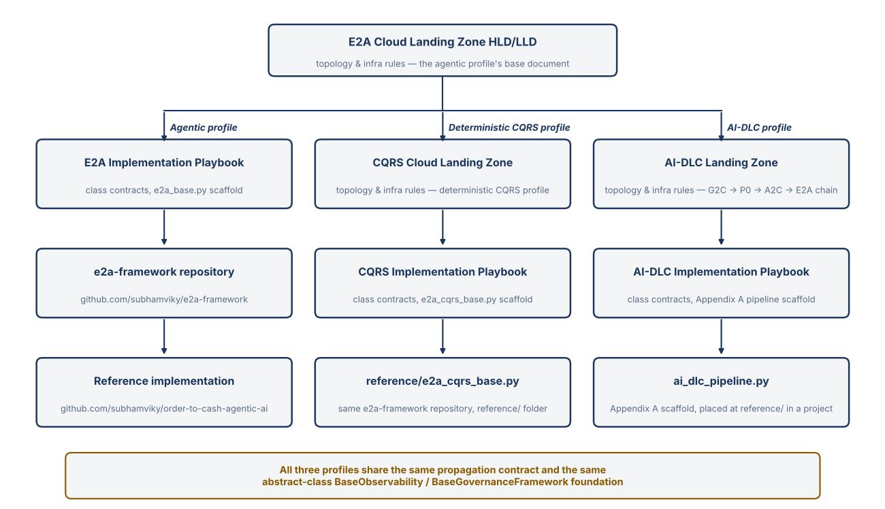

# Enterprise-to-Agentic (E2A) Architecture Framework
### Implementation Playbook — Scaffold File, Class Contracts & Usage Guide

> **Framework reference** — Repository: [github.com/subhamviky/e2a-framework](https://github.com/subhamviky/e2a-framework) · Reference implementation: [github.com/subhamviky/order-to-cash-agentic-ai](https://github.com/subhamviky/order-to-cash-agentic-ai) · Scaffold file: `e2a_base.py` — drop into any repo, inherit, override, run. · Document role: single, consolidated playbook. The Master Abstraction Reference defines WHAT the framework enforces; this Playbook defines HOW to implement it — including MCP server hosting and cross-class propagation as core, first-class content rather than addenda.

# 1. Purpose & Scope

This playbook provides everything a developer needs to implement the E2A Architecture Framework in a new or existing repository: the complete, runnable scaffold file (e2a_base.py), method signature specifications for all primary abstract classes, configuration and environment variable resolution patterns, and a full worked example from inheritance through execution.

This edition folds two sets of content that earlier revisions carried as separate addenda directly into the main body, so there is a single set of class contracts to read rather than a base version plus patches:

- MCP is now native to the Tool Services layer. Alongside BaseToolService (the existing client-side tool caller, which can speak REST or MCP transport via RestToolService / MCPToolService), the framework defines BaseMCPServer — a class whose job is to turn existing wrapped APIs into a spec-compliant MCP server exposing tools/list and tools/call — plus a single tool-call routing function that checks whether a wrapped MCP server exists for a given tool before falling back to the normal REST tool call.

- The cross-class propagation contract (correlation_id, io_config, idempotency_key, tenant_id, message_log, failed_keys) is written directly into the constructor and method tables of BaseWorkflow, BaseAgent, BaseRAGPipeline, BaseToolService, BaseMCPServer, and BaseLLMAgentService. There is no separate reconciliation step — the tables below are the current, single source of truth.

- LLM invocation is its own abstract microservice class. BaseLLMAgentService (Section 2.18) owns everything around a model call — capacity admission, context budgeting, caching hooks, tool-schema compilation, input and output screening, and token accounting — and every agent archetype (BaseAgent, LLMOnlyAgent, RAG-grounded, tool-calling) reaches it through config['llm_service']. Agent classes contain no model call of their own; a concrete service subclass implements only the two vendor transport hooks.
- Configuration is central. Every config key and environment variable is declared once in E2A_CONFIG at the top of e2a_base.py and resolved by one function, resolve_config(); no class reads os.getenv() or hardcodes a default. Projects add keys with register_config_key() in src/settings.py. Section 5 and .env.example are generated from the registry.

- State validation is no longer a method each BaseAgent subclass implements on itself. It is now a separate class, BaseValidationService (Section 2.2), invoked before BaseWorkflow or BaseAgent is instantiated at all — so an invalid request never pays for agent-service compute. BaseAgent's contract no longer includes _validate_state.

- Concurrency is owned by invariant, not by a global manager. Each shared-resource risk — duplicate work, lost updates, stale owners, overload, work orphaned after a timeout — is assigned to exactly one existing class, contract or config key. Section 2.19 maps each invariant to its owner, gives the pseudocode and failure semantics, and lists the tests that prove it. The guarantee the framework makes is effectively-once material effects under at-least-once delivery — never exactly-once.

The document is structured in four parts:

- Part A — Class Contract Specifications (Section 2): complete method signatures, config/kwargs, and the propagation contract for every class — BaseValidationService, BaseAgent, BaseWorkflow, BaseRAGPipeline, BaseToolService, BaseMCPServer, tool-call routing, and guidance on progressively splitting a class into multiple microservices as it grows.

- Part B — Scaffold File (Section 3): the ready-to-drop e2a_base.py with all abstract classes, fully wired.

- Part C — Usage Guide (Section 4): repo structure, inheritance, invocation, config/env integration, a worked example that includes validation, wrapping an API as an MCP server, and tool-call routing.

- Part D — Central Configuration Registry (Section 5): one table of every config key and environment variable across every class, generated from E2A_CONFIG in the scaffold.

> **Single Rule**
>
> Every class has exactly one public entry point: validate() for BaseValidationService, run() for BaseAgent, execute() for BaseWorkflow and BaseToolService, retrieve() for BaseRAGPipeline, serve() for BaseMCPServer, ingest() for BaseIndexingPipeline. BaseLLMAgentService is the one class with two public entry points — process_inference() (unary) and process_inference_stream() (server-streaming) — because the two are distinct interaction modes that cannot share a return type; both run the same admission pipeline. The rule is therefore one public entry point per interaction mode. The operational lifecycle members of BaseLLMAgentService — drain(), ready and inflight — are shutdown and health controls, not entry points, and are not counted. Application code calls only this public method. All protected methods are called internally in a fixed sequence. Subclasses override only the protected methods they need.

*Source Note: Implementation examples and the categorical breakdown of cloud-native primitives in this playbook align with the AWS AI Ecosystem architectural map by Prashant Rathi.*

## 1.1 Related Documents



*Document and repository relationships across the three E2A execution profiles: Agentic, Deterministic CQRS and AI-DLC.*

- [CLOUD_LANDING_ZONE.md](CLOUD_LANDING_ZONE.md) — the HLD/LLD this playbook implements: network zones, compute tiers (including the Tier 2b Inference Gateway) and the Saga edge.
- [CQRS_IMPLEMENTATION_PLAYBOOK.md](CQRS_IMPLEMENTATION_PLAYBOOK.md) and [CQRS_CLOUD_LANDING_ZONE.md](CQRS_CLOUD_LANDING_ZONE.md) — the Deterministic CQRS profile.
- [AIDLC_IMPLEMENTATION_PLAYBOOK.md](AIDLC_IMPLEMENTATION_PLAYBOOK.md) and [AIDLC_LANDING_ZONE.md](AIDLC_LANDING_ZONE.md) — the AI-DLC profile.

# 2. Class Contract Specifications

This section specifies the complete method contracts for each abstract class — access modifier, signature, accepted config/kwargs keys, and purpose. The config parameter and **kwargs together provide full flexibility: pass explicit values at call time, or rely on config dict defaults, or fall back to environment variables. The resolution order is always: kwargs override → config dict → environment variable → hardcoded default.

## 2.1 Cross-Class Propagation Fields

Six fields flow through every PUBLIC, PROTECTED, and PRIVATE method across all six primary request-path classes (BaseWorkflow, BaseAgent, BaseRAGPipeline, BaseToolService, BaseMCPServer, BaseLLMAgentService). Four are inputs, resolved once and passed down unchanged; two are outputs, mutated in place by every method that touches them and read once at the end of the chain. This is core to the framework, not an extension of it — every constructor and method table in this section already reflects these fields.

> **Why Not Class-Level (self.) Attributes**
>
> A field stored as self.correlation_id would be shared instance state. If a BaseWorkflow or BaseAgent instance is reused across concurrent requests — the normal case behind FastAPI/Lambda/ECS — two in-flight requests writing to the same self.message_log would corrupt each other's logs and failure data. Every field below is created fresh at the top of BaseWorkflow.execute() for a single logical request, passed as an explicit parameter to every method it touches, and discarded when that request completes.

| **Direction** | **Field**                 | **Resolved / Mutated**                                                                                                  | **Purpose**                                                                                                                                                                                                                                                                                                                                                                                                                                                                                                                                                                                                                                                                                                                              |
|---------------|---------------------------|-------------------------------------------------------------------------------------------------------------------------|------------------------------------------------------------------------------------------------------------------------------------------------------------------------------------------------------------------------------------------------------------------------------------------------------------------------------------------------------------------------------------------------------------------------------------------------------------------------------------------------------------------------------------------------------------------------------------------------------------------------------------------------------------------------------------------------------------------------------------------|
| INPUT         | correlation_id: str       | Generated once in BaseWorkflow.execute() (uuid4, or client-supplied). Read-only below that point.                       | Ties every log line and DLQ entry across all classes back to one logical request.                                                                                                                                                                                                                                                                                                                                                                                                                                                                                                                                                                                                                                                        |
| INPUT         | io_config: dict           | Resolved once in BaseWorkflow.execute() from config['io'] (or IO_CONFIG env namespace); a validated subset of config. | Separates connection/endpoint concerns (DB, S3, queue, vector store, MCP server URLs) from behavioral NFR config. Also carries max_token_budget, read by BaseGovernanceFramework.enforce_governance_gate() (Section 2.11) to cap cumulative LLM spend per request.                                                                                                                                                                                                                                                                                                                                                                                                                                                                       |
| INPUT         | idempotency_key: str      | Resolved once via __resolve_idempotency() — client-supplied and validated, or generated.                              | Lets BaseToolService, BaseMCPServer, and any commit/save path detect and skip a request that already completed.                                                                                                                                                                                                                                                                                                                                                                                                                                                                                                                                                                                                                          |
| INPUT         | tenant_id: str            | Read from state['tenant_id']; validated present in BaseWorkflow.execute() before routing.                             | Scopes RAG index search, tool endpoint resolution, and MCP server/tool registry lookups to a tenant namespace.                                                                                                                                                                                                                                                                                                                                                                                                                                                                                                                                                                                                                           |
| OUTPUT        | message_log: list[dict] | Empty list created in BaseWorkflow.execute(); every method appends structured entries via the shared _log() helper.    | One ordered, structured log for the entire request. BaseWorkflow.execute() no longer flushes it to stdout directly: its finally block hands message_log to a configured BaseObservability.record_telemetry() implementation (Section 2.10), falling back to per-entry logging only if no observability_engine is configured. Individual entries carry whatever fields the writer attached — BaseAgent.run(), BaseRAGPipeline.retrieve(), and BaseToolService.execute() each attach latency (seconds) to their own completion entry, and BaseAgent.run() additionally attaches tokens_used and confidence, which is what lets BaseObservability.__extract_metrics() (Section 2.10) sum total_tokens without any class-specific parsing. |
| OUTPUT        | failed_keys: list[str]  | Empty list created in BaseWorkflow.execute(); any _handle_error() across any class appends the failing item's key.     | Drives the commit gate and end-of-request DLQ dispatch — failed items are isolated, successful items still commit.                                                                                                                                                                                                                                                                                                                                                                                                                                                                                                                                                                                                                       |

An optional seventh field, deadline, is additive and does not change the six above. It is an INPUT resolved once at the request origin — BaseWorkflow.execute(), BaseOrchestrator.execute() or AIDLCPipelineOrchestrator.execute_pipeline() — from an inbound Deadline (or remaining milliseconds, carried on the x-e2a-deadline-ms header) or, failing that, from request_deadline_seconds. When neither is present there is no deadline and existing callers behave exactly as before. Locally a Deadline is an absolute monotonic instant; across a process boundary it travels as remaining milliseconds and is rebuilt with Deadline.from_remaining_ms(), because monotonic clocks are not comparable between hosts. Every wait in the framework — permit, quota, bulkhead, cache fill, tool call, bridge wait — is bounded by min(its own timeout, deadline.remaining()). Cancellation uses the runtime's native mechanism (asyncio task cancellation); there is deliberately no cancellation field. Section 2.19.2 gives the rule in full.

### 2.1.1 AgentState Schema — Additions

state (the dict threaded through every BaseAgent method) carries three required keys, using the same mechanism trace_id already used before correlation_id replaced it.

| **Kind** | **Key**              | **Resolution**                                                                    | **Purpose**                                                                                             |
|----------|----------------------|-----------------------------------------------------------------------------------|---------------------------------------------------------------------------------------------------------|
| STATE    | tenant_id: str       | Required. Set by the API boundary before BaseWorkflow.execute() is called.        | Read by BaseRAGPipeline._search_index() and BaseToolService/BaseMCPServer for tenant-scoped filtering. |
| STATE    | correlation_id: str  | Required after BaseWorkflow.execute() runs. Mirrors the correlation_id parameter. | Convenience accessor for any code that only has state, not the full call signature.                     |
| STATE    | idempotency_key: str | Required after BaseWorkflow.execute() runs.                                       | Same rationale — available on state for handlers that don't thread the full parameter list.             |

## 2.2 BaseValidationService

*validation/ — validate() is the single public entry point. Runs before any agent, workflow, RAG, tool, or MCP class is invoked — and before any of them are even instantiated.*

Every prior revision of this playbook had each BaseAgent subclass validate its own state via _validate_state(), as the first step inside run(). That means an invalid request still pays for a full agent-service invocation (container already warm or cold-started, full class instantiated) before being rejected. BaseValidationService moves that check in front of the agent entirely: one small, cheap function validates the request and either forwards it or rejects it before the compute that runs BaseWorkflow/BaseAgent is ever triggered.

> **Fail-Fast Placement**
>
> BaseValidationService is designed to run in a separate, smaller compute tier from BaseWorkflow/BaseAgent — typically a Lambda or Cloud Function in front of a Fargate/Cloud Run service. On a validation failure, the caller returns immediately; the downstream agent container is never invoked. This is a cost and latency control, not just a code-organization change — see Section 3 of the companion Cloud Landing Zone HLD/LLD document for the deployment topology this enables.

Class Variables

| **Variable**       | **Type**              | **Default** | **Description**                                                                                                                          |
|--------------------|-----------------------|-------------|------------------------------------------------------------------------------------------------------------------------------------------|
| validator_registry | Dict[str, Callable] | {}          | Populated by the concrete subclass. Maps agent_name -> the bound _validate_<agent_name> method that validates state for that agent. |

Method Contract Table

| **Access**           | **Signature**                                                                                  | **Config / kwargs keys**     | **Purpose**                                                                                                                                                                                                                                                                                                                                                         |
|----------------------|------------------------------------------------------------------------------------------------|------------------------------|---------------------------------------------------------------------------------------------------------------------------------------------------------------------------------------------------------------------------------------------------------------------------------------------------------------------------------------------------------------------|
| PUBLIC               | validate(agent_name, state, config=None, correlation_id=None, **kwargs) -> ValidationResult | schema_registry, strict_mode | Template method — the single entry point. Originates correlation_id if not supplied (this is now the earliest point in the request chain, ahead of BaseWorkflow). Resolves the correct validator via _resolve_validator(), runs it, and returns a structured result. Raises nothing — a failed validation is a normal, well-formed return value, not an exception. |
| PROTECTED            | _resolve_validator(agent_name, config=None, **kwargs) -> Callable                          | validator_registry           | Looks up agent_name in validator_registry and returns the bound _validate_<agent_name> method. Same resolution pattern as BaseWorkflow._get_agent() and _get_tool_service() — a name-keyed registry, not a chain of if/elif.                                                                                                                                  |
| ABSTRACT (per agent) | _validate_<agent_name>(state, config=None, **kwargs) -> ValidationResult                | schema, required_fields      | One method per agent, implemented on the concrete subclass. Same signature and shape as the old per-agent _validate_state(), just relocated. Returns ValidationResult(valid, errors) rather than a bare bool, so a failure can carry field-level detail back to the caller.                                                                                        |
| PRIVATE              | __build_result(valid, errors, agent_name, correlation_id, **kwargs) -> ValidationResult   | —                            | Framework-owned. Shapes a consistent {valid, errors, agent_name, correlation_id} object regardless of which _validate_<agent_name> produced it.                                                                                                                                                                                                                 |

### Configuration — BaseValidationService (central registry)

Keys read by this class — names, environment variables and defaults are defined once in the central registry (Section 5, group 'Validation'), resolved kwargs > config > environment variable > default: schema_registry, strict_mode.

What Changes Downstream

- BaseAgent no longer declares _validate_state — it is removed from the contract entirely (Section 2.3). BaseAgent.run() assumes it is only ever called with state that already passed validate().

- correlation_id now originates in BaseValidationService.validate(), not BaseWorkflow.execute(). BaseWorkflow.execute() still accepts correlation_id as a parameter and still falls back to generating one if called standalone (e.g. in a unit test that skips the validation gate), but in the normal request path it receives one already minted.

- A validation failure is a terminal, cheap response (HTTP 400 with the ValidationResult body) returned from the validation tier. BaseWorkflow, BaseAgent, and everything behind them are never instantiated for that request.

## 2.3 BaseAgent

*agents/ — run() is the single public entry point*

Constructor

| **Parameter**                                                                   | **Type**         | **Default** | **Required** | **Description**                                                                                                                                                               |
|---------------------------------------------------------------------------------|------------------|-------------|--------------|-------------------------------------------------------------------------------------------------------------------------------------------------------------------------------|
| state                                                                           | Dict[str, Any] | —           | Yes          | Agent state object. Must contain at minimum: query (str), intent (str), tenant_id (str).                                                                                      |
| config                                                                          | Dict[str, Any] | None        | No           | Runtime configuration dict. Falls back to environment variables then hardcoded defaults.                                                                                      |
| correlation_id, io_config, idempotency_key, tenant_id, message_log, failed_keys | see 2.1          | None / [] | No           | Propagation fields. Received from BaseWorkflow when run() is called through the normal chain; self-originated as a fallback so BaseAgent remains independently unit-testable. |
| **kwargs                                                                      | Any              | —           | No           | Optional per-call overrides. Highest priority in the resolution chain.                                                                                                        |

Method Contract Table

| **Access** | **Signature**                                                                                                                                               | **Config / kwargs keys**               | **Purpose**                                                                                                                                                                                                                                                                                                                                                                                                                                                                                                                                                                                                                                                                                                                                                                                                                                                                                                                                                                                                                                            |
|------------|-------------------------------------------------------------------------------------------------------------------------------------------------------------|----------------------------------------|--------------------------------------------------------------------------------------------------------------------------------------------------------------------------------------------------------------------------------------------------------------------------------------------------------------------------------------------------------------------------------------------------------------------------------------------------------------------------------------------------------------------------------------------------------------------------------------------------------------------------------------------------------------------------------------------------------------------------------------------------------------------------------------------------------------------------------------------------------------------------------------------------------------------------------------------------------------------------------------------------------------------------------------------------------|
| PUBLIC     | run(state, config=None, correlation_id=None, io_config=None, idempotency_key=None, tenant_id=None, message_log=None, failed_keys=None, **kwargs) -> Dict | any config key; any kwarg              | Template method. Calls all protected methods in fixed sequence. Receives and forwards propagation fields; does not re-generate correlation_id if one is supplied. Assumes state has already passed BaseValidationService.validate() (Section 2.2) — run() no longer validates its own input. Immediately before this step, run() checks config['governance_engine']: if a BaseGovernanceFramework instance is configured, run() calls its enforce_governance_gate() (Section 2.11) instead of _apply_policy(); a DehydrationInterrupt raised from that call is re-raised unchanged, for BaseWorkflow to catch. After the LLM call, run() also tracks this call's token usage via the private __track_usage() helper below (feeding state['cumulative_tokens_used'], which the governance gate's token-budget check reads on the next call) and, once a response is set, measures total elapsed latency against max_latency, logging a single agent_run_complete entry to message_log either way and raising NFRViolationError only on a breach. |
| PROTECTED  | _build_messages(state, config, **common, **kwargs) -> list                                                                                            | prompt_template, role                  | Enforce governance: retries, circuit breakers, approval gates, redaction. Used only as the fallback when no governance_engine is configured — the preferred, centrally-enforced path is BaseGovernanceFramework.enforce_governance_gate() (Section 2.11). This is also where a tool call is triggered via _resolve_tool_call() (Section 2.8) when this fallback path runs.                                                                                                                                                                                                                                                                                                                                                                                                                                                                                                                                                                                                                                                                            |
| PROTECTED  | _apply_policy(state, config, **common, **kwargs) -> None                                                                                              | retry_policy, circuit_breaker_config   | Enforce governance: retries, circuit breakers, approval gates, redaction. This is also where a tool call is triggered via _resolve_tool_call() (Section 2.8).                                                                                                                                                                                                                                                                                                                                                                                                                                                                                                                                                                                                                                                                                                                                                                                                                                                                                         |
| PROTECTED (mixin) | _infer(messages, config, common, **kwargs) -> dict | llm_service, model_id, max_output_tokens, temperature | Base-owned bridge to config['llm_service'] (Section 2.18), shared by BaseAgent and LLMOnlyAgent. Runs the service's async process_inference() on one process-wide background event loop, so the service's semaphores and token bucket are always bound to the same loop whatever thread the agent runs on. The bridge wait is bounded — by the request deadline when one exists, otherwise by llm_max_latency + permit_timeout + quota_timeout + 1 second — and on expiry or interrupt the coroutine is cancelled rather than left running (Section 2.19.2). A FAILED inference raises, so run()'s normal except path (failed_keys + _handle_error) applies; async callers use the awaitable twin _infer_async(). Replaces the former private __llm_call(): there is no model dispatch code in BaseAgent. |
| PRIVATE    | __track_usage(messages, response, config=None, **kwargs) -> int                                                                                        | —                                      | Base-owned, never overridden. Prefers an actual token count from the LLM provider's response metadata (response['metadata']['tokens_used']); falls back to a ~4-chars/token estimate over the outbound messages when a provider doesn't report usage. run() adds the returned value to state['cumulative_tokens_used'] and to the agent_run_complete log entry's tokens_used field — the same field BaseObservability.__extract_metrics() (Section 2.10) already sums into total_tokens.                                                                                                                                                                                                                                                                                                                                                                                                                                                                                                                                                       |
| PROTECTED  | _evaluate_output(response, state, config, **common, **kwargs) -> float                                                                                | min_confidence, groundedness_threshold | Evaluate output quality, return [0.0–1.0].                                                                                                                                                                                                                                                                                                                                                                                                                                                                                                                                                                                                                                                                                                                                                                                                                                                                                                                                                                                                           |
| PROTECTED  | _fallback(state, config, **common, **kwargs) -> dict                                                                                                  | fallback_model, cache_key              | Fallback strategy when confidence is below threshold.                                                                                                                                                                                                                                                                                                                                                                                                                                                                                                                                                                                                                                                                                                                                                                                                                                                                                                                                                                                                  |
| PRIVATE    | (inline in run(), not a separate method) — latency SLO check                                                                                                | max_latency                            | Base-owned, not overridden — there is no separate hook because there is nothing for a subclass to customize: run() measures its own wall-clock time from entry to the point state['response'] is set, compares it to max_latency (kwargs > config > MAX_LATENCY env > 2.0s default), and raises NFRViolationError on breach. The measurement always happens and is always logged, whether or not it breaches — see the run() row above.                                                                                                                                                                                                                                                                                                                                                                                                                                                                                                                                                                                                           |
| PROTECTED  | _handle_error(error, state, config, correlation_id, message_log, failed_keys, **kwargs) -> None                                                         | alert_channel, retry_policy            | Error handling. Appends the failing key to failed_keys instead of raising past the request boundary.                                                                                                                                                                                                                                                                                                                                                                                                                                                                                                                                                                                                                                                                                                                                                                                                                                                                                                                                                   |

> **NFRViolationError — a Measured Breach, Not a Control-Flow Signal**
>
> class NFRViolationError(Exception): raised whenever a measured non-functional requirement is breached — a latency SLO in BaseAgent.run(), BaseRAGPipeline.retrieve(), or BaseToolService.execute() (Section 2.6), or the token budget in BaseGovernanceFramework.__enforce_token_budget() (Section 2.11). Unlike DehydrationInterrupt above, it is not caught separately — it falls through the normal except Exception path in whichever method raised it, so a breach is a regular failure: added to failed_keys, handed to _handle_error(), and routed to the DLQ like any other exception.

### Configuration — BaseAgent (central registry)

Keys read by this class — names, environment variables and defaults are defined once in the central registry (Section 5, group 'Agents'), resolved kwargs > config > environment variable > default: min_confidence, max_latency, cache_refresh_token, llm_service.

## 2.4 BaseWorkflow

*orchestration/ — execute() is the single public entry point; origin point for io_config, idempotency_key, message_log, and failed_keys. correlation_id is now typically received from BaseValidationService (Section 2.2) rather than originated here.*

Method Contract Table

| **Access** | **Signature**                                                          | **Config / kwargs keys**                       | **Purpose**                                                                                                                                                                                                                                                                                                                                                                                                                                                                                                                                                                                                                    |
|------------|------------------------------------------------------------------------|------------------------------------------------|--------------------------------------------------------------------------------------------------------------------------------------------------------------------------------------------------------------------------------------------------------------------------------------------------------------------------------------------------------------------------------------------------------------------------------------------------------------------------------------------------------------------------------------------------------------------------------------------------------------------------------|
| PUBLIC     | execute(state, config=None, correlation_id=None, **kwargs) -> Dict  | workflow_id, routing_strategy                  | Public entry point. Validates tenant_id, accepts correlation_id from the caller (BaseValidationService, normally) or originates one as a standalone fallback, resolves io_config, the request deadline and the idempotency_key, takes the atomic idempotency claim when an idempotency_store is configured (a duplicate returns a typed REPLAYED / IN_PROGRESS / CONFLICT / RECOVERY_REQUIRED / FAILED_FINAL status without executing again), builds and validates the workflow graph, resolves and invokes the target agent, dispatches message_log to the configured observability engine, and dispatches failed_keys to the DLQ. A DehydrationInterrupt raised from within the agent chain (Section 2.11) is caught separately: execute() logs a workflow_dehydrated event and sets state['status'] = 'AWAITING_WEBHOOK' rather than treating the pause as a failure. The claim is settled in the finally block — SUCCEEDED with the post-redaction result, FAILED_RETRYABLE, FAILED_FINAL, or parked for reconciliation when the physical outcome is UNKNOWN (Section 2.19.5). |
| PROTECTED  | _build_workflow(config, **common, **kwargs) -> Any               | workflow_definition                            | Construct the LangGraph graph (or equivalent) of agent nodes.                                                                                                                                                                                                                                                                                                                                                                                                                                                                                                                                                                  |
| PROTECTED  | _validate_workflow(workflow, config, **common, **kwargs) -> bool | required_nodes                                 | Validate the graph is well-formed before execution.                                                                                                                                                                                                                                                                                                                                                                                                                                                                                                                                                                            |
| PROTECTED  | _get_agent(intent, config, **common, **kwargs) -> BaseAgent      | agent_registry                                 | Resolve which BaseAgent subclass handles a given intent.                                                                                                                                                                                                                                                                                                                                                                                                                                                                                                                                                                       |
| PROTECTED  | _resolve_io_config(config, **kwargs) -> dict                       | io_config namespace                            | Extract the IO_CONFIG-prefixed subset of config, separate from behavioral NFR config.                                                                                                                                                                                                                                                                                                                                                                                                                                                                                                                                          |
| PROTECTED  | _generate_idempotency_key(state, config, **kwargs) -> str          | idempotency_strategy, business_key_fields      | Abstract — subclass supplies domain logic, e.g. hash(tenant_id + REF_ELEM_KEY). Called only when no valid client-supplied key exists.                                                                                                                                                                                                                                                                                                                                                                                                                                                                                          |
| PRIVATE    | __resolve_idempotency(state, config, **kwargs) -> str             | idempotency_ttl_seconds, idempotency_store_url | Base-owned. Derives the key only: a client-supplied key wins, otherwise _generate_idempotency_key() mints one. It no longer decides whether a request is a duplicate — that is the atomic claim in execute() (Section 2.19.5), because a look-up followed by a later write lets two concurrent requests both pass. |
| PROTECTED  | _requires_idempotency_claim(state, config, **kwargs) -> bool | — | Does this request carry a material effect (a write or side effect that must happen at most once)? Default True. A workflow whose intents are read-only or purely generative overrides it to False so those requests are not replayed from a stored answer. |
| PROTECTED  | _request_fingerprint(state, config, **kwargs) -> str | — | Stable SHA-256 of the request's business content, excluding propagation and volatile fields. The same idempotency key with a different fingerprint is a typed CONFLICT, never a replay. |
| PROTECTED  | _replayable_result(state, config, **kwargs) -> dict | — | What a duplicate caller receives on REPLAY. Taken after egress redaction so a stored result never re-exposes redacted fields. |
| PROTECTED  | _physical_outcome(state, config, **kwargs) -> Optional[PhysicalOutcome] | — | Typed commit evidence (COMMITTED / NOT_COMMITTED / UNKNOWN) read from state['outcome'], or None when the request had no material effect. UNKNOWN parks the claim for reconciliation instead of marking it failed or done. |
| PRIVATE    | __resolve_deadline(config, kwargs) -> Optional[Deadline] | request_deadline_seconds | Base-owned. Inbound deadline wins; otherwise request_deadline_seconds; 0 means none. |
| PRIVATE    | __short_circuit(state, claim, message_log, correlation_id, config) / __settle_claim(store, key, tenant_id, owner, state, failed_keys, dehydrated, error, config) | idempotency_lease_seconds | Base-owned. Return the typed duplicate outcome without executing, and settle the claim exactly once in finally. A dehydrated (paused) request is settled as retryable so it is claimable again on resume. |
| PRIVATE    | (retired — see BaseObservability.record_telemetry(), Section 2.10)     | —                                              | The private __flush_logs() helper from the prior revision is retired. BaseWorkflow.execute()'s finally block now reads config['observability_engine'] directly: if a BaseObservability instance is configured it calls record_telemetry(message_log, correlation_id, config, tenant_id=tenant_id); otherwise it falls back to logging each message_log entry individually.                                                                                                                                                                                                                                                 |
| PRIVATE    | _send_to_dlq(failed_keys, config)                                     | dlq_queue_url                                  | Base-owned. Dispatches failed_keys to SQS/Pub-Sub/Service Bus at end of request.                                                                                                                                                                                                                                                                                                                                                                                                                                                                                                                                               |

**Compatibility note.** A concrete subclass that supplied only the old check_and_set behaviour keeps working: BaseIdempotencyStore.check_and_set() remains as a shim over claim(). What does not stay source-compatible is an implementer of BaseIdempotencyStore itself — it must now provide claim(), complete() and fail() (Section 2.16).

**Verification (beside the class).** smoke_test_concurrency.py: "T-01 exactly one of 20 concurrent claimers wins"; "workflow: duplicate request replays, agent ran once"; "workflow: same key, changed payload -> CONFLICT, not executed"; "T-12 UNKNOWN outcome parks the key for reconciliation"; "T-12 duplicate of an UNKNOWN request is not re-executed"; "failed run is retryable (claimable again)"; "expired deadline rejected before any work".

## 2.5 BaseRAGPipeline

*rag/ — retrieve() is the single public entry point*

Method Contract Table

| **Access** | **Signature**                                                                     | **Config / kwargs keys**            | **Purpose**                                                                                                                                                                                                                                                                                                                                                                                                                                                                              |
|------------|-----------------------------------------------------------------------------------|-------------------------------------|------------------------------------------------------------------------------------------------------------------------------------------------------------------------------------------------------------------------------------------------------------------------------------------------------------------------------------------------------------------------------------------------------------------------------------------------------------------------------------------|
| PUBLIC | retrieve(query, config=None, tenant_id=None, **kwargs) -> list | top_k, embedding_model, max_latency | Template method. Embeds the query (embedding_model resolved kwargs > config > env > default), runs a hybrid search by handing the index both the raw query text and the query vector, tenant-scoped, evaluates groundedness, returns ranked context. Measures wall-clock latency across the embed → search → rerank sequence, logs a rag_retrieve_complete entry to message_log (when the caller passes one), and raises NFRViolationError if latency exceeds max_latency (kwargs > config > MAX_LATENCY env > 2.0s default) — same pattern as BaseAgent.run() (Section 2.3) and BaseToolService.execute() (Section 2.6). |
| PROTECTED | _search_index(query_text, query_vector, config, tenant_id=None, **kwargs) -> list[dict] | index_name, tenant_index_prefix, top_k, hybrid_alpha | Hybrid keyword (BM25) + vector search; receives BOTH the raw query text and the embedding and owns the fusion (reciprocal-rank or weighted via hybrid_alpha). Namespaces the search to f'{tenant_index_prefix}_{tenant_id}' or an equivalent metadata filter — prevents one tenant's retrieve() from ever surfacing another tenant's documents. The former vector-only signature _search_index(query_vector, ...) no longer exists. |
| PROTECTED  | _rerank(results, config, **kwargs) -> list                                    | rerank_top_n                        | Re-rank candidate documents before returning.                                                                                                                                                                                                                                                                                                                                                                                                                                            |
| PROTECTED  | _evaluate_answer(answer, config, **kwargs) -> float                           | groundedness_threshold              | Evaluate answer quality (RAGAS faithfulness gate).                                                                                                                                                                                                                                                                                                                                                                                                                                       |

### Configuration — BaseRAGPipeline (central registry)

Keys read by this class — names, environment variables and defaults are defined once in the central registry (Section 5, group 'RAG'), resolved kwargs > config > environment variable > default: faithfulness_threshold, rag_top_k, embedding_model, hybrid_alpha, similarity_metric, index_name, tenant_index_prefix, rerank_top_n, max_latency.

## 2.6 BaseToolService

*tools/ — execute() is the single public entry point (async). Client-side tool caller: REST or MCP transport via RestToolService / MCPToolService.*

Method Contract Table

| **Access** | **Signature**                                                            | **Config / kwargs keys**                   | **Purpose**                                                                                                                                                                                                                                                                                                                                                                                                                                                                                                                     |
|------------|--------------------------------------------------------------------------|--------------------------------------------|---------------------------------------------------------------------------------------------------------------------------------------------------------------------------------------------------------------------------------------------------------------------------------------------------------------------------------------------------------------------------------------------------------------------------------------------------------------------------------------------------------------------------------|
| PUBLIC     | async execute(payload, config=None, tenant_id=None, **kwargs) -> dict | timeout, retries, auth_token, max_latency  | Template method. Validates → resolves endpoint → builds payload → checks the commit gate → HTTP POST under the resilience policy (retry budget, circuit breaker, bulkhead — Section 2.19.4). Returns result dict. Measures wall-clock latency across the full call (validation through __http_post's return), logs a tool_execute_complete entry to message_log (when the caller passes one), and raises NFRViolationError if latency exceeds max_latency (kwargs > config > MAX_LATENCY env > 5.0s default here, a looser bound than BaseAgent/BaseRAGPipeline's 2.0s since this measures a network round trip). |
| PROTECTED  | get_endpoint(config, tenant_id=None, **kwargs) -> str                 | base_url, service_name, tenant_routing_map | Return the endpoint URL for this tool. Optionally resolves a tenant-specific base URL via config['tenant_routing_map'][tenant_id], falling back to the shared base_url.                                                                                                                                                                                                                                                                                                                                                     |
| PROTECTED  | _build_payload(payload, config, **kwargs) -> dict                    | schema, enrichments                        | Transform input dict to the tool's request schema.                                                                                                                                                                                                                                                                                                                                                                                                                                                                              |
| PROTECTED  | _validate_input(payload, config, **kwargs) -> bool                   | schema, required_fields                    | Domain-specific validation. Return False to raise ValueError in execute().                                                                                                                                                                                                                                                                                                                                                                                                                                                      |
| PROTECTED  | _resilience_policy(config=None, kwargs=None) -> ResiliencePolicy | retry_base_backoff, retry_max_backoff, retry_budget_ratio, retry_budget_cap, circuit_failure_threshold, circuit_reset_seconds, bulkhead_max_concurrent, bulkhead_acquire_timeout | Returns the service's ResiliencePolicy. One policy instance is kept per (transport, tool) so the retry budget and circuit state are shared by every call to the same dependency — a fresh policy per call would defeat both. |
| PROTECTED  | async _send_request(endpoint, body, token=None, timeout=None, config=None, **kwargs) -> dict | timeout, auth_token | The wire call itself — the one hook a concrete transport implements. The framework default is a stub; the policy, deadline and outcome typing around it are base-owned. |
| PRIVATE    | async __http_post(endpoint, body, config, **kwargs) -> dict         | timeout, retries, auth_token               | Perform the HTTP POST through ResiliencePolicy.call(). Retries are drawn from a shared retry budget with full-jitter backoff and only happen for an idempotent call — one carrying an idempotency_key or safe_to_retry=True. A timeout is an UNKNOWN physical outcome, not a failure: the result is {'status': 'UNKNOWN', 'outcome': UNKNOWN, 'physical_success': False}, the request is never re-sent blindly, and the idempotency claim is parked for reconciliation. Never overridden. |
| PRIVATE    | _commit_gate(key, failed_keys, config, **kwargs) -> bool             | commit_gate_enabled, expected_version      | Base-owned and ADVISORY. Called immediately before a save/commit/write; returns False if key is already in failed_keys, so the item is excluded and left for DLQ investigation while sibling items proceed. The optional expected_version check here is a pre-flight convenience only — it is not the authority on a lost update. The authority is BaseTransactionalStore.put_if_version(), a single conditional write in the store itself (Section 2.19.6). |

The return contract is tri-state. physical_success stays a required boolean for existing callers; the typed outcome key (COMMITTED, NOT_COMMITTED or UNKNOWN) adds the case a boolean cannot express — the call timed out or the connection dropped after the request left, so the remote system may or may not have applied it. UNKNOWN is routed to reconciliation (Section 2.17), never to a blind retry and never to a DLQ replay.

**Verification (beside the class).** smoke_test_concurrency.py: "T-06 retry amplification bounded by the budget (not 4x)"; "circuit opens after the threshold; later calls fail fast"; "T-12 timeout on a non-idempotent write -> UNKNOWN, sent once, never retried"; "T-05 bulkhead: 2 admitted, the rest rejected within the bound". smoke_test_multimodal_concurrency.py: "T-12 slow tool: typed UNKNOWN, sent exactly once, bounded wait".

### 2.6.1 RestToolService and MCPToolService — Transport Implementations

MCP's Streamable HTTP transport is JSON-RPC framed over HTTP POST. An MCP-backed tool call therefore fits the existing BaseToolService.execute() template — validate → get_endpoint → build_payload → __http_post — without touching the private, framework-owned __http_post method. Only get_endpoint() and _build_payload() differ from a REST tool.

| **Class**       | **Access** | **Signature**                                         | **Purpose**                                                                                                               |
|-----------------|------------|-------------------------------------------------------|---------------------------------------------------------------------------------------------------------------------------|
| RestToolService | PROTECTED  | get_endpoint(config, **kwargs) -> str              | Existing pattern, unchanged: return config['tool_base_url'].                                                            |
| RestToolService | PROTECTED  | _build_payload(payload, config, **kwargs) -> dict | Existing pattern, unchanged: schema-mapped passthrough.                                                                   |
| MCPToolService  | PUBLIC     | execute(...) -> dict                                 | Inherited unchanged from BaseToolService. No override.                                                                    |
| MCPToolService  | PROTECTED  | get_endpoint(config, **kwargs) -> str              | Return the MCP server's Streamable HTTP URL from config['mcp_server_url'].                                              |
| MCPToolService  | PROTECTED  | _build_payload(payload, config, **kwargs) -> dict | Wrap payload in the MCP JSON-RPC envelope: {"jsonrpc":"2.0","method":"tools/call","params":{"name":...,"arguments":...}}. |

### Configuration — BaseToolService (central registry)

Keys read by this class — names, environment variables and defaults are defined once in the central registry (Section 5, group 'Tools / MCP and Common'), resolved kwargs > config > environment variable > default: timeout, retries, tool_base_url, mcp_server_url, auth_token, tenant_routing_map, commit_gate_enabled, max_latency (default 5.0 for BaseToolService).

## 2.7 BaseMCPServer

*mcp/ — serve() is the single public entry point. Server-side counterpart to BaseToolService: turns wrapped APIs into a spec-compliant MCP server.*

BaseToolService (2.5) is a client — it calls an MCP server that already exists somewhere. BaseMCPServer is the other half: it lets a repo expose its own existing tool implementations (typically BaseToolService subclasses) as an MCP server, so external agents can discover them via tools/list and invoke them via tools/call, without hand-writing MCP protocol code per tool.

Class Variables

| **Variable**     | **Type**          | **Default**      | **Description**                                                                                                     |
|------------------|-------------------|------------------|---------------------------------------------------------------------------------------------------------------------|
| server_name      | str               | 'e2a-mcp-server' | Governance key identifying this server instance in logs and the tool registry.                                      |
| registered_tools | Dict[str, dict] | {}               | Populated by wrap_api_as_tool(). Maps tool_name -> {handler: BaseToolService instance, description, input_schema}. |

Method Contract Table

| **Access** | **Signature**                                                                                     | **Config / kwargs keys** | **Purpose**                                                                                                                                                                                                                                                                                               |
|------------|---------------------------------------------------------------------------------------------------|--------------------------|-----------------------------------------------------------------------------------------------------------------------------------------------------------------------------------------------------------------------------------------------------------------------------------------------------------|
| PUBLIC     | serve(request, config=None, **kwargs) -> dict                                                  | mcp_protocol_version     | Template method — the single entry point, mirroring run()/execute()/retrieve(). Delegates to the framework-owned __dispatch_jsonrpc() and returns a JSON-RPC-shaped response.                                                                                                                           |
| PROTECTED  | _list_tools(config=None, **kwargs) -> list[dict]                                            | tool_filter              | Handles the tools/list method. Default implementation derives {name, description, inputSchema} for every entry in registered_tools. Override only to filter or augment what is advertised (e.g. per-tenant tool visibility).                                                                              |
| PROTECTED  | _call_tool(tool_name, arguments, config=None, tenant_id=None, **kwargs) -> dict               | —                        | Handles the tools/call method. Default implementation resolves tool_name in registered_tools and awaits the wrapped handler's execute(arguments, config, tenant_id=tenant_id). Returns an MCP-shaped {content, isError} result.                                                                           |
| PROTECTED  | wrap_api_as_tool(handler, tool_name, description, input_schema, config=None, **kwargs) -> None | —                        | Factory method — 'create an MCP server by wrapping an API'. Registers an existing BaseToolService instance (REST or otherwise) under tool_name with an MCP tool definition generated from input_schema. No new transport code is written; the existing tool's execute() is reused as-is.                  |
| PRIVATE    | __dispatch_jsonrpc(request, config, **kwargs) -> dict                                        | —                        | Framework-owned. Parses the JSON-RPC envelope, routes request['method'] ('tools/list' -> _list_tools, 'tools/call' -> _call_tool), and wraps the result or error in the correct JSON-RPC response shape. Never overridden — same pattern as __http_post being framework-owned in BaseToolService. |

### Configuration — BaseMCPServer (central registry)

Keys read by this class — names, environment variables and defaults are defined once in the central registry (Section 5, group 'Tools / MCP'), resolved kwargs > config > environment variable > default: mcp_protocol_version, mcp_server_name, tool_filter.

## 2.8 Tool Call Routing — MCP-First With REST Fallback

*workflow/ or a ToolRouter helper — lives beside _get_agent() on BaseWorkflow, called from the orchestration layer immediately before a tool is invoked, never from inside BaseAgent.*

This is the single function that answers: for this tool call, does a wrapped MCP server exist? If yes, call it as an MCP tool call through MCPToolService. If no, execute the normal (REST) tool call through RestToolService — the existing behavior is preserved unchanged as the fallback path.

| **Access** | **Signature**                                                                             | **Config / kwargs keys**                              | **Purpose**                                                                                                                                                                                                                                     |
|------------|-------------------------------------------------------------------------------------------|-------------------------------------------------------|-------------------------------------------------------------------------------------------------------------------------------------------------------------------------------------------------------------------------------------------------|
| PROTECTED  | _resolve_tool_call(tool_name, payload, config=None, tenant_id=None, **kwargs) -> dict | mcp_server_registry, tool_registry, default_transport | Checks config['mcp_server_registry'] for tool_name. If an entry exists, executes via MCPToolService against that server's endpoint. Otherwise falls back to _get_tool_service()'s existing REST/MCP-client resolution and executes normally. |
| PROTECTED  | _get_tool_service(tool_name, config=None, **kwargs) -> BaseToolService                | tool_registry, default_transport                      | Secondary resolver, used only inside the fallback path. Resolves which BaseToolService subclass (Rest or MCP client) to instantiate for a tool that is not backed by a locally wrapped MCP server.                                              |

Design Rule

Tool-transport selection is resolved outside BaseAgent, using the same resolution pattern BaseWorkflow already uses for agent routing (_get_agent) and BaseAgent already uses for LLM provider routing (the BaseLLMAgentService bound at config['llm_service'], Section 2.18). BaseAgent's contract does not change: it still only reasons and returns state, calling _resolve_tool_call() from inside _apply_policy() rather than doing tool-execution work itself. This preserves the retry, timeout, auth, and tracing guarantees that BaseToolService.execute() centrally enforces, whichever path is taken.

### Configuration — Tool Routing (central registry)

Keys read by this class — names, environment variables and defaults are defined once in the central registry (Section 5, group 'Tools / MCP'), resolved kwargs > config > environment variable > default: mcp_server_registry, tool_registry, default_transport.

What Does Not Change

- BaseAgent — no new methods, no tool-execution code. It still only produces state via run(); it calls _resolve_tool_call() from _apply_policy(), the same place it always called tools from.

- BaseToolService.execute() and __http_post() — both inherited unchanged by MCPToolService, whether the endpoint is an external MCP server or one hosted locally via BaseMCPServer.

- Governance — retries, timeout, and auth_token injection in __http_post() apply identically whether the downstream call is a legacy REST tool or an MCP server, local or external.

## 2.9 Foundation Classes

*Interface pattern — BasePromptRegistry*

> **Interface Pattern — No Shared Implementation**
>
> Foundation classes are Interfaces (Python Protocol or pure ABC with no __init__ state). They carry no shared implementations. The abstract class enforces the contract; the project-specific subclass owns the complete implementation. Every method accepts config=None and **kwargs so the same signature pattern is consistent across all E2A classes. BaseInfraProvisioner, BasePipeline, BaseObservability, and BaseGovernanceFramework are no longer listed here — each now has a public template method and at least one framework-provided step, which makes each a primary class like BaseAgent or BaseWorkflow, not a bare interface. BaseObservability and BaseGovernanceFramework moved first, in Sections 2.10 and 2.11, since request-path classes (BaseAgent, BaseWorkflow) call into them directly; BasePipeline and BaseInfraProvisioner follow in Sections 2.12 and 2.13.

| **Access** | **Class / Method**                                                                    | **Config / kwargs keys**          | **Purpose**                                                                                                                                          |
|------------|---------------------------------------------------------------------------------------|-----------------------------------|------------------------------------------------------------------------------------------------------------------------------------------------------|
| INTERFACE  | BasePromptRegistry                                                                    |                                   | New in this revision — see rationale below.                                                                                                          |
| INTERFACE  | get_prompt(prompt_id, version, tenant_id, config=None, **kwargs) -> PromptTemplate | prompt_store_url, default_version | Fetch a version-controlled, tenant-aware prompt template from an external, GitOps-managed store instead of a hardcoded string in _build_messages(). |

> **Why BasePromptRegistry Is the One New Interface**
>
> Every other reference pattern reviewed for this revision fit an existing hook — _build_messages(), _rerank(), _search_index(), _get_agent(), _evaluate_output(), _commit_gate. Prompt Registry is the one exception: nothing in the prior contract represented 'an external, versioned source of prompt templates,' so BaseAgent._build_messages() had no composable collaborator to call. BaseObservability and BaseGovernanceFramework used to sit in this same thin-interface bucket, but both have since been promoted to primary classes (Sections 2.10-2.11) once each gained a real template method — record_telemetry() and enforce_governance_gate() respectively. Prompt Registry is the one that stays here, because it never had, and still doesn't have, one.

## 2.10 BaseObservability — Enterprise Telemetry Engine

*telemetry/ — record_telemetry() is the single public entry point. Promoted from a thin Foundation interface (which had only _collect_metrics, _collect_traces, and _collect_logs) to a primary class for the same reason as BasePipeline and BaseInfraProvisioner: it now has a real template method.*

record_telemetry() replaces the private __flush_logs() helper described in Section 2.1: BaseWorkflow.execute() no longer writes message_log to stdout directly in its finally block. Instead it reads config['observability_engine']; if a BaseObservability instance is configured, execute() calls record_telemetry(message_log, correlation_id, config, tenant_id=tenant_id) and lets this class own dispatch. If no observability_engine is configured, BaseWorkflow falls back to logging each message_log entry individually, so the framework degrades gracefully rather than failing when observability isn't wired up yet.

| **Access** | **Signature**                                                                   | **Config / kwargs keys** | **Purpose**                                                                                                                                                                                                                                                                                                                                                                                                                                                             |
|------------|---------------------------------------------------------------------------------|--------------------------|-------------------------------------------------------------------------------------------------------------------------------------------------------------------------------------------------------------------------------------------------------------------------------------------------------------------------------------------------------------------------------------------------------------------------------------------------------------------------|
| PUBLIC     | record_telemetry(message_log, correlation_id, config=None, **kwargs) -> None | tenant_id                | Template method. Enriches every message_log entry with correlation_id, tenant_id, a host_epoch_ms timestamp, and the running framework_version, then derives request-level metrics and calls the hooks below in sequence: _ship_logs(), _emit_metrics() (only if metrics were extracted), _export_traces(). The whole dispatch is wrapped in a try/except — a telemetry backend outage falls back to logging.info() per entry rather than losing the request's logs. |
| PROTECTED  | _ship_logs(enriched_logs, config, **kwargs) -> None                         | log_sink                 | Ship the enriched log entries to the configured sink (CloudWatch Logs / Datadog / Cloud Logging).                                                                                                                                                                                                                                                                                                                                                                       |
| PROTECTED  | _emit_metrics(metrics, config, **kwargs) -> None                            | namespace, dimensions    | Emit the metrics record_telemetry() derived (total_tokens, error_count) to a metrics backend.                                                                                                                                                                                                                                                                                                                                                                           |
| PROTECTED  | _export_traces(correlation_id, logs, config, **kwargs) -> None              | trace_id, service_name   | Export distributed traces for this request, keyed by correlation_id.                                                                                                                                                                                                                                                                                                                                                                                                    |
| PRIVATE    | __extract_metrics(enriched_logs) -> Dict[str, float]                       | —                        | Base-owned, never overridden. Single pass over enriched_logs: counts entries at level == 'ERROR' into error_count, and sums any tokens_used field present on an entry into total_tokens.                                                                                                                                                                                                                                                                                |

## 2.11 BaseGovernanceFramework — AI Safety, Economics & Lifecycle Governance

*governance/ — enforce_governance_gate() is the single public entry point. Promoted from a thin Foundation interface (which had only _apply_policy and _circuit_breaker) to a primary class for the same reason as BaseObservability: it now has a real template method, invoked from inside BaseAgent.run() rather than delegated to from a subclass's own _apply_policy() override.*

BaseAgent.run() branches on config['governance_engine'] immediately before what used to be an unconditional call to _apply_policy(): if a BaseGovernanceFramework instance is configured, run() calls gov_engine.enforce_governance_gate(state, io_config, config, **common, **kwargs) and uses its returned state; otherwise it falls back to the agent subclass's own _apply_policy(), unchanged (Section 2.3). This replaces the composition pattern from the prior revision of this table — a concrete agent's _apply_policy() delegating internally to an injected governance instance — with an explicit either/or branch in the base class itself, so the governance path is enforced by the framework rather than by convention in each agent.

A new DehydrationInterrupt signal exception, raised only by the base-owned __trigger_dehydration() helper below, is how this class pauses a request pending human approval without holding Tier 2 compute open. BaseAgent.run() re-raises it unchanged rather than converting it into a failed_keys entry — a dehydrated request is not a failure. BaseWorkflow.execute() catches it separately from other exceptions, logs a workflow_dehydrated event, and sets state['status'] = 'AWAITING_WEBHOOK', resuming later through the same asynchronous webhook path described in Landing Zone Section 10.1 rather than a held-open connection.

> **DehydrationInterrupt — a Signal Exception, Not an Error**
>
> class DehydrationInterrupt(Exception): a lightweight signal exception used only to communicate between BaseGovernanceFramework and BaseWorkflow. It is raised exclusively by __trigger_dehydration() and caught exclusively by BaseWorkflow.execute(); it must never reach _handle_error() or the DLQ, since a paused-for-approval request has not failed.

| **Access** | **Signature**                                                                     | **Config / kwargs keys**         | **Purpose**                                                                                                                                                                                                                                                                                                                                                                                                                                                                             |
|------------|-----------------------------------------------------------------------------------|----------------------------------|-----------------------------------------------------------------------------------------------------------------------------------------------------------------------------------------------------------------------------------------------------------------------------------------------------------------------------------------------------------------------------------------------------------------------------------------------------------------------------------------|
| PUBLIC     | enforce_governance_gate(state, io_config, config=None, **kwargs) -> dict       | —                                | Template method, called from BaseAgent.run() in place of _apply_policy() whenever a governance_engine is configured. Runs, in fixed order: (1) the base-owned token budget check; (2) if state['requires_human_approval'] is set and not yet approved, the base-owned dehydration trigger; (3) if state['pending_mcp_tool_execution'] is set, the abstract sandbox-verification hook; (4) the abstract semantic firewall hook, whose returned state is this method's return value. |
| PRIVATE    | __enforce_token_budget(state, io_config) -> None                               | max_token_budget (io_config key) | Base-owned. Compares state['cumulative_tokens_used'] against io_config['max_token_budget'] (default unlimited) and raises a Governance Violation ValueError once the budget is exhausted — stops the request before another LLM call is made, not after.                                                                                                                                                                                                                            |
| PRIVATE    | __trigger_dehydration(state, config, **kwargs) -> None                       | —                                | Base-owned. Calls the abstract _dehydrate_state_to_perimeter() hook to persist state to the Data & Messaging Perimeter, then raises DehydrationInterrupt so BaseWorkflow can halt the request and scale Tier 2 compute to zero while awaiting the human-approval webhook, instead of holding a paid compute tier open on a blocking wait.                                                                                                                                              |
| PROTECTED  | _execute_semantic_firewall(state, config, **kwargs) -> dict                   | policy_file, redaction_rules     | Run local guard models for PII redaction and prompt-injection blocking; returns the (possibly redacted) state. Same Tier 2 placement as the Semantic Firewall reference in Section 2.15.                                                                                                                                                                                                                                                                                                |
| PROTECTED  | _verify_sandbox_profile(config, **kwargs) -> None                             | —                                | Assert the current execution context is an isolated microVM (gVisor/Firecracker) before a pending MCP tool call is allowed to proceed.                                                                                                                                                                                                                                                                                                                                                  |
| PROTECTED  | _circuit_breaker(failures, config, **kwargs) -> bool                          | fail_max, reset_timeout          | Circuit breaker state transitions + metric emission — unchanged contract from the prior revision of this table.                                                                                                                                                                                                                                                                                                                                                                         |
| PROTECTED  | _dehydrate_state_to_perimeter(state, correlation_id, tenant_id, config) -> None | —                                | Persist state to the Data & Messaging Perimeter ahead of a human-in-the-loop pause; called only by the base-owned __trigger_dehydration().                                                                                                                                                                                                                                                                                                                                            |

## 2.12 BasePipeline — CI/CD Lifecycle Engine

*cicd/ — run_pipeline() is the single public entry point. Promoted from a thin Foundation interface (which had only _run_tests and _run_rag_eval) to a primary class for the same reason as BaseInfraProvisioner: it now has a real template method.*

This class is the code-level counterpart to Landing Zone Section 9 (CI/CD & Deployment Topology). Where that document narrates build → test → gate → deploy in prose, BasePipeline.run_pipeline() is the template method that runs it, in a fixed seven-stage order, fail-fast on the cheapest checks first.

Constructor

| **Attribute**            | **Type**    | **Description**                                                                                                                                                                                                                                                                                                                                                                                                                                        |
|--------------------------|-------------|--------------------------------------------------------------------------------------------------------------------------------------------------------------------------------------------------------------------------------------------------------------------------------------------------------------------------------------------------------------------------------------------------------------------------------------------------------|
| required_artifact_matrix | List[str] | The container images this pipeline must build and push — one per E2A class family that deploys as its own service: ingress-validator (Tier 1), orchestration-engine (Tier 2), rag-retrieval-worker / rest-tool-worker / mcp-server-worker (Tier 4). Tier 0 (API Gateway) is a managed service, not a custom image; Tier 5 (Saga) is an IaC-defined state machine via BaseInfraProvisioner, not a container — both are correctly absent from this list. |

Method Contract Table

| **Access**           | **Signature**                                                                                           | **Purpose**                                                                                                                                                                                                                                                                                                                                                                                                         |
|----------------------|---------------------------------------------------------------------------------------------------------|---------------------------------------------------------------------------------------------------------------------------------------------------------------------------------------------------------------------------------------------------------------------------------------------------------------------------------------------------------------------------------------------------------------------|
| PUBLIC               | run_pipeline(config=None, correlation_id=None, message_log=None, failed_keys=None, **kwargs) -> dict | Template method. Runs seven stages in fixed order; any stage failing raises internally and is caught, appending correlation_id to failed_keys and returning status='FAILED' rather than propagating the exception.                                                                                                                                                                                                  |
| PROTECTED (abstract) | _run_static_security_scans(config, **kwargs) -> bool                                                | SAST linting and secret-detection scans (e.g. gitleaks) for exposed LLM API tokens/keys. Runs first — cheapest, fastest check, so a bad commit fails before any compute-heavy stage runs.                                                                                                                                                                                                                           |
| PROTECTED (abstract) | _execute_test_suite(config, **kwargs) -> bool                                                       | Runs the tests/ directory — unit and integration tests against the Playbook's scaffold contracts. Supersedes the old bare _run_tests() stub with a richer, execution-oriented name.                                                                                                                                                                                                                                |
| PROTECTED (default since v1.2) | _verify_scaffold_contracts(config, **kwargs) -> bool | **v1.2:** runs `e2a.conformance` (the Governed Entry Point rules R1–R3) over `conformance_paths`: R1 fails, R2 and D1 fail only with `conformance_strict`, R3 is a note. **v1.1 (historic):** statically parses source classes and asserts the Single Public Entry Point Rule (Section 1) still holds: exactly one public method per core class (run/execute/retrieve/serve/validate/ingest/provision_landing_zone/run_pipeline; two for BaseLLMAgentService — process_inference and process_inference_stream; its drain(), ready and inflight lifecycle members are operational controls, not entry points), and no framework-owned private method (the double-underscore ones, e.g. __http_post) has been overridden in a subclass. This turns a documented convention into an enforced CI gate. The same stage also runs validate_capacity() over the central registry (Section 2.19.11) and fails the pipeline when replicas × per-instance concurrency exceeds a pool, a database or model ceiling, or the drain window outlasts the platform's termination grace period. The seven stages and their order are unchanged. |
| PROTECTED (abstract) | _run_rag_eval(config, **kwargs) -> float                                                            | Same method name as the retired Foundation-interface stub — RAGAS faithfulness/groundedness score against a golden dataset. Canonical reference implementation: Needle-In-A-Haystack recall testing (Section 2.15). Runs before artifact compilation deliberately: no point building and pushing five container images if the eval already failed.                                                                  |
| PROTECTED (abstract) | _compile_artifact(artifact_name, config, **kwargs) -> bool                                          | Builds one OCI/Docker image from required_artifact_matrix and pushes it to the versioned artifact registry (Landing Zone Section 9.1).                                                                                                                                                                                                                                                                              |
| PROTECTED (abstract) | _run_dynamic_security_checks(config, **kwargs) -> bool                                              | DAST scans against a running instance in an ephemeral staging sandbox — the same sandbox infrastructure the NIAH validation pattern uses (Section 2.15), since both need a live, disposable deployment rather than static source.                                                                                                                                                                                   |
| PROTECTED (abstract) | _execute_deployment_rollout(strategy, config, **kwargs) -> dict                                     | Canary weight-shifting or Blue-Green environment cutover. Deployment-level Blue-Green — swapping whole environments/infra — is a different layer from Section 2.15's Shadow Mode pattern, which mirrors live request traffic at the BaseWorkflow.execute() level. Same vocabulary, two different altitudes in the stack; don't conflate them.                                                                       |

### Configuration — BasePipeline (central registry)

Keys read by this class — names, environment variables and defaults are defined once in the central registry (Section 5, group 'Workflow / Pipeline and RAG'), resolved kwargs > config > environment variable > default: faithfulness_threshold, deployment_strategy.

## 2.13 BaseInfraProvisioner — Landing Zone Provisioning

*infra/ — provision_landing_zone() is the single public entry point. Promoted from a Foundation interface to a primary class: it now has a real template method and one framework-provided step, the same shape as every other core E2A class.*

This class is the code-level counterpart to the entire Cloud Landing Zone HLD/LLD document — where that document narrates the three zones, six tiers, and Saga engine in prose, BaseInfraProvisioner.provision_landing_zone() is the template method that actually stands them up. This is Structural Isomorphism applied one level deeper than the rest of the framework: not just 'class boundaries map to network boundaries,' but 'the act of provisioning those network boundaries is itself an E2A class following E2A's own rules.'

Method Contract Table

| **Access**                                | **Signature**                                                                                           | **Config / kwargs keys**       | **Purpose**                                                                                                                                                                                                                                                                                                                                                                                                                                       |
|-------------------------------------------|---------------------------------------------------------------------------------------------------------|--------------------------------|---------------------------------------------------------------------------------------------------------------------------------------------------------------------------------------------------------------------------------------------------------------------------------------------------------------------------------------------------------------------------------------------------------------------------------------------------|
| PUBLIC                                    | provision_landing_zone(tenant_id, tenancy_model, config=None, correlation_id=None, **kwargs) -> dict | tenancy_model ('POOL'|'SILO') | Template method. Runs all seven provisioning steps in fixed order, returns a manifest with topology_maps and status ('PROVISIONED' | 'FAILED'). Mints its own correlation_id if the caller doesn't supply one — this is a control-plane operation, invoked from CI/CD, not a per-request data-plane call, so it does not carry the full six-field runtime propagation contract from Section 2.1.                                                 |
| PROTECTED (abstract)                      | _define_network_topologies(tenant_id, config, **kwargs) -> dict                                     | cidr_block, region             | Provisions the Public VPC/DMZ, Private VPC application space, and the Data & Messaging Perimeter's service boundary (VPC Service Controls / PrivateLink / Private Link).                                                                                                                                                                                                                                                                          |
| PROTECTED (abstract)                      | _define_edge_security(networks, config, **kwargs) -> dict                                           | waf_policy, rate_limit         | Deploys Tier 0: API Gateway plus WAF/Cloud Armor rules — including prompt-injection filter rules, which is where the Semantic Firewall pattern's edge-layer half lives (Section 2.15).                                                                                                                                                                                                                                                            |
| PROTECTED (abstract)                      | _define_data_perimeter_substrate(networks, tenant_id, tenancy_model, config, **kwargs) -> dict      | pool_or_silo_routing           | Provisions Tier 3: Intake Topic (push), Task Queue (pull, with a poison-pill redrive policy at max_receives=3), and the State/Outbox table, routed per tenancy_model per Section 10.2.                                                                                                                                                                                                                                                            |
| PROTECTED (abstract)                      | _define_compute_tiers(networks, data_meta, config, **kwargs) -> dict                                | instance_type, desired_count   | Provisions Tier 1 (validation function), Tier 2 (BaseWorkflow + BaseAgent, co-located), and Tier 4 (decoupled workers, queue-depth autoscaled).                                                                                                                                                                                                                                                                                                   |
| PROTECTED (abstract)                      | _define_iam_governance_framework(compute, data_meta, config, **kwargs) -> dict                      | role_bindings                  | Generates per-tier IAM roles/service accounts: Tier 1 gets publish-only access to the Intake Topic; Tier 2/4 get broader intra-perimeter read/write; Tier 2's database credential toward read-replica connections is read-only where the Read-Only Data pattern applies (Section 2.15). One shared service account for every tier is an under-specification of this hook, not a valid implementation of it.                                       |
| PROTECTED (concrete, override per vendor) | _generate_saga_orchestrator(compute_ctx, config, **kwargs) -> dict                                  | —                              | Returns the Tier 5 state-machine definition. Ships with an AWS Step Functions (ASL) default. This is NOT framework-locked the way __http_post or _commit_gate are — a GCP or Azure subclass MUST override it, because Step Functions ASL JSON is not valid GCP Workflows YAML or Azure Logic Apps JSON. The logical shape (Choice on failed_keys → Parallel with three tracks → webhook dispatch) is what's vendor-neutral; the syntax is not. |
| PROTECTED (abstract)                      | _apply_infrastructure_graph(final_manifest, config, **kwargs) -> bool                               | dry_run, auto_approve          | Executes the actual apply — Terraform, Pulumi, CDK, or a raw cloud SDK client. The only step that touches real infrastructure; every step before it only builds the manifest in memory.                                                                                                                                                                                                                                                           |

Correcting the Reference Implementation This Was Built From

- _generate_saga_orchestrator was originally proposed as a single framework-owned method returning hardcoded ASL JSON, used unchanged by every vendor subclass including a GCP one. That's a real bug, not a simplification: GCP Workflows and Azure Logic Apps do not read ASL. The corrected contract makes this method vendor-overridable with an AWS-flavored default, and the scaffold in Section 3 includes a corrected GCPInfraProvisioner that overrides it with GCP Workflows YAML.

- _define_iam_governance_framework's reference implementation returned one generic service account for the whole tenant. That collapses exactly the per-tier privilege separation the rest of this framework insists on — Tier 1's publish-only grant into the Data & Messaging Perimeter (Landing Zone Section 3.2) has no meaning if Tier 2 and Tier 4 share the same credential. The corrected scaffold returns one role binding per tier.

> **What This Class Deliberately Does Not Do**
>
> provision_landing_zone() stands up the substrate — networks, edge security, data perimeter, compute shells, IAM, and the Saga state machine definition. It does not deploy application code (that's the CI/CD pipeline in Landing Zone Section 9, consuming the artifact registry this class's compute tier definitions point at) and it does not run per-request business logic. Keeping that line clean is what keeps this a control-plane class instead of turning it into a second, competing workflow engine.

## 2.14 Progressive Decomposition — Splitting a Class Into Multiple Microservices

Every class in this playbook is deliberately coarse-grained at first: one BaseRAGPipeline, one BaseToolService per tool, one BaseMCPServer per wrapped API surface. That is a starting shape, not a ceiling. As traffic, team size, or NFRs diverge across the responsibilities inside a single class, the same class can be split along its natural method boundaries into two or more narrower classes — and each of those can then be deployed as its own microservice. BaseValidationService (Section 2.2) is itself an example of this pattern already applied once: state validation was split out of BaseAgent for exactly this reason.

How to Recognize a Split Point

- Different scaling profiles: one group of methods is CPU/GPU-bound and bursty (e.g. embedding generation), another is I/O-bound and steady (e.g. vector search) — forcing them to scale together wastes cost in one direction or starves the other.

- Different update cadence: one group of methods changes weekly (retrieval ranking tuned per tenant), another is nearly static (the ingestion/chunking pipeline) — coupling them in one deployable means low-risk changes wait on high-risk release cycles, and vice versa.

- Different failure blast radius: a failure in one group should not take down the other. A chunking/indexing failure during a batch ingestion job has no reason to affect live query-time retrieval.

- Different callers: if one group of methods is called synchronously in the request path and another is called from a scheduled batch job or a separate producer, they already have different runtime lifecycles even before the code is split.

Worked Example: BaseRAGPipeline

BaseRAGPipeline (Section 2.5) currently owns the full lifecycle implicitly: an implementation's _search_index() assumes documents are already chunked, embedded, and indexed by some other process. Made explicit, that upstream lifecycle splits cleanly into a second class:

| **Class**                                | **Owns**                                                                                                                                                             | **Public entry point** | **Typical deployment**                                                                                                |
|------------------------------------------|----------------------------------------------------------------------------------------------------------------------------------------------------------------------|------------------------|-----------------------------------------------------------------------------------------------------------------------|
| BaseRAGPipeline (existing)               | retrieve() — embed query, _search_index(), _rerank(), _evaluate_answer(). Query-time, synchronous, called on every agent request.                                 | retrieve()             | Request-path service, scales with query QPS (Section 3.2-style compute).                                              |
| BaseIndexingPipeline (new, same pattern) | ingest() — _chunk_documents(), _embed_documents(), _write_index(). Write-time, usually batch or event-triggered, called on document upload/update, not per query. | ingest()               | Event-driven worker, scales with ingestion volume (Section 3.4-style decoupled worker), independent of query traffic. |

BaseIndexingPipeline follows the same shape as every other class in this playbook: one public entry point (ingest()), protected hooks a subclass overrides (_chunk_documents(), _embed_documents(), _write_index()), and the same six propagation fields threaded through — tenant_id in particular is just as critical here as in _search_index(), since a mis-scoped write is worse than a mis-scoped read.

Applying the Same Pattern Elsewhere

| **Existing class** | **Candidate split**                                                                                                                                                                                                                                                                              | **Why**                                                                                                                                      |
|--------------------|--------------------------------------------------------------------------------------------------------------------------------------------------------------------------------------------------------------------------------------------------------------------------------------------------|----------------------------------------------------------------------------------------------------------------------------------------------|
| BaseToolService    | Split _build_payload()/schema-mapping concerns from __http_post()/transport concerns only if a single tool's payload construction becomes independently complex (e.g. a multi-step enrichment pipeline before the call) — otherwise leave as one class.                                       | Most tools don't warrant this; only split when payload-building has its own failure modes and release cadence distinct from the call itself. |
| BaseAgent          | Split _build_messages() (prompt construction, often content/PM-owned and iterated frequently) from _apply_policy()/_evaluate_output() (governance, owned by platform/risk teams, changed rarely) if the two are maintained by different teams with different review and release requirements. | Different owners and different change risk are a stronger signal than raw traffic volume.                                                    |
| BaseMCPServer      | Split wrap_api_as_tool() registration/config concerns (rarely called, admin-time) from serve()/_call_tool() (every request, hot path) only once the number of wrapped tools is large enough that registration logic itself needs independent versioning.                                        | Registration is admin-plane; serving is data-plane — usually fine to colocate until scale forces the split.                                  |

> **Rule of Thumb**
>
> Don't split preemptively. Splitting a class into two microservices adds a network hop, a second deployment pipeline, and a second place propagation fields must be threaded through correctly. Split only once one of the four recognition signals above is concretely true for your workload — not because the class 'feels big'. Every split still follows the same E2A shape: one public entry point, protected override hooks, and the same propagation contract, so the framework's guarantees don't weaken as it decomposes.

## 2.15 Advanced Pattern Integration — Reference Implementations

The patterns below are performance, cost, reliability, and safety techniques that a production E2A deployment accumulates over time. Sixteen of the seventeen fit an existing hook — no new class required. Only Prompt Registry needed a new Foundation interface (Section 2.9). Two contract refinements are formalized rather than left as informal advice: BaseToolService.execute()'s return contract, and _commit_gate's optional version check.

### 2.15.1 Integration Map

| **Pattern**                            | **Hook / Extension Point**                                                                         | **Integration Type**                                                                                                                                                                                                                                                                                                                                           |
|----------------------------------------|----------------------------------------------------------------------------------------------------|----------------------------------------------------------------------------------------------------------------------------------------------------------------------------------------------------------------------------------------------------------------------------------------------------------------------------------------------------------------|
| Ephemeral Context Caching | BaseLLMAgentService._apply_kv_caching() (Section 2.18); the agent still places the static block first in _build_messages() | Hook on the inference service — large static prefixes get a deterministic, tenant-scoped cache handle; the vendor transport creates the provider-side cache. Config keys enable_context_caching, min_cache_threshold. |
| Speculative Decoding | BaseLLMAgentService._dispatch_upstream_call() (vendor transport hook, Section 2.18) | Config key on io_config — speculative_model, max_speculative_tokens. Zero-touch for managed model endpoints; self-hosted requires the draft and target model co-located on the same Tier 2 GPU node. |
| Lost-in-the-Middle (U-shape reorder)   | BaseRAGPipeline._rerank()                                                                         | Existing hook — reference implementation only, no contract change                                                                                                                                                                                                                                                                                              |
| Hybrid Long-Context Architecture       | BaseAgent._build_messages()                                                                       | Existing hook — the agent decides per-call whether to load a cached full-context prefix or call self.rag_pipeline.retrieve() first; not a new abstract method, since forcing every agent through a shared decision hook would be a preemptive split (Section 2.14)                                                                                             |
| Semantic Firewall                      | BaseGovernanceFramework.enforce_governance_gate() -> _execute_semantic_firewall() (Section 2.11) | Primary-class template method, not a composed hook — corrected placement: Tier 2 (Private VPC), not a public-edge proxy. See note below.                                                                                                                                                                                                                       |
| Semantic Routing                       | BaseWorkflow._get_agent()                                                                         | Existing hook — corrected placement: classifier runs as Tier 2 compute, not inside the Tier 3 data perimeter, which holds no compute in this framework; the same lookup resolves a RAG-grounded, MCP tool-call, API tool-call, or LLM-only agent (Section 4.8), or the fallback agent directly when no intent matches — a fifth registry entry, not a new hook |
| Chain of Verification (CoVe)           | BaseAgent._evaluate_output() / _fallback()                                                       | Existing hooks — runs synchronously inside BaseAgent.run() (Tier 2) as coded; offloading it to Tier 4 would require an explicit async redesign, not assume one                                                                                                                                                                                                 |
| Extraction Backstop                    | BaseAgent.run() exception handling → _fallback()                                                  | Existing pattern — already how run() converts exceptions into failed_keys entries; formalized as the canonical use of _fallback() for schema repair                                                                                                                                                                                                           |
| Optimistic Concurrency Control         | BaseTransactionalStore.put_if_version() (Section 2.16); _commit_gate stays advisory | Contract extension — the store performs one conditional write on an expected version and returns a typed CommitResult (COMMITTED / CONFLICT / FENCED). _commit_gate keeps its failed_keys check and an optional pre-flight version comparison, but it is never the authority on a lost update. |
| Ordered / Causal Delivery              | Intake Topic + Task Queue (FIFO), correlation_id + timestamped message_log                         | Infrastructure-level, already present — see naming note below                                                                                                                                                                                                                                                                                                  |
| Logical vs. Physical State Resolution  | BaseToolService.execute() return contract | Contract extension — physical_success: bool is a required key in every tool result, and a typed outcome (COMMITTED / NOT_COMMITTED / UNKNOWN) carries the case a boolean cannot: a timeout after the request left. _resolve_tool_call() and BaseWorkflow check it before treating a tool's result as ground truth, and UNKNOWN goes to reconciliation. |
| Blue-Green / Shadow Mode Trials        | BaseWorkflow.execute()                                                                             | Config-driven — shadow_mode_enabled, shadow_target_pipeline; existing entry point, no new method                                                                                                                                                                                                                                                               |
| Prompt Registry (IaC for Prompts)      | BaseAgent._build_messages(), composing with BasePromptRegistry                                    | New Foundation interface (Section 2.9) — the one genuinely new abstraction in this revision                                                                                                                                                                                                                                                                    |
| Base + Delta (Tenant Merging)          | BaseRAGPipeline._search_index()                                                                   | Existing hook — reference implementation only                                                                                                                                                                                                                                                                                                                  |
| Read-Only Data (Access Locked)         | BaseToolService discovery-tool subclasses + IAM/network boundary                                   | Not a code abstraction — enforced by database credentials and read replicas between Tier 2 and Tier 3, documented in the Landing Zone Section 10.5                                                                                                                                                                                                             |
| Semantic Distance (Similarity Metrics) | BaseRAGPipeline._search_index() io_config                                                         | Config key — similarity_metric, added to the Central Configuration Registry (Section 5)                                                                                                                                                                                                                                                                               |
| Needle-In-A-Haystack (NIAH) Validation | BasePipeline._run_rag_eval()                                                                      | Existing Foundation interface — canonical reference implementation of the CI/CD RAG evaluation gate                                                                                                                                                                                                                                                            |
| Capacity Admission (RPM/TPM + Concurrency) | BaseLLMAgentService.process_inference() — private __concurrency_permit() then __admit_quota() | Framework-owned, in-memory per pod: tenant and pod permits with a bounded wait, then a dual token bucket, under the request deadline. Optional fleet-wide quota through the _acquire_shared_quota() / _release_shared_quota() hooks. Overload is a typed AdmissionTimeout, never an unbounded queue (Section 2.19.3). |
| Semantic Cache | BaseLLMAgentService._check_semantic_cache() / _store_semantic_cache() | Optional hooks, tenant-scoped; backed by a BaseCacheStore. Disabled whenever tools are supplied or bypass_cache is set. |
| Streaming DLP | BaseLLMAgentService.process_inference_stream() | Holdback-window redaction so a sensitive value split across chunks is screened before any part of it is released. |
| Single-flight cache fill | BaseCacheStore.get_or_load() / aget_or_load() (Section 2.16) | Strengthened existing port — one caller loads a missing key while concurrent callers wait for it (bounded by cache_fill_timeout_seconds) instead of all hitting the origin. Replaces the earlier cache-stampede mutex (Section 2.15.2). |
| Atomic Idempotency Claim | BaseIdempotencyStore.claim() / complete() / fail() (Section 2.16); BaseWorkflow.execute() | Strengthened existing port — ownership of a material request is one atomic conditional write, with typed outcomes for the duplicate. Replaces look-up-then-write (Section 2.19.5). |
| Retry Budget, Circuit Breaker, Bulkhead | ResiliencePolicy (Section 2.19.4), used by BaseToolService.__http_post() and BaseLLMAgentService | One shared helper, not a class family — bounded retry amplification, fail-fast on a failing dependency, and a per-dependency in-flight cap. |
| Request Deadline and Cancellation | Deadline (Section 2.19.2), resolved in execute() and propagated through the additive deadline field | One absolute budget for the request; every wait is bounded by it and cancelled work releases what it held. |

### 2.15.2 Two Corrections Worth Flagging

- Semantic Firewall and Semantic Router both run model inference over raw tenant query content — a guard model for the firewall, an embedding classifier for the router. Placing either in a public-facing proxy, or in the Data & Messaging Perimeter (which holds no compute in this framework — see Landing Zone Section 3.3), contradicts the rule that governs every other class in this framework: business logic and tenant-data processing live in the Private VPC, never the public edge or the data-only perimeter. Both patterns' own code samples already agree with this — Semantic Firewall wires into BaseGovernanceFramework.enforce_governance_gate() (Section 2.11) and Semantic Router wires into _get_agent(), both Tier 2 methods. Keep them there.

- 'External Consistency' is a specific, stronger distributed-systems guarantee (Spanner's TrueTime commit-wait, linearizable global ordering across synchronized clocks) than what FIFO partition keys plus timestamped logs actually provide, which is ordered, causal delivery per partition key — a real and useful guarantee, just a weaker one than the name implies. This framework's Intake Topic and Task Queue already give you the weaker, honest guarantee; nothing needs to change in the infrastructure, only in what you call it when explaining the system to someone else.

- The earlier cache-stampede pattern used a mutex around the cache fill, and the lock port was described as extracted from it. That is the wrong tool: a mutex gives mutual exclusion, but a cache fill needs single-flight — one caller loads, the others receive that caller's result — and a mutex held by a crashed loader blocks everyone until its TTL. Single-flight is now BaseCacheStore.get_or_load() (Section 2.16). The lock port (BaseDistributedLock) is a lease, kept for scheduled workers that need one active instance (Section 2.17), and is not used for de-duplication (use the idempotency claim), ordinary writes (use put_if_version) or cache fills (use get_or_load).

- 'Exactly-once' is not a property this framework claims or can provide: delivery is at-least-once, so the guarantee is effectively-once material effects — an idempotency claim plus a conditional write — with an UNKNOWN physical outcome reconciled rather than guessed. A lease also does not make a stale owner harmless on its own; where that matters the holder's fencing token must be checked by the store that receives the write.

## 2.16 New Foundation Ports — Storage, Coordination, Messaging, Schema, and Memory

Six new classes, added in this revision, follow the Foundation-interface discipline already established for BasePromptRegistry (Section 2.9): no shared implementation, no domain knowledge, every method accepts config=None and **kwargs. Each is a mechanism a concrete subclass points at a real backend and a real business meaning — never the reverse.

| **Access** | **Signature** | **Config / kwargs keys** | **Purpose** |
|---|---|---|---|
| INTERFACE | BaseTransactionalStore |  | Vendor-neutral read/write contract, replacing ad hoc direct SDK calls scattered across protected methods. |
| INTERFACE | get(key, config=None, **kwargs) -> Optional[dict] / put(key, value, config=None, **kwargs) -> bool / delete(key, config=None, **kwargs) -> bool / get_versioned(key, config=None, **kwargs) -> Optional[(dict, int)] / put_if_version(key, value, expected_version, config=None, **kwargs) -> CommitResult | table_or_collection_name, fencing_token | The three plain operations, plus the versioned pair that carries optimistic concurrency. put_if_version() is ONE conditional write — expected_version None means create-only — returning COMMITTED, CONFLICT (another writer changed it first) or FENCED (the supplied fencing_token is older than one the store has accepted). No query language and no multi-item transaction API: those stay subclass-owned. Where a backend's conditional write is single-item, the invariant must be confined to one item. |
| INTERFACE | BaseCacheStore |  | Vendor-neutral get/set/delete contract over a cache backend, separate from BaseTransactionalStore because cache semantics (TTL, eviction) differ from durable-store semantics. |
| INTERFACE | get(key, config=None, **kwargs) -> Optional[Any] / set(key, value, ttl_seconds=None, config=None, **kwargs) -> bool / delete(key, config=None, **kwargs) -> bool / get_or_load(key, loader, ttl_seconds=None, config=None, **kwargs) / aget_or_load(...) | default_ttl_seconds, cache_fill_timeout_seconds, cache_fill_on_timeout | The three-operation shape, plus single-flight: concurrent callers for one missing key share one loader call. A follower that waits longer than cache_fill_timeout_seconds follows cache_fill_on_timeout — load (fall through to the origin), stale (serve the last value) or raise. A loader failure propagates to every waiter and is not cached. get_or_load is concrete; a subclass implementing two-tier (L1 in-process / L2 shared) caching does so entirely inside its own get()/set(). |
| INTERFACE | BaseIdempotencyStore |  | The atomic idempotency CLAIM — a small state machine, not a lock: ABSENT → IN_PROGRESS(owner, lease) → SUCCEEDED(result) / FAILED_RETRYABLE / FAILED_FINAL / UNKNOWN. Keys are scoped by tenant_id. It answers "has this request already been, or is it being, done?" and replaces the informal look-up-then-write of the earlier revision. |
| INTERFACE | claim(idempotency_key, config=None, **kwargs) -> ClaimResult / complete(idempotency_key, result, config=None, **kwargs) -> bool / fail(idempotency_key, retryable=True, config=None, **kwargs) -> bool / check_and_set(idempotency_key, config=None, **kwargs) -> bool | tenant_id, fingerprint, owner, lease_seconds, ttl_seconds, recover, idempotency_ttl_seconds | claim() is ONE atomic conditional write and returns CLAIMED, IN_PROGRESS, REPLAY (stored result), CONFLICT (same key, different fingerprint), RECOVERY_REQUIRED (the owner's lease expired or the outcome is UNKNOWN) or FAILED_FINAL. complete() and fail() are owner-checked — a stale owner whose claim was taken over gets False. recover=True lets a reconciler take over a RECOVERY_REQUIRED record. The claim's expiry is an explicit field; the store's TTL deletion is garbage collection only and is never relied on for correctness. check_and_set() is retained as a compatibility shim: True only for the caller that wins the claim. |
| INTERFACE | BaseDistributedLock |  | A LEASE — temporary exclusive ownership that is time-bound, renewable and owner-checked — for scheduled and reconciliation workers that need one active instance (BaseOutboxSweeper, BaseReconciliationService, 2.17). It is not used for ordinary writes (put_if_version), de-duplication (the idempotency claim) or cache fills (get_or_load). |
| INTERFACE | acquire(lock_key, ttl_seconds, config=None, **kwargs) -> Optional[LeaseHandle] / renew(handle, ttl_seconds=None, config=None, **kwargs) -> bool / release(handle, config=None, **kwargs) -> None | lock_backend, lease_ttl_seconds, lease_renew_interval_seconds, fencing_enabled | acquire() returns a LeaseHandle(key, owner_token, fencing_token, expires_at) or None when the lease is held elsewhere; the fencing_token is strictly increasing per key. renew() returns False once the lease is lost. release() is owner-checked, so releasing a lease that was taken over is a no-op. A lease alone does not stop an expired-but-still-running owner from reaching a downstream store: the holder passes the fencing_token with each commit and the store rejects a token older than one it has already accepted. No reentrancy and no distributed-transaction semantics. |
| PRIMARY | BaseWebhookDispatcher — dispatch() is the single public entry point |  | Outbound counterpart to BaseToolService: BaseToolService calls out and waits for a response; BaseWebhookDispatcher pushes a notification and does not. |
| PUBLIC | dispatch(webhook_url, payload, config=None, correlation_id=None, **kwargs) -> dict | signing_secret, max_retries | Template method. Signs the payload (HMAC), attempts delivery with retry/backoff (reusing the same retry contract already established elsewhere in the framework), and records success/failure to message_log. Failure after max_retries appends to failed_keys, same DLQ path as any other class. |
| PROTECTED (abstract) | _sign_payload(payload, signing_secret, config=None, **kwargs) -> str | signing_algorithm | HMAC-SHA256 by default; subclass-overridable for a different signing scheme. |
| PROTECTED (abstract) | _deliver(webhook_url, signed_payload, config=None, **kwargs) -> bool | timeout_seconds | The actual HTTP POST (or equivalent transport). Kept abstract because some deployments route webhook delivery through a managed service (EventBridge API destinations, Cloud Tasks) rather than a raw HTTP client. |
| INTERFACE | BaseSchemaTransformer |  | Upcast/downcast contract for a versioned event or payload, applied inline at deserialization — no compute tier of its own. |
| INTERFACE | upcast(payload, from_version, to_version, config=None, **kwargs) -> dict | schema_registry_url | Transforms an older-versioned payload into the shape the current protected-method code expects. Contains no business meaning itself — it is a structural transform, with the actual field-mapping rules owned entirely by the concrete subclass. |
| INTERFACE | BaseMemoryManager *(composed into BaseAgent, Agentic profile only — no CQRS equivalent, since CQRS carries no conversation state)* |  | Same composition pattern as BasePromptRegistry: referenced from BaseAgent._build_messages(), not called directly by BaseWorkflow. |
| INTERFACE | prune(message_history, max_tokens, config=None, **kwargs) -> list | pruning_strategy | Reduces conversation/context history to fit a token budget. The strategy (sliding window, summarization, importance scoring) is entirely subclass-owned; the abstract contract only guarantees the shape of the call. |

### Why These Six and Not More

Every method above either has no existing hook to attach to (storage access, distributed locking, outbound webhook delivery, schema versioning, memory pruning were genuinely absent — Section 2.15's Integration Map found a home for sixteen of seventeen reviewed patterns in *existing* hooks; these six are patterns that did not fit that criterion) or is a direct formalization of logic the framework already described informally (BaseIdempotencyStore formalizes Section 2.1's idempotency handling as an atomic claim; BaseDistributedLock is the lease the scheduled workers of Section 2.17 need — the cache-stampede mutex it was once extracted from is superseded by single-flight on BaseCacheStore). None of the six carry a single line of settlement, order, or tenant-specific business logic — that discipline is what keeps them Foundation interfaces rather than primary classes.

### 2.16.1 Port Contract Migration

Three ports changed shape, and the effect differs for callers and implementers.

| **Port** | **Callers** | **Implementers** |
|---|---|---|
| BaseIdempotencyStore | Keep working: check_and_set() is retained as a shim over claim(). Callers that need replay or in-progress distinction move to claim(). | Must implement claim(), complete() and fail(). check_and_set() needs no change. |
| BaseTransactionalStore | get()/put()/delete() are unchanged. | Must implement get_versioned() and put_if_version() with a real conditional write; a get-then-put emulation is not acceptable. |
| BaseDistributedLock | acquire() now returns a LeaseHandle (truthy) or None instead of a bool, so `if lock.acquire(...)` still reads correctly; release() takes the handle. | Must return a LeaseHandle with a monotonically increasing fencing_token, and implement renew() and owner-checked release(handle). |
| BaseCacheStore | get()/set()/delete() are unchanged; get_or_load() is new and optional to use. | No new abstract method — get_or_load() is concrete and built on get()/set(). |

The in-memory reference adapters (e2a_inmemory_adapters.py) implement the new contracts for tests only; they are not production implementations.

**Verification (beside the ports).** smoke_test_concurrency.py: "T-01 exactly one of 20 concurrent claimers wins"; "T-01 keys are tenant-scoped"; "expired claim -> RECOVERY_REQUIRED, never blind re-execution"; "reconciler takes over with recover=True; stale owner cannot complete"; "T-02 exactly one same-version writer commits; rest get typed CONFLICT"; "T-09 stale owner commit rejected as FENCED"; "lease: fencing token strictly increases"; "lease: stale owner cannot renew; its release is a no-op"; "T-03 async: 30 concurrent misses -> 1 load"; "T-03 loader failure propagates and is not cached".

## 2.17 Control-Plane Extensions — Scheduled Reconciliation Workers

Two new classes run on a schedule, not per request — the same control-plane category as BasePipeline (2.12) and BaseInfraProvisioner (2.13), not the request-time propagation contract of Section 2.1.

| **Access** | **Signature** | **Config / kwargs** | **Behaviour** |
|---|---|---|---|
| PUBLIC | BaseOutboxSweeper.sweep(config=None, correlation_id=None, **kwargs) -> dict | batch_size, max_age_seconds | Template method, invoked on a fixed cadence (EventBridge Scheduler / cron). Acquires a lease from BaseDistributedLock (2.16) before running, so only one sweeper instance processes a given batch, and renews it between records; if renewal fails the sweep stops with status LEASE_LOST rather than continuing without proof of ownership. Each publish receives the lease's fencing_token, so a downstream store can reject a stale sweeper. If the lease is held elsewhere the run returns SKIPPED_LOCKED. Reads pending records from the Outbox table (Landing Zone Section 3.1.3 / 8.1), publishes each via the abstract hook below, and marks each success. A record still PENDING past max_age_seconds is logged as a stuck-record warning, not silently retried forever. |
| PROTECTED (abstract) | _publish_pending_record(record, config=None, **kwargs) -> bool | destination_topic | Publishes one Outbox record to its downstream destination (event bus, message topic). What "publish" means and where it goes is entirely subclass-owned. |
| PUBLIC | BaseReconciliationService.reconcile(config=None, correlation_id=None, **kwargs) -> dict | dlq_source, max_replay_count | Template method, same scheduled-cadence and lease pattern as BaseOutboxSweeper (including LEASE_LOST). Reads entries from the configured DLQ source and, for each, takes over its idempotency record with claim(recover=True), asks _confirm_physical_outcome() what actually happened, and only then acts: COMMITTED is marked done and never replayed; NOT_COMMITTED is replayed through the abstract hook below; UNKNOWN stays parked and is reported in the result's unresolved list for the next run — a replay is never issued on a guess. It tracks replay count per entry so a permanently-failing item is flagged for manual review rather than replayed indefinitely. |
| PROTECTED (abstract) | _replay_dlq_entry(entry, config=None, **kwargs) -> bool | target_idempotency_store | Re-submits one DLQ entry to its original destination, through the same BaseIdempotencyStore (2.16) check every live request already uses — a replay is not exempt from the idempotency contract just because it originated from reconciliation rather than the request path. |
| PROTECTED | _confirm_physical_outcome(entry, config=None, **kwargs) -> PhysicalOutcome | fencing_token | Hook: ask the system of record whether the entry's material effect actually committed, by idempotency key or business key. The default returns UNKNOWN — a safe never-replay default for a subclass that has not bound a confirmation query. |

Both classes are optional — a deployment with no Outbox table or no DLQ has nothing to schedule them against. Neither is called from BaseWorkflow.execute() or BaseAgent.run(); they are independently scheduled workers, wired up in the CI/CD-provisioned infrastructure (BaseInfraProvisioner, 2.13), not the request path.

**Verification (beside the workers).** smoke_test_concurrency.py: "sweeper passes the lease fencing token to publish"; "sweeper skips when lease is held"; "T-12 UNKNOWN stays parked: no replay"; "T-12 COMMITTED truth: marked done, never replayed"; "T-12 NOT_COMMITTED truth: replayed once, then SUCCEEDED".

## 2.18 BaseLLMAgentService — LLM Inference Microservice

*llm/ — process_inference() and process_inference_stream() are the two public entry points, one per interaction mode. Abstract peer to BaseAgent, BaseRAGPipeline, BaseToolService, and BaseMCPServer.*

Every agent archetype in this playbook — BaseAgent, LLMOnlyAgent, a RAG-grounded agent, a tool-calling agent — needs a model call, and every one needs the same things around it: bounded concurrency, provider quota, a context window that fits, a stable cached prefix, a tool-schema format, prompt-injection screening on the way in, data-loss screening on the way out, and token accounting. Left inside the agent classes those concerns are re-implemented per agent and drift apart. BaseLLMAgentService lifts them into one abstract microservice class that any agent reaches through config['llm_service']. The agent classes no longer contain a model call: BaseAgent's private __llm_call() and LLMOnlyAgent's _llm_call() are removed, replaced by the base-owned _infer() bridge (Section 2.3).

### Why It Is a Separate Class

Different scaling profile: capacity is governed by in-flight requests (Little's Law: arrival rate × upstream latency), not CPU, so it scales on in-flight count and backlog rather than the agent tier's metrics — Landing Zone Tier 2b.

Different failure blast radius: a quota stall or an upstream outage is contained at one boundary, and every agent sees one uniform FAILED result instead of provider-specific exceptions.

Different callers: one service serves LLM-only, RAG-grounded, tool-calling, MCP-facing and batch-evaluation callers, so a limit set once applies to all of them.

The vendor boundary: the only place a provider SDK appears is the concrete subclass's two transport hooks.

### Two Public Entry Points — One Per Interaction Mode

process_inference() is unary and serves every agent that needs a whole answer — confidence evaluation, structured-output validation, tool-call detection and egress DLP all need the complete response. process_inference_stream() is server-streaming and serves end-user chat surfaces where time-to-first-token matters. Streaming is exposed publicly because the caller must consume it incrementally; it cannot be hidden behind a private helper or folded into the unary return type. Both run the same admission steps (prompt sanitising, context budget, tenant and pod permits, quota) under the same deadline, and the same failure bookkeeping. The stream path deliberately omits semantic cache, tool calls, structured output and the total-latency SLO, and holds its permit for the life of the stream, so consumers must iterate it to completion or aclose() it.

### Capacity Model

The pod semaphore (pod_concurrency) bounds in-flight upstream calls, and the optional tenant semaphore (tenant_concurrency) is acquired first. A dual token bucket enforces requests-per-minute and tokens-per-minute; each pod holds its share of the fleet limit (max_rpm and max_tpm divided by llm_replica_count). This state is held in memory by design — no network hop on the hot path. A fleet-wide quota is optional: a subclass may bind _acquire_shared_quota() to a BaseCacheStore counter, and the in-memory bucket still applies on top. Tokens are admitted on an estimate (prompt plus max_output_tokens) and then refunded down to actual usage, or refunded in full if the call fails. tenant_concurrency optionally caps one tenant's share of the pod so a noisy tenant cannot starve the rest. A caller that cannot obtain a permit within permit_timeout, or quota within quota_timeout, fails fast with the typed AdmissionTimeout rather than queueing indefinitely; each wait is also capped by the request's remaining deadline.

Admission order (exact). (1) Reject immediately if the service is draining or the deadline has already expired. (2) Acquire the tenant permit, then the pod permit, within min(permit_timeout, deadline.remaining()). (3) Inside the permit, admit quota — the request bucket, then the token bucket on an estimate of prompt plus max_output_tokens, then the optional _acquire_shared_quota() hook — within min(quota_timeout, deadline.remaining()). (4) Run the upstream call under min(llm_max_latency, deadline.remaining()) through the resilience policy. The permit is held while quota is awaited, so the quota wait is bounded by design; it is the only nested wait. Release is mirrored and unconditional: the permit is released in a finally block, so a failure, timeout or cancellation cannot leak it.

Quota settlement. Admitted tokens are an estimate. On success the difference to actual usage is refunded; on failure, or on cancellation, everything admitted is refunded. CancelledError is a BaseException, so an `except Exception` clause never sees it — the service handles it explicitly, refunds the quota, counts e2a.cancellation.cleanup_total and re-raises. A request cancelled while still waiting for a permit has consumed no quota, so nothing is refunded.

Tenant permit table. Per-tenant semaphores live in a table whose entries count holders and waiters; an entry idle for tenant_idle_evict_seconds is evicted, so a stream of one-off tenant ids cannot grow it without bound. The quotas remain in memory per pod by design (each pod holds its share of the fleet limit); a fleet-wide quota is an optional hook, not the default.

Graceful shutdown. drain(timeout) stops new admission (new requests are rejected with AdmissionTimeout), waits for in-flight requests up to the drain bound, and flips ready to False so the platform's readiness probe withdraws the instance. The drain bound must be shorter than the platform's termination grace period; validate_capacity() checks this (Section 2.19.11).

### Method Contract Table

| **Access** | **Signature** | **Config / kwargs** | **Behaviour** |
|---|---|---|---|
| PUBLIC | process_inference(messages, config=None, correlation_id=None, io_config=None, idempotency_key=None, tenant_id=None, message_log=None, failed_keys=None, **kwargs) -> Dict | model_id, temperature, max_output_tokens, llm_max_latency, permit_timeout, quota_timeout; kwargs: tools, stop_sequences, response_schema, reasoning_budget, bypass_cache, deadline | Unary template method. Fixed lifecycle: reject if draining or past deadline → sanitise prompts → semantic cache → context budget → KV prefix cache → tool-schema compile → tenant + pod permit (bounded wait) → quota admission (bounded wait) → upstream call under min(llm_max_latency, remaining deadline) → output framing → egress DLP → usage accounting → quota settlement. tenant_id is required (ValueError if absent — never defaulted). Never raises a request failure past this boundary: errors return {'status': 'FAILED', 'error', 'error_type', 'physical_success': False}, append idempotency_key or correlation_id to failed_keys, and call _handle_error(). DehydrationInterrupt is re-raised unchanged. Always returns the physical_success contract (Section 2.15). |
| PUBLIC | process_inference_stream(messages, config=None, correlation_id=None, io_config=None, idempotency_key=None, tenant_id=None, message_log=None, failed_keys=None, **kwargs) -> AsyncGenerator[str] | dlp_enabled, dlp_holdback_chars | Server-streaming sibling. Same admission and failure bookkeeping, then yields DLP-screened text chunks. There is no result payload to carry a failure, so a failure is recorded (failed_keys + _handle_error) and re-raised to the consumer. |
| PROTECTED | _manage_context_budget(messages, budget, reasoning_budget, config, **kwargs) -> list | context_budget | Working-set management. System and priority-0 messages are pinned; the last turn and priority-1 messages are active; remaining history is kept newest-first as one contiguous recent window, conversation order preserved. Pinned + active alone exceeding the budget raises NFRViolationError — never silent truncation. |
| PROTECTED | _apply_kv_caching(messages, tenant_id, config, **kwargs) -> Optional[str] | enable_context_caching, min_cache_threshold | Static prefixes at or above the threshold get a deterministic, tenant-scoped cache-handle name. The handle is a request to the vendor transport, which creates or reuses the real provider-side cache. |
| PROTECTED | _compile_tool_schemas(tools, config, **kwargs) -> list | — | Normalises caller tool specs to the canonical vendor-neutral declaration {name, description, parameters}. Mapping to a provider wire format is the subclass's job. |
| PROTECTED (async hooks) | _check_semantic_cache(messages, config, tenant_id=None) / _store_semantic_cache(messages, payload, config, tenant_id=None) | enable_semantic_cache | Tenant-scoped similarity lookup and write-through against a BaseCacheStore. Default: no cache. Skipped when tools are supplied or bypass_cache is set; a hit returns cached_semantic_hit=True with tokens_used=0. |
| PROTECTED (async hook) | _acquire_shared_quota(tokens, tenant_id, config, **kwargs) -> bool / _release_shared_quota(tokens, tenant_id, config, **kwargs) -> None | — | Optional fleet-wide quota check and its matching release, called on the refund path. Defaults admit and do nothing. |
| PROTECTED | _emit_metric(kind, name, value, dimensions=None) -> None | — | Hook (default no-op): forward a metric from the E2A_METRICS catalogue — e2a.llm.inflight, e2a.llm.permit_wait_seconds, e2a.llm.quota_wait_seconds, e2a.admission.rejected_total, e2a.cancellation.cleanup_total — to the telemetry backend. |
| PUBLIC (lifecycle) | async drain(timeout=None, config=None) -> bool / ready (property) / inflight (property) | drain_timeout_seconds | Graceful shutdown support, not a third inference entry point: stop admitting, wait for in-flight work, report readiness. Returns True when everything finished within the bound. |
| PROTECTED | _format_and_validate_output(raw, response_schema, model_id, cached_hit, correlation_id, tenant_id, config) -> dict | response_schema | Frames the provider result: text, or tool_calls with action TOOL_CALL_DETECTED, or structured_output parsed against response_schema (a parse failure sets physical_success False). |
| PROTECTED | _redact_sensitive(text) -> (str, int) | dlp_enabled | Egress DLP: SSN, Luhn-validated card numbers and bearer tokens replaced by a marker. Best-effort pattern gate; strict egress belongs to BaseGovernanceFramework. |
| PROTECTED | _estimate_tokens(message) -> int / _resolve_param(key, config, kwargs) / _handle_error(error, messages, config, **kwargs) | all keys in the table below | Token estimate (~4 chars per token), kwargs > config > env > default resolution, and error logging. Each may be specialised. |
| PRIVATE | __sanitize_prompts(messages) / __admit_quota(...) / __settle_quota(quota, dispatched, used) / __concurrency_permit(...) / __tenant_entry(...) / __bounded_acquire(...) / __stream_with_dlp(...) / __track_usage(prepared, raw) / __extras(kwargs, *explicit) | — | Framework-owned, never overridden. Injection screening, dual token-bucket admission and refund, tenant + pod permits, holdback-window stream redaction, usage accounting (provider-reported tokens preferred, ~4 chars per token fallback), and a guard that no keyword is ever supplied twice to a hook. |
| ABSTRACT | _dispatch_upstream_call(messages, model_id, temperature, max_tokens, tools, stop_sequences, cache_handle, config, **kwargs) -> dict | model_id, speculative_model | The vendor transport — one concrete subclass per provider. Executes one model call, creates or reuses the provider-side cache for cache_handle, maps canonical tool declarations to the wire format, and owns any model-fallback cascade. Returns {'text', 'metadata': {'tokens_used'}} and/or {'tool_calls': [...]}. |
| ABSTRACT | _dispatch_upstream_stream(messages, model_id, temperature, max_tokens, config, **kwargs) -> AsyncGenerator[str] | model_id | Async generator yielding raw text chunks from the provider. |

### Failure Semantics

The service never lets a request failure escape as an exception from process_inference(). The sync bridge _infer() turns a FAILED payload back into an exception, so BaseAgent.run() has exactly one failure path (failed_keys + _handle_error). The upstream call runs under min(llm_max_latency, remaining request deadline), so a breach cancels the call instead of letting it complete and bill after the deadline; an SLO breach raises NFRViolationError and an expired request deadline raises DeadlineExceeded. Overload is a different failure from a model failure — a permit or quota wait that times out raises AdmissionTimeout, counted as e2a.admission.rejected_total, and the caller may retry later. Cancellation is not a failure: it propagates after the service has released its permit and refunded its quota. The agent's own max_latency measures the whole run, so it must be set above llm_max_latency plus the agent's own processing time or the agent-level SLO will always trip first.

### Token Accounting

The service logs llm_tokens_used, not tokens_used, so BaseObservability (Section 2.10), which sums tokens_used, counts each request once — through BaseAgent's agent_run_complete entry. The per-request cumulative budget in BaseGovernanceFramework (io_config['max_token_budget']) and the per-pod TPM bucket answer different questions — an economic cap on one request chain versus a rate limit on one pod — and both apply.

### Vendor Neutrality

The class contains no provider SDK and no provider name. A concrete subclass implements two transport hooks and nothing else, and the same agents run unchanged against a managed model API (AWS Bedrock, Azure OpenAI, Google Vertex AI), a self-hosted inference server (vLLM, TGI) or an internal gateway. Moving provider is a change of one subclass and one config value.

### Configuration — BaseLLMAgentService (central registry)

Keys read by this class — names, environment variables and defaults are defined once in the central registry (Section 5, group 'LLM service'), resolved kwargs > config > environment variable > default: model_id, temperature, context_budget, max_output_tokens, llm_max_latency, pod_concurrency, tenant_concurrency, permit_timeout, tenant_idle_evict_seconds, llm_replica_count, max_rpm, max_tpm, quota_timeout, drain_timeout_seconds, enable_context_caching, min_cache_threshold, enable_semantic_cache, dlp_enabled, dlp_holdback_chars, speculative_model, max_speculative_tokens.

### Verification (beside the class)

smoke_test_llm_service.py (37 checks) covers the registry, admission, quota and streaming. smoke_test_concurrency.py adds: "T-04 permit wait is bounded: excess rejected early, not queued"; "T-04 permits fully released afterwards"; "T-04 noisy tenant cannot starve a quiet tenant"; "idle tenant permit entries are evicted"; "deadline bounds the upstream call"; "expired deadline rejected before any work"; "T-10 cancel mid-call: permit released"; "T-10 cancel mid-call: TPM refunded, cleanup counted"; "T-10 cancel while waiting for a permit consumes no quota"; "T-11 drain: in-flight finishes, new work rejected, readiness flips"; "bridge: sync caller bounded by the deadline; coroutine cancelled"; "bridge: nothing orphaned after the deadline".

### What Does Not Change

BaseAgent's contract — no new abstract methods. It still builds messages, applies policy and evaluates output; only the private model call is gone. The seven-stage order of BasePipeline, the single-entry-point rule and the propagation fields are likewise unchanged; deadline is additive.

LLMOnlyAgent's modality dispatch and _select_model() — its _handle_* methods now call the inherited _infer() instead of _llm_call().

BaseGovernanceFramework — the gate still runs before the model call and redact_response() after it; the service's DLP is an additional, cheaper screen, not a replacement.

## 2.19 Concurrency Contracts — Ownership by Invariant

Concurrency in E2A is not managed by one central component. Each shared-resource risk is an invariant, and each invariant has exactly one owner — an existing class, port or config key that already sits at the point where the risk arises. This section is the single place that maps invariant to owner, states the rule, gives the pseudocode and failure semantics, and points at the tests. Sections 2.3 to 2.18 carry the per-class contracts and cross-refer here. The sections below describe what the reference scaffold in Section 3 implements; where a part is left to a concrete adapter it is labelled directional.

### 2.19.1 Invariant, Risk, Control, Owner

| **Invariant** | **Risk it prevents** | **Control** | **Owner** |
|---|---|---|---|
| A material request takes effect at most once | Duplicate or concurrent submission | Atomic idempotency claim | BaseIdempotencyStore, driven by BaseWorkflow.execute() and BaseOrchestrator.execute() |
| No lost update on shared state | Two writers acting on the same read | Optimistic concurrency: one conditional write on an expected version | BaseTransactionalStore.put_if_version() |
| A stale owner cannot change state | An expired lease holder still writing | Lease plus fencing token, checked by the receiving store | BaseDistributedLock; the store enforces the token |
| One loader per missing cache key | Cache stampede on the origin | Single-flight | BaseCacheStore.get_or_load() |
| In-flight work and waiting are bounded | Overload, unbounded queues, permit starvation | Admission with a bounded wait and a typed rejection | BaseLLMAgentService; AIDLCPipelineOrchestrator; consumer runtime |
| Retry amplification is bounded | Retry storms against a failing dependency | Retry budget, circuit breaker, bulkhead | ResiliencePolicy |
| No work continues after the caller gave up | Orphaned calls, leaked permits and quota | Request deadline, native cancellation, cleanup in finally | Deadline; every bounded wait |
| An unknown outcome is never guessed | A timeout after the request left | Tri-state PhysicalOutcome and reconciliation | BaseToolService, BaseWorkflow, BaseReconciliationService |
| Configuration is consistent with capacity | Replicas multiplying concurrency past a pool or ceiling | validate_capacity() | BasePipeline scaffold-compliance stage |
| Shutdown is orderly | In-flight work killed mid-effect | drain() and readiness | BaseLLMAgentService; consumer runtime |

Choose the control by the invariant, not by habit. A lock is not a de-duplication mechanism, and a lease is not a substitute for a conditional write.

### 2.19.2 Deadlines and Cancellation

Rules. The deadline is created once at the request origin and passed down as the additive deadline field (Section 2.1). Locally it is an absolute monotonic instant; across a process boundary it is sent as remaining milliseconds (header x-e2a-deadline-ms) and rebuilt on arrival. Every bounded wait takes min(its own timeout, deadline.remaining()). Cancellation uses the runtime's native mechanism; nothing is added to the state for it.

```
origin:           deadline = inbound deadline | Deadline.after(request_deadline_seconds) | none
before each step: deadline.check('step')                    # DeadlineExceeded, no work started
every wait:       timeout = deadline.bound(own_timeout)     # min(own, remaining)
process boundary: send   x-e2a-deadline-ms = deadline.to_remaining_ms()
                  receive deadline = Deadline.from_remaining_ms(header)
sync -> async:    _run_on_bridge_loop(coro, timeout=deadline.remaining() + 0.5)
                  on timeout or interrupt: cancel the coroutine, never leave it running
cleanup:          release permits and refund quota in finally; CancelledError is a
                  BaseException, so `except Exception` does not catch it
```

Failure semantics. An expired deadline raises DeadlineExceeded before any further work begins and is recorded as a failed request, not retried. A bridge wait that outlives the deadline cancels the coroutine; nothing is left running after the caller has returned. Cancellation propagates to the caller after the cleanup above has run; it is counted as e2a.cancellation.cleanup_total.

### 2.19.3 Admission and Backpressure

Admission is a bounded wait followed by a typed rejection — never an unbounded queue. Three owners apply it, each to the resource it protects.

| **Where** | **What is bounded** | **Keys** | **On refusal** |
|---|---|---|---|
| BaseLLMAgentService | Tenant permit, pod permit, then quota — in that order (Section 2.18) | tenant_concurrency, pod_concurrency, permit_timeout, quota_timeout | AdmissionTimeout; retryable by the caller; counted as e2a.admission.rejected_total |
| AIDLCPipelineOrchestrator | Concurrent builds per instance and per tenant | build_max_inflight, tenant_build_max_inflight, permit_timeout | Phase REJECTED_OVERLOAD: nothing ran, so nothing is compensated or dead-lettered, and the idempotency claim is released so a retry can proceed |
| Consumer runtime (directional — an adapter concern) | In-flight messages and broker prefetch per instance | worker_concurrency, worker_prefetch | Message stays on the queue; queue depth and oldest age are the signal |

A synchronous wait is always bounded by the request deadline. Backlog that must survive a restart belongs in a durable queue, with its age watched against queue_age_slo_seconds; it is not held in a process-local queue.

### 2.19.4 Retry Budgets, Circuit Breakers and Bulkheads

One helper, ResiliencePolicy, serves every outbound dependency. BaseToolService uses all three controls; BaseLLMAgentService uses the circuit breaker only, because quota and permit admission already bound its concurrency and its calls are not blindly retried.

```
call(fn, deadline, max_retries, idempotent):
    deadline.check()
    take a bulkhead slot within min(bulkhead_acquire_timeout, remaining)   # else BulkheadFullError
    budget.deposit()                          # each first attempt earns retry_budget_ratio tokens
    loop:
        if circuit is open: raise CircuitOpenError          # fn is not called
        try:  result = fn(); circuit.record_success(); return result
        except error:
            count a circuit failure unless the error is deterministic or structural
            retry only if  attempts <= max_retries
                      and error is not deterministic (ValueError, TypeError, PermissionError)
                      and error is not NFR, deadline, admission, circuit or bulkhead
                      and (idempotent  or  the error is not a timeout)
                      and budget.withdraw()                  # one token per retry
            sleep a full-jitter backoff, never past the remaining deadline
```

Failure semantics. Retry amplification is bounded by the budget to roughly retry_budget_ratio of traffic however hard the dependency fails. A timeout is retried only for an idempotent call: a timeout after a possible commit is an UNKNOWN physical outcome for a material write, never re-sent blindly (Section 2.19.9). After circuit_failure_threshold consecutive failures the circuit opens and calls fail fast; after circuit_reset_seconds exactly one half-open probe is allowed. One policy instance is kept per dependency so the budget and circuit are shared by every call to it.

### 2.19.5 The Atomic Idempotency Claim

Ownership of a material request is one atomic conditional write. A look-up followed by a later write lets two concurrent requests both see "not seen" and both execute; the claim removes that window.

| **State** | **Meaning** | **A duplicate caller gets** |
|---|---|---|
| IN_PROGRESS | One owner holds an unexpired claim | IN_PROGRESS — wait or retry later, no second execution |
| SUCCEEDED | The request completed and its post-redaction result is stored | REPLAY — the stored result |
| FAILED_RETRYABLE | The attempt failed, the request may be tried again | CLAIMED — the new caller becomes the owner |
| FAILED_FINAL | A deterministic failure | FAILED_FINAL — never re-executed |
| UNKNOWN / expired lease | The outcome cannot be determined | RECOVERY_REQUIRED — only a reconciler (claim with recover=True) may take it over |

```
claim(key, tenant_id, fingerprint, owner, lease_seconds)      # ONE conditional write
   absent                                -> IN_PROGRESS(owner)      -> CLAIMED
   present, other fingerprint            ->                            CONFLICT
   present, IN_PROGRESS, lease live      ->                            IN_PROGRESS
   present, IN_PROGRESS, lease expired   -> (recover only)             RECOVERY_REQUIRED
   present, SUCCEEDED                    ->                            REPLAY(result)
execute only when CLAIMED
finally: complete(result) | fail(retryable) | fail(retryable=False, outcome=UNKNOWN)
         # owner-checked: a stale owner whose claim was taken over gets False
```

Rules. Keys are scoped by tenant_id. The fingerprint is a hash of the request's business content, so the same key with a different payload is a CONFLICT, never a replay. The claim's expiry is an explicit field; a store's TTL deletion is garbage collection only and must not decide correctness, because TTL deletion can lag. A dehydrated (paused) request settles as retryable, so it is claimable again on resume. Read-only and purely generative intents return False from _requires_idempotency_claim() and are neither claimed nor replayed. The claim is stored after egress redaction. Compatibility is described in Section 2.16.1.

### 2.19.6 Optimistic Concurrency and Fencing

The authority on a lost update is the store, not the application. put_if_version(key, value, expected_version) is a single conditional write that returns a typed CommitResult.

```
current = store.get_versioned(key)                     # (value, version) or None
result  = store.put_if_version(key, new_value, current.version,    # None = create-only
                               fencing_token=lease.fencing_token)  # optional
COMMITTED -> done                  (new version returned)
CONFLICT  -> another writer won: re-read and decide, or surface a typed ConcurrencyConflict
FENCED    -> the token is older than one the store accepted: the caller is a stale owner; stop
```

Failure semantics. In the CQRS command path a CONFLICT is returned to the caller as status CONFLICT — it is a business-level answer, not a failure, so it is not dead-lettered, and the idempotency claim stays claimable. A FENCED result means the caller's lease has been superseded and its write was rejected. _commit_gate stays an advisory pre-flight check (Section 2.6) and is never the authority. Where a backend's conditional write is single-item, an invariant that spans items must be confined to one item or enforced by another mechanism.

### 2.19.7 Single-Flight

BaseCacheStore.get_or_load(key, loader) lets exactly one caller run the loader for a missing key; concurrent callers wait for that result. A follower waits at most cache_fill_timeout_seconds and then follows cache_fill_on_timeout: load (go to the origin itself), stale (serve the last known value) or raise. A loader failure propagates to every waiter and is not cached. aget_or_load() is the async twin. In the CQRS query path BaseQueryService.fetch() uses it when a BaseCacheStore is bound. It replaces the earlier mutex-around-the-fill pattern, which blocked every caller behind a crashed loader until the lock expired.

### 2.19.8 Leases and Fencing

A lease gives one scheduled worker temporary exclusive ownership. It is time-bound, renewable and owner-checked, and it is used only by BaseOutboxSweeper and BaseReconciliationService.

```
handle = lock.acquire(key, ttl_seconds)        # LeaseHandle(owner_token, fencing_token, expires_at) | None
none  -> return SKIPPED_LOCKED
loop over work:
    renew when lease_renew_interval_seconds has passed   # must be shorter than lease_ttl_seconds
    renew fails -> stop with LEASE_LOST; do not release (it is no longer ours)
    pass handle.fencing_token to every downstream write
finally: lock.release(handle)                  # owner-checked; a no-op if the lease was taken over
```

A lease alone does not stop an expired-but-still-running owner from reaching a store; the fencing token, checked where the write lands, does. No major managed service provides a monotonic fencing token natively, so a concrete lock adapter must supply one from its own counter or version.

### 2.19.9 Physical Outcome and Reconciliation

A tool call can end in three ways, not two. PhysicalOutcome is COMMITTED (the effect is confirmed), NOT_COMMITTED (it is confirmed not to have happened) or UNKNOWN (the request left and no confirmation came back — a timeout, a dropped connection). A boolean cannot tell the last case from a failure, and treating it as a failure is how a duplicate material effect happens.

```
tool call times out        -> result {'status': 'UNKNOWN', 'outcome': UNKNOWN, 'physical_success': False}
workflow settles the claim -> fail(retryable=False, outcome=UNKNOWN)       # parked: RECOVERY_REQUIRED
a duplicate arrives        -> RECOVERY_REQUIRED                            # not re-sent
reconciler:  claim(recover=True) -> _confirm_physical_outcome(entry)
             COMMITTED     -> complete(); never replayed
             NOT_COMMITTED -> replay through the normal claim path
             UNKNOWN       -> stay parked; reported in the 'unresolved' list; retried next run
```

UNKNOWN is never routed to a blind retry and never to a DLQ replay. The default _confirm_physical_outcome() returns UNKNOWN, a safe never-replay default until a subclass binds a confirmation query to its system of record.

### 2.19.10 Graceful Shutdown

On SIGTERM a service stops admitting, finishes what is in flight and reports itself not ready, in that order.

```
SIGTERM -> service.drain(timeout=drain_timeout_seconds)
           new admissions rejected (AdmissionTimeout);  ready -> False
           wait for in-flight requests, up to the drain bound
           return True if everything finished, False if the bound was reached
platform kills the process after termination_grace_seconds
```

drain_timeout_seconds must be shorter than the platform's termination grace period, or in-flight work is killed mid-effect; validate_capacity() enforces this. The grace period itself is platform-specific and is configured as termination_grace_seconds to match the deployment.

### 2.19.11 Capacity Equation and Effective Fleet Capacity

validate_capacity(config) is one pure rule over the central registry. It returns the list of violated equations (empty when consistent) and runs inside BasePipeline's scaffold-compliance stage; it can also be called at start-up.

| **Check** | **Equation** |
|---|---|
| Worker concurrency within the DB pool | worker_concurrency ≤ db_pool_size, per instance |
| LLM concurrency within the HTTP pool | pod_concurrency ≤ http_pool_size, per instance |
| Tenant share within the pod | tenant_concurrency ≤ pod_concurrency |
| Prefetch does not starve workers | worker_prefetch ≥ worker_concurrency |
| Fleet DB connections | fleet_replica_count × db_pool_size ≤ db_max_connections (when set) |
| Fleet model concurrency, with retry amplification | fleet_replica_count × pod_concurrency × (1 + retry_budget_ratio) ≤ model_max_inflight (when set) |
| Lease renewal | lease_renew_interval_seconds < lease_ttl_seconds |
| Drain window | drain_timeout_seconds < termination_grace_seconds |

Worked example. Take pod_concurrency 32, db_pool_size 20, retry_budget_ratio 0.2, a database that allows 200 connections and a model quota of 400 concurrent requests. At 10 replicas the fleet needs 10 × 20 = 200 connections and 10 × 32 × 1.2 = 384 concurrent model requests: both fit and validate_capacity() returns an empty list. Scale to 12 replicas and it reports "fleet DB connections 12 x 20 = 240 exceed db_max_connections (200)" and "fleet model concurrency 12 x 32 x (1+retry_budget_ratio) = 461 exceeds model_max_inflight (400)". The per-instance limits did not change; replica multiplication did. The in-memory per-pod RPM and TPM buckets divide the fleet limit by llm_replica_count, so max_rpm and max_tpm are fleet figures, not per-pod ones.

### 2.19.12 Metric Catalogue

Metric names, types and labels are defined once in E2A_METRICS in the scaffold. Per-tenant labels are an unbounded-cardinality risk; use them only where the backend tolerates it.

| **Metric** | **Type** | **Status** |
|---|---|---|
| e2a.llm.inflight | gauge | Implemented — emitted by BaseLLMAgentService through _emit_metric() |
| e2a.llm.permit_wait_seconds, e2a.llm.quota_wait_seconds | histogram | Implemented — same hook |
| e2a.admission.rejected_total | counter | Implemented — same hook (reason: permit_timeout, quota_timeout, shared_quota) |
| e2a.cancellation.cleanup_total | counter | Implemented — same hook |
| e2a.retry.attempts_total, e2a.retry.budget_exhausted_total, e2a.circuit.state, e2a.bulkhead.wait_seconds | counter / gauge / histogram | Directional — ResiliencePolicy reports retry, retry_budget_exhausted and circuit_open events through an optional callback and keeps counters in its stats; an adapter maps them to these names |
| e2a.occ.conflicts_total, e2a.idempotency.replays_total, e2a.lease.lost_total, e2a.fencing.rejections_total, e2a.cache.single_flight_followers_total | counter | Directional — the outcomes exist as typed results (CONFLICT, REPLAY, LEASE_LOST, FENCED) and single_flight_stats(); a concrete adapter or the caller emits the metric |
| e2a.queue.depth, e2a.queue.oldest_age_seconds | gauge | Directional — emitted by the queue adapter; Azure Service Bus exposes no oldest-message-age metric natively, so it must be derived |

### 2.19.13 Verification

Each class section above lists its own checks. The suites and what they cover:

| **Suite** | **Checks** | **Covers** |
|---|---|---|
| smoke_test_llm_service.py | 37 | Registry, admission, quota, streaming, agent integration |
| smoke_test_concurrency.py | 48 | Claims, conditional writes, leases and fencing, single-flight, bounded admission, cancellation cleanup, drain, resilience, deadlines, bridge, capacity validation |
| smoke_test_cqrs_concurrency.py | 9 | CQRS command conflict and replay, single-flight read, deadline |
| smoke_test_multimodal_concurrency.py | 6 | Tool-call claim and replay, UNKNOWN outcome, deadline bounding, no asyncio.run |
| smoke_test_aidlc_concurrency.py | 16 | Duplicate build claim, build admission, shared-artifact reference and compensation, deadline |

The tests run against in-memory test doubles. They prove the contracts of the scaffold; they do not prove a production adapter, which must be run against its real backend.

# 3. Scaffold File — e2a_base.py

Drop this file into any repository as the foundation layer. All E2A abstract classes are defined here with full docstrings, @abstractmethod decorators, config/env resolution, and the cross-class propagation wiring baked in from the start — not layered on after. Developers import and subclass these without modifying this file.

> **File placement**
>
> Place e2a_base.py at src/e2a_base.py or framework/e2a_base.py. All concrete agent, workflow, RAG, tool, and MCP server classes import from it. The file must never be modified once placed — create subclasses instead. Ship the smoke suites beside it: tests/smoke_test_llm_service.py (37 checks — the central config registry, the inference service, its agent integration through _infer(), hybrid retrieve(), and BaseIndexingPipeline.ingest()) and tests/smoke_test_concurrency.py (48 checks — claims, conditional writes, leases and fencing, single-flight, bounded admission, cancellation cleanup, resilience, deadlines and capacity validation), which runs against the in-memory test adapters in e2a_inmemory_adapters.py (test doubles only, never for production).

e2a_base.py — Complete Source
```python
# e2a_base.py — E2A Architecture Framework Scaffold
# Drop into src/ or framework/. Import and subclass. Never modify.
# All config keys / env vars live in E2A_CONFIG (central registry below).
# github.com/subhamviky/e2a-framework
 
import os
import re
import json
import uuid
import time
import asyncio
import hashlib
import logging
import threading
import contextlib
import random
import concurrent.futures
from abc import ABC, abstractmethod
from dataclasses import dataclass, field
from enum import Enum
from typing import Any, AsyncGenerator, Callable, Dict, List, Optional
 
logging.basicConfig(level=logging.INFO)
 
 
class DehydrationInterrupt(Exception):
    """Signal exception, not an error. Raised exclusively by
    BaseGovernanceFramework.__trigger_dehydration() and caught exclusively
    by BaseWorkflow.execute() / BaseAgent.run(). Must never reach
    _handle_error() or the DLQ — a paused-for-approval request has not
    failed."""
    pass
 
 
class NFRViolationError(Exception):
    """Raised whenever a measured non-functional requirement is breached —
    a latency SLO in BaseAgent.run() / BaseRAGPipeline.retrieve() /
    BaseToolService.execute(), a capacity rejection or token-budget
    exhaustion in BaseGovernanceFramework. Unlike DehydrationInterrupt, not
    caught separately — falls through the normal except Exception path, so
    a breach is a regular failure: added to failed_keys, handed to
    _handle_error(), routed to the DLQ like any other exception."""
    pass
 
 

_BRIDGE = {'loop': None}
_BRIDGE_LOCK = threading.Lock()


def _run_on_bridge_loop(coro, timeout: Optional[float] = None):
    """Run a coroutine to completion on one shared background event
    loop (created lazily, daemon thread) and return its result. The wait
    is BOUNDED when `timeout` is given: on expiry (or if the calling
    thread is interrupted) the coroutine is cancelled, so its permits and
    quota are released by the coroutine's own cleanup — a parent deadline
    or cancellation is never left orphaned on the bridge loop."""
    with _BRIDGE_LOCK:
        if _BRIDGE['loop'] is None:
            loop = asyncio.new_event_loop()
            threading.Thread(target=loop.run_forever, daemon=True,
                             name='e2a-llm-bridge').start()
            _BRIDGE['loop'] = loop
    fut = asyncio.run_coroutine_threadsafe(coro, _BRIDGE['loop'])
    try:
        return fut.result(timeout)
    except concurrent.futures.TimeoutError:
        if fut.done():
            raise                      # the coroutine's own TimeoutError, not ours
        fut.cancel()
        raise DeadlineExceeded(f'bridge call exceeded its {timeout:.2f}s bound; coroutine cancelled')
    except BaseException:
        fut.cancel()
        raise


# ==================================================
# CONCURRENCY PRIMITIVES — typed outcomes and small, owner-local helpers.
# Nothing here is a global concurrency manager: each primitive is used by
# the class that owns the scarce resource or correctness invariant
# (LLM service -> permits/quota, stores -> conditional commit / claim,
# adapters -> retry budget / circuit / bulkhead, workflows -> deadline).
# ==================================================

class ConcurrencyConflict(Exception):
    """Typed conflict: an OCC version mismatch, a fenced (stale-owner)
    write, or an idempotency key reused with a different request
    fingerprint. Never auto-retried against new state without
    re-evaluating the caller's preconditions."""


class AdmissionTimeout(NFRViolationError):
    """A bounded wait for a permit or quota expired before admission —
    reject-early backpressure, not an unbounded queue."""


class DeadlineExceeded(NFRViolationError):
    """The request's remaining deadline reached zero."""


class CircuitOpenError(NFRViolationError):
    """A dependency's circuit is open; the call was never attempted."""


class BulkheadFullError(NFRViolationError):
    """A dependency's bulkhead had no free slot within its bounded wait."""


# Deterministic failures (validation / policy) are never retried.
_DETERMINISTIC_ERRORS = (ValueError, TypeError, PermissionError)


class PhysicalOutcome(str, Enum):
    """Typed commit evidence for a material side effect. Logical/model
    success is not proof of a system-of-record commit. UNKNOWN (e.g. a
    timeout after the request may have been committed) is reconciled,
    never blindly retried or dead-lettered."""
    COMMITTED = 'COMMITTED'
    NOT_COMMITTED = 'NOT_COMMITTED'
    UNKNOWN = 'UNKNOWN'


def outcome_of(result: Optional[Dict[str, Any]]) -> 'PhysicalOutcome':
    """Typed outcome of a tool/command result. physical_success stays the
    boolean view (True only for COMMITTED)."""
    result = result or {}
    if result.get('outcome') is not None:
        return PhysicalOutcome(result['outcome'])
    return PhysicalOutcome.COMMITTED if result.get('physical_success') else PhysicalOutcome.NOT_COMMITTED


class Deadline:
    """Additive propagation field `deadline`. Absolute on the local
    monotonic clock; across a process boundary it travels as REMAINING
    milliseconds (to_remaining_ms / from_remaining_ms), never as a
    wall-clock time, so clock skew cannot corrupt it. Cancellation is not
    a field: it propagates through the runtime (asyncio task
    cancellation / thread interruption)."""
    HEADER = 'x-e2a-deadline-ms'
    __slots__ = ('_at',)

    def __init__(self, at_monotonic: float):
        self._at = at_monotonic

    @classmethod
    def after(cls, seconds: float) -> 'Deadline':
        return cls(time.monotonic() + float(seconds))

    @classmethod
    def from_remaining_ms(cls, ms) -> 'Deadline':
        return cls.after(float(ms) / 1000.0)

    @classmethod
    def coerce(cls, value) -> Optional['Deadline']:
        """None -> None; Deadline -> itself; number -> remaining seconds."""
        if value is None or isinstance(value, Deadline):
            return value
        return cls.after(float(value))

    def remaining(self) -> float:
        return max(0.0, self._at - time.monotonic())

    def expired(self) -> bool:
        return time.monotonic() >= self._at

    def bound(self, timeout: Optional[float]) -> float:
        """min(timeout, remaining) — every bounded wait uses this."""
        rem = self.remaining()
        return rem if timeout is None else min(float(timeout), rem)

    def check(self, what: str = 'operation') -> None:
        if self.expired():
            raise DeadlineExceeded(f'request deadline exceeded before {what}')

    def to_remaining_ms(self) -> int:
        return int(self.remaining() * 1000)


class ClaimStatus(str, Enum):
    CLAIMED = 'CLAIMED'                      # caller owns the work; execute it
    IN_PROGRESS = 'IN_PROGRESS'              # another owner holds an unexpired claim
    REPLAY = 'REPLAY'                        # already SUCCEEDED; result is the stored one
    CONFLICT = 'CONFLICT'                    # same key, different request fingerprint
    RECOVERY_REQUIRED = 'RECOVERY_REQUIRED'  # owner lease expired / outcome UNKNOWN -> reconcile
    FAILED_FINAL = 'FAILED_FINAL'            # deterministic failure; never re-executed


@dataclass
class ClaimResult:
    status: 'ClaimStatus'
    result: Optional[Dict[str, Any]] = None
    owner: Optional[str] = None


@dataclass
class CommitResult:
    """Outcome of BaseTransactionalStore.put_if_version()."""
    status: str                    # COMMITTED | CONFLICT | FENCED
    version: Optional[int] = None  # new version when COMMITTED
    current_version: Optional[int] = None  # store's version when CONFLICT

    @property
    def committed(self) -> bool:
        return self.status == 'COMMITTED'


@dataclass
class LeaseHandle:
    """Returned by BaseDistributedLock.acquire(). owner_token proves
    ownership for renew()/release(); fencing_token is monotonically
    increasing per key and must accompany any commit a stale (expired)
    owner could otherwise still land."""
    key: str
    owner_token: str
    fencing_token: int
    expires_at: float              # monotonic clock


# Metric catalogue — names, types and labels defined once. Emitted through
# BaseObservability's typed emitters (_emit_counter/_emit_histogram/
# _emit_gauge) or a class's own _emit_metric() hook. tenant_id is a
# high-cardinality label: aggregate or sample it in the metrics backend.
E2A_METRICS: Dict[str, Dict[str, Any]] = {
    'e2a.llm.inflight': {'type': 'gauge', 'unit': 'requests', 'labels': ['pod']},
    'e2a.llm.permit_wait_seconds': {'type': 'histogram', 'unit': 's', 'labels': ['tenant_id']},
    'e2a.llm.quota_wait_seconds': {'type': 'histogram', 'unit': 's', 'labels': ['tenant_id']},
    'e2a.admission.rejected_total': {'type': 'counter', 'unit': '1', 'labels': ['reason']},
    'e2a.retry.attempts_total': {'type': 'counter', 'unit': '1', 'labels': ['dependency']},
    'e2a.retry.budget_exhausted_total': {'type': 'counter', 'unit': '1', 'labels': ['dependency']},
    'e2a.circuit.state': {'type': 'gauge', 'unit': '0=closed,1=half,2=open', 'labels': ['dependency']},
    'e2a.bulkhead.wait_seconds': {'type': 'histogram', 'unit': 's', 'labels': ['dependency']},
    'e2a.occ.conflicts_total': {'type': 'counter', 'unit': '1', 'labels': ['store']},
    'e2a.idempotency.replays_total': {'type': 'counter', 'unit': '1', 'labels': ['status']},
    'e2a.lease.lost_total': {'type': 'counter', 'unit': '1', 'labels': ['lease']},
    'e2a.fencing.rejections_total': {'type': 'counter', 'unit': '1', 'labels': ['store']},
    'e2a.cache.single_flight_followers_total': {'type': 'counter', 'unit': '1', 'labels': ['cache']},
    'e2a.queue.depth': {'type': 'gauge', 'unit': 'messages', 'labels': ['queue']},
    'e2a.queue.oldest_age_seconds': {'type': 'gauge', 'unit': 's', 'labels': ['queue']},
    'e2a.cancellation.cleanup_total': {'type': 'counter', 'unit': '1', 'labels': ['owner']},
}


# ==================================================
# CENTRAL CONFIGURATION REGISTRY — the single source of truth for every
# config key and environment variable used by every E2A class (agents,
# workflows, RAG, tools, MCP, LLM service, pipelines) and by the concrete
# subclasses in a project built on this scaffold.
#
# Resolution order, identical for every key and every class:
#     call-time kwargs  >  config dict  >  environment variable  >  default
#
# Rules:
#   1. No class reads os.getenv() or hardcodes a default itself — it calls
#      resolve_config(key, config, kwargs). Defaults live here only.
#   2. A project adds its own keys with register_config_key() at start-up
#      (e.g. in src/settings.py) — never by editing this file.
#   3. Section 5 of the Implementation Playbook and .env.example are
#      generated from this registry (config_reference_markdown(),
#      env_example()), so documentation cannot drift from the code.
# ==================================================

def _to_bool(v):
    return v if isinstance(v, bool) else str(v).strip().lower() in ('true', '1', 'yes', 'on')


def _to_json_map(v):
    """Env value is inline JSON or a path to a JSON file; {} on failure."""
    if isinstance(v, (dict, list)):
        return v
    try:
        text = str(v).strip()
        if text[:1] in '{[':
            return json.loads(text)
        with open(text, 'r', encoding='utf-8') as fh:
            return json.load(fh)
    except Exception:
        logging.warning('E2A config: could not load JSON map from %r', v)
        return {}


def _to_json_list(v):
    """Env value is a JSON array or a comma-separated list; [] when empty."""
    if isinstance(v, (list, tuple, set)):
        return list(v)
    text = str(v).strip()
    if not text:
        return []
    if text[:1] == '[':
        try:
            return json.loads(text)
        except Exception:
            logging.warning('E2A config: could not parse JSON list from %r', v)
            return []
    return [x.strip() for x in text.split(',') if x.strip()]


@dataclass(frozen=True)
class ConfigKey:
    key: str                        # name in the config dict / kwargs
    env: Optional[str]              # environment variable (None = not env-resolvable)
    default: Any                    # scaffold default
    cast: Callable[[Any], Any]      # applied to the env string only
    group: str                      # section of the reference table
    used_by: str                    # who reads it
    scoped_defaults: Dict[str, Any] = field(default_factory=dict)  # per-class default overrides
    secret: bool = False            # never written to .env.example with a value


def _k(key, env, default, cast, group, used_by, scoped=None, secret=False):
    return ConfigKey(key, env, default, cast, group, used_by, scoped or {}, secret)


E2A_CONFIG: Dict[str, ConfigKey] = {c.key: c for c in [
    # -- Propagation, logging, idempotency (all classes) --
    _k('io_config_prefix', 'IO_CONFIG_PREFIX', 'io_', str, 'Common', '_resolve_io_config()'),
    _k('log_sink', 'LOG_SINK', 'stdout', str, 'Common', 'BaseObservability._ship_logs() / _flush_logs()'),
    _k('dlq_queue_url', 'DLQ_QUEUE_URL', None, str, 'Common', '_send_to_dlq()'),
    _k('commit_gate_enabled', 'COMMIT_GATE_ENABLED', True, _to_bool, 'Common', '_commit_gate()'),
    _k('expected_version', None, None, str, 'Common', '_commit_gate() — optional OCC version, caller-supplied per call'),
    _k('idempotency_store_url', 'IDEMPOTENCY_STORE_URL', None, str, 'Common', 'BaseWorkflow.__resolve_idempotency()'),
    _k('idempotency_ttl_seconds', 'IDEMPOTENCY_TTL_SECONDS', 86400, int, 'Common', '__lookup_idempotency_store()'),
    _k('tenant_routing_map', 'TENANT_ROUTING_MAP', {}, _to_json_map, 'Common', 'get_endpoint() — per-tenant overrides'),
    _k('observability_engine', None, None, str, 'Engines (object references)', 'BaseWorkflow.execute() — BaseObservability instance'),
    _k('governance_engine', None, None, str, 'Engines (object references)', 'BaseAgent.run() — BaseGovernanceFramework instance'),
    _k('llm_service', None, None, str, 'Engines (object references)', 'BaseAgent / LLMOnlyAgent _infer() — the bound BaseLLMAgentService (required)'),
    _k('max_token_budget', None, float('inf'), float, 'Engines (object references)', 'BaseGovernanceFramework.__enforce_token_budget() — io_config key'),
    # -- Validation --
    _k('schema_registry', 'VALIDATION_SCHEMA_REGISTRY_PATH', {}, _to_json_map, 'Validation', 'BaseValidationService validators'),
    _k('strict_mode', 'VALIDATION_STRICT_MODE', True, _to_bool, 'Validation', 'BaseValidationService.validate()'),
    # -- Agents --
    _k('min_confidence', 'MIN_CONFIDENCE', 0.85, float, 'Agents', 'BaseAgent.run(), LLMOnlyAgent.run() — fallback threshold'),
    _k('max_latency', 'MAX_LATENCY', 2.0, float, 'Agents', 'BaseAgent.run(), BaseRAGPipeline.retrieve(), BaseToolService.execute() — latency SLO, NFRViolationError on breach',
       scoped={'BaseToolService': 5.0, 'CQRS': 1.0}),
    _k('max_tokens', 'MAX_TOKENS', 5000, int, 'Agents', 'BaseAgent.run() — token budget per call/workflow'),
    _k('approved_agents', 'APPROVED_AGENTS', [], _to_json_list, 'Governance', 'BaseAgent.run() — agent_name must be listed'),
    _k('approved_models', 'APPROVED_MODELS', [], _to_json_list, 'Governance', 'BaseRAGPipeline — embedding / reranker model allow-list'),
    _k('approved_tools', 'APPROVED_TOOLS', [], _to_json_list, 'Governance', 'BaseToolService — tool_name must be listed'),
    _k('prompt_template', 'PROMPT_TEMPLATE', None, str, 'Agents', 'BaseAgent._build_messages() — default prompt template when no registry is used'),
    _k('cache_refresh_token', None, 'v1', str, 'Agents', 'BaseAgent._build_messages() — mutate to force a context-cache miss'),
    _k('model_capability_registry', 'MODEL_CAPABILITY_REGISTRY_PATH', {}, _to_json_map, 'Multimodal', 'LLMOnlyAgent._select_model()'),
    _k('stt_provider', 'STT_PROVIDER', None, str, 'Multimodal', 'ModalityPreprocessor.transcribe()'),
    _k('document_extractor', 'DOCUMENT_EXTRACTOR_PROVIDER', None, str, 'Multimodal', 'ModalityPreprocessor.extract()'),
    _k('max_audio_duration_seconds', 'MAX_AUDIO_DURATION_SECONDS', 600, int, 'Multimodal', 'checked before transcribe() — NFRViolationError on breach'),
    _k('max_document_pages', 'MAX_DOCUMENT_PAGES', 50, int, 'Multimodal', 'checked before extract() — NFRViolationError on breach'),
    # -- LLM inference service (BaseLLMAgentService) --
    _k('model_id', 'LLM_MODEL_ID', 'default', str, 'LLM service', '_dispatch_upstream_call() — provider routing; LLMOnlyAgent._select_model() default'),
    _k('temperature', 'LLM_TEMPERATURE', 0.0, float, 'LLM service', '_dispatch_upstream_call()'),
    _k('context_budget', 'LLM_CONTEXT_BUDGET', 8192, int, 'LLM service', '_manage_context_budget() — input token budget'),
    _k('max_output_tokens', 'LLM_MAX_OUTPUT_TOKENS', 2048, int, 'LLM service', 'quota estimate and upstream limit'),
    _k('llm_max_latency', 'LLM_MAX_LATENCY', 3.0, float, 'LLM service', 'upstream call deadline — NFRViolationError on breach'),
    _k('pod_concurrency', 'LLM_POD_CONCURRENCY', 32, int, 'LLM service', 'pod semaphore — in-flight upstream calls'),
    _k('tenant_concurrency', 'LLM_TENANT_CONCURRENCY', 0, int, 'LLM service', 'per-tenant cap within the pod (0 = off)'),
    _k('llm_replica_count', 'LLM_REPLICA_COUNT', 1, int, 'LLM service', 'divides max_rpm / max_tpm into a per-pod share'),
    _k('max_rpm', 'LLM_MAX_RPM', 600, int, 'LLM service', 'fleet requests-per-minute limit'),
    _k('max_tpm', 'LLM_MAX_TPM', 300000, int, 'LLM service', 'fleet tokens-per-minute limit'),
    _k('quota_timeout', 'LLM_QUOTA_TIMEOUT', 5.0, float, 'LLM service', 'max wait for quota before NFRViolationError'),
    _k('enable_context_caching', 'LLM_ENABLE_CONTEXT_CACHING', True, _to_bool, 'LLM service', '_apply_kv_caching()'),
    _k('min_cache_threshold', 'LLM_MIN_CACHE_THRESHOLD', 1024, int, 'LLM service', '_apply_kv_caching() — minimum static prefix tokens'),
    _k('enable_semantic_cache', 'LLM_ENABLE_SEMANTIC_CACHE', True, _to_bool, 'LLM service', '_check_semantic_cache() / _store_semantic_cache()'),
    _k('dlp_enabled', 'LLM_DLP_ENABLED', True, _to_bool, 'LLM service', 'egress and stream redaction'),
    _k('dlp_holdback_chars', 'LLM_DLP_HOLDBACK_CHARS', 128, int, 'LLM service', 'stream holdback window'),
    _k('speculative_model', 'SPECULATIVE_MODEL', None, str, 'LLM service', '_dispatch_upstream_call() io_config — speculative-decoding draft model'),
    _k('max_speculative_tokens', 'MAX_SPECULATIVE_TOKENS', None, int, 'LLM service', '_dispatch_upstream_call() io_config — draft length'),
    # -- RAG --
    _k('faithfulness_threshold', 'FAITHFULNESS_THRESHOLD', 0.85, float, 'RAG', 'BaseRAGPipeline._evaluate_answer(); BasePipeline RAG eval gate'),
    _k('rag_top_k', 'RAG_TOP_K', 5, int, 'RAG', 'BaseRAGPipeline.retrieve() — result count'),
    _k('embedding_model', 'EMBEDDING_MODEL', 'amazon.titan-embed-text-v1', str, 'RAG', 'BaseRAGPipeline.__embed()'),
    _k('hybrid_alpha', 'HYBRID_ALPHA', 0.5, float, 'RAG', 'BaseRAGPipeline._search_index() — vector vs keyword weight'),
    _k('similarity_metric', 'SIMILARITY_METRIC', 'COSINE', str, 'RAG', 'BaseRAGPipeline._search_index() io_config'),
    _k('index_name', 'INDEX_NAME', None, str, 'RAG', 'BaseRAGPipeline._search_index() — index / collection'),
    _k('tenant_index_prefix', 'TENANT_INDEX_PREFIX', None, str, 'RAG', 'BaseRAGPipeline._search_index() — f"{prefix}_{tenant_id}" namespace'),
    _k('rerank_top_n', 'RERANK_TOP_N', None, int, 'RAG', 'BaseRAGPipeline._rerank()'),
    # -- Tools and MCP --
    _k('timeout', 'TOOL_TIMEOUT', 5.0, float, 'Tools / MCP', 'BaseToolService.__http_post()'),
    _k('retries', 'TOOL_RETRIES', 3, int, 'Tools / MCP', 'BaseToolService.execute()'),
    _k('tool_base_url', 'TOOL_BASE_URL', 'http://localhost', str, 'Tools / MCP', 'RestToolService.get_endpoint()'),
    _k('auth_token', 'TOOL_AUTH_TOKEN', None, str, 'Tools / MCP', 'BaseToolService.__http_post()', secret=True),
    _k('mcp_server_url', 'MCP_SERVER_URL', None, str, 'Tools / MCP', 'MCPToolService.get_endpoint()'),
    _k('mcp_protocol_version', 'MCP_PROTOCOL_VERSION', '2025-06-18', str, 'Tools / MCP', 'BaseMCPServer.serve()'),
    _k('mcp_server_name', 'MCP_SERVER_NAME', 'e2a-mcp-server', str, 'Tools / MCP', 'BaseMCPServer — logging identity'),
    _k('tool_filter', 'MCP_TOOL_FILTER', None, str, 'Tools / MCP', 'BaseMCPServer — exposed-tool allow-list'),
    _k('mcp_server_registry', 'MCP_SERVER_REGISTRY_PATH', {}, _to_json_map, 'Tools / MCP', '_resolve_tool_call() — checked first'),
    _k('tool_registry', 'TOOL_REGISTRY_PATH', {}, _to_json_map, 'Tools / MCP', '_get_tool_service() — fallback path'),
    _k('default_transport', 'DEFAULT_TOOL_TRANSPORT', 'http', str, 'Tools / MCP', '_get_tool_service() — final fallback'),
    _k('max_retries', 'WEBHOOK_MAX_RETRIES', 3, int, 'Tools / MCP', 'BaseWebhookDispatcher.dispatch()'),
    _k('signing_secret', 'WEBHOOK_SIGNING_SECRET', None, str, 'Tools / MCP', 'BaseWebhookDispatcher._sign_payload()', secret=True),
    # -- Workflow, prompts, pipeline --
    _k('shadow_mode_enabled', 'SHADOW_MODE_ENABLED', False, _to_bool, 'Workflow / Pipeline', 'BaseWorkflow.execute() — Blue-Green / shadow trials'),
    _k('shadow_target_pipeline', 'SHADOW_TARGET_PIPELINE', None, str, 'Workflow / Pipeline', 'BaseWorkflow.execute() — shadow target'),
    _k('prompt_store_url', 'PROMPT_STORE_URL', None, str, 'Workflow / Pipeline', 'BasePromptRegistry.get_prompt()'),
    _k('default_version', 'PROMPT_DEFAULT_VERSION', 'latest', str, 'Workflow / Pipeline', 'BasePromptRegistry.get_prompt()'),
    _k('deployment_strategy', 'DEPLOYMENT_STRATEGY', 'BLUE_GREEN', str, 'Workflow / Pipeline', 'BasePipeline._execute_deployment_rollout()'),
    # -- Object references added by the concurrency extension --
    _k('idempotency_store', None, None, str, 'Engines (object references)', 'BaseWorkflow.execute() / BaseOrchestrator.execute() / AIDLCPipelineOrchestrator — the bound BaseIdempotencyStore (atomic claim)'),
    _k('cache_store', None, None, str, 'Engines (object references)', 'BaseQueryService.fetch() — the bound BaseCacheStore (single-flight get_or_load)'),
    _k('transactional_store', None, None, str, 'Engines (object references)', 'BaseCommandService._commit_versioned() — the bound BaseTransactionalStore (conditional commit)'),
    _k('pipeline_state_store', None, None, str, 'Engines (object references)', 'AIDLCPipelineOrchestrator — the bound BaseTransactionalStore (durable phase state)'),
    # -- Deadlines --
    _k('request_deadline_seconds', 'REQUEST_DEADLINE_SECONDS', 0.0, float, 'Deadlines', 'BaseWorkflow.execute() / BaseOrchestrator.execute() — origin of the additive deadline field (0 = none)'),
    # -- LLM service admission (extends the LLM service group) --
    _k('permit_timeout', 'LLM_PERMIT_TIMEOUT', 5.0, float, 'LLM service', 'bounded wait for the tenant + pod permit — AdmissionTimeout on expiry (also capped by the remaining deadline)'),
    _k('tenant_idle_evict_seconds', 'LLM_TENANT_IDLE_EVICT_SECONDS', 300.0, float, 'LLM service', 'idle per-tenant permit entries are evicted after this long'),
    # -- Resilience (retry budget, circuit breaker, bulkhead) — owned by the adapter that calls the dependency --
    _k('retry_base_backoff', 'RETRY_BASE_BACKOFF', 0.1, float, 'Resilience', 'ResiliencePolicy — full-jitter exponential backoff base (seconds)'),
    _k('retry_max_backoff', 'RETRY_MAX_BACKOFF', 2.0, float, 'Resilience', 'ResiliencePolicy — backoff ceiling (seconds)'),
    _k('retry_budget_ratio', 'RETRY_BUDGET_RATIO', 0.2, float, 'Resilience', 'ResiliencePolicy — retry tokens earned per first attempt (caps retry amplification)'),
    _k('retry_budget_cap', 'RETRY_BUDGET_CAP', 10.0, float, 'Resilience', 'ResiliencePolicy — maximum retry-token balance'),
    _k('circuit_failure_threshold', 'CIRCUIT_FAILURE_THRESHOLD', 5, int, 'Resilience', 'ResiliencePolicy — consecutive failures that open the circuit'),
    _k('circuit_reset_seconds', 'CIRCUIT_RESET_SECONDS', 30.0, float, 'Resilience', 'ResiliencePolicy — open duration before a half-open probe'),
    _k('bulkhead_max_concurrent', 'BULKHEAD_MAX_CONCURRENT', 16, int, 'Resilience', 'ResiliencePolicy — per-dependency in-flight cap (0 = off)'),
    _k('bulkhead_acquire_timeout', 'BULKHEAD_ACQUIRE_TIMEOUT', 1.0, float, 'Resilience', 'ResiliencePolicy — bounded wait for a bulkhead slot'),
    # -- Pools and fleet capacity (inputs to validate_capacity()) --
    _k('db_pool_size', 'DB_POOL_SIZE', 20, int, 'Pools / capacity', 'store adapters — per-instance database connection pool'),
    _k('http_pool_size', 'HTTP_POOL_SIZE', 50, int, 'Pools / capacity', 'tool / upstream adapters — per-instance HTTP connection pool'),
    _k('retrieval_pool_size', 'RETRIEVAL_POOL_SIZE', 20, int, 'Pools / capacity', 'BaseRAGPipeline._search_index() adapters — per-instance index connection pool'),
    _k('fleet_replica_count', 'FLEET_REPLICA_COUNT', 1, int, 'Pools / capacity', 'validate_capacity() — replicas of this service (multiplies per-instance concurrency)'),
    _k('db_max_connections', 'DB_MAX_CONNECTIONS', 0, int, 'Pools / capacity', 'validate_capacity() — database connection ceiling for the whole fleet (0 = unchecked)'),
    _k('model_max_inflight', 'MODEL_MAX_INFLIGHT', 0, int, 'Pools / capacity', 'validate_capacity() — provider-side concurrent request ceiling for the whole fleet (0 = unchecked)'),
    _k('termination_grace_seconds', 'TERMINATION_GRACE_SECONDS', 30.0, float, 'Pools / capacity', 'validate_capacity() — platform SIGTERM-to-SIGKILL window; drain_timeout_seconds must be shorter'),
    # -- Async workers --
    _k('worker_concurrency', 'WORKER_CONCURRENCY', 8, int, 'Async workers', 'consumer runtime — in-flight messages per instance'),
    _k('worker_prefetch', 'WORKER_PREFETCH', 16, int, 'Async workers', 'consumer runtime — broker prefetch / max in-flight window per instance'),
    _k('drain_timeout_seconds', 'DRAIN_TIMEOUT_SECONDS', 20.0, float, 'Async workers', 'consumer runtime / services — graceful-shutdown drain bound'),
    # -- Leases --
    _k('lease_ttl_seconds', 'LEASE_TTL_SECONDS', 60, int, 'Leases', 'BaseOutboxSweeper / BaseReconciliationService — BaseDistributedLock lease TTL'),
    _k('lease_renew_interval_seconds', 'LEASE_RENEW_INTERVAL_SECONDS', 20, int, 'Leases', 'BaseOutboxSweeper / BaseReconciliationService — renew cadence (must be < lease_ttl_seconds)'),
    _k('fencing_enabled', 'FENCING_ENABLED', True, _to_bool, 'Leases', 'lease holders pass LeaseHandle.fencing_token to downstream commits'),
    _k('idempotency_lease_seconds', 'IDEMPOTENCY_LEASE_SECONDS', 300, int, 'Leases', 'BaseIdempotencyStore.claim() — IN_PROGRESS claim expiry; an expired claim needs reconciliation, never blind re-execution'),
    # -- Cache single-flight --
    _k('cache_fill_timeout_seconds', 'CACHE_FILL_TIMEOUT_SECONDS', 5.0, float, 'Cache', 'BaseCacheStore.get_or_load() — follower wait for the in-flight fill'),
    _k('cache_fill_on_timeout', 'CACHE_FILL_ON_TIMEOUT', 'load', str, 'Cache', 'BaseCacheStore.get_or_load() — follower policy on fill timeout: load | stale | raise'),
    # -- Build admission (AI-DLC) --
    _k('build_max_inflight', 'BUILD_MAX_INFLIGHT', 4, int, 'Build (AI-DLC)', 'AIDLCPipelineOrchestrator — concurrent builds per instance'),
    _k('tenant_build_max_inflight', 'TENANT_BUILD_MAX_INFLIGHT', 2, int, 'Build (AI-DLC)', 'AIDLCPipelineOrchestrator — concurrent builds per tenant'),
    # -- Concurrency observability --
    _k('slow_wait_threshold_seconds', 'SLOW_WAIT_THRESHOLD_SECONDS', 0.5, float, 'Concurrency observability', 'permit / pool / bulkhead waits above this are logged at WARN'),
    _k('queue_age_slo_seconds', 'QUEUE_AGE_SLO_SECONDS', 60.0, float, 'Concurrency observability', 'oldest-message age above this is an SLO breach signal'),
]}


def register_config_key(spec: ConfigKey) -> ConfigKey:
    """Add a project-specific key to the central registry (call once at
    start-up, e.g. from src/settings.py). Re-registering an identical spec
    is a no-op; a conflicting duplicate raises."""
    existing = E2A_CONFIG.get(spec.key)
    if existing is not None and existing != spec:
        raise ValueError(f"config key '{spec.key}' is already registered differently")
    E2A_CONFIG[spec.key] = spec
    return spec


def resolve_config(key: str, config: Optional[Dict[str, Any]] = None,
                   kwargs: Optional[Dict[str, Any]] = None, scope: Optional[str] = None):
    """kwargs > config > environment variable > default, for any registered
    key. `scope` selects a per-class default (e.g. 'BaseToolService')."""
    spec = E2A_CONFIG.get(key)
    if spec is None:
        raise KeyError(f"'{key}' is not in the central E2A_CONFIG registry — "
                       f"add it with register_config_key()")
    if kwargs and kwargs.get(key) is not None:
        return kwargs[key]
    if config and config.get(key) is not None:
        return config[key]
    if spec.env:
        raw = os.getenv(spec.env)
        if raw is not None:
            return spec.cast(raw)
    return spec.scoped_defaults.get(scope, spec.default) if scope else spec.default


def unknown_config_keys(config: Optional[Dict[str, Any]]) -> List[str]:
    """Keys in a config dict that are neither registered nor io_ prefixed —
    a typo guard to call at start-up."""
    prefix = resolve_config('io_config_prefix', config)
    return sorted(k for k in (config or {}) if k not in E2A_CONFIG and not k.startswith(prefix))


def config_reference_markdown() -> str:
    """The Section 5 reference table, grouped, generated from the registry."""
    out, groups = [], []
    for c in E2A_CONFIG.values():
        if c.group not in groups:
            groups.append(c.group)
    for g in groups:
        out += [f'### {g}', '', '| Config key | Environment variable | Default | Used by |', '|---|---|---|---|']
        for c in (x for x in E2A_CONFIG.values() if x.group == g):
            env = c.env or '— (not env-resolvable)'
            d = '(unset)' if c.default is None else repr(c.default)
            if c.scoped_defaults:
                d += ' (' + ', '.join(f'{v!r} for {k}' for k, v in c.scoped_defaults.items()) + ')'
            out.append(f'| {c.key} | {env} | {d} | {c.used_by} |')
        out.append('')
    return '\n'.join(out)


def env_example() -> str:
    """A .env.example listing every env-resolvable key with its default.
    Secrets are emitted empty."""
    lines = ['# Generated from E2A_CONFIG — edit values, never add keys here;',
             '# register project keys with register_config_key().']
    group = None
    for c in E2A_CONFIG.values():
        if not c.env:
            continue
        if c.group != group:
            group = c.group
            lines += ['', f'# --- {group} ---']
        val = '' if (c.secret or c.default is None) else (
            json.dumps(c.default) if isinstance(c.default, (dict, list)) else str(c.default))
        lines.append(f'{c.env}={val}')
    return '\n'.join(lines) + '\n'


# ==================================================
# ResiliencePolicy — retry budget + circuit breaker + bulkhead, as ONE small
# composition helper owned by the ADAPTER that calls a dependency
# (BaseToolService, BaseLLMAgentService upstream, retrieval adapters).
# Not a manager: each adapter instance owns one policy per dependency, so
# a saturated dependency cannot starve another.
# ==================================================

class RetryBudget:
    """Token-deposit retry budget: every first attempt earns `ratio`
    tokens (capped); every retry spends one. Bounds retry amplification
    to roughly `ratio` of traffic regardless of failure rate."""

    def __init__(self, ratio: float = 0.2, cap: float = 10.0):
        self._ratio, self._cap = float(ratio), float(cap)
        self._tokens = self._cap / 2.0
        self._lock = threading.Lock()

    def deposit(self) -> None:
        with self._lock:
            self._tokens = min(self._cap, self._tokens + self._ratio)

    def withdraw(self) -> bool:
        with self._lock:
            if self._tokens >= 1.0:
                self._tokens -= 1.0
                return True
            return False

    @property
    def balance(self) -> float:
        return self._tokens


class CircuitBreaker:
    """closed -> (threshold consecutive failures) -> open -> (reset window)
    -> half-open (one probe) -> closed on success / open on failure."""

    def __init__(self, failure_threshold: int = 5, reset_seconds: float = 30.0, clock=time.monotonic):
        self._threshold, self._reset, self._clock = int(failure_threshold), float(reset_seconds), clock
        self._failures, self._opened_at, self._probing = 0, None, False
        self._lock = threading.Lock()

    @property
    def state(self) -> str:
        with self._lock:
            if self._opened_at is None:
                return 'closed'
            return 'half_open' if self._clock() - self._opened_at >= self._reset else 'open'

    def allow(self) -> bool:
        with self._lock:
            if self._opened_at is None:
                return True
            if self._clock() - self._opened_at >= self._reset and not self._probing:
                self._probing = True      # exactly one half-open probe
                return True
            return False

    def record_success(self) -> None:
        with self._lock:
            self._failures, self._opened_at, self._probing = 0, None, False

    def record_failure(self) -> None:
        with self._lock:
            self._failures += 1
            if self._probing or self._failures >= self._threshold:
                self._opened_at, self._probing = self._clock(), False


class Bulkhead:
    """Per-dependency in-flight cap with a BOUNDED wait."""

    def __init__(self, max_concurrent: int, name: str = 'dependency'):
        self.name, self.max_concurrent = name, int(max_concurrent)
        self._sem = asyncio.Semaphore(self.max_concurrent)
        self.waiting = 0

    @contextlib.asynccontextmanager
    async def slot(self, timeout: float):
        self.waiting += 1
        try:
            await asyncio.wait_for(self._sem.acquire(), timeout=max(0.0, timeout))
        except asyncio.TimeoutError:
            raise BulkheadFullError(f"bulkhead '{self.name}' full ({self.max_concurrent} in flight)")
        finally:
            self.waiting -= 1
        try:
            yield
        finally:
            self._sem.release()


class ResiliencePolicy:
    """One dependency's retry / circuit / bulkhead state.

    call(fn, deadline=, max_retries=, idempotent=) runs the zero-argument
    coroutine factory `fn`:
      * circuit open            -> CircuitOpenError, fn never called
      * bulkhead full (bounded) -> BulkheadFullError
      * deterministic failures (ValueError/TypeError/PermissionError) and
        NFR/deadline errors are never retried
      * a timeout is retried only when the call is idempotent (a timeout
        after a possible commit is an UNKNOWN outcome for a material
        write — never blindly re-sent)
      * each retry spends one retry-budget token, uses full-jitter
        exponential backoff and never sleeps past the remaining deadline
    `emit(name, **fields)` is an optional metrics callback."""

    def __init__(self, name: str, config: Dict[str, Any] = None, kwargs: Dict[str, Any] = None,
                 bulkhead: bool = True, emit: Callable[..., None] = None):
        c, k = config or {}, kwargs or {}
        self.name, self._emit = name, emit
        self.base = float(resolve_config('retry_base_backoff', c, k))
        self.max_backoff = float(resolve_config('retry_max_backoff', c, k))
        self.budget = RetryBudget(resolve_config('retry_budget_ratio', c, k),
                                  resolve_config('retry_budget_cap', c, k))
        self.breaker = CircuitBreaker(resolve_config('circuit_failure_threshold', c, k),
                                      resolve_config('circuit_reset_seconds', c, k))
        n = int(resolve_config('bulkhead_max_concurrent', c, k))
        self.bulkhead = Bulkhead(n, name) if (bulkhead and n > 0) else None
        self.bulkhead_timeout = float(resolve_config('bulkhead_acquire_timeout', c, k))
        self.stats = {'attempts': 0, 'retries': 0, 'budget_exhausted': 0, 'circuit_rejected': 0}

    def _note(self, event: str, **fields) -> None:
        if self._emit:
            self._emit(event, dependency=self.name, **fields)

    async def call(self, fn: Callable[[], Any], *, deadline: Optional[Deadline] = None,
                   max_retries: int = 0, idempotent: bool = False,
                   retryable: Callable[[BaseException], bool] = None):
        if deadline:
            deadline.check(f'calling {self.name}')
        if self.bulkhead is None:
            return await self.__attempts(fn, deadline, max_retries, idempotent, retryable)
        wait = deadline.bound(self.bulkhead_timeout) if deadline else self.bulkhead_timeout
        async with self.bulkhead.slot(wait):
            return await self.__attempts(fn, deadline, max_retries, idempotent, retryable)

    async def __attempts(self, fn, deadline, max_retries, idempotent, retryable):
        self.budget.deposit()
        attempt = 0
        while True:
            if not self.breaker.allow():
                self.stats['circuit_rejected'] += 1
                self._note('circuit_open')
                raise CircuitOpenError(f"circuit open for '{self.name}'")
            attempt += 1
            self.stats['attempts'] += 1
            try:
                result = await fn()
                self.breaker.record_success()
                return result
            except asyncio.CancelledError:
                raise
            except Exception as e:
                is_timeout = isinstance(e, (asyncio.TimeoutError, TimeoutError))
                structural = isinstance(e, (CircuitOpenError, BulkheadFullError, DeadlineExceeded, AdmissionTimeout))
                if not isinstance(e, _DETERMINISTIC_ERRORS) and not structural:
                    self.breaker.record_failure()
                can_retry = (attempt <= max_retries and not isinstance(e, _DETERMINISTIC_ERRORS)
                             and not structural and not isinstance(e, NFRViolationError)
                             and (idempotent or not is_timeout)
                             and (retryable(e) if retryable else True))
                if can_retry and not self.budget.withdraw():
                    self.stats['budget_exhausted'] += 1
                    self._note('retry_budget_exhausted')
                    can_retry = False
                if not can_retry:
                    raise
                delay = random.uniform(0.0, min(self.max_backoff, self.base * (2 ** (attempt - 1))))
                if deadline and deadline.remaining() <= delay:
                    raise
                self.stats['retries'] += 1
                self._note('retry', attempt=attempt, delay=round(delay, 4))
                await asyncio.sleep(delay)


def validate_capacity(config: Dict[str, Any] = None, **kwargs) -> List[str]:
    """Capacity equation as ONE pure, testable rule over the central
    registry: replicas x per-instance concurrency must not silently exceed
    pools, ceilings or the shutdown window. Returns violation strings
    (empty = consistent). Runs as part of BasePipeline's scaffold-compliance
    gate and may be called at start-up."""
    r = lambda key: resolve_config(key, config, kwargs)
    v: List[str] = []
    replicas = max(1, int(r('fleet_replica_count')))
    pod, tenant = int(r('pod_concurrency')), int(r('tenant_concurrency'))
    workers, prefetch = int(r('worker_concurrency')), int(r('worker_prefetch'))
    db_pool, http_pool = int(r('db_pool_size')), int(r('http_pool_size'))
    if workers > db_pool:
        v.append(f'worker_concurrency ({workers}) exceeds db_pool_size ({db_pool}) per instance')
    if pod > http_pool:
        v.append(f'pod_concurrency ({pod}) exceeds http_pool_size ({http_pool}) per instance')
    if tenant > pod:
        v.append(f'tenant_concurrency ({tenant}) exceeds pod_concurrency ({pod})')
    if prefetch < workers:
        v.append(f'worker_prefetch ({prefetch}) is below worker_concurrency ({workers}); workers would starve')
    db_max = int(r('db_max_connections'))
    if db_max and replicas * db_pool > db_max:
        v.append(f'fleet DB connections {replicas} x {db_pool} = {replicas * db_pool} exceed db_max_connections ({db_max})')
    model_max = int(r('model_max_inflight'))
    amplified = replicas * pod * (1.0 + float(r('retry_budget_ratio')))
    if model_max and amplified > model_max:
        v.append(f'fleet model concurrency {replicas} x {pod} x (1+retry_budget_ratio) = {amplified:.0f} exceeds model_max_inflight ({model_max})')
    if int(r('lease_renew_interval_seconds')) >= int(r('lease_ttl_seconds')):
        v.append('lease_renew_interval_seconds must be shorter than lease_ttl_seconds')
    if float(r('drain_timeout_seconds')) >= float(r('termination_grace_seconds')):
        v.append('drain_timeout_seconds must be shorter than termination_grace_seconds')
    return v


# ==================================================
# Shared propagation helpers (mixed into every class below)
# ==================================================
 
class _PropagationMixin:
    """Shared, base-owned helpers for correlation/log/DLQ handling.
    Never overridden by subclasses."""
 
    def _resolve_io_config(self, config=None, **kwargs):
        config = config or {}
        prefix = resolve_config('io_config_prefix', config, kwargs)
        return {k: v for k, v in config.items() if k.startswith(prefix)}
 
    def _log(self, message_log, correlation_id, level, event, **fields):
        if message_log is None:
            return
        message_log.append({
            'timestamp': time.time(), 'correlation_id': correlation_id,
            'level': level, 'event': event,
            'class': type(self).__name__, **fields,
        })
 
    def _flush_logs(self, message_log, config=None, **kwargs):
        config = config or {}
        sink = resolve_config('log_sink', config, kwargs)
        for entry in (message_log or []):
            logging.info(entry) if sink == 'stdout' else None
            # cloudwatch / datadog / stackdriver dispatch goes here
 
    def _send_to_dlq(self, failed_keys, config=None, **kwargs):
        config = config or {}
        queue_url = resolve_config('dlq_queue_url', config, kwargs)
        if queue_url and failed_keys:
            logging.warning(f'DLQ dispatch -> {queue_url}: {failed_keys}')
 
    def _commit_gate(self, key, failed_keys, config=None, **kwargs):
        """Base-owned, called immediately before any save/commit/write.
        Two independent checks, both must pass:
        1. Batch isolation: key must not already be in failed_keys.
        2. Optimistic Concurrency Control (optional): if the caller passes
           expected_version, it must match the store's actual_version —
           a mismatch means a sibling process already wrote a newer
           version, so this write is rejected rather than clobbering it.
        OCC and the failed_keys check are deliberately one gate, not two:
        both answer 'is it still safe to write this item right now?'

        ADVISORY ONLY for competing writers: a version compared here can
        change before the write lands (check-then-write). The AUTHORITY is
        BaseTransactionalStore.put_if_version(), an atomic conditional
        commit returning a typed CommitResult. This gate is the cheap
        local fast-fail in front of it."""
        config = config or {}
        enabled = resolve_config('commit_gate_enabled', config, kwargs)
        if not enabled:
            return True
        if key in (failed_keys or []):
            return False
        expected_version = kwargs.get('expected_version')
        if expected_version is not None:
            actual_version = kwargs.get('actual_version_lookup', lambda k, c: expected_version)(key, config)
            if expected_version != actual_version:
                return False  # OCC collision — a sibling process wrote a newer version
        return True

    # ---- LLM service bridge (the ONLY way any agent reaches a model) ----
    def _resolve_llm_service(self, config=None, **kwargs):
        config = config or {}
        svc = kwargs.get('llm_service') or config.get('llm_service')
        if not isinstance(svc, BaseLLMAgentService):
            raise ValueError("config['llm_service'] must be a BaseLLMAgentService")
        return svc

    async def _infer_async(self, messages, config=None, **kwargs) -> Dict[str, Any]:
        """Awaitable bridge for async callers (orchestrators, tests)."""
        svc = self._resolve_llm_service(config, **kwargs)
        kwargs.pop('llm_service', None)
        result = await svc.process_inference(messages, config, **kwargs)
        if result.get('status') == 'FAILED':
            raise RuntimeError(f"LLM inference failed: {result.get('error')}")
        return result

    def _infer(self, messages, config=None, **kwargs) -> Dict[str, Any]:
        """Sync bridge for BaseAgent.run() / LLMOnlyAgent._handle_*().
        Runs the coroutine on one process-wide background loop so the
        service's semaphores and token bucket are always bound to the
        same event loop, whatever thread the agent runs on. A FAILED
        inference raises, so the caller's normal except path
        (failed_keys + _handle_error) applies."""
        c = config or {}
        deadline = Deadline.coerce(kwargs.get('deadline'))
        bound = (float(resolve_config('llm_max_latency', c, kwargs)) + float(resolve_config('permit_timeout', c, kwargs))
                 + float(resolve_config('quota_timeout', c, kwargs)) + 1.0)
        # slack so the service raises its own typed DeadlineExceeded first
        timeout = min(bound, deadline.remaining() + 0.5) if deadline else bound
        return _run_on_bridge_loop(self._infer_async(messages, config, **kwargs), timeout=timeout)
 
# ==================================================
# BaseObservability & BaseGovernanceFramework — Foundation classes
# referenced by BaseAgent.run() / BaseWorkflow.execute() below.
# Defined ahead of BaseValidationService since both are wired in via
# config['observability_engine'] / config['governance_engine'] before
# any agent-specific class is reached.
# ==================================================
 
class BaseObservability(ABC):
    """Template method abstract class for Enterprise Telemetry.
    record_telemetry() is the single public entry point (Section 2.10).
    A subclass that omits any @abstractmethod hook below fails at
    instantiation rather than shipping a no-op integration to production."""
 
    def record_telemetry(self, message_log: List[dict], correlation_id: str,
                          config: Dict[str, Any] = None, **kwargs) -> None:
        config = config or {}
        enriched_logs = []
        for entry in (message_log or []):
            enriched_logs.append({
                **entry,
                'correlation_id': correlation_id,
                'tenant_id': kwargs.get('tenant_id', 'UNKNOWN_TENANT'),
                'host_epoch_ms': int(time.time() * 1000),
                'framework_version': 'e2a-v1.0',
            })
        metrics = self.__extract_metrics(enriched_logs)
        try:
            self._ship_logs(enriched_logs, config, **kwargs)
            if metrics:
                self._emit_metrics(metrics, config, **kwargs)
            self._export_traces(correlation_id, enriched_logs, config, **kwargs)
        except Exception as e:
            logging.error(f'Telemetry dispatch failed for {correlation_id}: {e}')
            for log in enriched_logs:
                logging.info(log)
 
    def __extract_metrics(self, enriched_logs: List[dict]) -> Dict[str, float]:
        # Base-owned, never overridden. Single pass: counts ERROR-level
        # entries into error_count, sums any tokens_used field into
        # total_tokens.
        metrics = {'total_tokens': 0.0, 'error_count': 0}
        for log in enriched_logs:
            if log.get('level') == 'ERROR':
                metrics['error_count'] += 1
            if 'tokens_used' in log:
                metrics['total_tokens'] += log['tokens_used']
        return metrics
 
    @abstractmethod
    def _ship_logs(self, enriched_logs: List[dict], config: Dict[str, Any], **kwargs) -> None:
        """kwargs: log_sink. Ship enriched log entries to the configured
        sink (CloudWatch Logs / Datadog / Cloud Logging)."""
 
    @abstractmethod
    def _emit_metrics(self, metrics: Dict[str, float], config: Dict[str, Any], **kwargs) -> None:
        """kwargs: namespace, dimensions. Emit the aggregate metrics
        record_telemetry() derived (total_tokens, error_count)."""
 
    @abstractmethod
    def _export_traces(self, correlation_id: str, logs: List[dict],
                        config: Dict[str, Any], **kwargs) -> None:
        """kwargs: trace_id, service_name. If trace_context (Section 2.1)
        is present, this is where it is forwarded as the W3C traceparent
        header to the next hop — correlation_id remains the internal
        join key; trace_context is what crosses the wire."""
 
    # Optional typed emitters — a subclass overrides these instead of, or
    # alongside, _emit_metrics() if the metrics backend distinguishes
    # metric types (OTel Counter/Histogram/Gauge). Default no-op: a
    # subclass that only implements _emit_metrics() above still works.
    def _emit_counter(self, name: str, value: float, dimensions: Dict[str, Any] = None,
                       config: Dict[str, Any] = None, **kwargs) -> None:
        pass
 
    def _emit_histogram(self, name: str, value: float, dimensions: Dict[str, Any] = None,
                         config: Dict[str, Any] = None, **kwargs) -> None:
        pass
 
    def _emit_gauge(self, name: str, value: float, dimensions: Dict[str, Any] = None,
                     config: Dict[str, Any] = None, **kwargs) -> None:
        pass
 
 
class BaseGovernanceFramework(ABC):
    """Template method abstract class for AI Safety, Economics &
    Lifecycle Governance (Section 2.11). Two public methods:
    enforce_governance_gate() runs once, pre-execution; redact_response()
    runs once, after a response exists. Kept separate rather than one
    method, because a response to redact does not exist at the point
    enforce_governance_gate() runs."""
 
    def enforce_governance_gate(self, state: Dict[str, Any], io_config: Dict[str, Any],
                                 config: Dict[str, Any] = None, **kwargs) -> Dict[str, Any]:
        config = config or {}
        if not self._check_execution_capacity(state, io_config, config, **kwargs):
            raise NFRViolationError('Execution capacity exceeded; admission rejected.')
        self.__enforce_token_budget(state, io_config)
        if state.get('requires_human_approval') and not state.get('approval_granted'):
            self.__trigger_dehydration(state, config, **kwargs)
        if state.get('pending_mcp_tool_execution'):
            self._verify_sandbox_profile(config, **kwargs)
        state = self._execute_semantic_firewall(state, config, **kwargs)
        return state
 
    def redact_response(self, state: Dict[str, Any], response: Dict[str, Any],
                         config: Dict[str, Any] = None, **kwargs) -> Dict[str, Any]:
        """Second public method on this class. Called once from
        BaseAgent.run(), after _evaluate_output() produces a response —
        never from enforce_governance_gate()."""
        config = config or {}
        return self._redact_output_fields(state, response, config, **kwargs)
 
    def __enforce_token_budget(self, state: Dict[str, Any], io_config: Dict[str, Any]) -> None:
        # Base-owned. Stops the request before another LLM call is made,
        # not after.
        max_budget = resolve_config('max_token_budget', io_config)
        used = state.get('cumulative_tokens_used', 0)
        if used >= max_budget:
            raise ValueError(
                f'Governance Violation: token budget exhausted. '
                f'Used {used}, Limit {max_budget}')
 
    def __trigger_dehydration(self, state: Dict[str, Any], config: Dict[str, Any], **kwargs) -> None:
        correlation_id = kwargs.get('correlation_id', state.get('correlation_id'))
        tenant_id = kwargs.get('tenant_id', state.get('tenant_id'))
        self._dehydrate_state_to_perimeter(state, correlation_id, tenant_id, config)
        raise DehydrationInterrupt(f'State {correlation_id} dehydrated. Awaiting webhook.')
 
    @abstractmethod
    def _check_execution_capacity(self, state: Dict[str, Any], io_config: Dict[str, Any],
                                   config: Dict[str, Any] = None, **kwargs) -> bool:
        """kwargs: max_concurrency, queue_depth_threshold. Consolidated
        capacity-aware admission check — edge load-shedding and worker
        backpressure in one contract, not two. Return False to reject
        admission before any LLM call or downstream dependency is
        touched."""
 
    @abstractmethod
    def _evaluate_dependency_health(self, config: Dict[str, Any] = None, **kwargs) -> bool:
        """kwargs: health_check_targets. Checks downstream dependency
        health (data store, cache, external API). Called by a concrete
        _check_execution_capacity() implementation as one of its inputs —
        a separate hook so health-check behavior and admission-threshold
        behavior can be overridden independently."""
 
    @abstractmethod
    def _execute_semantic_firewall(self, state: Dict[str, Any], config: Dict[str, Any],
                                    **kwargs) -> Dict[str, Any]:
        """kwargs: policy_file, redaction_rules. Run local guard models
        for PII redaction and prompt-injection blocking on the inbound
        payload; returns the (possibly redacted) state. Ingress
        direction — governs what reaches the model."""
 
    @abstractmethod
    def _redact_output_fields(self, state: Dict[str, Any], response: Dict[str, Any],
                               config: Dict[str, Any] = None, **kwargs) -> Dict[str, Any]:
        """kwargs: masking_policy_registry. Egress-direction counterpart
        to _execute_semantic_firewall() — field-level masking on the
        response. Called only from redact_response()."""
 
    @abstractmethod
    def _verify_sandbox_profile(self, config: Dict[str, Any], **kwargs) -> None:
        """Assert the current execution context is an isolated microVM
        (gVisor/Firecracker) before a pending MCP tool call proceeds."""
 
    @abstractmethod
    def _circuit_breaker(self, failures: int, config: Dict[str, Any], **kwargs) -> bool:
        """kwargs: fail_max, reset_timeout. Circuit breaker state
        transitions + metric emission."""
 
    @abstractmethod
    def _dehydrate_state_to_perimeter(self, state: Dict[str, Any], correlation_id: str,
                                       tenant_id: str, config: Dict[str, Any]) -> None:
        """Persist state to the Data & Messaging Perimeter ahead of a
        human-in-the-loop pause; called only by __trigger_dehydration()."""
 
 
# ==================================================
# BaseValidationService — runs before BaseWorkflow/BaseAgent exist
# ==================================================
 
class ValidationResult(dict):
    """Thin dict subclass: {'valid': bool, 'errors': list,
    'agent_name': str, 'correlation_id': str}. Kept as a dict so it
    serializes directly as an HTTP 400 body with no extra mapping."""
 
class BaseValidationService(ABC, _PropagationMixin):
 
    validator_registry: Dict[str, Any] = {}  # populated by the subclass
 
    def validate(self, agent_name: str, state: Dict[str, Any],
                 config: Dict[str, Any] = None, correlation_id: str = None,
                 **kwargs) -> 'ValidationResult':
        """Public entry point. Earliest point in the request chain —
        originates correlation_id if the caller (API Gateway / WAF)
        hasn't already minted one."""
        config = config or {}
        correlation_id = correlation_id or state.get(
            'correlation_id', str(uuid.uuid4()))
        validator = self._resolve_validator(agent_name, config, **kwargs)
        if validator is None:
            strict = resolve_config('strict_mode', config, kwargs)
            if strict:
                return self.__build_result(
                    False, [f'No validator registered for {agent_name}'],
                    agent_name, correlation_id)
            return self.__build_result(True, [], agent_name, correlation_id)
        valid, errors = validator(state, config, **kwargs)
        if not valid:
            return self.__build_result(valid, errors, agent_name, correlation_id)
        return self._enforce_entitlement_gate(agent_name, state, config, **kwargs)
 
    def _resolve_validator(self, agent_name, config=None, **kwargs):
        """Same registry-resolution pattern as BaseWorkflow._get_agent()
        and _get_tool_service() — name-keyed lookup, not if/elif chains."""
        return self.validator_registry.get(agent_name)
 
    @abstractmethod
    def _enforce_entitlement_gate(self, agent_name: str, state: Dict[str, Any],
                                   config: Dict[str, Any] = None,
                                   **kwargs) -> 'ValidationResult':
        """ABAC check — evaluates the caller's resolved claims against
        a policy for the agent_name/resource combination. kwargs:
        entitlement_policy_registry. Runs only after schema validation
        already succeeded."""
 
    def __build_result(self, valid, errors, agent_name, correlation_id) -> 'ValidationResult':
        """PRIVATE, framework-owned. Never overridden."""
        return ValidationResult(valid=valid, errors=errors,
                                 agent_name=agent_name, correlation_id=correlation_id)
 
 
class OrderOpsValidationService(BaseValidationService):
    """Example concrete subclass — one _validate_<agent_name> per agent,
    registered in validator_registry. This class is what actually
    deploys to the Lambda / Cloud Function edge tier."""
 
    def __init__(self):
        self.validator_registry = {
            'RefundAgent': self._validate_refund_agent,
            'OrderOpsAgent': self._validate_order_ops_agent,
        }
 
    def _validate_refund_agent(self, state, config=None, **kwargs):
        errors = []
        if 'order_id' not in state:
            errors.append('order_id is required')
        if 'tenant_id' not in state:
            errors.append('tenant_id is required')
        return (len(errors) == 0, errors)
 
    def _validate_order_ops_agent(self, state, config=None, **kwargs):
        errors = [f'{f} is required' for f in ('query', 'user_id', 'intent', 'tenant_id')
                  if f not in state]
        return (len(errors) == 0, errors)
 
# ==================================================
# BaseLLMAgentService — LLM inference microservice
# Peer of BaseAgent / BaseRAGPipeline / BaseToolService / BaseMCPServer.
# Owns every model-facing concern so no agent class does: capacity
# (pod semaphore + RPM/TPM token bucket), context budgeting, KV-prefix
# and semantic caching hooks, tool-schema compilation, ingress
# prompt-injection sanitising, egress/stream DLP, token accounting.
# Subclasses implement ONLY vendor wire transport (the two
# _dispatch_upstream_* hooks) — nothing else is vendor-specific.
# ==================================================

DLP_MARKER = '[REDACTED_BY_E2A_DLP]'


def _luhn_valid(candidate: str) -> bool:
    digits = [int(c) for c in candidate if c.isdigit()]
    if not 13 <= len(digits) <= 19:
        return False
    total = 0
    for i, d in enumerate(reversed(digits)):
        if i % 2 == 1:
            d *= 2
            if d > 9:
                d -= 9
        total += d
    return total % 10 == 0


class _TenantPermit:
    """Per-tenant concurrency cap entry. `active` counts holders AND
    waiters so an entry in use is never evicted."""
    __slots__ = ('sem', 'cap', 'active', 'last_used')

    def __init__(self, cap: int):
        self.sem, self.cap, self.active, self.last_used = asyncio.Semaphore(cap), cap, 0, time.monotonic()


class BaseLLMAgentService(ABC, _PropagationMixin):
    """E2A LLM Inference Microservice — the single, capacity-governed
    boundary between every agent archetype (BaseAgent, LLMOnlyAgent,
    RAG-grounded, tool-calling, MCP, batch evals) and a foundation model.

    Two public entry points, one per interaction mode, sharing one
    pipeline: process_inference() (unary) and process_inference_stream()
    (server-streaming). Callers never touch a model SDK; only a concrete
    subclass does, inside _dispatch_upstream_call / _dispatch_upstream_stream.

    Capacity state (pod semaphore, RPM/TPM bucket) is deliberately
    per-instance and in-memory; fleet-wide quota is an optional hook
    (_acquire_shared_quota) a subclass may bind to a BaseCacheStore."""

    # Ingress screens. Best-effort pattern gate; a model-based guard
    # belongs in BaseGovernanceFramework._execute_semantic_firewall.
    _INJECTION_PATTERNS = [
        re.compile(r'ignore\s+(all\s+)?(prior|previous)\s+instructions', re.IGNORECASE),
        re.compile(r'disregard\s+(the\s+)?system\s+prompt', re.IGNORECASE),
        re.compile(r'bypass\s+(the\s+)?security\s+boundary', re.IGNORECASE),
    ]
    # (name, pattern, optional validator). Card numbers must pass Luhn.
    _DLP_PATTERNS = [
        ('ssn', re.compile(r'\b\d{3}-\d{2}-\d{4}\b'), None),
        ('card', re.compile(r'\b(?:\d[ -]?){13,19}\b'), _luhn_valid),
        ('bearer', re.compile(r'Bearer\s+[A-Za-z0-9\-_\.=]{16,}'), None),
    ]

    def __init__(self, config: Dict[str, Any] = None, **kwargs):
        self._config: Dict[str, Any] = dict(config or {})
        replicas = max(1, int(self._resolve_param('llm_replica_count', self._config, kwargs)))
        self._pod_semaphore = asyncio.Semaphore(
            max(1, int(self._resolve_param('pod_concurrency', self._config, kwargs))))
        self._tenant_permits: Dict[str, _TenantPermit] = {}
        self._inflight = 0
        self._draining = False
        self.stats: Dict[str, float] = {
            'permit_wait_total': 0.0, 'quota_wait_total': 0.0, 'permit_timeouts': 0,
            'quota_timeouts': 0, 'quota_rejections': 0, 'cancelled_cleanups': 0, 'peak_inflight': 0}
        # circuit breaker around the upstream call; permits already bound
        # concurrency, so the policy runs without its own bulkhead
        self._resilience = ResiliencePolicy('llm-upstream', self._config, kwargs, bulkhead=False)
        # Per-pod share of the fleet quota: configured limit / replica count.
        self._max_rpm = float(self._resolve_param('max_rpm', self._config, kwargs)) / replicas
        self._max_tpm = float(self._resolve_param('max_tpm', self._config, kwargs)) / replicas
        self._rpm_tokens = self._max_rpm
        self._tpm_tokens = self._max_tpm
        self._last_bucket_update = time.monotonic()
        self._bucket_lock = asyncio.Lock()

    # ----------------------------------------------------------------
    # PUBLIC 1 — unary
    # ----------------------------------------------------------------
    async def process_inference(
            self, messages: List[Dict[str, Any]], config: Dict[str, Any] = None,
            correlation_id: str = None, io_config: Dict[str, Any] = None,
            idempotency_key: str = None, tenant_id: str = None,
            message_log: List[dict] = None, failed_keys: List[str] = None,
            deadline: Any = None, **kwargs) -> Dict[str, Any]:
        """Template method. Fixed lifecycle: sanitise -> semantic cache ->
        context budget -> KV prefix cache -> tool schemas -> (tenant + pod)
        concurrency permit [bounded wait] -> RPM/TPM quota admission
        [bounded wait] -> upstream call under min(llm_max_latency, remaining
        deadline) behind a circuit breaker -> output framing -> egress DLP
        -> usage accounting. `deadline` is the additive propagation field
        (a Deadline or remaining seconds): every wait is bounded by it, and
        permits and quota are released in finally-style cleanup on failure,
        deadline AND cancellation. Never raises a request failure past this
        boundary: errors become {'status': 'FAILED'} plus a failed_keys
        entry, like every other E2A class. Always returns the E2A
        physical_success contract. kwargs (model_id, temperature, tools,
        stop_sequences, response_schema, reasoning_budget, bypass_cache,
        max_output_tokens ...) take highest precedence."""
        cfg = {**self._config, **(config or {})}
        correlation_id = correlation_id or str(uuid.uuid4())
        io_config = io_config or self._resolve_io_config(cfg, **kwargs)
        message_log = message_log if message_log is not None else []
        failed_keys = failed_keys if failed_keys is not None else []
        if not tenant_id:
            raise ValueError('tenant_id is required for LLM inference')
        common = dict(correlation_id=correlation_id, io_config=io_config,
                      tenant_id=tenant_id, message_log=message_log)
        start = time.time()
        deadline = Deadline.coerce(deadline)
        quota, dispatched = None, False
        note = lambda event, **f: self._log(message_log, correlation_id, 'WARN', event, **f)
        payload: Dict[str, Any] = {}
        try:
            if self._draining:
                raise AdmissionTimeout('E2A service draining: not accepting new inference')
            if deadline:
                deadline.check('inference')
            self.__sanitize_prompts(messages)

            tools = kwargs.get('tools')
            use_cache = (self._resolve_param('enable_semantic_cache', cfg, kwargs)
                         and not kwargs.get('bypass_cache', False) and not tools)
            if use_cache:
                cached = await self._check_semantic_cache(
                    messages, cfg, tenant_id=tenant_id, **self.__extras(kwargs))
                if cached:
                    hit = dict(cached, correlation_id=correlation_id, tenant_id=tenant_id,
                               cached_semantic_hit=True, tokens_used=0)
                    self._log(message_log, correlation_id, 'INFO', 'llm_semantic_cache_hit',
                              latency=round(time.time() - start, 3))
                    return hit

            prepared = self._manage_context_budget(
                messages, self._resolve_param('context_budget', cfg, kwargs),
                kwargs.get('reasoning_budget'), cfg, **common)
            cache_handle = None
            if self._resolve_param('enable_context_caching', cfg, kwargs):
                cache_handle = self._apply_kv_caching(prepared, tenant_id, cfg)
            compiled_tools = self._compile_tool_schemas(tools, cfg) if tools else None
            stop_sequences = kwargs.get('stop_sequences') or []
            max_out = int(self._resolve_param('max_output_tokens', cfg, kwargs))
            model_id = self._resolve_param('model_id', cfg, kwargs)
            temperature = self._resolve_param('temperature', cfg, kwargs)

            estimate = sum(self._estimate_tokens(m) for m in prepared) + max_out
            async with self.__concurrency_permit(tenant_id, cfg, kwargs, deadline, note):
                quota = await self.__admit_quota(estimate, tenant_id, cfg, kwargs, deadline)
                up_timeout = float(self._resolve_param('llm_max_latency', cfg, kwargs))
                if deadline:
                    up_timeout = deadline.bound(up_timeout)

                async def _upstream():
                    nonlocal dispatched
                    dispatched = True
                    try:
                        return await asyncio.wait_for(
                            self._dispatch_upstream_call(
                                messages=prepared, model_id=model_id, temperature=temperature,
                                max_tokens=max_out, tools=compiled_tools,
                                stop_sequences=stop_sequences, cache_handle=cache_handle,
                                config=cfg, **common,
                                **self.__extras(kwargs, 'model_id', 'temperature', 'max_tokens',
                                                'tools', 'stop_sequences', 'cache_handle', 'config')),
                            timeout=up_timeout)
                    except asyncio.TimeoutError:
                        if deadline and deadline.expired():
                            raise DeadlineExceeded('request deadline exceeded during the upstream call')
                        raise NFRViolationError(
                            f'LLM inference latency SLO breached: > {up_timeout:.2f}s')

                raw = await self._resilience.call(_upstream, deadline=deadline)

            payload = self._format_and_validate_output(
                raw, kwargs.get('response_schema'), model_id, cache_handle is not None,
                correlation_id, tenant_id, cfg)
            payload['tokens_used'] = self.__track_usage(prepared, raw)
            payload['metadata'] = {'model_id': model_id, 'tokens_used': payload['tokens_used']}
            if self._resolve_param('dlp_enabled', cfg, kwargs) and 'text' in payload:
                payload['text'], payload['dlp_redactions'] = self._redact_sensitive(payload['text'])
            self.__settle_quota(quota, dispatched, used=payload['tokens_used'])
            quota = None
            if use_cache and payload.get('physical_success') and 'tool_calls' not in payload:
                await self._store_semantic_cache(
                    messages, payload, cfg, tenant_id=tenant_id, **self.__extras(kwargs))
        except DehydrationInterrupt:
            self.__settle_quota(quota, dispatched, used=None)
            raise
        except asyncio.CancelledError:
            # BaseException: the `except Exception` below never sees it, so
            # the admitted quota MUST be returned here (cancellation cleanup)
            self.__settle_quota(quota, dispatched, used=None)
            self.stats['cancelled_cleanups'] += 1
            self._emit_metric('counter', 'e2a.cancellation.cleanup_total', 1, {'owner': 'llm_service'})
            raise
        except Exception as e:
            self.__settle_quota(quota, dispatched, used=None)
            key = idempotency_key or correlation_id
            if key not in failed_keys:
                failed_keys.append(key)
            self._handle_error(e, messages, cfg, **common, failed_keys=failed_keys)
            payload = {'status': 'FAILED', 'correlation_id': correlation_id,
                       'tenant_id': tenant_id, 'error': str(e),
                       'error_type': type(e).__name__, 'physical_success': False,
                       'tokens_used': 0}
        self._log(message_log, correlation_id, 'INFO', 'llm_inference_complete',
                  latency=round(time.time() - start, 3),
                  llm_tokens_used=payload.get('tokens_used', 0),
                  kv_cache_hit=payload.get('cached_kv_hit', False),
                  status=payload.get('status'))
        return payload

    # ----------------------------------------------------------------
    # PUBLIC 2 — server-streaming
    # ----------------------------------------------------------------
    async def process_inference_stream(
            self, messages: List[Dict[str, Any]], config: Dict[str, Any] = None,
            correlation_id: str = None, io_config: Dict[str, Any] = None,
            idempotency_key: str = None, tenant_id: str = None,
            message_log: List[dict] = None, failed_keys: List[str] = None,
            deadline: Any = None, **kwargs) -> AsyncGenerator[str, None]:
        """Streaming sibling of process_inference(). Same admission
        (sanitise, context budget, quota, tenant + pod permit) and the
        same failure bookkeeping, then yields DLP-screened text chunks.
        There is no result payload to carry a failure, so a failure is
        recorded (failed_keys + _handle_error) and re-raised to the
        consumer. Total-latency SLO is not enforced mid-stream; the
        permit is held for the life of the stream, so consumers must
        iterate it to completion or aclose() it."""
        cfg = {**self._config, **(config or {})}
        correlation_id = correlation_id or str(uuid.uuid4())
        io_config = io_config or self._resolve_io_config(cfg, **kwargs)
        message_log = message_log if message_log is not None else []
        failed_keys = failed_keys if failed_keys is not None else []
        if not tenant_id:
            raise ValueError('tenant_id is required for LLM inference')
        common = dict(correlation_id=correlation_id, io_config=io_config,
                      tenant_id=tenant_id, message_log=message_log)
        start, emitted = time.time(), 0
        deadline = Deadline.coerce(deadline)
        quota, dispatched, completed = None, False, False
        note = lambda event, **f: self._log(message_log, correlation_id, 'WARN', event, **f)
        try:
            if self._draining:
                raise AdmissionTimeout('E2A service draining: not accepting new inference')
            if deadline:
                deadline.check('stream inference')
            self.__sanitize_prompts(messages)
            prepared = self._manage_context_budget(
                messages, self._resolve_param('context_budget', cfg, kwargs),
                kwargs.get('reasoning_budget'), cfg, **common)
            max_out = int(self._resolve_param('max_output_tokens', cfg, kwargs))
            estimate = sum(self._estimate_tokens(m) for m in prepared) + max_out
            holdback = int(self._resolve_param('dlp_holdback_chars', cfg, kwargs))
            dlp_on = self._resolve_param('dlp_enabled', cfg, kwargs)
            async with self.__concurrency_permit(tenant_id, cfg, kwargs, deadline, note):
                quota = await self.__admit_quota(estimate, tenant_id, cfg, kwargs, deadline)
                dispatched = True
                raw_stream = self._dispatch_upstream_stream(
                    messages=prepared,
                    model_id=self._resolve_param('model_id', cfg, kwargs),
                    temperature=self._resolve_param('temperature', cfg, kwargs),
                    max_tokens=max_out, config=cfg, **common,
                    **self.__extras(kwargs, 'model_id', 'temperature', 'max_tokens', 'config'))
                async for chunk in self.__stream_with_dlp(raw_stream, holdback, dlp_on):
                    if deadline and deadline.expired():
                        raise DeadlineExceeded('request deadline exceeded mid-stream')
                    emitted += len(chunk)
                    yield chunk
                completed = True
        except DehydrationInterrupt:
            raise
        except asyncio.CancelledError:
            self.stats['cancelled_cleanups'] += 1
            self._emit_metric('counter', 'e2a.cancellation.cleanup_total', 1, {'owner': 'llm_service'})
            raise
        except Exception as e:
            key = idempotency_key or correlation_id
            if key not in failed_keys:
                failed_keys.append(key)
            self._handle_error(e, messages, cfg, **common, failed_keys=failed_keys)
            raise
        finally:
            # runs on completion, failure, cancellation and aclose()
            self.__settle_quota(quota, dispatched, used=(emitted // 4 + 1) if completed else None)
            self._log(message_log, correlation_id, 'INFO', 'llm_stream_complete',
                      latency=round(time.time() - start, 3), chars_emitted=emitted)

    # ----------------------------------------------------------------
    # PROTECTED hooks — fully implemented; override only to specialise
    # ----------------------------------------------------------------
    def _estimate_tokens(self, message: Dict[str, Any]) -> int:
        return len(str(message.get('content', ''))) // 4 + 4

    def _manage_context_budget(self, messages, budget, reasoning_budget, config, **kwargs):
        """Working-set management. System / priority-0 messages are
        pinned; the final turn and priority-1 messages are active; the
        rest is compressible history, kept newest-first as one contiguous
        recent window. Conversation order is preserved. Pinned + active
        alone exceeding the budget is an NFR violation, never silently
        truncated."""
        if not messages:
            raise ValueError('messages must be a non-empty list')
        effective = budget - (reasoning_budget or 0)
        pinned = {i for i, m in enumerate(messages)
                  if m.get('priority') == 0 or m.get('role') == 'system'}
        active = ({i for i, m in enumerate(messages) if m.get('priority') == 1}
                  | {len(messages) - 1}) - pinned
        invariant = sum(self._estimate_tokens(messages[i]) for i in pinned | active)
        if invariant > effective:
            raise NFRViolationError(
                f'Context overflow: pinned+active ({invariant}) exceed budget ({effective}).')
        remaining, keep = effective - invariant, set(pinned | active)
        for i in reversed([j for j in range(len(messages)) if j not in keep]):
            cost = self._estimate_tokens(messages[i])
            if cost > remaining:
                break
            keep.add(i)
            remaining -= cost
        return [messages[i] for i in sorted(keep)]

    def _apply_kv_caching(self, messages, tenant_id, config, **kwargs) -> Optional[str]:
        """Large static prefixes (>= min_cache_threshold tokens) get a
        deterministic, tenant-scoped cache-handle name. The handle is a
        request to the vendor transport, which creates/reuses the real
        provider-side cache inside _dispatch_upstream_call."""
        threshold = int(self._resolve_param('min_cache_threshold', config, kwargs))
        pinned = [m for m in messages if m.get('priority') == 0 or m.get('role') == 'system']
        if sum(self._estimate_tokens(m) for m in pinned) < threshold:
            return None
        digest = hashlib.sha256(
            '\x1f'.join(str(m.get('content', '')) for m in pinned).encode()).hexdigest()[:32]
        return f'kvcache/{tenant_id}/{digest}'

    def _compile_tool_schemas(self, tools, config, **kwargs) -> List[Dict[str, Any]]:
        """Normalise caller tool specs to the canonical, vendor-neutral
        E2A declaration {name, description, parameters}. Mapping to a
        provider wire format is the vendor subclass's job."""
        compiled = []
        for t in tools:
            if not t.get('name'):
                raise ValueError('tool declaration requires a name')
            compiled.append({
                'name': t['name'], 'description': t.get('description', ''),
                'parameters': t.get('parameters', t.get('input_schema',
                                                        {'type': 'object', 'properties': {}}))})
        return compiled

    async def _check_semantic_cache(self, messages, config, tenant_id=None, **kwargs):
        """Hook: tenant-scoped similarity lookup (cosine >= tau, e.g. 0.95)
        against a BaseCacheStore. Default: no cache."""
        return None

    async def _store_semantic_cache(self, messages, payload, config, tenant_id=None, **kwargs):
        """Hook: write-through counterpart of _check_semantic_cache."""
        return None

    async def _acquire_shared_quota(self, tokens, tenant_id, config, **kwargs) -> bool:
        """Optional fleet-wide quota hook (e.g. a BaseCacheStore-backed
        counter). Default admits; the in-memory per-pod bucket always
        applies in addition."""
        return True

    async def _release_shared_quota(self, tokens, tenant_id, config, **kwargs) -> None:
        """Hook: return fleet-wide quota taken by _acquire_shared_quota()
        when local admission then failed. Default no-op."""
        return None

    def _format_and_validate_output(self, raw, response_schema, model_id, cached_hit,
                                    correlation_id, tenant_id, config, **kwargs):
        out: Dict[str, Any] = {
            'status': 'SUCCESS', 'correlation_id': correlation_id, 'tenant_id': tenant_id,
            'model_executed': model_id, 'cached_kv_hit': cached_hit,
            'physical_success': True}
        if raw.get('tool_calls'):
            out['tool_calls'] = raw['tool_calls']
            out['action'] = 'TOOL_CALL_DETECTED'
            out['text'] = raw.get('text', '')
            return out
        if response_schema:
            try:
                out['structured_output'] = json.loads(raw.get('text', '{}'))
            except Exception as e:
                out['structured_output'] = {'parse_error': str(e), 'raw': raw.get('text')}
                out['physical_success'] = False
        out['text'] = raw.get('text', '')
        return out

    def _redact_sensitive(self, text: str):
        """Egress DLP. Returns (redacted_text, redaction_count)."""
        count = 0
        for _name, pattern, validator in self._DLP_PATTERNS:
            def _sub(m, validator=validator):
                nonlocal count
                if validator and not validator(m.group(0)):
                    return m.group(0)
                count += 1
                return DLP_MARKER
            text = pattern.sub(_sub, text)
        return text, count

    def _handle_error(self, error, messages, config=None, **kwargs) -> None:
        self._log(kwargs.get('message_log'), kwargs.get('correlation_id', 'UNKNOWN'),
                  'ERROR', 'llm_inference_failed', error=str(error),
                  error_type=type(error).__name__)

    # ----------------------------------------------------------------
    # PRIVATE — framework-owned, never overridden
    # ----------------------------------------------------------------
    def _resolve_param(self, key, config, kwargs):
        """Thin alias of the central resolve_config() — kwargs > config >
        env var > default. Single underscore so a subclass's transport can
        resolve its own (registered) keys."""
        return resolve_config(key, config, kwargs, scope='BaseLLMAgentService')

    @staticmethod
    def __extras(kwargs, *explicit):
        """kwargs minus the names this class already passes explicitly
        (and minus the propagation fields), so no keyword is ever
        supplied twice to a hook."""
        skip = set(explicit) | {'correlation_id', 'io_config', 'tenant_id', 'message_log',
                                'failed_keys', 'idempotency_key'}
        return {k: v for k, v in kwargs.items() if k not in skip}

    def __sanitize_prompts(self, messages) -> None:
        for m in messages:
            if m.get('role') in ('user', 'prompt', 'tool'):
                content = str(m.get('content', ''))
                if any(p.search(content) for p in self._INJECTION_PATTERNS):
                    raise ValueError('E2A Security Gate: prompt-injection pattern detected.')

    def __track_usage(self, prepared, raw) -> int:
        reported = (raw or {}).get('metadata', {}).get('tokens_used')
        if reported is not None:
            return int(reported)
        return max(1, sum(self._estimate_tokens(m) for m in prepared)
                   + len(str((raw or {}).get('text', ''))) // 4)

    def _emit_metric(self, kind: str, name: str, value: float, dimensions: Dict[str, Any] = None) -> None:
        """Hook (default no-op): forward a metric from the E2A_METRICS
        catalogue to BaseObservability's typed emitters / the metrics
        backend. kind: counter | histogram | gauge."""

    def __observe_wait(self, kind: str, waited: float, tenant_id: str, note=None) -> None:
        self.stats[f'{kind}_wait_total'] += waited
        self._emit_metric('histogram', f'e2a.llm.{kind}_wait_seconds', waited, {'tenant_id': tenant_id})
        slow = float(self._resolve_param('slow_wait_threshold_seconds', self._config, {}))
        if note and waited >= slow:
            note('llm_slow_wait', kind=kind, waited=round(waited, 3))

    @property
    def ready(self) -> bool:
        """Readiness signal: False once drain() has started, so the
        platform stops routing new traffic before in-flight work ends."""
        return not self._draining

    async def drain(self, timeout: float = None, config: Dict[str, Any] = None) -> bool:
        """Graceful shutdown: flip readiness, reject new inference, wait up
        to drain_timeout_seconds (which must be shorter than the platform's
        SIGTERM-to-SIGKILL window — see validate_capacity()) for in-flight
        work. Returns True if everything finished; the caller cancels the
        remainder otherwise, and cancellation cleanup releases their
        permits and quota."""
        self._draining = True
        limit = float(timeout if timeout is not None
                      else self._resolve_param('drain_timeout_seconds', {**self._config, **(config or {})}, {}))
        end = time.monotonic() + limit
        while self._inflight > 0 and time.monotonic() < end:
            await asyncio.sleep(0.01)
        return self._inflight == 0

    @property
    def inflight(self) -> int:
        """Requests currently holding a pod permit (gauge e2a.llm.inflight)."""
        return self._inflight

    async def __bounded_acquire(self, sem, timeout, deadline, what) -> None:
        if not sem.locked():
            await sem.acquire()
            return
        try:
            await asyncio.wait_for(sem.acquire(), timeout=max(0.0, timeout))
        except asyncio.TimeoutError:
            self.stats['permit_timeouts'] += 1
            self._emit_metric('counter', 'e2a.admission.rejected_total', 1, {'reason': 'permit_timeout'})
            if deadline and deadline.expired():
                raise DeadlineExceeded(f'request deadline exceeded waiting for the {what}')
            raise AdmissionTimeout(f'E2A Admission Timeout: no {what} within {max(0.0, timeout):.2f}s')

    def __tenant_entry(self, tenant_id, cap, config, kwargs) -> _TenantPermit:
        now = time.monotonic()
        evict = float(self._resolve_param('tenant_idle_evict_seconds', config, kwargs))
        for k in [k for k, e in self._tenant_permits.items() if e.active == 0 and now - e.last_used > evict]:
            del self._tenant_permits[k]          # idle tenants do not accumulate
        entry = self._tenant_permits.get(tenant_id)
        if entry is None or (entry.cap != cap and entry.active == 0):
            entry = self._tenant_permits[tenant_id] = _TenantPermit(cap)   # picks up a changed cap once idle
        return entry

    @contextlib.asynccontextmanager
    async def __concurrency_permit(self, tenant_id, config, kwargs, deadline=None, note=None):
        """Optional tenant-fairness cap, then the pod semaphore. The WAIT is
        bounded by min(permit_timeout, remaining deadline); nothing is
        queued indefinitely. Always released, including on cancellation."""
        timeout = float(self._resolve_param('permit_timeout', config, kwargs))
        budget = deadline.bound(timeout) if deadline else timeout
        t0 = time.monotonic()
        entry, tenant_held = None, False
        try:
            cap = int(self._resolve_param('tenant_concurrency', config, kwargs))
            if cap > 0:
                entry = self.__tenant_entry(tenant_id, cap, config, kwargs)
                entry.active += 1
                await self.__bounded_acquire(entry.sem, budget - (time.monotonic() - t0), deadline, 'tenant permit')
                tenant_held = True
            await self.__bounded_acquire(self._pod_semaphore, budget - (time.monotonic() - t0), deadline, 'pod permit')
        except BaseException:
            if tenant_held:
                entry.sem.release()
            if entry:
                entry.active -= 1
                entry.last_used = time.monotonic()
            raise
        self.__observe_wait('permit', time.monotonic() - t0, tenant_id, note)
        self._inflight += 1
        self.stats['peak_inflight'] = max(self.stats['peak_inflight'], self._inflight)
        self._emit_metric('gauge', 'e2a.llm.inflight', self._inflight, {})
        try:
            yield
        finally:
            self._inflight -= 1
            self._pod_semaphore.release()
            if tenant_held:
                entry.sem.release()
            if entry:
                entry.active -= 1
                entry.last_used = time.monotonic()

    async def __admit_quota(self, tokens, tenant_id, config, kwargs, deadline=None):
        """Dual token bucket (requests/min and tokens/min). Fails fast with
        a typed AdmissionTimeout after min(quota_timeout, remaining
        deadline) rather than queueing a caller indefinitely. The wait is
        computed from the refill rate, not busy-polled. Returns the
        (rpm_units, tpm_tokens) actually consumed, for settlement."""
        timeout = float(self._resolve_param('quota_timeout', config, kwargs))
        budget = deadline.bound(timeout) if deadline else timeout
        start = time.monotonic()
        if not await self._acquire_shared_quota(tokens, tenant_id, config):
            self.stats['quota_rejections'] += 1
            self._emit_metric('counter', 'e2a.admission.rejected_total', 1, {'reason': 'shared_quota'})
            raise AdmissionTimeout('E2A Quota Exhaustion: shared fleet quota denied.')
        need_tpm = min(tokens, self._max_tpm)
        try:
            while True:
                async with self._bucket_lock:
                    now = time.monotonic()
                    elapsed, self._last_bucket_update = now - self._last_bucket_update, now
                    self._rpm_tokens = min(self._max_rpm, self._rpm_tokens + elapsed * self._max_rpm / 60.0)
                    self._tpm_tokens = min(self._max_tpm, self._tpm_tokens + elapsed * self._max_tpm / 60.0)
                    if self._rpm_tokens >= 1.0 and self._tpm_tokens >= need_tpm:
                        self._rpm_tokens -= 1.0
                        self._tpm_tokens -= need_tpm
                        self.__observe_wait('quota', time.monotonic() - start, tenant_id)
                        return (1.0, need_tpm)
                    rpm_rate, tpm_rate = self._max_rpm / 60.0, self._max_tpm / 60.0
                    wait = max((1.0 - self._rpm_tokens) / rpm_rate if (self._rpm_tokens < 1.0 and rpm_rate > 0) else 0.0,
                               (need_tpm - self._tpm_tokens) / tpm_rate if (self._tpm_tokens < need_tpm and tpm_rate > 0) else 0.0)
                remaining = budget - (time.monotonic() - start)
                if remaining <= 0 or wait == float('inf'):
                    self.stats['quota_timeouts'] += 1
                    self._emit_metric('counter', 'e2a.admission.rejected_total', 1, {'reason': 'quota_timeout'})
                    if deadline and deadline.expired():
                        raise DeadlineExceeded('request deadline exceeded waiting for RPM/TPM quota')
                    raise AdmissionTimeout('E2A Quota Exhaustion: timed out waiting for RPM/TPM quota.')
                await asyncio.sleep(max(0.005, min(wait, remaining, 1.0)))
        except BaseException:
            await self._release_shared_quota(tokens, tenant_id, config)   # local admission failed: give the fleet quota back
            raise

    def __settle_quota(self, quota, dispatched, used) -> None:
        """Return admitted-but-unused quota. Synchronous on purpose: it must
        run on the cancellation path too. RPM is returned only if the call
        never reached the upstream; tokens are returned for the unused part
        (all of it when the outcome is a failure/cancellation)."""
        if not quota:
            return
        rpm, tpm = quota
        if not dispatched:
            self._rpm_tokens = min(self._max_rpm, self._rpm_tokens + rpm)
        refund = tpm if used is None else max(0, tpm - used)
        if refund > 0:
            self._tpm_tokens = min(self._max_tpm, self._tpm_tokens + refund)

    async def __stream_with_dlp(self, raw_stream, holdback, enabled):
        """Hold back the trailing `holdback` characters so a sensitive
        value split across chunks is complete in the buffer before any
        part of it is released. Best effort: a value longer than
        holdback can still leak its head — pair with
        BaseGovernanceFramework._redact_output_fields for strict egress."""
        if not enabled:
            async for chunk in raw_stream:
                yield chunk
            return
        buf = ''
        async for chunk in raw_stream:
            buf, _ = self._redact_sensitive(buf + chunk)
            if len(buf) > holdback:
                out, buf = buf[:-holdback], buf[-holdback:]
                yield out
        buf, _ = self._redact_sensitive(buf)
        if buf:
            yield buf

    # ----------------------------------------------------------------
    # ABSTRACT — vendor wire transport only
    # ----------------------------------------------------------------
    @abstractmethod
    async def _dispatch_upstream_call(self, messages, model_id, temperature, max_tokens,
                                      tools, stop_sequences, cache_handle, config,
                                      **kwargs) -> Dict[str, Any]:
        """Execute one model call on the concrete provider (managed API,
        self-hosted server, ...), including any provider-side cache
        creation for cache_handle and any model fallback cascade. `tools`
        are canonical E2A declarations; map them to the provider's wire
        format here. Return {'text': str, 'metadata': {'tokens_used': int}}
        and/or {'tool_calls': [...]}."""

    @abstractmethod
    def _dispatch_upstream_stream(self, messages, model_id, temperature, max_tokens,
                                  config, **kwargs) -> AsyncGenerator[str, None]:
        """Async generator yielding raw text chunks from the provider.
        Implement as `async def ...` containing `yield`."""


# ==================================================
# BaseAgent
# ==================================================
 
class BaseAgent(ABC, _PropagationMixin):
 
    def run(self, state: Dict[str, Any], config: Dict[str, Any] = None,
            correlation_id: str = None, io_config: Dict[str, Any] = None,
            idempotency_key: str = None, tenant_id: str = None,
            message_log: List[dict] = None, failed_keys: List[str] = None,
            **kwargs) -> Dict[str, Any]:
        """Public entry point. Receives propagation fields from
        BaseWorkflow; self-originates them only if run() is invoked
        standalone (e.g. in a unit test), so the class remains usable
        outside the full chain. Assumes `state` already passed
        BaseValidationService.validate() — run() does not validate
        its own input; there is no _validate_state hook here."""
        config = config or {}
        correlation_id = correlation_id or state.get(
            'correlation_id', str(uuid.uuid4()))
        io_config = io_config or self._resolve_io_config(config, **kwargs)
        message_log = message_log if message_log is not None else []
        failed_keys = failed_keys if failed_keys is not None else []
        tenant_id = tenant_id or state.get('tenant_id')
        common = dict(correlation_id=correlation_id, io_config=io_config,
                      tenant_id=tenant_id, message_log=message_log)
        gov_engine = config.get('governance_engine')
        start = time.time()
        try:
            messages = self._build_messages(state, config, **common, **kwargs)
            if gov_engine and isinstance(gov_engine, BaseGovernanceFramework):
                state = gov_engine.enforce_governance_gate(state, io_config, config, **common, **kwargs)
            else:
                self._apply_policy(state, config, **common, **kwargs)
            response = self._infer(messages, config, **common, **kwargs)
            tokens_used = self.__track_usage(messages, response, config, **kwargs)
            state['cumulative_tokens_used'] = state.get('cumulative_tokens_used', 0) + tokens_used
            confidence = self._evaluate_output(
                response, state, config, **common, **kwargs)
            min_conf = resolve_config('min_confidence', config, kwargs)
            if confidence < min_conf:
                response = self._fallback(state, config, **common, **kwargs)
            if gov_engine and isinstance(gov_engine, BaseGovernanceFramework):
                response = gov_engine.redact_response(state, response, config, **common, **kwargs)
            state['response'] = response
        except DehydrationInterrupt:
            raise  # re-raised unchanged; BaseWorkflow.execute() catches it
        except Exception as e:
            failed_keys.append(idempotency_key or correlation_id)
            self._handle_error(e, state, config, correlation_id=correlation_id,
                                message_log=message_log,
                                failed_keys=failed_keys, **kwargs)
        latency = time.time() - start
        max_latency = resolve_config('max_latency', config, kwargs)
        self._log(message_log, correlation_id, 'INFO', 'agent_run_complete',
                   latency=round(latency, 3), tokens_used=state.get('cumulative_tokens_used', 0))
        state['tenant_id'] = tenant_id
        state['correlation_id'] = correlation_id
        if latency > max_latency:
            raise NFRViolationError(f'Agent run latency SLO breached: {latency:.2f}s > {max_latency}s')
        return state
 
    @abstractmethod
    def _build_messages(self, state, config=None, **kwargs):
        """kwargs: prompt_template, role"""
 
    @abstractmethod
    def _apply_policy(self, state, config=None, **kwargs):
        """kwargs: retry_policy, circuit_breaker_config. Fallback path,
        used only when no governance_engine is configured — the
        preferred, centrally-enforced path is
        BaseGovernanceFramework.enforce_governance_gate(). This is also
        where _resolve_tool_call() is invoked if the agent decides a
        tool needs to run — see the Tool Routing section."""
 
    # No LLM dispatch lives here: the model call is delegated to
    # config['llm_service'] (a BaseLLMAgentService) through the
    # mixin's _infer().
 
    def __track_usage(self, messages, response, config=None, **kwargs) -> int:
        """Base-owned, never overridden. Prefers an actual token count
        from the LLM provider's response metadata; falls back to a
        ~4-chars/token estimate over the outbound messages when a
        provider doesn't report usage."""
        reported = (response or {}).get('metadata', {}).get('tokens_used')
        if reported is not None:
            return reported
        char_count = sum(len(str(m)) for m in (messages or []))
        return max(1, char_count // 4)
 
    @abstractmethod
    def _evaluate_output(self, response, state, config=None, **kwargs):
        """Return float [0.0-1.0]. kwargs: min_confidence"""
 
    @abstractmethod
    def _fallback(self, state, config=None, **kwargs):
        """kwargs: fallback_model, cache_key"""
 
    @abstractmethod
    def _handle_error(self, error, state, config=None, **kwargs):
        """Appends to failed_keys via kwargs['failed_keys'].append(...)"""
 
# ==================================================
# BaseWorkflow
# ==================================================
 
class BaseWorkflow(ABC, _PropagationMixin):
 
    def execute(self, state: Dict[str, Any], config: Dict[str, Any] = None,
                **kwargs) -> Dict[str, Any]:
        """Public entry point. Origin of every propagation field — the
        only place correlation_id, io_config, and idempotency_key are
        generated from scratch."""
        config = config or {}
        tenant_id = state.get('tenant_id')
        if not tenant_id:
            raise ValueError('state["tenant_id"] is required')
        correlation_id = kwargs.get(
            'correlation_id', state.get('correlation_id', str(uuid.uuid4())))
        io_config = self._resolve_io_config(config, **kwargs)
        deadline = self.__resolve_deadline(config, kwargs)
        idempotency_key = self.__resolve_idempotency(state, config, **kwargs)
        message_log: List[dict] = []
        failed_keys: List[str] = []
        state['tenant_id'] = tenant_id
        state['correlation_id'] = correlation_id
        state['idempotency_key'] = idempotency_key
        # Atomic claim: exactly one caller owns a material request. A
        # duplicate gets a typed outcome (REPLAYED / IN_PROGRESS / CONFLICT /
        # RECOVERY_REQUIRED / FAILED_FINAL), never a second execution.
        store = config.get('idempotency_store')
        owned, dehydrated, last_error = False, False, None
        if isinstance(store, BaseIdempotencyStore) and self._requires_idempotency_claim(state, config, **kwargs):
            claim = store.claim(
                idempotency_key, config, tenant_id=tenant_id, owner=correlation_id,
                fingerprint=self._request_fingerprint(state, config, **kwargs),
                lease_seconds=int(resolve_config('idempotency_lease_seconds', config, kwargs)),
                ttl_seconds=int(resolve_config('idempotency_ttl_seconds', config, kwargs)))
            if claim.status != ClaimStatus.CLAIMED:
                return self.__short_circuit(state, claim, message_log, correlation_id, config)
            owned = True
        try:
            workflow = self._build_workflow(
                config, correlation_id=correlation_id, io_config=io_config,
                tenant_id=tenant_id, message_log=message_log, **kwargs)
            if not self._validate_workflow(
                    workflow, config, correlation_id=correlation_id,
                    io_config=io_config, tenant_id=tenant_id,
                    message_log=message_log, **kwargs):
                raise ValueError('Workflow validation failed')
            agent = self._get_agent(
                state.get('intent'), config, correlation_id=correlation_id,
                io_config=io_config, tenant_id=tenant_id,
                message_log=message_log, **kwargs)
            state = agent.run(
                state, config, correlation_id=correlation_id,
                io_config=io_config, idempotency_key=idempotency_key,
                tenant_id=tenant_id, message_log=message_log,
                failed_keys=failed_keys, deadline=deadline, **kwargs)
        except DehydrationInterrupt as d:
            self._log(message_log, correlation_id, 'INFO', 'workflow_dehydrated', reason=str(d))
            state['status'] = 'AWAITING_WEBHOOK'
            dehydrated = True
        except Exception as e:
            last_error = e
            failed_keys.append(idempotency_key)
            self._handle_error(e, state, config, correlation_id=correlation_id,
                                message_log=message_log,
                                failed_keys=failed_keys, **kwargs)
        finally:
            obs_engine = config.get('observability_engine')
            if obs_engine and isinstance(obs_engine, BaseObservability):
                obs_engine.record_telemetry(message_log, correlation_id, config, tenant_id=tenant_id)
            else:
                self._flush_logs(message_log, config)  # fallback when no engine configured
            if owned:
                self.__settle_claim(store, idempotency_key, tenant_id, correlation_id, state,
                                    failed_keys, dehydrated, last_error, config)
            if failed_keys:
                self._send_to_dlq(failed_keys, config)
            state['message_log'] = message_log
            state['failed_keys'] = failed_keys
        return state
 
    @abstractmethod
    def _build_workflow(self, config=None, **kwargs):
        """kwargs: workflow_definition"""
 
    @abstractmethod
    def _validate_workflow(self, workflow, config=None, **kwargs):
        """kwargs: required_nodes"""
 
    @abstractmethod
    def _get_agent(self, intent, config=None, **kwargs) -> BaseAgent:
        """kwargs: agent_registry"""
 
    @abstractmethod
    def _generate_idempotency_key(self, state, config=None, **kwargs) -> str:
        """Domain logic, e.g. hash(tenant_id + REF_ELEM_KEY).
        Called only when no valid client-supplied key exists."""
 
    @abstractmethod
    def _handle_error(self, error, state, config=None, **kwargs):
        pass
 
    # PROTECTED hooks with defaults — a subclass overrides only to specialise
    def _requires_idempotency_claim(self, state, config=None, **kwargs) -> bool:
        """Hook: does this request carry a MATERIAL effect (a write /
        side effect that must happen at most once)? Default True. A
        workflow with read-only or purely generative intents overrides it
        so those are not replayed from a stored answer."""
        return True

    def _request_fingerprint(self, state, config=None, **kwargs) -> str:
        """Stable hash of the request's business content. The same
        idempotency key with a different fingerprint is a CONFLICT, never a
        replay. Volatile/propagation fields are excluded."""
        volatile = {'correlation_id', 'idempotency_key', 'message_log', 'failed_keys', 'deadline',
                    'status', 'response', 'outcome', 'cumulative_tokens_used', 'trace_context'}
        body = {k: v for k, v in state.items() if k not in volatile}
        return hashlib.sha256(json.dumps(body, sort_keys=True, default=str).encode()).hexdigest()

    def _replayable_result(self, state, config=None, **kwargs) -> Dict[str, Any]:
        """What a duplicate caller gets back on REPLAY. Taken AFTER egress
        redaction, so a stored result never re-exposes redacted fields."""
        return {k: state[k] for k in ('response', 'outcome', 'cumulative_tokens_used') if k in state}

    def _physical_outcome(self, state, config=None, **kwargs) -> Optional['PhysicalOutcome']:
        """Typed commit evidence for the request, or None when the request
        had no material side effect. Default reads state['outcome'] (set by
        the agent from a tool's typed result)."""
        o = state.get('outcome')
        if o is None and isinstance(state.get('response'), dict):
            o = state['response'].get('outcome')
        return PhysicalOutcome(o) if o else None

    # PRIVATE — base-owned, never overridden
    def __resolve_deadline(self, config, kwargs) -> Optional['Deadline']:
        d = kwargs.pop('deadline', None)
        if d is not None:
            return Deadline.coerce(d)
        secs = float(resolve_config('request_deadline_seconds', config, kwargs))
        return Deadline.after(secs) if secs > 0 else None

    def __resolve_idempotency(self, state, config=None, **kwargs) -> str:
        """Client-supplied key wins; otherwise the subclass's domain logic
        mints one. Resolution only DERIVES the key — ownership is the
        atomic claim in execute(), never a lookup-then-persist."""
        client_key = kwargs.get('idempotency_key', state.get('idempotency_key'))
        return client_key if client_key else self._generate_idempotency_key(state, config, **kwargs)

    def __short_circuit(self, state, claim, message_log, correlation_id, config):
        st = {ClaimStatus.REPLAY: 'REPLAYED', ClaimStatus.IN_PROGRESS: 'IN_PROGRESS',
              ClaimStatus.CONFLICT: 'CONFLICT', ClaimStatus.RECOVERY_REQUIRED: 'RECOVERY_REQUIRED',
              ClaimStatus.FAILED_FINAL: 'FAILED_FINAL'}[claim.status]
        state['status'] = st
        state['idempotency_status'] = claim.status.value
        if claim.status == ClaimStatus.REPLAY and claim.result:
            state.update({k: v for k, v in claim.result.items() if k in ('response', 'outcome', 'cumulative_tokens_used')})
            state['replayed'] = True
        self._log(message_log, correlation_id, 'INFO', 'idempotent_short_circuit', claim_status=claim.status.value)
        self._flush_logs(message_log, config)
        state['message_log'], state['failed_keys'] = message_log, []
        return state

    def __settle_claim(self, store, key, tenant_id, owner, state, failed_keys, dehydrated, error, config):
        kw = dict(config=config, tenant_id=tenant_id, owner=owner)
        outcome = self._physical_outcome(state, config)
        if dehydrated:
            store.fail(key, retryable=True, **kw)            # paused, not failed: claimable again on resume
        elif outcome == PhysicalOutcome.UNKNOWN:
            store.fail(key, retryable=False, outcome=PhysicalOutcome.UNKNOWN, **kw)   # parked for reconciliation
        elif failed_keys:
            store.fail(key, retryable=not isinstance(error, _DETERMINISTIC_ERRORS), **kw)
        else:
            store.complete(key, self._replayable_result(state, config), **kw)

# ==================================================
# BaseRAGPipeline
# ==================================================
 
class BaseRAGPipeline(ABC, _PropagationMixin):
 
    def retrieve(self, query: str, config: Dict[str, Any] = None,
                 tenant_id: str = None, **kwargs) -> List[dict]:
        config = config or {}
        vector = self.__embed(query, config, **kwargs)
        # hybrid: the index gets BOTH the raw text (keyword/BM25 leg)
        # and the vector (semantic leg) and fuses them itself.
        results = self._search_index(query_text=query, query_vector=vector,
                                     config=config, tenant_id=tenant_id, **kwargs)
        reranked = self._rerank(results, config, **kwargs)
        return reranked
 
    @abstractmethod
    def _search_index(self, query_text, query_vector, config=None, tenant_id=None, **kwargs):
        """Hybrid keyword + vector search. Namespace the search to
        f'{tenant_index_prefix}_{tenant_id}'. kwargs: top_k, hybrid_alpha"""
 
    @abstractmethod
    def _rerank(self, results, config=None, **kwargs):
        """kwargs: rerank_top_n"""
 
    @abstractmethod
    def _evaluate_answer(self, answer, config=None, **kwargs):
        """kwargs: groundedness_threshold"""
 
    def __embed(self, query, config=None, **kwargs):
        model = resolve_config('embedding_model', config, kwargs)
        return [0.0]  # provider call
 
# ==================================================
# BaseIndexingPipeline — write side of BaseRAGPipeline
# Fed by a change stream (CDC) or a bulk load; keeps the vector /
# keyword index consistent with the system of record.
# ==================================================
 
class BaseIndexingPipeline(ABC, _PropagationMixin):
    """Single public entry point: ingest(). Each document dict carries
    {'id', 'op': 'upsert'|'delete', 'text'/fields}. Per-document
    isolation: one failing document lands in failed_keys and never
    blocks the batch. The embedding model MUST match the one
    BaseRAGPipeline.retrieve() embeds queries with (same
    'embedding_model' key)."""
 
    def ingest(self, documents: List[Dict[str, Any]], config: Dict[str, Any] = None,
              correlation_id: str = None, io_config: Dict[str, Any] = None,
              idempotency_key: str = None, tenant_id: str = None,
              message_log: List[dict] = None, failed_keys: List[str] = None,
              **kwargs) -> Dict[str, Any]:
        config = config or {}
        if not tenant_id:
            raise ValueError('tenant_id is required for indexing')
        correlation_id = correlation_id or str(uuid.uuid4())
        io_config = io_config or self._resolve_io_config(config, **kwargs)
        message_log = message_log if message_log is not None else []
        failed_keys = failed_keys if failed_keys is not None else []
        common = dict(correlation_id=correlation_id, io_config=io_config,
                      tenant_id=tenant_id, message_log=message_log)
        indexed = deleted = 0
        for doc in documents:
            doc_id = doc.get('id')
            try:
                if not self._commit_gate(doc_id, failed_keys, config, **kwargs):
                    continue
                if doc.get('op', 'upsert') == 'delete':
                    self._delete_from_index(doc_id, config, **common, **kwargs)
                    deleted += 1
                else:
                    chunks = self._chunk_documents(doc, config, **common, **kwargs)
                    vectors = self._embed_documents([c['text'] for c in chunks], config,
                                                **common, **kwargs)
                    if len(vectors) != len(chunks):
                        raise ValueError('embedding count != chunk count')
                    self._write_index(chunks, vectors, config, **common, **kwargs)
                    indexed += 1
            except Exception as e:
                failed_keys.append(doc_id)
                self._handle_error(e, doc, config, correlation_id=correlation_id,
                                   message_log=message_log, failed_keys=failed_keys, **kwargs)
        self._log(message_log, correlation_id, 'INFO', 'indexing_complete',
                  indexed=indexed, deleted=deleted, failed=len(failed_keys))
        return {'correlation_id': correlation_id, 'tenant_id': tenant_id,
                'indexed': indexed, 'deleted': deleted, 'failed_keys': failed_keys}
 
    @abstractmethod
    def _chunk_documents(self, document, config=None, **kwargs) -> List[Dict[str, Any]]:
        """Return [{'text': ..., 'metadata': {...}}]. kwargs: chunk_size, chunk_overlap"""
 
    @abstractmethod
    def _embed_documents(self, texts, config=None, **kwargs) -> List[List[float]]:
        """kwargs: embedding_model — must equal the retrieval-side model."""
 
    @abstractmethod
    def _write_index(self, chunks, vectors, config=None, tenant_id=None, **kwargs):
        """Write to f'{tenant_index_prefix}_{tenant_id}'. Must be idempotent
        on chunk id so CDC at-least-once delivery is safe."""
 
    @abstractmethod
    def _delete_from_index(self, doc_id, config=None, tenant_id=None, **kwargs):
        """Remove every chunk of doc_id from the tenant namespace."""
 
    @abstractmethod
    def _handle_error(self, error, document, config=None, **kwargs):
        """Appends to failed_keys via kwargs['failed_keys'].append(...)"""
 
# ==================================================
# BaseToolService  (client — REST or MCP transport)
# ==================================================
 
class BaseToolService(ABC, _PropagationMixin):
 
    async def execute(self, payload: Dict[str, Any],
                       config: Dict[str, Any] = None, tenant_id: str = None,
                       failed_keys: List[str] = None, **kwargs) -> Dict[str, Any]:
        """Return contract: every result MUST include physical_success: bool.
        This is the framework's Logical-vs-Physical rule — an agent's
        textual narrative ('I processed the transfer') is never treated
        as ground truth. Only this typed field is. Callers (BaseWorkflow,
        _resolve_tool_call()) check physical_success before proceeding,
        regardless of what the agent's response text claims."""
        config = config or {}
        if not self._validate_input(payload, config, **kwargs):
            raise ValueError('Invalid input')
        key = kwargs.get('idempotency_key', payload.get('idempotency_key'))
        if key and not self._commit_gate(key, failed_keys, config, **kwargs):
            return {'status': 'blocked', 'reason': 'commit_gate'}
        endpoint = self.get_endpoint(config, tenant_id=tenant_id, **kwargs)
        body = self._build_payload(payload, config, **kwargs)
        return await self.__http_post(endpoint, body, config, **kwargs)
 
    @abstractmethod
    def get_endpoint(self, config=None, tenant_id=None, **kwargs):
        """kwargs: base_url, service_name, tenant_routing_map"""
 
    @abstractmethod
    def _build_payload(self, payload, config=None, **kwargs):
        """kwargs: schema, enrichments"""
 
    @abstractmethod
    def _validate_input(self, payload, config=None, **kwargs):
        """kwargs: schema, required_fields"""
 
    # PRIVATE — framework owns HTTP mechanics, resilience and outcome typing
    def _resilience_policy(self, config=None, kwargs=None) -> 'ResiliencePolicy':
        """One ResiliencePolicy (retry budget, circuit, bulkhead) per tool
        service instance = per dependency, so one slow dependency saturates
        only its own bulkhead."""
        pol = self.__dict__.get('_e2a_policy')
        if pol is None:
            pol = self.__dict__['_e2a_policy'] = ResiliencePolicy(type(self).__name__, config, kwargs)
        return pol

    async def __http_post(self, endpoint, body, config=None, **kwargs):
        timeout = float(resolve_config('timeout', config, kwargs))
        retries = int(resolve_config('retries', config, kwargs))
        token = resolve_config('auth_token', config, kwargs)
        deadline = Deadline.coerce(kwargs.get('deadline'))
        # A call is replay-safe only with an idempotency key (or an explicit
        # safe_to_retry for reads); only then may a timeout be retried.
        replay_safe = bool(kwargs.get('idempotency_key')) or bool(kwargs.get('safe_to_retry'))

        async def attempt():
            t = deadline.bound(timeout) if deadline else timeout
            return await asyncio.wait_for(
                self._send_request(endpoint, body, token=token, timeout=t, config=config, **kwargs),
                timeout=t)
        try:
            result = await self._resilience_policy(config, kwargs).call(
                attempt, deadline=deadline, max_retries=retries if replay_safe else 0,
                idempotent=replay_safe)
        except (asyncio.TimeoutError, TimeoutError):
            # The request may or may not have been committed: typed UNKNOWN,
            # never a plain failure that a retry would re-execute.
            return {'status': 'UNKNOWN', 'endpoint': endpoint, 'physical_success': False,
                    'outcome': PhysicalOutcome.UNKNOWN,
                    'error': 'timeout after the request may have been committed; reconcile, do not blindly retry'}
        # physical_success reflects the real network/API outcome —
        # callers must check this, never an agent's narrative about it.
        result.setdefault('outcome', PhysicalOutcome.COMMITTED if result.get('physical_success') else PhysicalOutcome.NOT_COMMITTED)
        return result

    async def _send_request(self, endpoint, body, token=None, timeout=None, config=None, **kwargs):
        """Protected transport hook (aiohttp/httpx call in a real subclass).
        Return {'status', 'physical_success': bool, ...}; raise on
        transport failure. Default is the reference stub."""
        return {'status': 'ok', 'endpoint': endpoint, 'physical_success': True}

class RestToolService(BaseToolService):
    """Classic REST/HTTP tool."""
 
    def get_endpoint(self, config=None, tenant_id=None, **kwargs):
        config = config or {}
        routing = resolve_config('tenant_routing_map', config, kwargs)
        if tenant_id and tenant_id in routing:
            return routing[tenant_id]
        return kwargs.get('base_url') or resolve_config('tool_base_url', config, kwargs)
 
    def _build_payload(self, payload, config=None, **kwargs):
        return payload
 
    def _validate_input(self, payload, config=None, **kwargs):
        required = kwargs.get('required_fields', [])
        return all(f in payload for f in required)
 
class MCPToolService(BaseToolService):
    """MCP tool over Streamable HTTP. Reuses BaseToolService.__http_post
    unchanged — MCP Streamable HTTP is JSON-RPC over HTTP POST, so only
    get_endpoint() and _build_payload() differ from RestToolService.
    Points at either an external MCP server or one hosted locally via
    a BaseMCPServer instance."""
 
    def get_endpoint(self, config=None, tenant_id=None, **kwargs):
        config = config or {}
        return resolve_config('mcp_server_url', config, kwargs)
 
    def _build_payload(self, payload, config=None, **kwargs):
        tool_name = kwargs.get('mcp_tool_name', payload.get('_tool_name'))
        return {
            'jsonrpc': '2.0', 'method': 'tools/call',
            'params': {'name': tool_name, 'arguments': payload},
        }
 
    def _validate_input(self, payload, config=None, **kwargs):
        required = kwargs.get('required_fields', [])
        return all(f in payload for f in required)
 
# ==================================================
# BaseMCPServer  (server — wraps existing APIs as MCP tools)
# ==================================================
 
class BaseMCPServer(ABC, _PropagationMixin):
    """Turns wrapped BaseToolService instances into a spec-compliant
    MCP server: tools/list + tools/call over JSON-RPC."""
 
    server_name: str = 'e2a-mcp-server'
 
    def __init__(self):
        self.registered_tools: Dict[str, dict] = {}
 
    def serve(self, request: Dict[str, Any],
              config: Dict[str, Any] = None, **kwargs) -> Dict[str, Any]:
        """Public entry point. Single JSON-RPC dispatch surface for the
        server, mirroring run()/execute()/retrieve()."""
        return self.__dispatch_jsonrpc(request, config, **kwargs)
 
    def wrap_api_as_tool(self, handler, tool_name: str, description: str,
                          input_schema: dict, config: Dict[str, Any] = None,
                          **kwargs) -> None:
        """Factory method — 'create an MCP server by wrapping an API'.
        handler is any existing BaseToolService instance; its execute()
        is reused as-is. No new transport code is written per tool."""
        self.registered_tools[tool_name] = {
            'handler': handler, 'description': description,
            'input_schema': input_schema,
        }
 
    def _list_tools(self, config: Dict[str, Any] = None, **kwargs) -> List[dict]:
        """Default: derive tools/list output from registered_tools.
        Override only to filter/augment (e.g. per-tenant visibility)."""
        return [
            {'name': name, 'description': entry['description'],
             'inputSchema': entry['input_schema']}
            for name, entry in self.registered_tools.items()
        ]
 
    async def _call_tool(self, tool_name: str, arguments: dict,
                          config: Dict[str, Any] = None, tenant_id: str = None,
                          **kwargs) -> Dict[str, Any]:
        """Default: resolve tool_name and delegate to the wrapped
        handler's execute(). Returns an MCP-shaped result."""
        entry = self.registered_tools.get(tool_name)
        if not entry:
            return {'content': [{'type': 'text',
                    'text': f'Unknown tool: {tool_name}'}], 'isError': True}
        result = await entry['handler'].execute(
            arguments, config, tenant_id=tenant_id, **kwargs)
        return {'content': [{'type': 'text', 'text': str(result)}],
                'isError': False}
 
    # PRIVATE — framework-owned JSON-RPC envelope handling
    def __dispatch_jsonrpc(self, request, config=None, **kwargs):
        method = request.get('method')
        req_id = request.get('id')
        if method == 'tools/list':
            result = self._list_tools(config, **kwargs)
        elif method == 'tools/call':
            params = request.get('params', {})
            result = self._call_tool(
                params.get('name'), params.get('arguments', {}),
                config, **kwargs)
        else:
            return {'jsonrpc': '2.0', 'id': req_id,
                    'error': {'code': -32601, 'message': 'Method not found'}}
        return {'jsonrpc': '2.0', 'id': req_id, 'result': result}
 
# ==================================================
# Tool call routing — MCP-first, REST fallback
# lives beside _get_agent(); called from the orchestration layer
# ==================================================
 
async def _resolve_tool_call(tool_name: str, payload: dict,
                              config: Dict[str, Any] = None,
                              tenant_id: str = None, **kwargs) -> dict:
    """1. Does a wrapped MCP server exist for this tool? -> call it as
    an MCP tool call. 2. Otherwise -> execute the normal tool call
    (REST, via _get_tool_service's existing resolution)."""
    config = config or {}
    mcp_registry = resolve_config('mcp_server_registry', config, kwargs)
    entry = mcp_registry.get(tool_name)
    if entry:
        service = MCPToolService()
        return await service.execute(
            payload, config, tenant_id=tenant_id,
            mcp_server_url=entry['mcp_server_url'],
            mcp_tool_name=entry.get('mcp_tool_name', tool_name),
            **kwargs)
    service = _get_tool_service(tool_name, config, **kwargs)
    return await service.execute(payload, config, tenant_id=tenant_id, **kwargs)
 
def _get_tool_service(tool_name: str, config: Dict[str, Any] = None,
                       **kwargs) -> BaseToolService:
    """Fallback resolver, used only when no local MCP server wraps this
    tool. Resolution: kwargs > config['tool_registry'][tool_name] >
    default_transport."""
    config = config or {}
    registry = resolve_config('tool_registry', config, kwargs)
    entry = registry.get(tool_name, {})
    transport = kwargs.get('transport') or entry.get(
        'transport', resolve_config('default_transport', config, kwargs))
    # One long-lived instance per (transport, tool): its ResiliencePolicy
    # (retry budget, circuit, bulkhead) must be SHARED by every call to the
    # same dependency — a fresh instance per request would give each
    # request its own, empty breaker and budget.
    cache_key = (transport, tool_name)
    with _TOOL_SERVICE_LOCK:
        svc = _TOOL_SERVICE_CACHE.get(cache_key)
        if svc is None:
            svc = _TOOL_SERVICE_CACHE[cache_key] = MCPToolService() if transport == 'mcp' else RestToolService()
    return svc


_TOOL_SERVICE_CACHE: Dict[Any, 'BaseToolService'] = {}
_TOOL_SERVICE_LOCK = threading.Lock()
 
# ======================================================================
# LLMOnlyAgent — abstract peer to BaseAgent, BaseRAGPipeline, and
# BaseToolService above, for intents that need only the model itself.
# Subclass this directly (see multimodal_orchestrator.py for a
# reference implementation, GenericLLMOnlyAgent).
# ======================================================================
 
class LLMOnlyAgent(ABC, _PropagationMixin):
    """Abstract peer to BaseAgent, BaseRAGPipeline, and BaseToolService —
    for intents that need only the model itself: no tool call, no
    retrieval. Kept as its own abstract line rather than a BaseAgent
    subclass because its public contract dispatches on modality (text,
    audio, image, document) to a distinct abstract handler per
    modality before a single prompt is ever built — the same reason
    BaseRAGPipeline is its own abstract class beside BaseAgent instead
    of a subclass of it. run() has the same public shape as
    BaseAgent.run() — propagation fields in, confidence-checked
    response out — so a concrete subclass slots into an agent_registry
    and is returned by _get_agent() exactly like a BaseAgent subclass
    would be, without inheriting from it. Subclass this directly for
    any concrete multimodal agent; never modify this class itself."""
 
    def run(self, state, config=None, correlation_id=None, io_config=None,
            idempotency_key=None, tenant_id=None, message_log=None,
            failed_keys=None, **kwargs) -> Dict[str, Any]:
        config = config or {}
        correlation_id = correlation_id or state.get(
            "correlation_id", str(uuid.uuid4()))
        io_config = io_config or self._resolve_io_config(config, **kwargs)
        message_log = message_log if message_log is not None else []
        failed_keys = failed_keys if failed_keys is not None else []
        tenant_id = tenant_id or state.get("tenant_id")
        common = dict(correlation_id=correlation_id, io_config=io_config,
                      tenant_id=tenant_id, message_log=message_log)
        try:
            modality = self._detect_modality(state, config, **kwargs)
            handler = {
                "TEXT": self._handle_text,
                "AUDIO": self._handle_audio,
                "IMAGE": self._handle_image,
                "DOCUMENT": self._handle_document,
            }[modality]
            response = handler(state, config, **common, **kwargs)
            confidence = self._evaluate_output(
                response, state, config, **common, **kwargs)
            min_conf = resolve_config('min_confidence', config, kwargs)
            if confidence < min_conf:
                response = self._fallback(state, config, **common, **kwargs)
            state["response"] = response
        except Exception as e:
            failed_keys.append(idempotency_key or correlation_id)
            self._handle_error(e, state, config, correlation_id=correlation_id,
                                message_log=message_log,
                                failed_keys=failed_keys, **kwargs)
        state["tenant_id"] = tenant_id
        state["correlation_id"] = correlation_id
        return state
 
    @abstractmethod
    def _detect_modality(self, state, config=None, **kwargs) -> str:
        """Return one of 'TEXT', 'AUDIO', 'IMAGE', 'DOCUMENT'."""
 
    @abstractmethod
    def _handle_text(self, state, config=None, **kwargs) -> Dict[str, Any]:
        """Compose the prompt from state directly and call the model."""
 
    @abstractmethod
    def _handle_audio(self, state, config=None, **kwargs) -> Dict[str, Any]:
        """Transcribe state['audio_uri'], then call the model. kwargs:
        stt_provider, max_audio_duration_seconds."""
 
    @abstractmethod
    def _handle_image(self, state, config=None, **kwargs) -> Dict[str, Any]:
        """Call a vision-capable model with state['image_uri'] directly —
        no transcription/extraction step, unlike audio and document."""
 
    @abstractmethod
    def _handle_document(self, state, config=None, **kwargs) -> Dict[str, Any]:
        """Extract state['document_uri'], then call the model. kwargs:
        document_extractor, max_document_pages."""
 
    def _select_model(self, modality, config=None, **kwargs) -> str:
        """PROTECTED, concrete — same registry-resolution pattern as
        _get_tool_service(): a config-driven lookup, resolved by
        modality, never an if/elif chain, so adding a model is a
        config change, not code. Available to every _handle_*
        implementation a subclass writes:
        {'TEXT': 'anthropic.claude-sonnet-4-6', 'IMAGE': 'anthropic.
         claude-sonnet-4-6', 'AUDIO': 'amazon.titan-text-express-v1',
         'DOCUMENT': 'anthropic.claude-sonnet-4-6', 'default': '...'}"""
        registry = resolve_config('model_capability_registry', config, kwargs)
        return registry.get(modality, registry.get(
            'default', resolve_config('model_id', config, kwargs)))
 
    # No _llm_call here: every _handle_* implementation reaches the
    # model with self._infer(messages, config, model_id=self._select_model(
    # modality, config, **kwargs), **common) — delegated to
    # config['llm_service'] (BaseLLMAgentService).
 
    @abstractmethod
    def _evaluate_output(self, response, state, config=None, **kwargs) -> float:
        """Return float [0.0-1.0]. kwargs: min_confidence"""
 
    @abstractmethod
    def _fallback(self, state, config=None, **kwargs):
        """kwargs: fallback_model, cache_key"""
 
    @abstractmethod
    def _handle_error(self, error, state, config=None, **kwargs):
        """Appends to failed_keys via kwargs['failed_keys'].append(...)"""
 
 
# ==================================================
# BasePromptRegistry — Foundation interface, composed
# into BaseAgent._build_messages(), not called directly
# ==================================================
 
class BasePromptRegistry(ABC):
    """Interface — no shared implementation. Decouples prompt text
    from application code so business teams can update a prompt via
    GitOps without a container rebuild."""
 
    @abstractmethod
    def get_prompt(self, prompt_id: str, version: str = 'latest',
                    tenant_id: str = None, config: Dict[str, Any] = None,
                    **kwargs) -> 'PromptTemplate':
        """kwargs: prompt_store_url, default_version. Returns an object
        with a .render(**variables) -> str method."""
 
 
# Example usage inside a concrete BaseAgent — not part of the scaffold,
# shown here for reference:
#
# def _build_messages(self, state, config=None, **kwargs):
#     template = self.prompt_registry.get_prompt(
#         prompt_id=self.prompt_id,
#         version=kwargs.get('io_config', {}).get('prompt_version', 'latest'),
#         tenant_id=kwargs.get('tenant_id'))
#     return [{'role': 'user', 'content': template.render(query=state['query'])}]
 
# ==================================================
# New Foundation Ports — Section 2.16. Interfaces only,
# no shared implementation, no domain knowledge. A concrete
# subclass binds each one to a real backend.
# ==================================================
 
class BaseTransactionalStore(ABC):
    """Vendor-neutral durable read/write contract. put_if_version() is the
    AUTHORITY for competing writers (optimistic concurrency): a version
    check done earlier (e.g. _commit_gate's expected_version fast-fail) is
    advisory, because the state can change between check and write; only a
    conditional commit inside the store is atomic."""

    @abstractmethod
    def get(self, key: str, config: Dict[str, Any] = None, **kwargs) -> Optional[Dict[str, Any]]:
        """kwargs: table_or_collection_name."""

    @abstractmethod
    def put(self, key: str, value: Dict[str, Any], config: Dict[str, Any] = None, **kwargs) -> bool:
        """Unconditional write — for records with a single writer by
        construction. Competing writers use put_if_version().
        kwargs: table_or_collection_name."""

    @abstractmethod
    def delete(self, key: str, config: Dict[str, Any] = None, **kwargs) -> bool:
        """kwargs: table_or_collection_name."""

    @abstractmethod
    def get_versioned(self, key: str, config: Dict[str, Any] = None, **kwargs):
        """Return (value, version) or None. kwargs: table_or_collection_name."""

    @abstractmethod
    def put_if_version(self, key: str, value: Dict[str, Any], expected_version: Optional[int],
                       config: Dict[str, Any] = None, **kwargs) -> 'CommitResult':
        """Atomic conditional commit. expected_version None means
        'create only if absent'. Returns CommitResult COMMITTED (new
        version) or CONFLICT (current_version) — never silently
        overwrites. kwargs: table_or_collection_name, fencing_token (when
        given, a token older than the highest one the store has accepted
        for this key must return status FENCED). On CONFLICT the caller
        reloads and RE-EVALUATES its preconditions; it never blindly
        retries the same decision against new state."""


class BaseCacheStore(ABC):
    """Vendor-neutral cache contract. Separate from
    BaseTransactionalStore — TTL/eviction semantics differ from
    durable-store semantics. A subclass implementing two-tier
    (L1 in-process / L2 shared) caching does so entirely inside
    get()/set(); no separate abstract method for that.

    get_or_load()/aget_or_load() are base-owned template methods adding
    per-key SINGLE-FLIGHT inside one process: concurrent misses for the
    same key share one loader call. This is deduplication of expensive
    work, not mutual exclusion — no lock is held around cache reads. A
    short distributed fill lease is only justified when a cross-replica
    stampede materially matters, and is then a subclass concern."""

    @abstractmethod
    def get(self, key: str, config: Dict[str, Any] = None, **kwargs) -> Optional[Any]:
        """kwargs: default_ttl_seconds."""

    @abstractmethod
    def set(self, key: str, value: Any, ttl_seconds: int = None,
            config: Dict[str, Any] = None, **kwargs) -> bool:
        """kwargs: default_ttl_seconds."""

    @abstractmethod
    def delete(self, key: str, config: Dict[str, Any] = None, **kwargs) -> bool:
        pass

    # ---- single-flight (base-owned) ----
    def __sf(self) -> Dict[str, Any]:
        with _SINGLE_FLIGHT_INIT_LOCK:
            st = self.__dict__.get('_e2a_single_flight')
            if st is None:
                st = {'lock': threading.Lock(), 'flights': {}, 'followers': 0, 'loads': 0}
                self.__dict__['_e2a_single_flight'] = st
            return st

    @property
    def single_flight_stats(self) -> Dict[str, int]:
        st = self.__sf()
        return {'loads': st['loads'], 'followers': st['followers']}

    def get_or_load(self, key: str, loader: Callable[[], Any], ttl_seconds: int = None,
                    config: Dict[str, Any] = None, **kwargs) -> Any:
        """Cache-aside read with per-key single-flight (threads). Followers
        wait up to cache_fill_timeout_seconds (bounded by kwargs['deadline']),
        then follow cache_fill_on_timeout: load | stale | raise."""
        value = self.get(key, config, **kwargs)
        if value is not None:
            return value
        st = self.__sf()
        with st['lock']:
            flight = st['flights'].get(key)
            leader = flight is None
            if leader:
                flight = st['flights'][key] = _Flight()
                st['loads'] += 1
            else:
                st['followers'] += 1
        if leader:
            try:
                value = loader()
                if value is not None:
                    self.set(key, value, ttl_seconds, config, **kwargs)
                flight.finish(value=value)
                return value
            except BaseException as e:
                flight.finish(error=e)
                raise
            finally:
                with st['lock']:
                    st['flights'].pop(key, None)
        deadline = Deadline.coerce(kwargs.get('deadline'))
        timeout = float(resolve_config('cache_fill_timeout_seconds', config, kwargs))
        timeout = deadline.bound(timeout) if deadline else timeout
        if flight.event.wait(timeout):
            if flight.error is not None and not isinstance(flight.error, _FlightAborted):
                raise flight.error
            if flight.error is None:
                return flight.value
        return self.__follower_fallback(key, loader, config, kwargs)

    def __follower_fallback(self, key, loader, config, kwargs):
        policy = str(resolve_config('cache_fill_on_timeout', config, kwargs)).lower()
        if policy == 'raise':
            raise AdmissionTimeout(f'cache fill for {key!r} did not complete in time')
        if policy == 'stale':
            return self.get(key, config, **kwargs)
        return loader()

    async def aget_or_load(self, key: str, loader: Callable[[], Any], ttl_seconds: int = None,
                           config: Dict[str, Any] = None, **kwargs) -> Any:
        """asyncio variant of get_or_load(); `loader` is an async callable.
        get()/set() are the store's own (synchronous) calls."""
        value = self.get(key, config, **kwargs)
        if value is not None:
            return value
        st = self.__sf()
        loop = asyncio.get_running_loop()
        fkey = (id(loop), key)
        fut = st['flights'].get(fkey)
        if fut is None:
            fut = loop.create_future()
            st['flights'][fkey] = fut
            st['loads'] += 1
            try:
                value = await loader()
                if value is not None:
                    self.set(key, value, ttl_seconds, config, **kwargs)
                fut.set_result(value)
                return value
            except asyncio.CancelledError:
                fut.set_exception(_FlightAborted())   # followers fall back; they are not cancelled
                raise
            except BaseException as e:
                fut.set_exception(e)
                raise
            finally:
                st['flights'].pop(fkey, None)
                if fut.done() and not fut.cancelled():
                    fut.exception()      # mark retrieved: no 'never retrieved' warning when nobody followed
        st['followers'] += 1
        deadline = Deadline.coerce(kwargs.get('deadline'))
        timeout = float(resolve_config('cache_fill_timeout_seconds', config, kwargs))
        timeout = deadline.bound(timeout) if deadline else timeout
        try:
            return await asyncio.wait_for(asyncio.shield(fut), timeout)
        except _FlightAborted:
            pass
        except asyncio.TimeoutError:
            pass
        policy = str(resolve_config('cache_fill_on_timeout', config, kwargs)).lower()
        if policy == 'raise':
            raise AdmissionTimeout(f'cache fill for {key!r} did not complete in time')
        if policy == 'stale':
            return self.get(key, config, **kwargs)
        return await loader()


_SINGLE_FLIGHT_INIT_LOCK = threading.Lock()


class _FlightAborted(Exception):
    """Leader was cancelled; followers degrade instead of inheriting the cancellation."""


class _Flight:
    def __init__(self):
        self.event, self.value, self.error = threading.Event(), None, None

    def finish(self, value=None, error=None):
        self.value = value
        self.error = _FlightAborted() if isinstance(error, (KeyboardInterrupt, SystemExit)) else error
        self.event.set()


class BaseIdempotencyStore(ABC):
    """Atomic idempotency CLAIM with a small state machine:
        ABSENT -> IN_PROGRESS(owner, lease) -> SUCCEEDED(result)
                                            -> FAILED_RETRYABLE | FAILED_FINAL
                                            -> UNKNOWN (outcome needs reconciliation)
    The ABSENT -> IN_PROGRESS transition MUST be one atomic conditional
    write: a duplicate caller never executes the action merely because it
    saw no cached result before another claimant committed ownership.
    Keys are scoped by tenant_id; a request fingerprint makes the same
    key with a different payload a typed CONFLICT. This is NOT a lock:
    it answers 'has this request already been (or is it being) done?'."""

    @abstractmethod
    def claim(self, idempotency_key: str, config: Dict[str, Any] = None, **kwargs) -> 'ClaimResult':
        """kwargs: tenant_id, fingerprint, owner, lease_seconds,
        ttl_seconds, recover (True lets a reconciler take over a
        RECOVERY_REQUIRED record). CLAIMED -> caller owns the work;
        IN_PROGRESS -> another unexpired owner; REPLAY -> stored result;
        CONFLICT -> fingerprint mismatch; RECOVERY_REQUIRED -> expired
        lease or UNKNOWN outcome; FAILED_FINAL -> never re-executed.
        TTL is garbage collection only — correctness uses an explicit
        expiry field, never a store's TTL deletion timing."""

    @abstractmethod
    def complete(self, idempotency_key: str, result: Dict[str, Any],
                 config: Dict[str, Any] = None, **kwargs) -> bool:
        """IN_PROGRESS -> SUCCEEDED, only for the current owner (a stale
        owner whose lease was taken over returns False). Store the
        post-redaction result. kwargs: tenant_id, owner."""

    @abstractmethod
    def fail(self, idempotency_key: str, retryable: bool = True,
             config: Dict[str, Any] = None, **kwargs) -> bool:
        """IN_PROGRESS -> FAILED_RETRYABLE (claimable again) or
        FAILED_FINAL (deterministic failure). kwargs: tenant_id, owner,
        outcome — PhysicalOutcome.UNKNOWN parks the record as
        RECOVERY_REQUIRED for the reconciler."""

    def check_and_set(self, idempotency_key: str, config: Dict[str, Any] = None,
                      **kwargs) -> bool:
        """Compatibility shim: True only for the caller that wins the
        atomic claim. Callers that need replay or in-progress
        distinction use claim()."""
        return self.claim(idempotency_key, config, **kwargs).status == ClaimStatus.CLAIMED


class BaseDistributedLock(ABC):
    """Temporary EXCLUSIVE OWNERSHIP as a lease: time-bound, renewable,
    owner-checked. Used by scheduled/reconciliation work that needs one
    active worker (BaseOutboxSweeper, BaseReconciliationService). It is
    not used for ordinary writes (use put_if_version), de-duplication
    (use BaseIdempotencyStore) or cache fills (use get_or_load).

    A lease alone does not stop an expired-but-still-running owner from
    reaching a downstream store. Where that matters the holder passes
    LeaseHandle.fencing_token with each commit and the store rejects a
    token older than one it has already accepted."""

    @abstractmethod
    def acquire(self, lock_key: str, ttl_seconds: int,
                config: Dict[str, Any] = None, **kwargs) -> Optional['LeaseHandle']:
        """Return a LeaseHandle (truthy) or None if held elsewhere.
        fencing_token is strictly increasing per key. kwargs: lock_backend."""

    @abstractmethod
    def renew(self, handle: 'LeaseHandle', ttl_seconds: int = None,
              config: Dict[str, Any] = None, **kwargs) -> bool:
        """Extend the lease; False if it was lost (expired and taken)."""

    @abstractmethod
    def release(self, handle: 'LeaseHandle', config: Dict[str, Any] = None, **kwargs) -> None:
        """Owner-checked: releasing a lease that was lost/taken over is a no-op."""


class BaseWebhookDispatcher(ABC, _PropagationMixin):
    """PRIMARY class — dispatch() is the single public entry point.
    Outbound counterpart to BaseToolService: pushes a notification
    and does not wait for a business-logic response."""
 
    def dispatch(self, webhook_url: str, payload: Dict[str, Any],
                 config: Dict[str, Any] = None, correlation_id: str = None,
                 **kwargs) -> Dict[str, Any]:
        """Template method. kwargs: signing_secret, max_retries."""
        config = config or {}
        correlation_id = correlation_id or str(uuid.uuid4())
        signed = self._sign_payload(payload, resolve_config('signing_secret', config, kwargs), config, **kwargs)
        max_retries = resolve_config('max_retries', config, kwargs)
        for attempt in range(max_retries):
            if self._deliver(webhook_url, signed, config, **kwargs):
                return {'status': 'DELIVERED', 'correlation_id': correlation_id,
                        'attempts': attempt + 1}
        return {'status': 'FAILED', 'correlation_id': correlation_id,
                'attempts': max_retries}
 
    @abstractmethod
    def _sign_payload(self, payload: Dict[str, Any], signing_secret: str,
                       config: Dict[str, Any] = None, **kwargs) -> str:
        """kwargs: signing_algorithm. HMAC-SHA256 by default convention;
        subclass owns the actual implementation."""
 
    @abstractmethod
    def _deliver(self, webhook_url: str, signed_payload: str,
                 config: Dict[str, Any] = None, **kwargs) -> bool:
        """kwargs: timeout_seconds. The transport call — raw HTTP POST
        or a managed delivery service."""
 
 
class BaseSchemaTransformer(ABC):
    """Upcast/downcast contract for a versioned event/payload, applied
    inline at deserialization. No compute tier of its own, no business
    meaning of its own — a structural transform only."""
 
    @abstractmethod
    def upcast(self, payload: Dict[str, Any], from_version: str, to_version: str,
               config: Dict[str, Any] = None, **kwargs) -> Dict[str, Any]:
        """kwargs: schema_registry_url."""
 
 
class BaseMemoryManager(ABC):
    """Agentic profile only — composed into BaseAgent._build_messages()
    the same way BasePromptRegistry is, not called directly by
    BaseWorkflow. No CQRS equivalent: CQRS carries no conversation
    state to prune."""
 
    @abstractmethod
    def prune(self, message_history: list, max_tokens: int,
              config: Dict[str, Any] = None, **kwargs) -> list:
        """kwargs: pruning_strategy. Strategy (sliding window,
        summarization, importance scoring) is entirely subclass-owned."""
 
 
# Example usage inside a concrete BaseAgent — not part of the scaffold,
# shown here for reference:
#
# def _build_messages(self, state, config=None, **kwargs):
#     history = self.memory_manager.prune(
#         state.get('message_history', []),
#         max_tokens=kwargs.get('io_config', {}).get('max_context_tokens', 8000))
#     ...
 
# ==================================================
# BaseOutboxSweeper and BaseReconciliationService —
# Section 2.17. Control-plane workers, scheduled, not
# called from BaseWorkflow.execute() or BaseAgent.run().
# ==================================================
 
class BaseOutboxSweeper(ABC, _PropagationMixin):
    """PRIMARY class — sweep() is the single public entry point.
    Invoked on a fixed cadence (EventBridge Scheduler / cron),
    not per request. Exclusivity is a LEASE (BaseDistributedLock): the
    sweeper renews it between records and stops with LEASE_LOST if it can
    no longer prove ownership. Each publish carries the lease's
    fencing_token so a downstream store can reject a stale sweeper."""

    def __init__(self, lock: 'BaseDistributedLock' = None):
        self.lock = lock  # injected BaseDistributedLock (2.16)

    def sweep(self, config: Dict[str, Any] = None, correlation_id: str = None,
              **kwargs) -> Dict[str, Any]:
        """Template method. kwargs: batch_size, max_age_seconds."""
        config = config or {}
        correlation_id = correlation_id or str(uuid.uuid4())
        handle = None
        if self.lock:
            handle = self.lock.acquire('outbox_sweeper', ttl_seconds=int(resolve_config('lease_ttl_seconds', config, kwargs)),
                                        config=config)
            if not handle:
                return {'status': 'SKIPPED_LOCKED', 'correlation_id': correlation_id}
        try:
            fencing = (handle.fencing_token if handle and resolve_config('fencing_enabled', config, kwargs) else None)
            renew_every = float(resolve_config('lease_renew_interval_seconds', config, kwargs))
            last_renew = time.monotonic()
            pending = self._fetch_pending_records(config, **kwargs)
            published, failed = 0, []
            for record in pending:
                if handle and time.monotonic() - last_renew >= renew_every:
                    if not self.lock.renew(handle, config=config):
                        handle = None   # lease lost: stop, do not release someone else's
                        return {'status': 'LEASE_LOST', 'correlation_id': correlation_id,
                                'published': published, 'failed_keys': failed}
                    last_renew = time.monotonic()
                if self._publish_pending_record(record, config, fencing_token=fencing, **kwargs):
                    published += 1
                else:
                    failed.append(record.get('id'))
            return {'status': 'SWEPT', 'correlation_id': correlation_id,
                    'published': published, 'failed_keys': failed}
        finally:
            if self.lock and handle:
                self.lock.release(handle, config=config)

    @abstractmethod
    def _fetch_pending_records(self, config: Dict[str, Any] = None, **kwargs) -> list:
        """kwargs: batch_size, max_age_seconds. Reads pending records
        from the Outbox table (Landing Zone Section 3.1.3 / 8.1)."""

    @abstractmethod
    def _publish_pending_record(self, record: Dict[str, Any],
                                 config: Dict[str, Any] = None, **kwargs) -> bool:
        """kwargs: destination_topic, fencing_token (the lease's token, or
        None when fencing is off — pass it on to any store write a stale
        sweeper could otherwise land)."""


class BaseReconciliationService(ABC, _PropagationMixin):
    """PRIMARY class — reconcile() is the single public entry point.
    Same scheduled-cadence, same lease pattern as BaseOutboxSweeper.

    For each entry it takes over the idempotency record (claim with
    recover=True), CONFIRMS PHYSICAL TRUTH through
    _confirm_physical_outcome() before any replay, and only then replays
    a NOT_COMMITTED entry. An UNKNOWN outcome stays parked for the next
    run — it is never replayed blindly (that is how a duplicate material
    effect happens)."""

    def __init__(self, lock: 'BaseDistributedLock' = None,
                 idempotency_store: 'BaseIdempotencyStore' = None):
        self.lock = lock
        self.idempotency_store = idempotency_store  # (2.16)

    def reconcile(self, config: Dict[str, Any] = None, correlation_id: str = None,
                  **kwargs) -> Dict[str, Any]:
        """Template method. kwargs: dlq_source, max_replay_count."""
        config = config or {}
        correlation_id = correlation_id or str(uuid.uuid4())
        handle = None
        if self.lock:
            handle = self.lock.acquire('reconciliation_service',
                                        ttl_seconds=int(resolve_config('lease_ttl_seconds', config, kwargs)),
                                        config=config)
            if not handle:
                return {'status': 'SKIPPED_LOCKED', 'correlation_id': correlation_id}
        store = self.idempotency_store
        try:
            fencing = (handle.fencing_token if handle and resolve_config('fencing_enabled', config, kwargs) else None)
            renew_every = float(resolve_config('lease_renew_interval_seconds', config, kwargs))
            last_renew = time.monotonic()
            lease_s = int(resolve_config('idempotency_lease_seconds', config, kwargs))
            entries = self._fetch_dlq_entries(config, **kwargs)
            replayed, exhausted, unresolved = 0, [], []
            for entry in entries:
                if handle and time.monotonic() - last_renew >= renew_every:
                    if not self.lock.renew(handle, config=config):
                        handle = None
                        return {'status': 'LEASE_LOST', 'correlation_id': correlation_id,
                                'replayed': replayed, 'failed_keys': exhausted, 'unresolved': unresolved}
                    last_renew = time.monotonic()
                key, tenant = entry.get('idempotency_key'), entry.get('tenant_id')
                owned = False
                if store and key:
                    cr = store.claim(key, config, tenant_id=tenant, owner=correlation_id,
                                     fingerprint=entry.get('fingerprint'), lease_seconds=lease_s, recover=True)
                    if cr.status != ClaimStatus.CLAIMED:
                        continue  # already reconciled, being worked, or finally failed
                    owned = True
                    outcome = self._confirm_physical_outcome(entry, config, fencing_token=fencing, **kwargs)
                    if outcome == PhysicalOutcome.COMMITTED:
                        store.complete(key, entry.get('result') or {'outcome': 'COMMITTED'}, config,
                                       tenant_id=tenant, owner=correlation_id)
                        continue    # the effect already happened — nothing to replay
                    if outcome == PhysicalOutcome.UNKNOWN:
                        store.fail(key, retryable=False, config=config, tenant_id=tenant,
                                   owner=correlation_id, outcome=PhysicalOutcome.UNKNOWN)
                        unresolved.append(entry.get('id'))
                        continue
                if self._replay_dlq_entry(entry, config, fencing_token=fencing, **kwargs):
                    replayed += 1
                    if owned:
                        store.complete(key, entry.get('result') or {'outcome': 'COMMITTED'}, config,
                                       tenant_id=tenant, owner=correlation_id)
                else:
                    exhausted.append(entry.get('id'))
                    if owned:
                        store.fail(key, retryable=True, config=config, tenant_id=tenant, owner=correlation_id)
            return {'status': 'RECONCILED', 'correlation_id': correlation_id,
                    'replayed': replayed, 'failed_keys': exhausted, 'unresolved': unresolved}
        finally:
            if self.lock and handle:
                self.lock.release(handle, config=config)

    def _confirm_physical_outcome(self, entry: Dict[str, Any], config: Dict[str, Any] = None,
                                  **kwargs) -> 'PhysicalOutcome':
        """Hook: ask the system of record whether the entry's material
        effect actually committed (by idempotency key / business key).
        Default UNKNOWN — a safe, never-replay default for a subclass that
        has not bound a confirmation query. kwargs: fencing_token."""
        return PhysicalOutcome.UNKNOWN

    @abstractmethod
    def _fetch_dlq_entries(self, config: Dict[str, Any] = None, **kwargs) -> list:
        """kwargs: dlq_source, max_replay_count."""

    @abstractmethod
    def _replay_dlq_entry(self, entry: Dict[str, Any],
                           config: Dict[str, Any] = None, **kwargs) -> bool:
        """kwargs: target_idempotency_store, fencing_token. Re-submits
        through the same BaseIdempotencyStore claim every live request
        uses, and through the same governance/policy path."""


# ==================================================
# BasePipeline — control-plane class. CI/CD lifecycle engine,
# the code-level counterpart to Landing Zone Section 9.
# Run once per commit/deploy, not per request.
# ==================================================
 
class BasePipeline(ABC, _PropagationMixin):
 
    def __init__(self):
        # One image per E2A class family that deploys as its own
        # service. Tier 0 (API Gateway) is a managed service, not a
        # custom image; Tier 5 (Saga) is IaC-defined via
        # BaseInfraProvisioner, not a container — both correctly absent.
        self.required_artifact_matrix = [
            'e2a-ingress-validator',      # Tier 1
            'e2a-orchestration-engine',   # Tier 2 (Workflow + Agent)
            'e2a-rag-retrieval-worker',   # Tier 4
            'e2a-rest-tool-worker',       # Tier 4
            'e2a-mcp-server-worker',      # Tier 4
        ]
 
    def run_pipeline(self, config: Dict[str, Any] = None,
                      correlation_id: str = None,
                      message_log: List[dict] = None,
                      failed_keys: List[str] = None, **kwargs) -> Dict[str, Any]:
        """Public entry point. Seven fixed stages, cheapest/fastest
        checks first. Any stage failing is caught here, not raised
        past this boundary — same philosophy as every other run()/
        execute() in this framework."""
        config = config or {}
        correlation_id = correlation_id or f'pipeline-{int(time.time())}'
        message_log = message_log if message_log is not None else []
        failed_keys = failed_keys if failed_keys is not None else []
        report = {'correlation_id': correlation_id, 'stages': {}, 'status': 'IN_PROGRESS'}
        try:
            if not self._run_static_security_scans(config, **kwargs):
                raise ValueError('Static security check failed: vulnerabilities or exposed secrets.')
            report['stages']['static_security'] = 'PASSED'
            self._log(message_log, correlation_id, 'INFO', 'static_security_passed')
 
            if not self._execute_test_suite(config, **kwargs):
                raise ValueError('Test suite failed: regression detected in tests/.')
            report['stages']['test_execution'] = 'PASSED'
            self._log(message_log, correlation_id, 'INFO', 'test_suite_passed')
 
            capacity = self._validate_capacity_budget(config, **kwargs)
            report['capacity_violations'] = capacity
            if capacity:
                raise ValueError('Capacity budget violated: ' + '; '.join(capacity))
            if not self._verify_scaffold_contracts(config, **kwargs):
                raise ValueError('Scaffold verification failed: Single Public Entry Point Rule violated.')
            report['stages']['scaffold_compliance'] = 'PASSED'
            self._log(message_log, correlation_id, 'INFO', 'scaffold_compliance_passed')
 
            min_faithfulness = float(resolve_config('faithfulness_threshold', config, kwargs))
            rag_score = self._run_rag_eval(config, **kwargs)
            report['rag_eval_score'] = rag_score
            if rag_score < min_faithfulness:
                raise ValueError(f'RAGAS gate failed: {rag_score} below threshold {min_faithfulness}.')
            report['stages']['ragas_gate'] = 'PASSED'
            self._log(message_log, correlation_id, 'INFO', 'ragas_gate_passed', score=rag_score)
 
            for artifact in self.required_artifact_matrix:
                if not self._compile_artifact(artifact, config, **kwargs):
                    raise RuntimeError(f'Failed to compile/push artifact: {artifact}')
            report['stages']['artifact_compilation'] = 'PASSED'
            self._log(message_log, correlation_id, 'INFO', 'artifacts_compiled',
                       count=len(self.required_artifact_matrix))
 
            if not self._run_dynamic_security_checks(config, **kwargs):
                raise ValueError('DAST failed in the ephemeral staging sandbox.')
            report['stages']['dynamic_security'] = 'PASSED'
            self._log(message_log, correlation_id, 'INFO', 'dynamic_security_passed')
 
            strategy = str(resolve_config('deployment_strategy', config, kwargs)).upper()
            deploy_meta = self._execute_deployment_rollout(strategy, config, **kwargs)
            report['stages']['deployment_rollout'] = f'PASSED_{strategy}'
            report['deployment_metadata'] = deploy_meta
            report['status'] = 'SUCCESS'
        except Exception as e:
            failed_keys.append(correlation_id)
            report['status'] = 'FAILED'
            report['error'] = str(e)
            self._log(message_log, correlation_id, 'ERROR', 'pipeline_failed', error=str(e))
        finally:
            self._flush_logs(message_log, config)
            report['message_log'] = message_log
        return report
 
    def _validate_capacity_budget(self, config, **kwargs) -> List[str]:
        """Part of the scaffold-compliance gate: the capacity equation
        (replicas x per-instance concurrency vs pools, ceilings, retry
        amplification, lease and shutdown windows). Returns violations;
        override only to add project-specific rules."""
        return validate_capacity(config, **kwargs)

    @abstractmethod
    def _run_static_security_scans(self, config, **kwargs) -> bool:
        """SAST + secret detection (e.g. gitleaks) for exposed LLM API keys."""
 
    @abstractmethod
    def _execute_test_suite(self, config, **kwargs) -> bool:
        """Run tests/ — unit + integration against the scaffold contracts."""
 
    @abstractmethod
    def _verify_scaffold_contracts(self, config, **kwargs) -> bool:
        """Statically assert the Single Public Entry Point Rule: exactly
        one public method per core class, no framework-owned private
        method (__http_post, __admit_quota, etc.) overridden downstream."""
 
    @abstractmethod
    def _run_rag_eval(self, config, **kwargs) -> float:
        """RAGAS faithfulness score against a golden dataset. See the
        NIAH reference implementation for a concrete example."""
 
    @abstractmethod
    def _compile_artifact(self, artifact_name, config, **kwargs) -> bool:
        """Build + push one OCI/Docker image to the artifact registry."""
 
    @abstractmethod
    def _run_dynamic_security_checks(self, config, **kwargs) -> bool:
        """DAST against a running instance in an ephemeral sandbox —
        shares infrastructure with the NIAH testing pattern."""
 
    @abstractmethod
    def _execute_deployment_rollout(self, strategy, config, **kwargs) -> dict:
        """Canary weight-shift or Blue-Green cutover. Deployment-level —
        not to be confused with Section 2.15's application-level Shadow
        Mode, which mirrors live request traffic instead of environments."""
 
# ==================================================
# BaseInfraProvisioner — control-plane class. Stands up the
# substrate the Cloud Landing Zone HLD/LLD document describes.
# Not part of the request-time propagation contract (Section 2.1) —
# this runs from CI/CD, once per environment/tenant, not per request.
# ==================================================
 
class BaseInfraProvisioner(ABC):
 
    def provision_landing_zone(self, tenant_id: str, tenancy_model: str,
                                availability_tier: str = 'STANDARD',
                                config: Dict[str, Any] = None,
                                correlation_id: str = None, **kwargs) -> Dict[str, Any]:
        """Public entry point. tenancy_model is 'POOL' or 'SILO' (Section 10.2
        of the Landing Zone doc). availability_tier is 'STANDARD', 'HIGH', or
        'CRITICAL' (Landing Zone Section 8.4) — selects Multi-AZ/Multi-Region
        topology; carries no domain meaning of its own. Runs all seven steps
        in fixed order and returns a manifest; never raises past this boundary."""
        config = config or {}
        correlation_id = correlation_id or f'iac-{tenant_id}-{int(time.time())}'
        manifest = {
            'tenant_id': tenant_id, 'tenancy_model': tenancy_model,
            'availability_tier': availability_tier,
            'correlation_id': correlation_id, 'topology_maps': {}, 'status': 'INITIATED',
        }
        try:
            networks = self._define_network_topologies(
                tenant_id, availability_tier, config, **kwargs)
            manifest['topology_maps']['networks'] = networks
            edge_security = self._define_edge_security(networks, config, **kwargs)
            manifest['topology_maps']['edge_security'] = edge_security
            data_perimeter = self._define_data_perimeter_substrate(
                networks, tenant_id, tenancy_model, config, **kwargs)
            manifest['topology_maps']['data_perimeter'] = data_perimeter
            compute = self._define_compute_tiers(networks, data_perimeter, config, **kwargs)
            manifest['topology_maps']['compute'] = compute
            iam = self._define_iam_governance_framework(compute, data_perimeter, config, **kwargs)
            manifest['topology_maps']['iam_governance'] = iam
            saga = self._generate_saga_orchestrator(compute, config, **kwargs)
            manifest['topology_maps']['saga_orchestration'] = saga
            if self._apply_infrastructure_graph(manifest, config, **kwargs):
                manifest['status'] = 'PROVISIONED'
                manifest['timestamp'] = time.time()
            else:
                raise RuntimeError('Infra apply returned a structural error.')
        except Exception as e:
            manifest['status'] = 'FAILED'
            manifest['error_trace'] = str(e)
        return manifest
 
    @abstractmethod
    def _define_network_topologies(self, tenant_id, availability_tier,
                                    config=None, **kwargs) -> dict:
        """Public VPC/DMZ, Private VPC application space, and the Data &
        Messaging Perimeter's service boundary (VPC-SC / PrivateLink).
        availability_tier determines AZ/region count (STANDARD: 1, HIGH:
        >=2 AZs, CRITICAL: >=2 AZs across >=2 regions) — this contract only
        guarantees the count is honored; the subclass owns the concrete list."""
 
    @abstractmethod
    def _define_edge_security(self, networks, config=None, **kwargs) -> dict:
        """Tier 0: API Gateway + WAF/Cloud Armor, including prompt-injection
        filter rules (Semantic Firewall's edge-layer half)."""
 
    @abstractmethod
    def _define_data_perimeter_substrate(self, networks, tenant_id,
                                          tenancy_model, config=None, **kwargs) -> dict:
        """Tier 3: Intake Topic (push), Task Queue (pull, redrive at
        max_receives=3 to a DLQ), State/Outbox table routed per
        tenancy_model (POOL: shared table + partition key; SILO: separate
        instance/account)."""
 
    @abstractmethod
    def _define_compute_tiers(self, networks, data_meta, config=None, **kwargs) -> dict:
        """Tier 1 (validation function), Tier 2 (BaseWorkflow + BaseAgent,
        co-located), Tier 4 (decoupled workers, queue-depth autoscaled)."""
 
    @abstractmethod
    def _define_iam_governance_framework(self, compute, data_meta,
                                          config=None, **kwargs) -> dict:
        """One role binding PER TIER, not one shared credential:
        Tier 1 -> publish-only on the Intake Topic.
        Tier 2/4 -> broader intra-perimeter read/write.
        Tier 2 -> tool/database credentials read-only where the
        Read-Only Data pattern applies."""
 
    def _generate_saga_orchestrator(self, compute_ctx, config=None, **kwargs) -> dict:
        """Concrete AWS-flavored DEFAULT — override this for GCP/Azure.
        Unlike __http_post or _commit_gate, this is NOT framework-locked;
        Step Functions ASL is not valid GCP Workflows YAML or Azure Logic
        Apps JSON, so a non-AWS subclass must override the syntax while
        keeping the same logical shape (Choice on failed_keys -> Parallel
        with 3 tracks -> webhook dispatch)."""
        return {
            'engine_type': 'aws_states_language',
            'structural_skeleton': {
                'Comment': 'E2A Distributed Saga Orchestrator & Save Prevention Engine',
                'StartAt': 'EvaluateFailedKeys',
                'States': {
                    'EvaluateFailedKeys': {
                        'Type': 'Choice',
                        'Choices': [{'Variable': '$.failed_keys[0]', 'IsPresent': True,
                                     'Next': 'IsolateAndSplitBatch'}],
                        'Default': 'StandardDatabaseCommit',
                    },
                    'StandardDatabaseCommit': {'Type': 'Task', 'Next': 'DispatchFinalWebhook'},
                    'IsolateAndSplitBatch': {
                        'Type': 'Parallel',
                        'Branches': [
                            {'StartAt': 'CommitSuccessfulItems', 'States': {'...': '...'}},
                            {'StartAt': 'RunCompensatingRollback', 'States': {'...': '...'}},
                            {'StartAt': 'RouteToDLQ', 'States': {'...': '...'}},
                        ],
                        'Next': 'DispatchFinalWebhook',
                    },
                    'DispatchFinalWebhook': {'Type': 'Task', 'End': True},
                },
            },
        }
 
    @abstractmethod
    def _apply_infrastructure_graph(self, final_manifest, config=None, **kwargs) -> bool:
        """Terraform apply / Pulumi up / CDK deploy / raw SDK client. The
        only step that touches real infrastructure."""
 
 
class GCPInfraProvisioner(BaseInfraProvisioner):
    """Corrected reference implementation — overrides
    _generate_saga_orchestrator (GCP Workflows YAML, not ASL) and
    provisions one IAM role per tier instead of one shared account."""
 
    def _define_network_topologies(self, tenant_id, availability_tier='STANDARD',
                                    config=None, **kwargs):
        region_count = {'STANDARD': 1, 'HIGH': 1, 'CRITICAL': 2}.get(availability_tier, 1)
        return {
            'vpc_network_name': f'e2a-vpc-{tenant_id}',
            'vpc_service_perimeter': 'accessPolicies/e2a_policy/servicePerimeters/prod_perimeter',
            'availability_tier': availability_tier,
            'region_count': region_count,
        }
 
    def _define_edge_security(self, networks, config=None, **kwargs):
        return {
            'api_gateway_id': 'e2a-cloud-endpoints-gw',
            'cloud_armor_policy': 'securityPolicies/block-prompt-injection-rules',
        }
 
    def _define_data_perimeter_substrate(self, networks, tenant_id, tenancy_model, config=None, **kwargs):
        table_id = (f'projects/e2a-prod/databases/{tenant_id}-state-db' if tenancy_model == 'SILO'
                    else 'projects/e2a-prod/databases/shared-pool-state-db')
        return {
            'pubsub_intake_topic': 'projects/e2a-prod/topics/intake-topic',
            'pubsub_task_queue': 'projects/e2a-prod/topics/task-queue',
            'firestore_nosql_table': table_id,
        }
 
    def _define_compute_tiers(self, networks, data_meta, config=None, **kwargs):
        return {
            'tier1_validation_function': 'gcr.io/e2a-prod/ingress-validator:latest',
            'tier2_orchestrator_cloudrun': 'gcr.io/e2a-prod/orchestration-engine:latest',
            'tier4_worker_cloudrun': 'gcr.io/e2a-prod/async-workers:latest',
        }
 
    def _define_iam_governance_framework(self, compute, data_meta, config=None, **kwargs):
        # One binding per tier — a single shared service account would
        # collapse the Tier 1 publish-only / Tier 2+4 read-write
        # separation the Landing Zone doc's Section 3.2 depends on.
        return {
            'tier1_sa': 'e2a-validator-sa@e2a-prod.iam.gserviceaccount.com',
            'tier1_role': 'roles/pubsub.publisher',  # Intake Topic only
            'tier2_sa': 'e2a-orchestrator-sa@e2a-prod.iam.gserviceaccount.com',
            'tier2_role': 'roles/pubsub.editor,roles/datastore.user',
            'tier2_db_role': 'roles/datastore.viewer',  # read-only replica, if Read-Only Data pattern applies
            'tier4_sa': 'e2a-worker-sa@e2a-prod.iam.gserviceaccount.com',
            'tier4_role': 'roles/pubsub.subscriber,roles/datastore.user',
        }
 
    def _generate_saga_orchestrator(self, compute_ctx, config=None, **kwargs):
        # Overridden: GCP Workflows uses YAML, not Amazon States
        # Language — same logical shape as the AWS default, different syntax.
        return {
            'engine_type': 'gcp_workflows_yaml',
            'structural_skeleton': {
                'main': {
                    'steps': [
                        {'evaluate_failed_keys': {'switch': [
                            {'condition': '${len(failed_keys) > 0}', 'next': 'isolate_and_split_batch'},
                        ], 'next': 'standard_database_commit'}},
                        {'standard_database_commit': {'call': 'commit_all', 'next': 'dispatch_final_webhook'}},
                        {'isolate_and_split_batch': {'parallel': {'branches': [
                            {'commit_successful_items': {'call': 'commit_partial'}},
                            {'run_compensating_rollback': {'call': 'compensate'}},
                            {'route_to_dlq': {'call': 'dlq_publish'}},
                        ]}, 'next': 'dispatch_final_webhook'}},
                        {'dispatch_final_webhook': {'call': 'http.post', 'end': True}},
                    ],
                },
            },
        }
 
    def _apply_infrastructure_graph(self, final_manifest, config=None, **kwargs):
        return True  # gcloud SDK client or Terraform google provider apply
```

# 4. Usage Guide

## 4.1 Repo Structure

After placing e2a_base.py, the recommended repo structure is:

```python
repo-root/
├── src/
│   ├── e2a_base.py        # E2A scaffold — never modify
│   ├── settings.py        # project config keys: register_config_key() — the only config declaration point
│   ├── validation/        # BaseValidationService subclasses — deploys
│   │                      # separately, ahead of agents/ and workflows/
│   ├── llm/               # BaseLLMAgentService subclasses — one per model provider
│   ├── agents/            # Concrete agent classes
│   ├── workflows/         # Workflow implementations
│   ├── rag/               # RAG pipeline implementations
│   ├── tools/             # Tool service implementations (REST + MCP client)
│   │   ├── create_order_tool.py
│   │   └── check_stock_tool.py
│   └── mcp/               # BaseMCPServer subclasses — wrap tools/ as MCP
│       └── order_ops_mcp_server.py
├── tests/
│   └── smoke_test_llm_service.py
├── .env.example           # generated by env_example(); real .env files are git-ignored
└── requirements.txt
```

## 4.2 Creating an Inherited Class

Subclass the abstract base class and override only the protected methods relevant to your domain. The public method (run, execute, retrieve, serve) is never overridden — it is inherited and used directly.

```python
# src/agents/refund_agent.py
from src.e2a_base import BaseAgent
 
class RefundAgent(BaseAgent):
    agent_name = 'RefundAgent'
    # No _validate_state here — see OrderOpsValidationService
    # ._validate_refund_agent() in Section 3, which runs before
    # this class is ever instantiated.
 
    def _build_messages(self, state, config=None, **kwargs):
        template = kwargs.get('prompt_template', config.get(
            'prompt_template', 'Process refund for order {order_id}'))
        content = template.format(order_id=state['order_id'])
        return [{'role': 'system', 'content': 'You are a refund specialist.'},
                {'role': 'user', 'content': content}]
 
    def _apply_policy(self, state, config=None, **kwargs):
        limit = resolve_config('refund_limit', config, kwargs)   # registered in src/settings.py
        if state.get('amount', 0) > limit:
            raise ValueError(f'Refund exceeds limit: {limit}')
 
    def _evaluate_output(self, response, state, config=None, **kwargs):
        return 1.0
```
return 1.0

## 4.3 Invoking the Public Entry Point

Every class has a single public method. Application code calls only this method. Protected methods are never called directly.

```python
# Pattern 1: Direct invocation
agent = RefundAgent()
state = {'order_id': 'ORD-123', 'amount': 150.0, 'tenant_id': 'acme'}
result = agent.run(state)
 
# Pattern 2: LangGraph node — same call, no wrapper needed
def refund_node(state: dict) -> dict:
    return RefundAgent().run(state, config=AGENT_CONFIG)
 
# Pattern 3: FastAPI endpoint — public method maps directly to endpoint
@router.post('/api/v1/refund', response_model=AgentState)
async def process_refund(request: RefundRequest, settings=Depends(get_settings)):
    return RefundAgent().run(state=request.to_state(), config=settings.agent_config)
 
# Pattern 4: MCP server, hosted behind a FastAPI route
mcp_server = OrderOpsMCPServer()
@router.post('/mcp')
async def mcp_endpoint(request: dict):
    return mcp_server.serve(request, config=settings.agent_config)
```
return mcp_server.serve(request, config=settings.agent_config)

## 4.4 Config and Environment Variable Integration

Every E2A class resolves every config key the same way, through one function in the scaffold — resolve_config(key, config, kwargs): call-time kwargs, then the config dict, then the environment variable, then the default. Keys, environment-variable names, casts and defaults are declared once, centrally, in E2A_CONFIG (Section 5). No class — framework or project — reads os.getenv() or hardcodes a default. A project declares its own keys once in src/settings.py:

```python
# src/settings.py — the ONE place a project declares configuration. Import at start-up.
from src.e2a_base import ConfigKey, register_config_key, resolve_config, unknown_config_keys
 
register_config_key(ConfigKey('refund_limit', 'REFUND_LIMIT', 500.0, float, 'Project', 'RefundAgent'))
register_config_key(ConfigKey('payments_endpoint', 'PAYMENTS_ENDPOINT', None, str, 'Project', 'PaymentsTool'))
 
# src/agents/refund_agent.py — a concrete agent reads its keys exactly as framework classes do
limit = resolve_config('refund_limit', config, kwargs)      # kwargs > config > env > default
 
# start-up guard — catches typos such as 'min_confidnce'
bad = unknown_config_keys(AGENT_CONFIG)
assert not bad, f'unregistered config keys: {bad}'
 
# CI / project bootstrap — regenerate artefacts from the registry, never hand-edit them
#   python -c "from src.e2a_base import *; import src.settings; print(env_example())" > .env.example
#   python -c "from src.e2a_base import *; import src.settings; print(config_reference_markdown())" > docs/config-reference.md
```

Where each kind of value lives: non-secret defaults only in E2A_CONFIG; per-environment values (dev, qa, prod) in .env files whose skeleton is generated by env_example(); secrets as secrets-manager references injected into the environment, never committed; objects (llm_service, governance_engine, observability_engine) built once in the composition root and passed in the config dict; one-off overrides as call-time kwargs.

## 4.5 Guidance: Which Methods to Override

| **Protected Method**                                  | **Override?**       | **When and why**                                                                                     | **Default**                     |
|-------------------------------------------------------|---------------------|------------------------------------------------------------------------------------------------------|---------------------------------|
| _validate_<agent_name> (on BaseValidationService) | Required, per agent | One per agent, on the validation subclass — not on BaseAgent. Runs before the agent is instantiated. | no default — must be registered |
| _build_messages                                      | Yes                 | Always: every agent needs a domain-specific prompt.                                                  | pass — no messages              |
| _apply_policy                                        | If governed         | Domain-specific approval gates or a tool call via _resolve_tool_call().                             | pass — no policy                |
| _evaluate_output                                     | Yes                 | Always: define what 'quality' means for this agent.                                                  | pass — returns None             |
| wrap_api_as_tool calls                                | As needed           | Once per existing API you want discoverable/callable over MCP.                                       | no tools registered             |
| _list_tools / _call_tool                            | Rarely              | Only to filter tool visibility per tenant or add pre/post-processing.                                | derives from registered_tools   |

## 4.6 Multi-Class End-to-End Example

This example shows the full request path: BaseValidationService gates the request first — the agent is never instantiated on a validation failure — then an OrderOpsAgent grounds its response via a RAG pipeline and calls a tool through _resolve_tool_call(). One tool (check_stock) has been wrapped and hosted as an MCP server; the other (legacy_pricing_lookup) has not — so the same call site transparently uses MCP for the first and REST for the second, with no branching in the agent code.

```python
# src/validation/order_ops_validation_service.py — runs first,
# typically as its own Lambda/Cloud Function ahead of the agent tier
from src.e2a_base import BaseValidationService
 
class OrderOpsValidationService(BaseValidationService):
    def __init__(self):
        self.validator_registry = {'OrderOpsAgent': self._validate_order_ops_agent}
 
    def _validate_order_ops_agent(self, state, config=None, **kwargs):
        errors = [f'{f} is required' for f in ('query', 'user_id', 'intent')
                  if f not in state]
        return (len(errors) == 0, errors)
 
# --- edge handler (Lambda/Cloud Function) ---
def validation_handler(event, context):
    result = OrderOpsValidationService().validate('OrderOpsAgent', event['state'])
    if not result['valid']:
        return {'statusCode': 400, 'body': result}   # BaseWorkflow/BaseAgent never invoked
    return invoke_agent_service(event['state'], correlation_id=result['correlation_id'])
 
# src/mcp/order_ops_mcp_server.py — wrap an existing API as MCP
from src.e2a_base import BaseMCPServer
from src.tools.check_stock_tool import CheckStockTool
 
class OrderOpsMCPServer(BaseMCPServer):
    server_name = 'order-ops-mcp'
 
    def __init__(self):
        super().__init__()
        self.wrap_api_as_tool(
            handler=CheckStockTool(),
            tool_name='check_stock',
            description='Check on-hand inventory for a SKU',
            input_schema={'type': 'object',
                           'properties': {'sku': {'type': 'string'}},
                           'required': ['sku']},
        )
 
# src/agents/order_ops_agent.py
from src.e2a_base import BaseAgent, _resolve_tool_call
from e2a_base import Deadline, _run_on_bridge_loop
 
def _run_tool(coro, config, kwargs):
    # Sync agent path -> shared bridge loop. Never asyncio.run(): a fresh loop per call
    # cannot be cancelled by a parent. The wait is bounded by the request deadline and the
    # coroutine is cancelled, not orphaned, on expiry. (Reference: multimodal_orchestrator.py)
    deadline = Deadline.coerce(kwargs.get('deadline'))
    bound = float(resolve_config('timeout', config, kwargs)) * (int(resolve_config('retries', config, kwargs)) + 1) + 1.0
    return _run_on_bridge_loop(coro, timeout=min(bound, deadline.remaining() + 0.5) if deadline else bound)

class OrderOpsAgent(BaseAgent):
    agent_name = 'OrderOpsAgent'
    # State is already validated by OrderOpsValidationService above —
    # this class assumes a well-formed state and gets straight to work.
 
    def _build_messages(self, state, config=None, **kwargs):
        return [{'role': 'user', 'content': state['query']}]
 
    def _apply_policy(self, state, config=None, tenant_id=None, **kwargs):
        if state.get('action') == 'check_stock':
            state['tool_result'] = _run_tool(_resolve_tool_call(
                'check_stock', {'sku': state['sku']}, config,
                tenant_id=tenant_id), config, kwargs)
        elif state.get('action') == 'legacy_pricing_lookup':
            state['tool_result'] = _run_tool(_resolve_tool_call(
                'legacy_pricing_lookup', {'sku': state['sku']}, config,
                tenant_id=tenant_id), config, kwargs)
 
    def _evaluate_output(self, response, state, config=None, **kwargs):
        return 1.0 if response.get('text') else 0.0
 
# config['mcp_server_registry'] — the only thing that determines
# which tools route through MCP; everything else falls back to REST:
# {
#     'check_stock': {
#         'mcp_server_url': 'https://order-ops-mcp.internal/mcp',
#         'mcp_tool_name': 'check_stock',
#     },
#     # 'legacy_pricing_lookup' is absent -> _resolve_tool_call falls
#     # back to _get_tool_service() -> RestToolService, unchanged.
# }
```
# }

## 4.7 Composing BasePromptRegistry, BaseInfraProvisioner, and BasePipeline

Three more collaborators an agent or a deploy pipeline typically composes with:

```python
# src/agents/order_ops_agent.py — same class as Section 4.6, with the
# hardcoded prompt swapped for a registry-backed one
class OrderOpsAgent(BaseAgent):
    agent_name = 'OrderOpsAgent'
    prompt_id = 'order-ops-system-prompt'
 
    def __init__(self, prompt_registry: BasePromptRegistry):
        self.prompt_registry = prompt_registry  # composed in, not inherited
 
    def _build_messages(self, state, config=None, **kwargs):
        template = self.prompt_registry.get_prompt(
            prompt_id=self.prompt_id,
            version=kwargs.get('io_config', {}).get('prompt_version', 'latest'),
            tenant_id=kwargs.get('tenant_id'), config=config)
        return [{'role': 'user', 'content': template.render(query=state['query'])}]
```
return [{'role': 'user', 'content': template.render(query=state['query'])}]

```python
# deploy/provision.py — CI/CD entry point, one call per tenant/environment
from src.infra.gcp_provisioner import GCPInfraProvisioner
 
result = GCPInfraProvisioner().provision_landing_zone(
    tenant_id='acme', tenancy_model='POOL',
    config={'region': 'us-central1'})
 
if result['status'] != 'PROVISIONED':
    raise SystemExit(f"Provisioning failed: {result.get('error_trace')}")
 
# deploy/ci_pipeline.py — CI/CD entry point, one call per commit
from src.cicd.gcp_pipeline import GCPPipeline
 
report = GCPPipeline().run_pipeline(config={'deployment_strategy': 'CANARY'})
if report['status'] != 'SUCCESS':
    raise SystemExit(f"Pipeline failed at: {report['stages']}")
```
raise SystemExit(f"Pipeline failed at: {report['stages']}")

Both provision_landing_zone() and run_pipeline() are control-plane calls, run once per environment or per commit from CI/CD (Landing Zone Section 9) — neither ever appears inside a BaseWorkflow.execute() or BaseAgent.run() call chain.

## 4.8 Four-Way Agent Orchestration — RAG, MCP Tool Call, API Tool Call, and LLM-Only

LLMOnlyAgent ships in the scaffold (Section 3) as an abstract peer to BaseAgent, BaseRAGPipeline, and BaseToolService — for intents that need only the model itself: no tool call, no retrieval. It is not a BaseAgent subclass, the same way BaseRAGPipeline isn't one either. Its run() has the same public shape as BaseAgent.run() — propagation fields in, confidence-checked response out — but dispatches by modality to four separate abstract handlers (_handle_text, _handle_audio, _handle_image, _handle_document) instead of one _build_messages(); _select_model() is a concrete, framework-owned helper on the class itself, following the same registry-resolution pattern as _get_tool_service(), and the model call is delegated to config['llm_service'] through the inherited _infer() bridge — LLMOnlyAgent contains no model dispatch of its own.

A reference implementation (GenericLLMOnlyAgent) and the other three peer agents — RAGAgent, MCPToolAgent, APIToolAgent, plus FallbackAgent — live in src/workflows/multimodal_orchestrator.py, the same file-placement convention RefundAgent uses (src/agents/refund_agent.py, Section 4.1): generic and reusable, but downstream of the never-modify scaffold, not part of it. _get_agent() resolves every intent to one of these four peers through the same agent_registry lookup used in Section 4.6 — no new abstract method, no new hook. When the semantic router (Section 2.15) matches none of the four, or scores the match below min_confidence, _get_agent() returns a fifth agent, FallbackAgent, whose _evaluate_output() always returns 0.0 — which forces BaseAgent.run()'s own confidence check (Section 2.3) to call _fallback() immediately. No change to run() or execute() was needed to add this path.

```python
# src/workflows/multimodal_orchestrator.py — imports from src.e2a_base
self.agent_registry = {
    'RAG_GROUNDED':  RAGAgent(rag_pipeline),
    'MCP_TOOL_CALL': MCPToolAgent(),
    'API_TOOL_CALL': APIToolAgent(),
    'LLM_ONLY':      GenericLLMOnlyAgent(),   # concrete subclass of
}                                          # LLMOnlyAgent (Section 3),
self.fallback_agent = FallbackAgent()     # not of BaseAgent

def _get_agent(self, intent, config=None, **kwargs):
    agent_registry = kwargs.get('agent_registry', self.agent_registry)
    score = kwargs.get('intent_score', 1.0)
    if intent not in agent_registry or score < self.min_confidence:
        return self.fallback_agent
    return agent_registry[intent]
```
return agent_registry[intent]

GenericLLMOnlyAgent implements the four abstract handlers by composing a ModalityPreprocessor (audio transcription, document extraction) and calling the inherited _infer() with the modality-resolved model:

```python
class GenericLLMOnlyAgent(LLMOnlyAgent):
    def __init__(self, modality_preprocessor=None):
        self.modality_preprocessor = modality_preprocessor or ModalityPreprocessor()

    def _detect_modality(self, state, config=None, **kwargs) -> str:
        for key, modality in (('audio_uri', 'AUDIO'), ('image_uri', 'IMAGE'),
                              ('document_uri', 'DOCUMENT')):
            if state.get(key):
                return modality
        return 'TEXT'

    def _handle_audio(self, state, config=None, **kwargs):
        transcript = self.modality_preprocessor.transcribe(state['audio_uri'], config, **kwargs)
        return self._infer([{'role': 'user', 'content': transcript}], config, model_id=self._select_model('AUDIO', config, **kwargs), **kwargs)

    def _handle_image(self, state, config=None, **kwargs):
        # vision-capable model takes the reference directly
        return self._infer([{'role': 'user', 'content': state['image_uri']}], config, model_id=self._select_model('IMAGE', config, **kwargs), **kwargs)

    # _handle_text() and _handle_document() follow the same shape —
    # full source in src/workflows/multimodal_orchestrator.py
```
# full source in src/workflows/multimodal_orchestrator.py

_build_workflow() (Section 2.4) constructs the LangGraph StateGraph that _validate_workflow() checks for required_nodes before execute() ever calls _get_agent() — one node per peer agent, plus the fallback node, wired with the same routing rule _get_agent() applies at runtime, so the two never drift apart:

```python
def _build_workflow(self, config=None, **kwargs):
    graph = StateGraph(OrchestratorState)
    graph.add_node('classify_intent', self._classify_intent_node)
    graph.add_node('rag_agent', self._agent_node('RAG_GROUNDED'))
    graph.add_node('mcp_tool_agent', self._agent_node('MCP_TOOL_CALL'))
    graph.add_node('api_tool_agent', self._agent_node('API_TOOL_CALL'))
    graph.add_node('llm_only_agent', self._agent_node('LLM_ONLY'))
    graph.add_node('fallback', self._fallback_node)
    graph.set_entry_point('classify_intent')
    graph.add_conditional_edges('classify_intent', self._route_intent, {
        'RAG_GROUNDED':  'rag_agent',
        'MCP_TOOL_CALL': 'mcp_tool_agent',
        'API_TOOL_CALL': 'api_tool_agent',
        'LLM_ONLY':      'llm_only_agent',
        'NONE':          'fallback',  # no match, or score < min_confidence
    })
    for node in ('rag_agent', 'mcp_tool_agent', 'api_tool_agent', 'llm_only_agent'):
        graph.add_edge(node, END)
    graph.add_edge('fallback', END)
    return graph.compile()
```
return graph.compile()

Transcription and extraction — like tool calls (Section 2.6) — run through the Logical-vs-Physical rule: an empty or low-confidence result from modality_preprocessor is not treated as ground truth, and should route straight to _fallback() rather than reach the model as if it were complete. On the Landing Zone side (Landing Zone Section 3.1.4), the LLM-only path skips the Integration Tier and Knowledge Tier hops entirely, and its preprocessing step runs as Tier 2 compute alongside BaseAgent (Landing Zone Section 8.3) — never as a public-facing service, for the same reason the Semantic Router and Semantic Firewall do (Section 2.15.2). The fallback path needs no infrastructure of its own — FallbackAgent runs in-process, in whichever tier the workflow was already executing in.

New config keys, added to the Central Configuration Registry (Section 5) below: model_capability_registry, stt_provider, document_extractor, max_audio_duration_seconds, and max_document_pages — the last two enforced before a transcription or extraction job starts, the same NFR-violation pattern max_latency already uses.

## 4.9 Binding the LLM Inference Service to a Model Provider

Every agent in this guide reaches a model through a BaseLLMAgentService bound at config['llm_service']. A deployment writes one transport subclass per provider — the two hooks below are the only provider-specific code — and wires one instance per pod. Synchronous agents (BaseAgent, LLMOnlyAgent) call it through _infer(); async callers such as an orchestrator or a chat endpoint await the service directly.

```python
# src/llm/managed_api_llm_service.py — one transport subclass per provider.
# Quota, budgeting, caching, DLP and accounting are all inherited.
from src.e2a_base import BaseLLMAgentService
 
class ManagedApiLLMService(BaseLLMAgentService):
    def __init__(self, client, config=None, **kwargs):
        super().__init__(config, **kwargs)
        self._client = client   # provider SDK client — vendor-specific code lives only here
 
    async def _dispatch_upstream_call(self, messages, model_id, temperature, max_tokens,
                                      tools, stop_sequences, cache_handle, config, **kwargs):
        reply = await self._client.generate(
            model=model_id, messages=messages, temperature=temperature,
            max_tokens=max_tokens, tools=self._to_wire_tools(tools),  # canonical -> provider format
            stop=stop_sequences, cached_prefix=cache_handle)
        return {'text': reply.text, 'tool_calls': reply.tool_calls,
                'metadata': {'tokens_used': reply.usage.total_tokens}}
 
    async def _dispatch_upstream_stream(self, messages, model_id, temperature,
                                        max_tokens, config, **kwargs):
        async for part in self._client.generate_stream(
                model=model_id, messages=messages, temperature=temperature,
                max_tokens=max_tokens):
            yield part.text
 
# Wiring — one service per pod, shared by every agent in that pod
llm_service = ManagedApiLLMService(client, config={
    'pod_concurrency': 32, 'max_rpm': 600, 'max_tpm': 300000, 'llm_replica_count': 4})
AGENT_CONFIG = {'llm_service': llm_service, 'max_latency': 5.0}
result = RefundAgent().run(state, config=AGENT_CONFIG)          # sync agent: via _infer()
payload = await llm_service.process_inference(                  # async caller: direct
    messages, tenant_id='acme', tools=[...])
async for chunk in llm_service.process_inference_stream(        # chat surface
        messages, tenant_id='acme'):
    send_to_client(chunk)
```

# 5. Central Configuration Registry — Config / Environment Reference

This section is the single point of reference for every config key and environment variable used anywhere in the playbook — every agent, workflow, RAG, tool, MCP, LLM-service and pipeline class. It is generated from the E2A_CONFIG registry at the top of e2a_base.py (config_reference_markdown()), so it cannot drift from the code. Each concurrency key is declared once, in the group of the class that consumes it; a resource is controlled by one key, and the existing keys (pod_concurrency, tenant_concurrency, quota_timeout, llm_max_latency, timeout, retries, max_rpm, max_tpm) remain the owners of their resources. The per-class sections in Section 2 list only which keys a class reads and point here for names, environment variables and defaults.

Rules. (1) Resolution is identical everywhere: call-time kwargs, then the config dict, then the environment variable, then the default — resolve_config(key, config, kwargs). (2) No class reads os.getenv() or hardcodes a default; defaults live only in E2A_CONFIG. (3) A project declares its own keys once, in src/settings.py, with register_config_key(ConfigKey(...)) — never by editing e2a_base.py — and its concrete agents read them with resolve_config() like framework classes do. (4) Object references (llm_service, governance_engine, observability_engine) are not environment-resolvable; they are constructed in the composition root and passed in the config dict. (5) Secrets (auth_token, signing_secret) are env-resolvable but emitted empty in .env.example; production values come from the secrets manager. (6) unknown_config_keys(config) flags typos at start-up; env_example() generates .env.example. (7) Provider overrides follow the same precedence: a provider-specific value is supplied as a call-time kwarg or in the config dict by the concrete subclass, never by a second key for the same resource. (8) validate_capacity() checks the registry as a whole — per-instance concurrency multiplied by fleet_replica_count against the pool, database and model ceilings — and runs in BasePipeline's scaffold-compliance stage (Section 2.19.11).

### Common

| Config key | Environment variable | Default | Used by |
|---|---|---|---|
| io_config_prefix | IO_CONFIG_PREFIX | 'io_' | _resolve_io_config() |
| log_sink | LOG_SINK | 'stdout' | BaseObservability._ship_logs() / _flush_logs() |
| dlq_queue_url | DLQ_QUEUE_URL | (unset) | _send_to_dlq() |
| commit_gate_enabled | COMMIT_GATE_ENABLED | True | _commit_gate() |
| expected_version | — (not env-resolvable) | (unset) | _commit_gate() — optional OCC version, caller-supplied per call |
| idempotency_store_url | IDEMPOTENCY_STORE_URL | (unset) | BaseWorkflow.__resolve_idempotency() |
| idempotency_ttl_seconds | IDEMPOTENCY_TTL_SECONDS | 86400 | __lookup_idempotency_store() |
| tenant_routing_map | TENANT_ROUTING_MAP | {} | get_endpoint() — per-tenant overrides |

### Engines (object references)

| Config key | Environment variable | Default | Used by |
|---|---|---|---|
| observability_engine | — (not env-resolvable) | (unset) | BaseWorkflow.execute() — BaseObservability instance |
| governance_engine | — (not env-resolvable) | (unset) | BaseAgent.run() — BaseGovernanceFramework instance |
| llm_service | — (not env-resolvable) | (unset) | BaseAgent / LLMOnlyAgent _infer() — the bound BaseLLMAgentService (required) |
| max_token_budget | — (not env-resolvable) | inf | BaseGovernanceFramework.__enforce_token_budget() — io_config key |
| idempotency_store | — (not env-resolvable) | (unset) | BaseWorkflow.execute() / BaseOrchestrator.execute() / AIDLCPipelineOrchestrator — the bound BaseIdempotencyStore (atomic claim) |
| cache_store | — (not env-resolvable) | (unset) | BaseQueryService.fetch() — the bound BaseCacheStore (single-flight get_or_load) |
| transactional_store | — (not env-resolvable) | (unset) | BaseCommandService._commit_versioned() — the bound BaseTransactionalStore (conditional commit) |
| pipeline_state_store | — (not env-resolvable) | (unset) | AIDLCPipelineOrchestrator — the bound BaseTransactionalStore (durable phase state) |

### Validation

| Config key | Environment variable | Default | Used by |
|---|---|---|---|
| schema_registry | VALIDATION_SCHEMA_REGISTRY_PATH | {} | BaseValidationService validators |
| strict_mode | VALIDATION_STRICT_MODE | True | BaseValidationService.validate() |

### Agents

| Config key | Environment variable | Default | Used by |
|---|---|---|---|
| min_confidence | MIN_CONFIDENCE | 0.85 | BaseAgent.run(), LLMOnlyAgent.run() — fallback threshold |
| max_latency | MAX_LATENCY | 2.0 (5.0 for BaseToolService, 1.0 for CQRS) | BaseAgent.run(), BaseRAGPipeline.retrieve(), BaseToolService.execute() — latency SLO, NFRViolationError on breach |
| max_tokens | MAX_TOKENS | 5000 | BaseAgent.run() — token budget per call/workflow |
| prompt_template | PROMPT_TEMPLATE | (unset) | BaseAgent._build_messages() — default prompt template when no registry is used |
| cache_refresh_token | — (not env-resolvable) | 'v1' | BaseAgent._build_messages() — mutate to force a context-cache miss |

### Governance

| Config key | Environment variable | Default | Used by |
|---|---|---|---|
| approved_agents | APPROVED_AGENTS | [] | BaseAgent.run() — agent_name must be listed |
| approved_models | APPROVED_MODELS | [] | BaseRAGPipeline — embedding / reranker model allow-list |
| approved_tools | APPROVED_TOOLS | [] | BaseToolService — tool_name must be listed |

### Multimodal

| Config key | Environment variable | Default | Used by |
|---|---|---|---|
| model_capability_registry | MODEL_CAPABILITY_REGISTRY_PATH | {} | LLMOnlyAgent._select_model() |
| stt_provider | STT_PROVIDER | (unset) | ModalityPreprocessor.transcribe() |
| document_extractor | DOCUMENT_EXTRACTOR_PROVIDER | (unset) | ModalityPreprocessor.extract() |
| max_audio_duration_seconds | MAX_AUDIO_DURATION_SECONDS | 600 | checked before transcribe() — NFRViolationError on breach |
| max_document_pages | MAX_DOCUMENT_PAGES | 50 | checked before extract() — NFRViolationError on breach |

### LLM service

| Config key | Environment variable | Default | Used by |
|---|---|---|---|
| model_id | LLM_MODEL_ID | 'default' | _dispatch_upstream_call() — provider routing; LLMOnlyAgent._select_model() default |
| temperature | LLM_TEMPERATURE | 0.0 | _dispatch_upstream_call() |
| context_budget | LLM_CONTEXT_BUDGET | 8192 | _manage_context_budget() — input token budget |
| max_output_tokens | LLM_MAX_OUTPUT_TOKENS | 2048 | quota estimate and upstream limit |
| llm_max_latency | LLM_MAX_LATENCY | 3.0 | upstream call deadline — NFRViolationError on breach |
| pod_concurrency | LLM_POD_CONCURRENCY | 32 | pod semaphore — in-flight upstream calls |
| tenant_concurrency | LLM_TENANT_CONCURRENCY | 0 | per-tenant cap within the pod (0 = off) |
| llm_replica_count | LLM_REPLICA_COUNT | 1 | divides max_rpm / max_tpm into a per-pod share |
| max_rpm | LLM_MAX_RPM | 600 | fleet requests-per-minute limit |
| max_tpm | LLM_MAX_TPM | 300000 | fleet tokens-per-minute limit |
| quota_timeout | LLM_QUOTA_TIMEOUT | 5.0 | max wait for quota before NFRViolationError |
| enable_context_caching | LLM_ENABLE_CONTEXT_CACHING | True | _apply_kv_caching() |
| min_cache_threshold | LLM_MIN_CACHE_THRESHOLD | 1024 | _apply_kv_caching() — minimum static prefix tokens |
| enable_semantic_cache | LLM_ENABLE_SEMANTIC_CACHE | True | _check_semantic_cache() / _store_semantic_cache() |
| dlp_enabled | LLM_DLP_ENABLED | True | egress and stream redaction |
| dlp_holdback_chars | LLM_DLP_HOLDBACK_CHARS | 128 | stream holdback window |
| speculative_model | SPECULATIVE_MODEL | (unset) | _dispatch_upstream_call() io_config — speculative-decoding draft model |
| max_speculative_tokens | MAX_SPECULATIVE_TOKENS | (unset) | _dispatch_upstream_call() io_config — draft length |
| permit_timeout | LLM_PERMIT_TIMEOUT | 5.0 | bounded wait for the tenant + pod permit — AdmissionTimeout on expiry (also capped by the remaining deadline) |
| tenant_idle_evict_seconds | LLM_TENANT_IDLE_EVICT_SECONDS | 300.0 | idle per-tenant permit entries are evicted after this long |

### RAG

| Config key | Environment variable | Default | Used by |
|---|---|---|---|
| faithfulness_threshold | FAITHFULNESS_THRESHOLD | 0.85 | BaseRAGPipeline._evaluate_answer(); BasePipeline RAG eval gate |
| rag_top_k | RAG_TOP_K | 5 | BaseRAGPipeline.retrieve() — result count |
| embedding_model | EMBEDDING_MODEL | 'amazon.titan-embed-text-v1' | BaseRAGPipeline.__embed() |
| hybrid_alpha | HYBRID_ALPHA | 0.5 | BaseRAGPipeline._search_index() — vector vs keyword weight |
| similarity_metric | SIMILARITY_METRIC | 'COSINE' | BaseRAGPipeline._search_index() io_config |
| index_name | INDEX_NAME | (unset) | BaseRAGPipeline._search_index() — index / collection |
| tenant_index_prefix | TENANT_INDEX_PREFIX | (unset) | BaseRAGPipeline._search_index() — f"{prefix}_{tenant_id}" namespace |
| rerank_top_n | RERANK_TOP_N | (unset) | BaseRAGPipeline._rerank() |

### Tools / MCP

| Config key | Environment variable | Default | Used by |
|---|---|---|---|
| timeout | TOOL_TIMEOUT | 5.0 | BaseToolService.__http_post() |
| retries | TOOL_RETRIES | 3 | BaseToolService.execute() |
| tool_base_url | TOOL_BASE_URL | 'http://localhost' | RestToolService.get_endpoint() |
| auth_token | TOOL_AUTH_TOKEN | (unset) | BaseToolService.__http_post() |
| mcp_server_url | MCP_SERVER_URL | (unset) | MCPToolService.get_endpoint() |
| mcp_protocol_version | MCP_PROTOCOL_VERSION | '2025-06-18' | BaseMCPServer.serve() |
| mcp_server_name | MCP_SERVER_NAME | 'e2a-mcp-server' | BaseMCPServer — logging identity |
| tool_filter | MCP_TOOL_FILTER | (unset) | BaseMCPServer — exposed-tool allow-list |
| mcp_server_registry | MCP_SERVER_REGISTRY_PATH | {} | _resolve_tool_call() — checked first |
| tool_registry | TOOL_REGISTRY_PATH | {} | _get_tool_service() — fallback path |
| default_transport | DEFAULT_TOOL_TRANSPORT | 'http' | _get_tool_service() — final fallback |
| max_retries | WEBHOOK_MAX_RETRIES | 3 | BaseWebhookDispatcher.dispatch() |
| signing_secret | WEBHOOK_SIGNING_SECRET | (unset) | BaseWebhookDispatcher._sign_payload() |

### Workflow / Pipeline

| Config key | Environment variable | Default | Used by |
|---|---|---|---|
| shadow_mode_enabled | SHADOW_MODE_ENABLED | False | BaseWorkflow.execute() — Blue-Green / shadow trials |
| shadow_target_pipeline | SHADOW_TARGET_PIPELINE | (unset) | BaseWorkflow.execute() — shadow target |
| prompt_store_url | PROMPT_STORE_URL | (unset) | BasePromptRegistry.get_prompt() |
| default_version | PROMPT_DEFAULT_VERSION | 'latest' | BasePromptRegistry.get_prompt() |
| deployment_strategy | DEPLOYMENT_STRATEGY | 'BLUE_GREEN' | BasePipeline._execute_deployment_rollout() |

### Deadlines

| Config key | Environment variable | Default | Used by |
|---|---|---|---|
| request_deadline_seconds | REQUEST_DEADLINE_SECONDS | 0.0 | BaseWorkflow.execute() / BaseOrchestrator.execute() — origin of the additive deadline field (0 = none) |

### Resilience

| Config key | Environment variable | Default | Used by |
|---|---|---|---|
| retry_base_backoff | RETRY_BASE_BACKOFF | 0.1 | ResiliencePolicy — full-jitter exponential backoff base (seconds) |
| retry_max_backoff | RETRY_MAX_BACKOFF | 2.0 | ResiliencePolicy — backoff ceiling (seconds) |
| retry_budget_ratio | RETRY_BUDGET_RATIO | 0.2 | ResiliencePolicy — retry tokens earned per first attempt (caps retry amplification) |
| retry_budget_cap | RETRY_BUDGET_CAP | 10.0 | ResiliencePolicy — maximum retry-token balance |
| circuit_failure_threshold | CIRCUIT_FAILURE_THRESHOLD | 5 | ResiliencePolicy — consecutive failures that open the circuit |
| circuit_reset_seconds | CIRCUIT_RESET_SECONDS | 30.0 | ResiliencePolicy — open duration before a half-open probe |
| bulkhead_max_concurrent | BULKHEAD_MAX_CONCURRENT | 16 | ResiliencePolicy — per-dependency in-flight cap (0 = off) |
| bulkhead_acquire_timeout | BULKHEAD_ACQUIRE_TIMEOUT | 1.0 | ResiliencePolicy — bounded wait for a bulkhead slot |

### Pools / capacity

| Config key | Environment variable | Default | Used by |
|---|---|---|---|
| db_pool_size | DB_POOL_SIZE | 20 | store adapters — per-instance database connection pool |
| http_pool_size | HTTP_POOL_SIZE | 50 | tool / upstream adapters — per-instance HTTP connection pool |
| retrieval_pool_size | RETRIEVAL_POOL_SIZE | 20 | BaseRAGPipeline._search_index() adapters — per-instance index connection pool |
| fleet_replica_count | FLEET_REPLICA_COUNT | 1 | validate_capacity() — replicas of this service (multiplies per-instance concurrency) |
| db_max_connections | DB_MAX_CONNECTIONS | 0 | validate_capacity() — database connection ceiling for the whole fleet (0 = unchecked) |
| model_max_inflight | MODEL_MAX_INFLIGHT | 0 | validate_capacity() — provider-side concurrent request ceiling for the whole fleet (0 = unchecked) |
| termination_grace_seconds | TERMINATION_GRACE_SECONDS | 30.0 | validate_capacity() — platform SIGTERM-to-SIGKILL window; drain_timeout_seconds must be shorter |

### Async workers

| Config key | Environment variable | Default | Used by |
|---|---|---|---|
| worker_concurrency | WORKER_CONCURRENCY | 8 | consumer runtime — in-flight messages per instance |
| worker_prefetch | WORKER_PREFETCH | 16 | consumer runtime — broker prefetch / max in-flight window per instance |
| drain_timeout_seconds | DRAIN_TIMEOUT_SECONDS | 20.0 | consumer runtime / services — graceful-shutdown drain bound |

### Leases

| Config key | Environment variable | Default | Used by |
|---|---|---|---|
| lease_ttl_seconds | LEASE_TTL_SECONDS | 60 | BaseOutboxSweeper / BaseReconciliationService — BaseDistributedLock lease TTL |
| lease_renew_interval_seconds | LEASE_RENEW_INTERVAL_SECONDS | 20 | BaseOutboxSweeper / BaseReconciliationService — renew cadence (must be < lease_ttl_seconds) |
| fencing_enabled | FENCING_ENABLED | True | lease holders pass LeaseHandle.fencing_token to downstream commits |
| idempotency_lease_seconds | IDEMPOTENCY_LEASE_SECONDS | 300 | BaseIdempotencyStore.claim() — IN_PROGRESS claim expiry; an expired claim needs reconciliation, never blind re-execution |

### Cache

| Config key | Environment variable | Default | Used by |
|---|---|---|---|
| cache_fill_timeout_seconds | CACHE_FILL_TIMEOUT_SECONDS | 5.0 | BaseCacheStore.get_or_load() — follower wait for the in-flight fill |
| cache_fill_on_timeout | CACHE_FILL_ON_TIMEOUT | 'load' | BaseCacheStore.get_or_load() — follower policy on fill timeout: load | stale | raise |

### Build (AI-DLC)

| Config key | Environment variable | Default | Used by |
|---|---|---|---|
| build_max_inflight | BUILD_MAX_INFLIGHT | 4 | AIDLCPipelineOrchestrator — concurrent builds per instance |
| tenant_build_max_inflight | TENANT_BUILD_MAX_INFLIGHT | 2 | AIDLCPipelineOrchestrator — concurrent builds per tenant |

### Concurrency observability

| Config key | Environment variable | Default | Used by |
|---|---|---|---|
| slow_wait_threshold_seconds | SLOW_WAIT_THRESHOLD_SECONDS | 0.5 | permit / pool / bulkhead waits above this are logged at WARN |
| queue_age_slo_seconds | QUEUE_AGE_SLO_SECONDS | 60.0 | oldest-message age above this is an SLO breach signal |
