# E2A AI-DLC Profile

### High-Level and Low-Level Design

*This document describes the E2A AI-DLC (AI-assisted Software Development Life Cycle) profile from problem statement to method-level contract: the composed, saga-governed build service that turns one developer request into a governed, verified repository by running G2C, P0, A2C and E2A in sequence. It is written so that a reader can form a complete mental model of the profile without opening the Python source, which remains the reference for line-level detail.*

| | |
|---|---|
| Framework | E2A — Enterprise-to-Agentic Architecture Framework (AI-DLC profile composing G2C, P0 and A2C) |
| Document type | Design Document (HLD + LLD) |
| Author | Subham Gupta, Principal Platform Architect |
| Source baseline | `subhamviky/e2a-framework` `v1.2.0` — `reference/ai_dlc_pipeline.py` and the shared contracts it imports through `e2a_base` from the `e2a` package; composes `subhamviky/a2c-framework` `v1.2.0` (G2C, P0 and A2C implementations) |
| Date | 13 November 2026 (E2A v1.2.0, A2C v1.2.0; baseline 8 November 2026) |
| Status | Aligned to the current reference implementation |

## 1. Introduction

### 1.1 Purpose

The E2A framework has three execution profiles. The **agentic** profile runs a governed agent; the **deterministic CQRS** profile runs a command/query service; the **AI-DLC** profile runs the framework stack that *generates* such services. A developer fills three panels in a UI — context, harness and prompt — and clicks Execute; the platform produces an abstract class (if needed), a project scaffold, an inherited domain class, and optionally Terraform, CI/CD and business-logic code, then statically verifies the result and commits or compensates.

The profile adds exactly one composing class, `AIDLCPipelineOrchestrator`, plus two supporting classes and three data contracts. Everything else is reused unmodified through its own public entry point: G2C's `DeveloperPlatformWorkflow.generate()`, P0's `BaseProjectBootstrapper.bootstrap()` (invoked inline by G2C, never by the orchestrator), A2C's `SDLCWorkflow.execute()`, and E2A's `BasePipeline.run_pipeline()`, stores, governance, observability and inference gateway.

This document covers the problem and motivation (Section 2), use cases (Section 3), principles and invariants (Section 4), the HLD (Section 5), data contracts (Section 6), the LLD class model and contracts (Sections 7–8), dynamic behaviour (Section 9), the concurrency and saga model (Section 10), NFRs (Section 11), extension (Section 12), verification (Section 13) and known gaps (Section 14).

### 1.2 Audience

| Reader | Read first | Use the document to |
|---|---|---|
| Platform architect | Sections 2–5, 10, 11 | Place the build service in the landing zone; size build capacity and model quota. |
| Platform engineer | Sections 6–9, 12 | Bind stores, compensator hooks and the static pipeline; operate the orchestrator. |
| Framework author (G2C / P0 / A2C) | Sections 5.4, 6.1, 8.1 | Understand exactly which entry points and fields the profile relies on. |
| SRE | Sections 5.6, 10, 11, 13 | Understand duplicate, overload and failure outcomes and what compensation touches. |
| Reviewer | Sections 4, 13, 14, Appendix B | Check invariants, evidence and gaps. |

### 1.3 Status labels

| Label | Meaning |
|---|---|
| **Implemented** | In `reference/ai_dlc_pipeline.py` and exercised by `smoke_test_aidlc_concurrency.py` (26 checks, stubbed G2C/A2C) and by `smoke_test_aidlc_integration.py` in `a2c-framework` (15 checks, real G2C, P0 and A2C modules). |
| **Hook** | A protected method with a reference body that a deployment overrides (compensation actions, object deletion, static-pipeline stages). |
| **Reused** | A G2C, P0, A2C or E2A class called through its published entry point. |
| **Runtime obligation** | Provided by the platform (push delivery, status stream, saga engine, Git operations). |

> **Phase B entry point** `SDLCWorkflow.execute(dev_request, config) → DevRequest` is implemented in `a2c_base.py` and is validated by `DevPlatformValidationService` before the orchestrator calls it. A2C enriches the request it is given, so the orchestrator passes a deep copy and keeps its own `dev_request` unchanged.

### 1.4 Related documents

| Document | Relationship |
|---|---|
| E2A Framework — Agentic Core Design Document | Defines `BasePipeline`, store ports, governance, observability, `BaseLLMAgentService` and the concurrency vocabulary used here. |
| E2A Deterministic CQRS Profile — Design Document | Sibling profile; same tier numbering and propagation conventions. |
| G2C Framework Design Document | `DeveloperPlatformWorkflow`, `GeneratorRequest`, `GeneratorResult`, `GeneratorCriticAgent` — Phase A. |
| P0 Framework Design Document | `BaseProjectBootstrapper`, `ScaffoldRequest`, the `a2c` config block and `dev_request` handoff — Phase A/B boundary. |
| A2C Framework Design Document | `SDLCWorkflow`, `DevRequest`, `DevPlatformValidationService`, `CodeCriticAgent` — Phase B. |
| E2A Family System Design Document | Cross-framework claim namespaces, shared-artifact ownership and open system-level gaps. |
| AI-DLC Landing Zone (HLD) and Implementation Playbook | Infrastructure view and full scaffold listing. |

## 2. Problem Statement and Motivation

### 2.1 The problem

Each generation framework solves one slice of building a governed service:

- **G2C** produces classes — an abstract base (E2A or A2C) and an inherited domain class — and, inline, a P0 project scaffold. By contract it writes class and scaffold files, never Terraform or CI/CD YAML.
- **P0** produces a compilable, policy-shaped workspace and, when asked, the `DevRequest` that A2C consumes.
- **A2C** produces infrastructure-as-code, CI/CD workflows and the remaining business logic from a `DevRequest`.
- **E2A** defines what a compliant result looks like and how to verify it.

Run by hand, these steps fail in predictable ways: a developer re-submits and two builds race on one repository; one tenant's burst consumes every build slot and the shared model quota; a later phase fails and a naive cleanup deletes a shared abstract class that other, already-completed builds depend on; a crash mid-build leaves nobody knowing which phase finished; and verification is skipped because it lives in a different tool.

### 2.2 Why a composing class

No existing class closes the gap between G2C's output (classes and scaffold) and A2C's input (a `DevRequest`), and none owns the cross-phase concerns: one idempotency claim per build, bounded build admission, durable phase state, phase-aware compensation and a single telemetry trail. P0's `BootstrapAndGenerateWorkflow` already composes P0 and A2C for the P0-only case; `AIDLCPipelineOrchestrator` is the G2C-inclusive superset of the same pattern — and deliberately nothing more. There are no phase-service wrapper classes: the orchestrator calls `DeveloperPlatformWorkflow.generate()` and `SDLCWorkflow.execute()` directly.

### 2.3 Design goals

| ID | Goal | Mechanism |
|---|---|---|
| G-1 | One build per business request | Atomic tenant-scoped claim on `aidlc:<build_key>` with a request fingerprint; invalid requests are rejected before the claim. |
| G-2 | Fair, bounded build capacity | `_BuildAdmission`: per-tenant and per-instance permits with a bounded wait; overload is a typed, retryable rejection. |
| G-3 | Durable progress | Phase state written by conditional commit after each phase. |
| G-4 | Safe compensation | Phase-aware saga that never deletes outputs a settled claim vouches for; shared abstract classes protected by compare-and-set reference records. |
| G-5 | Reuse without modification | Every composed framework called through its own public entry point; the static pipeline is a `BasePipeline` subclass, not a call into its hooks. |
| G-6 | Shared model governance | Every LLM call in every phase goes through the Tier 2b inference gateway. |
| G-7 | Smaller valid deliverables | Phase B is optional; G2C + P0 alone is a valid pipeline; later-phase failures keep earlier valid artifacts. |

## 3. Core Use Cases

### 3.1 Actors

| Actor | Description |
|---|---|
| Developer | Fills the context, harness and prompt panels and triggers a build; watches the live build console. |
| Edge (T0/T1) | Gateway and `BaseValidationService`; checks entitlement (create-repository rights); returns 202. |
| Orchestrator (T2) | `AIDLCPipelineOrchestrator` running Phases A–C. |
| Inference gateway (T2b) | Serves every model call from G2C generators, A2C agents and critics. |
| Saga edge (T5) | Commits (merge, tag, webhook) or compensates. |
| Downstream systems | Chat-ops, ticketing, service catalogue (via T4 webhooks and events). |

### 3.2 Use-case catalogue

| ID | Use case | Flow | Outcome |
|---|---|---|---|
| UC-1 | Minimal build | Context + prompt; `a2c_sdlc` unset → Phase A → Phase C | Abstract class (if needed), scaffold, one inherited class; `E2A_VERIFIED` |
| UC-2 | Full build | `a2c_sdlc.enabled` → Phase A → Phase B (five agents) → Phase C | Repository with IaC, CI/CD and business logic; `E2A_VERIFIED` |
| UC-3 | Duplicate submission | Second claim on the same `build_key` | `SKIPPED_IN_PROGRESS` while running, `SKIPPED_IDEMPOTENT` (success) after completion |
| UC-4 | Changed request, same key | Fingerprint differs | `REJECTED_CONFLICT`; nothing built |
| UC-5 | Tenant at build cap | Admission wait expires | `REJECTED_OVERLOAD`; claim released; caller retries |
| UC-6 | Phase B fails | No `dev_request`, failed validation, or critic below threshold after retries | `FAILED_A2C`; A2C files and branch reverted; scaffold and classes kept |
| UC-7 | Phase C fails after A2C | Static scan / tests / contract check fails | Staged A2C commit reverted; scaffold and classes kept |
| UC-8 | Phase A fails | Generator or scaffold failure | Unsettled scaffold and inherited class deleted; this build's reference on the shared abstract class released |
| UC-9 | Concurrent builds share an abstract class | G2C registers a reference per build | Artifact survives while any referrer remains; deleted at most once, only if deletion is enabled and the creating build releases last |
| UC-10 | Worker lost mid-build | Claim lease expires | `RECOVERY_REQUIRED`; last phase reached is in durable state; no blind rebuild |
| UC-11 | A2C requested without an inherited generator | `a2c_sdlc.enabled` with `harness.generator_type` not `e2a_inherited` or `a2c_inherited` | `REJECTED_INVALID` before any claim or side effect |

### 3.3 Non-goals

- **No live deployment.** The pipeline verifies statically; the generated project's own CI/CD (produced by A2C's `CICDAgent`) compiles, scans and deploys on its first commit.
- **No phase fan-out.** Phases are sequential by data dependency; concurrency exists only across builds.
- **No interruption of a running phase.** The deadline is checked between phases; model calls inside a phase are bounded by the gateway.
- **No modification of G2C, P0, A2C or E2A classes.**

## 4. Design Principles and Invariants

### 4.1 Principles

1. **Compose through public entry points only** — `generate()`, `execute()`, `run_pipeline()`; never protected hooks from outside a class.
2. **P0 is inline** — `bootstrap()` runs inside G2C's inherited-class generator; the orchestrator never calls it and never rebuilds the `dev_request`.
3. **Duplicates and overload are outcomes, not failures** — they never reach the DLQ or the compensator.
4. **Settle after cleanup** — the claim is settled only after compensation, so a key is never claimable while its artifacts are being removed.
5. **Compensate only what this build produced** — scoped by build, phase-aware; never delete an output whose producing step settled as succeeded; shared artifacts protected by compare-and-set ownership.
6. **Model access is shared and governed** — every phase reaches models only through `config['llm_service']`.
7. **Fail a requested phase loudly** — a phase the caller asked for that cannot run is a rejected request or a failed build, never a silent skip.

### 4.2 Invariants

| ID | Invariant | Enforced by |
|---|---|---|
| INV-01 | At most one build runs per tenant-scoped `aidlc:<build_key>`; other frameworks claim under `g2c:`, `p0:` and `a2c:`, so keys never collide. | `BaseIdempotencyStore.claim()` |
| INV-02 | A changed request under the same key is never treated as a replay. | `__fingerprint()` over `context` and `a2c_sdlc` |
| INV-03 | No tenant holds more than `tenant_build_max_inflight` build slots; no instance more than `build_max_inflight`. | `_BuildAdmission` |
| INV-04 | Admission never waits beyond `min(permit_timeout, deadline)`. | `_BuildAdmission.acquire()` |
| INV-05 | Overload and duplicate outcomes produce no compensation and no DLQ entry. | Dedicated branches before the generic `except` |
| INV-06 | Phase state is never silently overwritten. | `put_if_version` in `__persist_state()` → `ConcurrencyConflict` |
| INV-07 | A shared abstract class is deleted only if deletion is enabled, the releasing build created it fresh, no reference remains, and only by the single CAS winner. | G2C registration through `_ArtifactRegistryAdapter` / `_delete_abstract_class_if_orphaned()` |
| INV-08 | A completed build never loses its artifacts to a sibling's compensation. | Completed builds keep their reference; a failed build releases only its own |
| INV-09 | The claim is settled after compensation. | Order inside `finally` |
| INV-10 | Phase B runs only when requested; when requested, a valid `dev_request` must exist or the build fails as `FAILED_A2C`. | Guard and validation before `SDLCWorkflow.execute()` |
| INV-11 | A request that enables A2C without an inherited generator is rejected before the claim. | `__request_problem()` |
| INV-12 | Compensation never deletes the output of a step whose claim settled as succeeded. | `compensate()` phase branches |

## 5. High-Level Design

### 5.1 System context

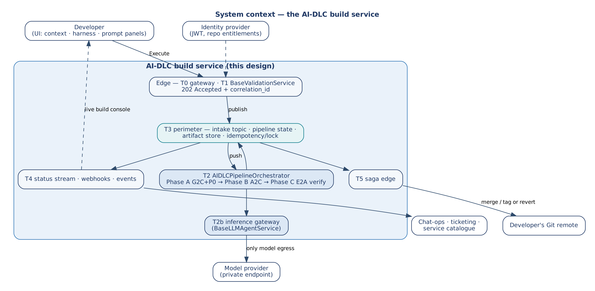

*Figure 1 — System context of the AI-DLC build service*

### 5.2 Zones and tiers

The profile reuses the three zones and tier numbering of the other profiles. Only Tier 2's internal composition changes: it runs a multi-phase, long-running saga instead of one agent run or a command/query split.

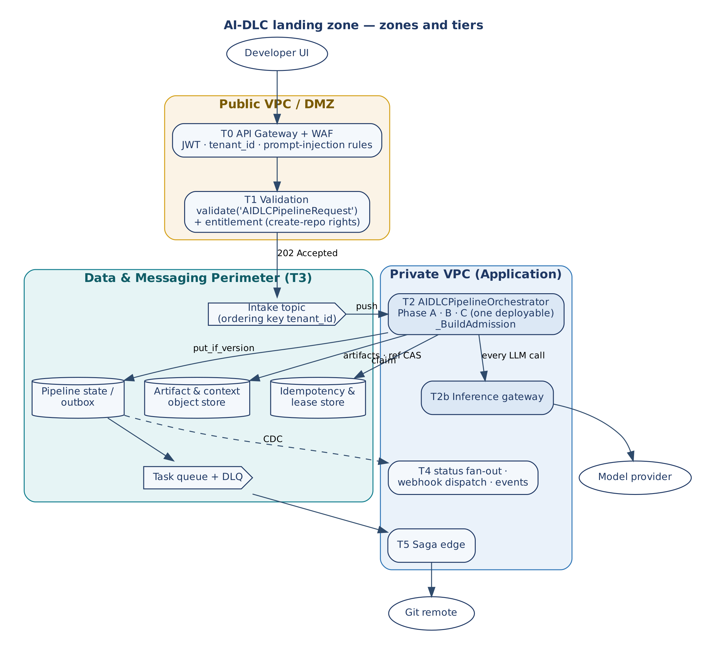

*Figure 2 — AI-DLC landing zone: zones and tiers*

| Tier | Component | Responsibility in this profile |
|---|---|---|
| T0 | API gateway + WAF | JWT, `tenant_id` and `developer_id`; rate limit; prompt-injection rules on `user_prompt`, `system_prompt_additions`, `class_description`; mints `correlation_id` and `trace_context`. |
| T1 | Validation | `validate('AIDLCPipelineRequest', state)`, entitlement (create-repository rights), publish to intake, 202. Never invokes T2 synchronously — builds take minutes. |
| T2 | Pipeline compute | `AIDLCPipelineOrchestrator` running all three phases in one process; one deployable, scaled by concurrent builds (admission limits), not by phase. |
| T2b | Inference gateway | Every model call from G2C generators, A2C agents and critics; absorbs the bursty, LLM-bound load. |
| T3 | Data & messaging perimeter | Intake topic (ordering key `tenant_id`); pipeline state/outbox table; artifact and context object store; idempotency and lease store; task queue and DLQ. |
| T4 | Fan-out consumers | Live status stream (WebSocket/SSE), webhook dispatch (`BaseWebhookDispatcher`), "service scaffolded" domain events. |
| T5 | Saga edge | Commit (merge, tag, completion webhook) or compensate. |

Network placement: the DMZ holds no repository content and no model credentials; the perimeter has no route from the DMZ or internet, protecting generated source and CI/CD secrets; the only external egress is model traffic from T2b and Git traffic from T5, both through allow-listed NAT.

### 5.3 Framework composition

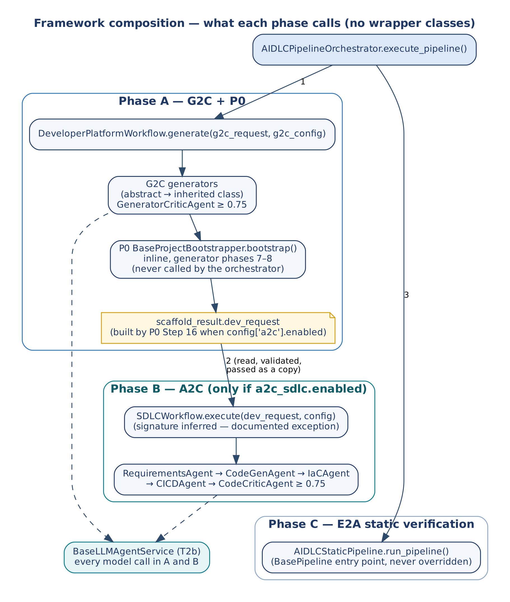

*Figure 3 — What each phase calls*

| Phase | Framework | Entry point | Quality gate | Artifacts |
|---|---|---|---|---|
| A | G2C | `DeveloperPlatformWorkflow.generate()` | `GeneratorCriticAgent` ≥ 0.75 (structure: access modifiers, abstract methods, inheritance) | Abstract base (`common/e2a_base.py` or `a2c_base.py`) if generated; inherited class. Since A2C v1.2.0 a Python service on E2A v1.2 generates no base: it depends on the `e2a` package |
| A | P0 (inline) | `BaseProjectBootstrapper.bootstrap()` inside G2C's generator phases 7–8 | `_validate_output()` — manifest, README, Docker, Makefile present | Build manifest, directory tree, Dockerfile, Makefile, `.env.example`, `.gitignore`; `dev_request` when `config['a2c'].enabled` |
| B | A2C (optional) | `SDLCWorkflow.execute(dev_request, config)` after `DevPlatformValidationService` | `CodeCriticAgent` ≥ 0.75 (mandatory NFR patterns present in code) | Terraform, CI/CD workflow, business-logic source written into the P0 workspace |
| C | E2A | `AIDLCStaticPipeline.run_pipeline()` | Static security, test suite, scaffold-contract compliance | Scan report, test results, compliance report |

### 5.4 The unified request

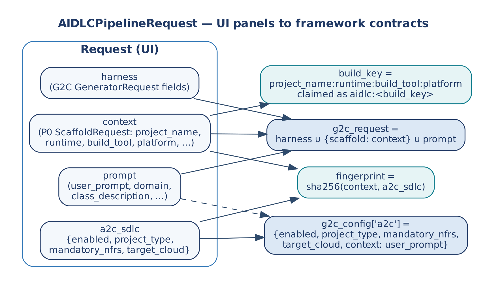

*Figure 4 — UI panels mapped onto existing framework contracts*

No new field vocabulary was invented: the context panel is P0's `ScaffoldRequest`, the harness panel is G2C's `GeneratorRequest`, the prompt panel carries G2C's free-text fields, and `a2c_sdlc` mirrors P0's existing `a2c` config block under a disambiguating name.

### 5.5 End-to-end flow

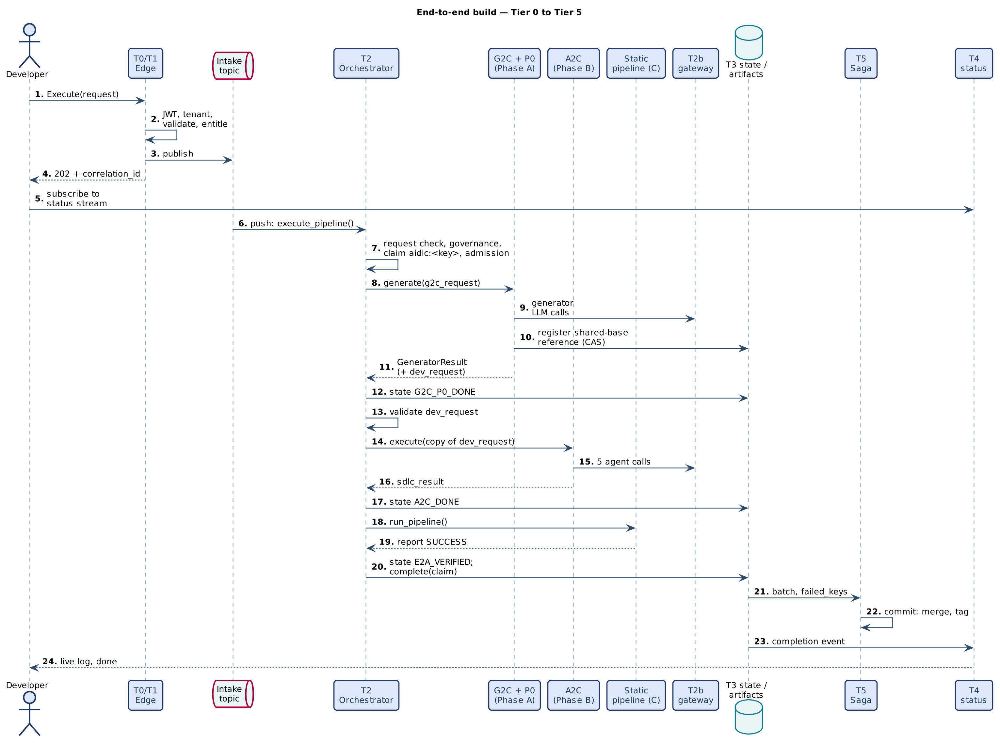

*Figure 5 — End-to-end build, Tier 0 to Tier 5*

### 5.6 Capacity, admission and durable state

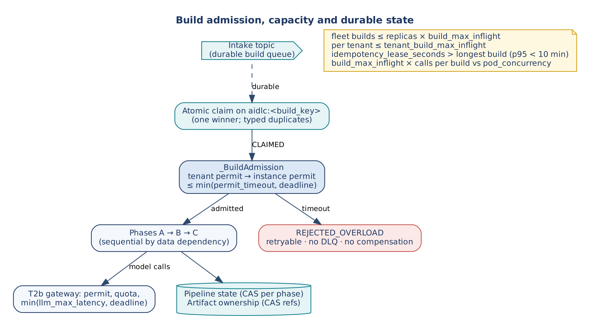

*Figure 6 — Build admission, capacity and durable state*

| Concern | Mechanism | Bound | When saturated |
|---|---|---|---|
| Build queue | T3 intake topic (durable, DLQ, ordered by tenant) | Retention; consumer concurrency | Builds wait durably; the caller already has 202 |
| Build admission | T2 `_BuildAdmission` (synchronous bounded wait) | `build_max_inflight`, `tenant_build_max_inflight`, `permit_timeout`, deadline | `REJECTED_OVERLOAD`; claim released; no compensation, no DLQ |
| Duplicate builds | T3 atomic claim on `aidlc:<build_key>` | `max(idempotency_lease_seconds, deadline + 60 s)` | Typed duplicate outcomes, no side effect |
| Durable phase state | T3 pipeline state, conditional commit | One record per `correlation_id` | Concurrent writer gets `ConcurrencyConflict` |
| Shared artifacts | T3 artifact store, CAS ownership record written by G2C | ≤ 8 CAS attempts | Reference never lost; at most one deletion, once, opt-in |
| Model quota | T2b permit, quota, `min(llm_max_latency, deadline)`, circuit | Gateway config | Bounded rejection; quota refunded; fails the phase |
| Completion delivery | T4 webhook and status fan-out after commit | At-least-once | Receivers dedupe on `correlation_id` |

### 5.7 Vendor mapping

| Component | AWS | GCP | Azure |
|---|---|---|---|
| T0 gateway + WAF | API Gateway + WAF | External HTTPS LB + Cloud Armor / Apigee | API Management + Front Door WAF |
| T1 validation | Lambda | Cloud Run functions | Azure Functions |
| T2 orchestrator | ECS Fargate service | Cloud Run service | Container Apps |
| T2b gateway → model | Fargate service → Bedrock (VPC endpoint) | Cloud Run → Vertex AI | Container Apps (KEDA) → Azure OpenAI / AI Foundry |
| Intake topic | SNS / SQS FIFO | Pub/Sub (ordering key) | Service Bus topic |
| Pipeline state | DynamoDB conditional writes | Firestore preconditions | Cosmos DB ETag `If-Match` |
| Artifact store + ownership CAS | S3 (or DynamoDB item) conditional write | GCS generation precondition | Blob ETag condition |
| Idempotency and lease store | DynamoDB / ElastiCache | Firestore / Memorystore | Cosmos DB / Azure Cache for Redis |
| T4 status stream / webhooks | API Gateway WebSocket + Lambda / EventBridge API destination | Cloud Run + Firestore listeners / Cloud Tasks | Web PubSub / Logic Apps HTTP |
| T5 saga + DLQ | Step Functions + SQS DLQ | Workflows + Pub/Sub DLQ | Durable Functions + Service Bus DLQ |
| Generated CI/CD target | GitHub Actions + OIDC → ECR/ECS | GitHub Actions + OIDC → Artifact Registry/Cloud Run | GitHub Actions + OIDC → ACR/AKS |
| Telemetry | CloudWatch + X-Ray | Cloud Monitoring + Trace | Azure Monitor + App Insights |

This mapping is vendor-neutral by design; a vendor-specific binding (for example language placement of control plane versus agent plane on one cloud) belongs in a separate companion document, not in this one.

## 6. Data and Propagation Contracts

### 6.1 Request — AIDLCPipelineRequest

| Field | Meaning |
|---|---|
| `context` | P0 `ScaffoldRequest` (`project_name`, `runtime`, `build_tool`, `platform`, `dependencies`, `license`, `include_docker`, `include_makefile`, `group_id`, `artifact_id`, `project_type`, …); embedded verbatim as `scaffold` in the G2C request. |
| `harness` | G2C `GeneratorRequest` fields (`generator_type`, `agent_name`, `mandatory_nfrs`, `abstract_class_source`, …). |
| `prompt` | `user_prompt`, `system_prompt_additions`, `domain`, `class_description`; merged into the G2C request. |
| `a2c_sdlc` | `{enabled, project_type, mandatory_nfrs, target_cloud}` — Phase B switch; absent or disabled means Phase B is skipped, not failed. |
| `tenant_id`, `model_id`, `critic_model_id` | Tenant and per-call model choices (passed through, never config mutations). `tenant_id` is copied into the G2C request and the `dev_request`. |
| `deadline` | Optional `Deadline` or seconds; else `request_deadline_seconds`. Its remaining time is passed to G2C as `deadline_ms`. |
| `build_key`, `correlation_id` | Written by the orchestrator. `generator_key` is kept as a deprecated alias of `build_key`; it is not G2C's `generator_key`. |

### 6.2 Result — AIDLCPipelineResult

| Field | Meaning |
|---|---|
| `success` | `True` only for `E2A_VERIFIED` and `SKIPPED_IDEMPOTENT`. |
| `phase_reached` | See Table in Section 6.4. |
| `generator_result` | G2C `GeneratorResult` (includes `abstract_class_path`, `abstract_class_generated_fresh`, `scaffold_result`). |
| `dev_request`, `sdlc_result` | A2C input and returned `DevRequest` (with `critic_report`, `errors`). |
| `pipeline_report` | `BasePipeline` report from Phase C. |
| `message_log`, `failed_keys`, `errors` | Telemetry, failure keys, error messages. |
| `build_key`, `generator_key` (alias), `correlation_id`, `trace_id`, `latency_ms` | Identity and timing (`trace_id` = `correlation_id`). |

### 6.3 Durable records

| Record | Store | Shape | Written by |
|---|---|---|---|
| `PipelineStateRecord` | `pipeline_state_store` (`BaseTransactionalStore`, collection `pipeline_state`), key `correlation_id` | `correlation_id`, `build_key`, `generator_key` (alias), `phase`, `updated_at` (TypedDict also declares `tenant_id`, `artifact_pointers`, `created_at`) | `__persist_state()` after Phase A attempt, Phase A done, Phase B done, Phase C done |
| Artifact ownership | `artifact_store` (`BaseTransactionalStore`), key `artifact:<path>` | `{refs: [G2C generator_key…], created_by: G2C generator_key \| None, deleted: bool}` | G2C's `DeveloperPlatformWorkflow` through `_ArtifactRegistryAdapter`; released by `_delete_abstract_class_if_orphaned()` |
| Idempotency record | `idempotency_store`, key `aidlc:<build_key>` (tenant-scoped) | Claim state machine; result `{phase_reached}` | `execute_pipeline()` |

### 6.4 phase_reached vocabulary

| Value | Meaning | `success` | Compensation |
|---|---|---|---|
| `QUEUED` | Initial; also the value if an exception occurs before Phase A completes | — | Unsettled scaffold, inherited class, this build's reference |
| `G2C_P0_DONE` | Phase A succeeded | — | Keep scaffold and classes; release this build's reference |
| `A2C_DONE` | Phase B succeeded | — | Revert staged A2C commit; release reference |
| `E2A_VERIFIED` | Phase C passed | True | — |
| `FAILED_G2C_P0` | Phase A reported failure | False | As `QUEUED` |
| `FAILED_A2C` | Phase B requested but impossible (no `dev_request`), invalid, or returned errors | False | Delete A2C artifacts, revert branch, release reference |
| `SKIPPED_IDEMPOTENT` | Claim `REPLAY` | True | none |
| `SKIPPED_IN_PROGRESS` | Claim `IN_PROGRESS` | False | none |
| `REJECTED_CONFLICT` | Claim `CONFLICT` | False | none |
| `RECOVERY_REQUIRED`, `FAILED_FINAL` | Claim outcomes | False | none |
| `REJECTED_INVALID` | A requested phase cannot run; checked before the claim | False | none |
| `REJECTED_OVERLOAD` | Admission timeout | False | none |

### 6.5 Propagation fields

| Field | Origin | Purpose here |
|---|---|---|
| `correlation_id` | T1 `validate()`, else minted | Joins logs across phases; claim owner; state key; `trace_id`. |
| `tenant_id` | JWT at T0 | Claim scope, admission fairness, object-store prefix, repository namespace. |
| `build_key` | `__generate_key()` = `project_name:runtime:build_tool:platform` | Business idempotency key, claimed as `aidlc:<build_key>`; identity in `failed_keys` and the DLQ. |
| G2C `generator_key` | G2C (`name:type:runtime:platform`) | Artifact ownership identity; claimed by G2C as `g2c:<key>`. |
| `io_config` | `config['io_config']` | Passed to the governance gate. |
| `message_log`, `failed_keys` | Empty per build | Live build console; saga input. |
| `deadline` | Request or `request_deadline_seconds` | Checked before each phase; bounds admission and the claim lease; passed to G2C as `deadline_ms`. |
| `trace_context` | W3C traceparent at T0 | Correlates phases in the tracing backend. |

### 6.6 Configuration

| Key | Default | Used by |
|---|---|---|
| `idempotency` | `True` | Enables the claim step. |
| `idempotency_store` | — | `BaseIdempotencyStore` for claims. |
| `idempotency_lease_seconds` | 300 | Claim lease. With a deadline the lease is `max(configured, deadline remaining + 60)`; without one, **raise it above the longest build** (full pipeline p95 < 10 min). |
| `pipeline_state_store` | — | `BaseTransactionalStore` for phase state. |
| `artifact_store` | — | `BaseTransactionalStore` for ownership records; bind only if it offers atomic conditional writes. Handed to G2C as `config['artifact_registry']` through `_ArtifactRegistryAdapter`. |
| `compensation_delete_orphan_abstract` | `False` | Allows the compensator to delete an orphaned shared abstract class (creating build only). |
| `a2c_validation_service` | `DevPlatformValidationService()` | Validates the `dev_request` before Phase B. |
| `governance_engine`, `observability_engine`, `llm_service` | — | E2A engines and the inference gateway. |
| `static_pipeline` | `AIDLCStaticPipeline()` | Phase C implementation. |
| `saga_compensator` | `AIDLCSagaCompensator()` | Compensation implementation. |
| `build_max_inflight`, `tenant_build_max_inflight` | 4, 2 | Admission caps. |
| `permit_timeout` | 5.0 s | Admission wait (shared key with the gateway permit). |
| `request_deadline_seconds` | 0 (none) | Deadline origin. |
| `dlq_queue_url` | — | DLQ dispatch. |
| `io_config` | `{}` | Governance gate input. |

## 7. Low-Level Design — Class Model

### 7.1 Classes this profile adds

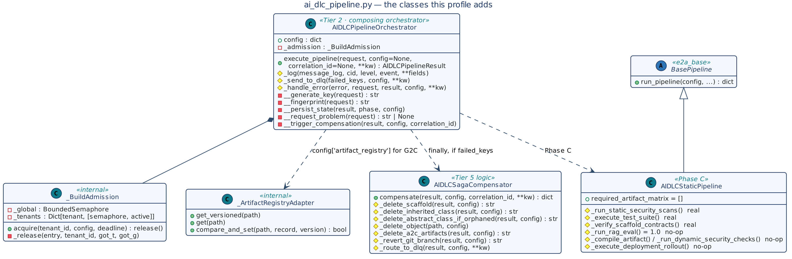

*Figure 7 — The classes this profile adds*

| Class | Status | Role |
|---|---|---|
| `AIDLCPipelineOrchestrator` | Implemented | Tier 2 composing orchestrator; single entry point `execute_pipeline()`. |
| `_BuildAdmission` | Implemented (internal) | Per-tenant and per-instance build permits with bounded wait. |
| `_ArtifactRegistryAdapter` | Implemented (internal) | Presents `artifact_store` as the registry G2C expects, in the AI-DLC record schema. |
| `AIDLCStaticPipeline` | Implemented | `BasePipeline` subclass for Phase C; three real stages, four no-ops. |
| `AIDLCSagaCompensator` | Implemented with hooks | Phase-aware compensation; reference release and opt-in, creator-only orphan deletion by CAS. |
| `AIDLCPipelineRequest`, `AIDLCPipelineResult`, `PipelineStateRecord` | TypedDict | Data contracts. |

### 7.2 Dependencies

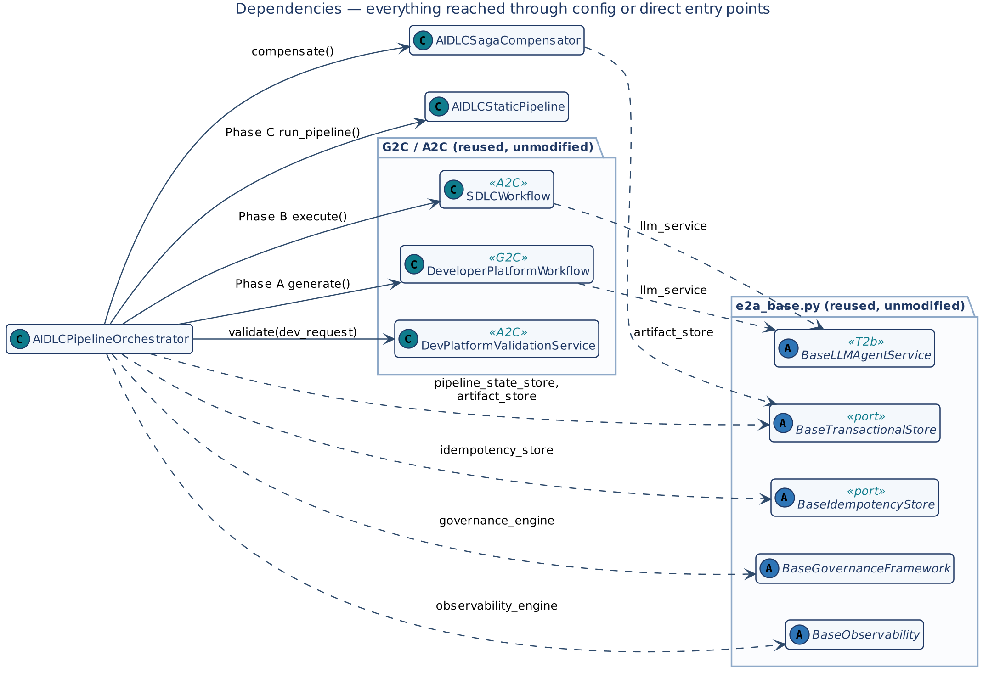

*Figure 8 — Dependencies reached through config or direct entry points*

### 7.3 Data contracts

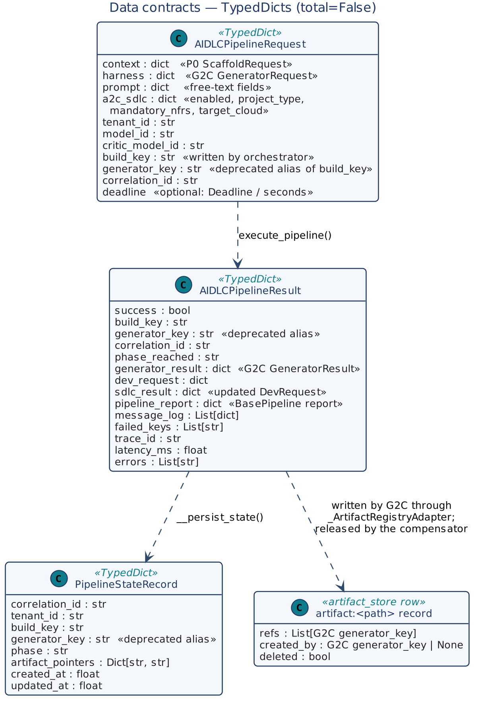

*Figure 9 — TypedDicts and the artifact ownership record*

## 8. Low-Level Design — Class Contracts

### 8.1 AIDLCPipelineOrchestrator

| Aspect | Detail |
|---|---|
| Stereotype | Tier 2 composing orchestrator; plain class (not an ABC) — subclass only at the request/config level |
| State | `config` (default config), `_admission` (one `_BuildAdmission` per instance) |
| Collaborators | `DeveloperPlatformWorkflow`, `SDLCWorkflow`, `DevPlatformValidationService`, `AIDLCStaticPipeline`, `AIDLCSagaCompensator`, `_ArtifactRegistryAdapter`; stores and engines from `config` |
| Invariants | INV-01 to INV-12 |

**Table 1 — AIDLCPipelineOrchestrator methods**

| Method | Kind | Signature → returns | Contract |
|---|---|---|---|
| `execute_pipeline` | entry | `(request, config=None, correlation_id=None, **kw) → AIDLCPipelineResult` | Fixed sequence (Section 9.1): resolve IDs, build key, tenant, deadline → request check (`REJECTED_INVALID`) → governance gate → claim `aidlc:<build_key>` (typed short-circuits) → admission → Phase A → Phase B (conditional, validated) → Phase C → `E2A_VERIFIED`. `AdmissionTimeout` → `REJECTED_OVERLOAD`; other exceptions → `failed_keys`, `errors`. `finally`: release slot; if `failed_keys`: DLQ + compensation; settle claim (complete on success, else retryable fail); telemetry; latency. Never raises. |
| `_log` | helper | `(message_log, cid, level, event, **fields)` | Structured log entry. |
| `_send_to_dlq` | helper | `(failed_keys, config, **kw)` | Dispatch to `dlq_queue_url`. |
| `_handle_error` | default | `(error, request, result, config, **kw)` | Log and append to `result['errors']`. |
| `__generate_key` | template | `(request) → str` | `build_key`: `project_name:runtime:build_tool:platform` from `context` (`?` for missing parts). |
| `__fingerprint` | template | `(request) → str` | SHA-256 of `context` and `a2c_sdlc`. |
| `__persist_state` | template | `(result, phase, config)` | Read version, `put_if_version` the record; not committed → `ConcurrencyConflict`. No-op without a store. |
| `__request_problem` | template | `(request) → str \| None` | Returns a message when `a2c_sdlc.enabled` and `harness.generator_type` is not `e2a_inherited` or `a2c_inherited`; the build then ends as `REJECTED_INVALID` before the claim. |
| `__trigger_compensation` | template | `(result, config, correlation_id)` | `config['saga_compensator']` or default → `compensate()`. |

Phase A request construction: `g2c_request = harness ∪ {scaffold: context} ∪ prompt`, plus `tenant_id` and `deadline_ms` (the deadline's remaining time). When `artifact_store` is bound, `g2c_config['artifact_registry']` is an `_ArtifactRegistryAdapter` over it, so G2C registers shared-class references in the build's own store; the orchestrator registers nothing itself. When `a2c_sdlc.enabled`, `g2c_config['a2c'] = {enabled, project_type, mandatory_nfrs, target_cloud ('aws' default), context: prompt.user_prompt}` so P0's `bootstrap()` builds the `dev_request` inline. Phase B reads `generator_result.scaffold_result.dev_request`. If A2C is enabled and there is none, the build ends as `FAILED_A2C`. Otherwise the request gets the build's `tenant_id`, is validated by `a2c_validation_service` (default `DevPlatformValidationService`, failure → `FAILED_A2C`), and `SDLCWorkflow.execute()` receives a deep copy.

### 8.2 _BuildAdmission

**Table 2 — _BuildAdmission methods**

| Method | Signature → returns | Contract |
|---|---|---|
| `acquire` | `(tenant_id, config, deadline=None) → release()` | Lazily create the instance semaphore (`build_max_inflight`); per-tenant semaphore (`tenant_build_max_inflight`). Total wait ≤ `min(permit_timeout, deadline)`: tenant permit first, then instance permit; either timeout → `AdmissionTimeout` after releasing what was taken. Returns a zero-argument release function. |
| `_release` | `(entry, tenant_id, got_t, got_g)` | Release held permits; decrement the tenant's active count; evict idle tenant entries once the table exceeds 1,024. |

### 8.3 AIDLCStaticPipeline

`run_pipeline()` is inherited from `BasePipeline` and never overridden; this subclass only fills the seven stage hooks.

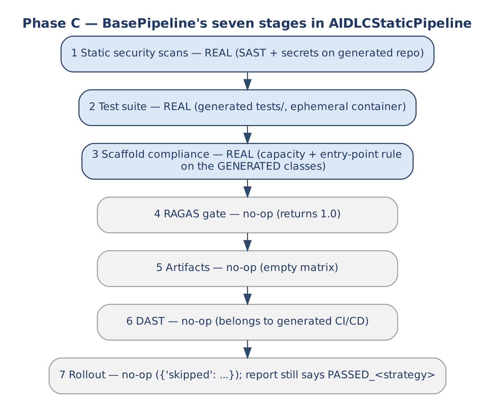

*Figure 10 — Phase C stages: three real, four no-ops*

**Table 3 — AIDLCStaticPipeline stage hooks**

| Hook | Reference behaviour | Deployment duty |
|---|---|---|
| `_run_static_security_scans` | `True` | SAST and secret detection on the generated repository in the object store. |
| `_execute_test_suite` | `True` | Run the generated project's `tests/` in an ephemeral build container. |
| `_verify_scaffold_contracts` | `True` | Since v1.2 the base default runs the `e2a.conformance` rules over `conformance_paths` (findings in `self.conformance_findings`); it no longer requires one public method per class. |
| `_run_rag_eval` | `1.0` | No-op — no RAG on this profile's path. |
| `_compile_artifact` | `True` | No-op — `required_artifact_matrix` is empty. |
| `_run_dynamic_security_checks` | `True` | No-op — DAST belongs to the generated CI/CD. |
| `_execute_deployment_rollout` | `{'skipped': …}` | No-op — no live deploy. |

> **Reading the report** `BasePipeline` still records `artifact_compilation`, `dynamic_security` and `deployment_rollout = PASSED_<strategy>` for the no-op stages. Consumers must treat only `static_security`, `test_execution` and `scaffold_compliance` as meaningful for this profile. The capacity check inside stage 3 (`validate_capacity()`) runs against the pipeline's own config.

### 8.4 AIDLCSagaCompensator

| Aspect | Detail |
|---|---|
| Stereotype | Tier 5 compensation logic; single public method `compensate()` |
| Scope | Only artifacts this build produced; never the output of a step whose claim settled as succeeded; a shared abstract class only through the CAS ownership protocol |

**Table 4 — AIDLCSagaCompensator methods**

| Method | Kind | Signature → returns | Contract |
|---|---|---|---|
| `compensate` | entry | `(result, config=None, correlation_id=None, **kw) → dict` | By `phase_reached`: `QUEUED`/`FAILED_G2C_P0` → delete the scaffold only if P0 did not succeed, delete the inherited class, release the reference; `G2C_P0_DONE` → keep scaffold and classes, release the reference; `FAILED_A2C` → delete A2C artifacts, revert branch, release the reference; `A2C_DONE` → revert branch, release the reference. Always `_route_to_dlq()`. Returns `{phase_compensated, actions}`. |
| `_delete_abstract_class_if_orphaned` | template | `(result, config) → str` | CAS loop (≤ 8): remove this build's key — G2C's `generator_key` — from `refs`. Orphan = `compensation_delete_orphan_abstract` is set, refs empty, `created_by` equals this build's key, not yet deleted; `deleted` is committed in the same write and only the committing caller calls `_delete_object()`. Returns `abstract_class_orphan_deleted`, `abstract_reference_released` or `abstract_class_untouched` (no record, or this build holds no reference); exhausted retries → `ConcurrencyConflict`. |
| `_delete_object` | hook | `(path, config)` | Delete from the object store. |
| `_delete_scaffold`, `_delete_inherited_class`, `_delete_a2c_artifacts`, `_revert_git_branch` | hook | `(result, config) → str` | Object-store deletes under the `build_key` prefix; Git branch revert. Reference bodies return action names. |
| `_route_to_dlq` | default | `(result, config, **kw)` | Dispatch the failed `build_key`. |

> **Deleting shared bases** Deletion is off by default. A deleted shared base makes later replays of the same G2C key point at a missing file; G2C and P0 then return `recovery_required` rather than a false success, and a new project in the same tenant gets that result for the base until its claim record is reconciled (Section 14, O-11).

### 8.5 Reused contracts

| Class | Entry point used | Notes |
|---|---|---|
| `DeveloperPlatformWorkflow` (G2C) | `generate(request, config) → GeneratorResult`; constructed with `config=` | Must embed `scaffold` so P0 runs inline and idempotently; claims `g2c:<key>`; registers shared-class references in `config['artifact_registry']`; returns `success`, `generator_key`, `abstract_class_path`, `abstract_class_generated_fresh`, `scaffold_result`. |
| `BaseProjectBootstrapper` (P0) | `bootstrap()` — inline only | Claims `p0:<key>`; builds `dev_request` (Step 16) with `tenant_id` and `project_root` when `config['a2c'].enabled`. |
| `SDLCWorkflow` (A2C) | `execute(dev_request, config) → DevRequest` | Claims `a2c:<key>`; writes into the P0 workspace; returns `critic_report` and `errors`. |
| `DevPlatformValidationService` (A2C) | `validate('SDLCWorkflow', dev_request, config, correlation_id=…)` | Gate before Phase B; failure ends the build as `FAILED_A2C`. |
| `BasePipeline` (E2A) | `run_pipeline(config, correlation_id, message_log, failed_keys)` | Shares the build's `message_log` and `failed_keys`. |
| `BaseIdempotencyStore` | `claim`, `complete`, `fail` | Tenant-scoped claim on `aidlc:<build_key>`. |
| `BaseTransactionalStore` | `get_versioned`, `put_if_version` | Phase state and artifact ownership. |
| `BaseGovernanceFramework` | `enforce_governance_gate(request, io_config, config, …)` | Agentic form — capacity, budget, firewall on prompt fields. |
| `BaseObservability` | `record_telemetry(message_log, cid, config, tenant_id)` | One trail per build. |
| `BaseLLMAgentService` | via `config['llm_service']` inside G2C and A2C | Shared quota across builds. |

## 9. Dynamic Behaviour

### 9.1 execute_pipeline() internals

Figure 5 shows the end-to-end path across tiers; Figure 11 shows the orchestrator's own sequence, including every early return and the order of the `finally` block.

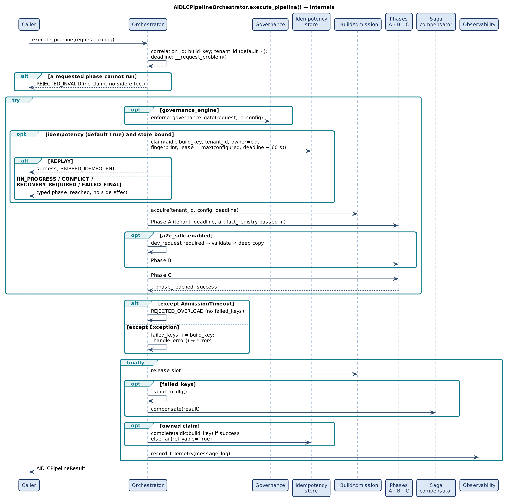

*Figure 11 — execute_pipeline() internals*

### 9.2 Phase state machine

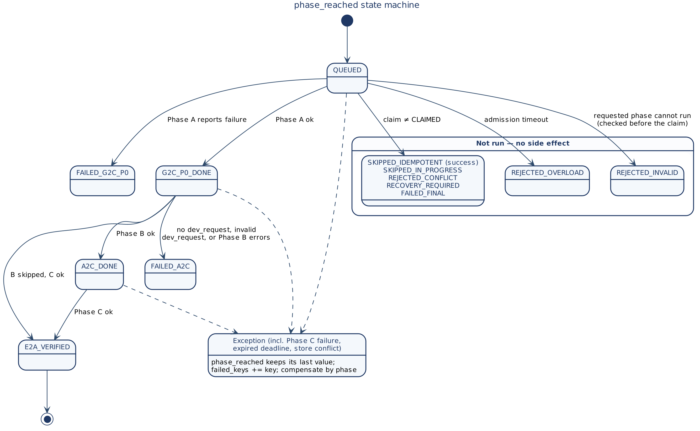

*Figure 12 — phase_reached state machine*

### 9.3 Duplicates and overload

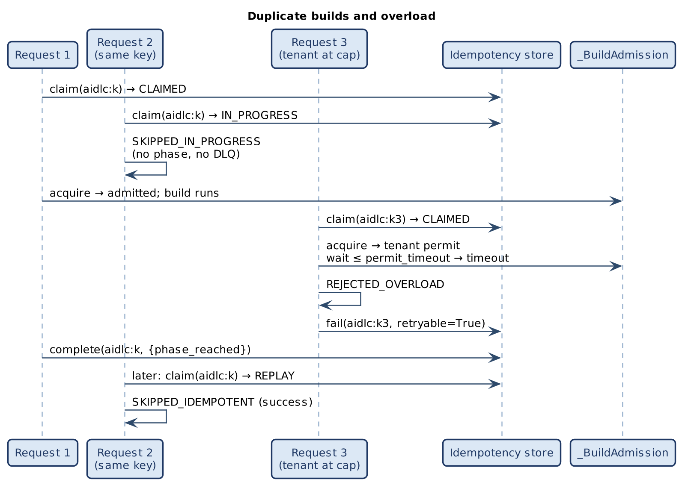

*Figure 13 — Duplicate builds and overload*

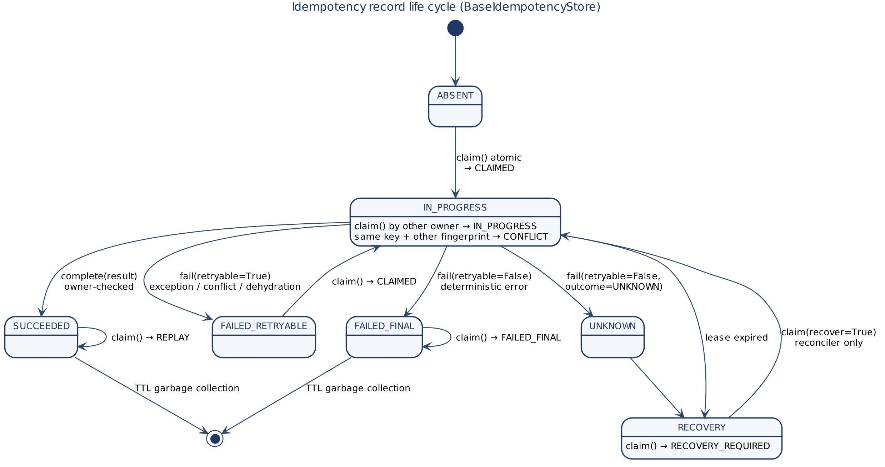

*Figure 14 — Idempotency record life cycle (shared contract)*

### 9.4 Compensation

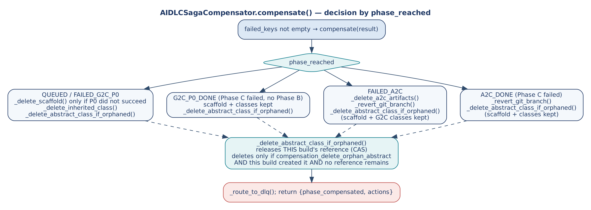

*Figure 15 — Compensation decision by phase*

### 9.5 Shared artifact ownership

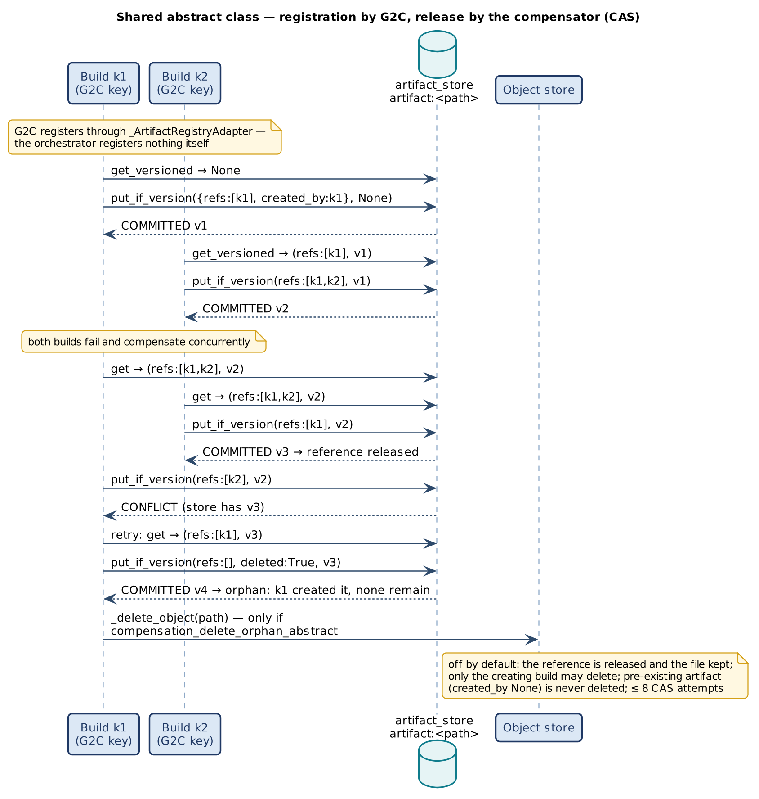

*Figure 16 — Reference registration and orphan deletion by compare-and-set*

## 10. Concurrency and Saga Model

### 10.1 Risk ownership

| Risk | Owner | Mechanism |
|---|---|---|
| Duplicate builds | Orchestrator + `BaseIdempotencyStore` | Atomic claim on `aidlc:<build_key>`; typed outcomes. |
| Claim collisions across frameworks | Namespaced keys | `aidlc:`, `g2c:`, `p0:`, `a2c:`. |
| A requested phase that cannot run | `__request_problem()`, Phase B guard | `REJECTED_INVALID` or `FAILED_A2C`; never a silent skip. |
| Changed request under a known key | `__fingerprint()` | `REJECTED_CONFLICT`. |
| Tenant monopolising capacity | `_BuildAdmission` | Per-tenant cap with bounded wait. |
| Instance overload | `_BuildAdmission` | Per-instance cap; overload rejected, not queued. |
| Lost phase progress | `__persist_state()` | Durable, conditional phase record. |
| Two builds on one shared artifact | Artifact ownership record (G2C writes, compensator releases) | CAS reference counting; single, opt-in deleter. |
| Shared model quota | T2b gateway | Bounded permits and quota, refund. |
| Lost worker | Claim lease | `RECOVERY_REQUIRED`; reconciler decides. |

### 10.2 What compensation preserves

| Artifact | When this build fails | Why |
|---|---|---|
| Scaffold whose P0 step did not succeed; inherited class of a failed generation (`QUEUED`, `FAILED_G2C_P0`) | Deleted | Partial output of an invalid build. |
| Scaffold that P0 reported as succeeded | Kept | A settled claim would replay a path that no longer exists. |
| Scaffold and classes when Phase C fails with no Phase B (`G2C_P0_DONE`) | Kept | Valid, replayable output; only the reference is released. |
| Scaffold and G2C classes (`FAILED_A2C`, `A2C_DONE`) | Kept | Valid on their own — the smaller deliverable. |
| A2C files (`FAILED_A2C`) | Deleted with the ephemeral branch | Uncommitted output of the failed phase. |
| Staged A2C commit (Phase C failed after A2C) | Reverted | Rejected by verification. |
| Shared abstract class still referenced | Kept | A sibling depends on it. |
| Shared abstract class, no references, created here, deletion enabled | Deleted exactly once | Orphaned by the creating build as last referrer. |
| Shared abstract class, no references, deletion not enabled (default) | Kept; reference released | Deleting a base that settled claims point at leaves them replaying a missing file. |
| Pre-existing abstract class (`created_by` None) | Kept | Not this system's to delete. |
| Artifacts of completed builds | Kept | Completed builds keep their reference; a failed build releases only its own. |
| Overload / duplicate / conflict outcomes | Nothing to do | No side effect occurred. |

### 10.3 Error routing

`__request_problem()` returns `REJECTED_INVALID` before the claim. `AdmissionTimeout` is caught first and is overload, not failure. Non-`CLAIMED` claims return before any phase. Everything else — G2C or A2C failure, a missing or invalid `dev_request` (`FAILED_A2C`), Phase C failure (raised as `ValueError` with the report's error), an expired deadline (`DeadlineExceeded` at a phase boundary), a `ConcurrencyConflict` from the state or artifact store — appends `generator_key` to `failed_keys`, is dead-lettered and compensated by phase. The claim is then settled retryable, so a corrected retry starts from a clean slate.

## 11. Non-Functional Design

### 11.1 Latency budgets

| Budget | Target (p95) | Notes |
|---|---|---|
| T0/T1 synchronous | < 300 ms | 202 Accepted; the UI never blocks beyond this. |
| Phase A (G2C + P0) | < 3 min | Two generator LLM calls plus scaffold writes. |
| Phase B (A2C) | < 6 min | Five sequential agent calls; dominant cost. |
| Phase C | < 1 min | No LLM; static scans and tests. |
| Minimal pipeline | < 4 min | G2C + P0 + verification. |
| Full pipeline | < 10 min | Includes one critic retry as the expected case. |
| Critic retry ceiling | 2 per gate | Same as the G2C and A2C critics. |

### 11.2 Capacity sizing

Fleet build capacity = replicas × `build_max_inflight`; per-tenant capacity = `tenant_build_max_inflight`; size both against peak simultaneous builds, not request rate. Admitted builds multiply into model calls: `build_max_inflight` × concurrent calls per build must fit the gateway's `pod_concurrency` and the provider quota, because the quota is shared by every build. Gateway pods = peak in-flight LLM calls ÷ per-pod semaphore (Little's Law); autoscale on in-flight > 25 or backlog > 100 (min 3, max 60). With a deadline the claim lease is at least the deadline plus 60 s; without one, `idempotency_lease_seconds` must exceed the longest expected build, because the 300 s default is too short for a full pipeline.

### 11.3 Security

| Control | Where |
|---|---|
| Developer identity and tenant | JWT at T0. |
| Repository entitlement | `_enforce_entitlement_gate()` at T1 (create-repository rights). |
| Prompt injection | T0 rule group on free-text fields; governance semantic firewall; gateway sanitiser. |
| Model credentials | Only at T2b. |
| Generated source and secrets | Perimeter object store with no DMZ/internet route. |
| Git access | Only from T5 through allow-listed egress. |
| Generated code quality | Critics (≥ 0.75) and Phase C static scans and contract checks. |

### 11.4 Observability

One `message_log` per build, streamed live to the developer through T4 and shipped once to `record_telemetry()`. Key events: `pipeline_skipped_idempotent`, `pipeline_duplicate` (with claim status), `pipeline_rejected_overload` (WARN), `pipeline_rejected_invalid` (WARN), `phase_a_complete` (success), `phase_b_complete` (critic score), plus the static pipeline's stage events and the gateway's inference events under the same `correlation_id`.

## 12. Extension Guide

1. **Bind stores:** an `idempotency_store`, a `pipeline_state_store` and an `artifact_store` with atomic conditional writes (otherwise leave `artifact_store` unbound — G2C then keeps its own in-memory registry and the saga never touches the shared abstract class).
2. **Set a deadline on every request**, or raise `idempotency_lease_seconds` above the longest expected build.
3. **Subclass `AIDLCStaticPipeline`** to implement real SAST/secret scanning, generated-test execution and contract verification against the object store.
4. **Subclass `AIDLCSagaCompensator`** to implement object-store deletes (`_delete_scaffold`, `_delete_inherited_class`, `_delete_a2c_artifacts`, `_delete_object`) and `_revert_git_branch`. Leave `compensation_delete_orphan_abstract` unset unless a reconciler for `recovery_required` replays exists (Section 14, O-11).
5. **Pass both through config** (`static_pipeline`, `saga_compensator`); never override `execute_pipeline()` or `run_pipeline()`.
6. **Bind E2A engines** (`governance_engine`, `observability_engine`) and the inference gateway (`llm_service`) used by G2C and A2C.
7. **Host the orchestrator** behind a push subscription on the intake topic; host the status stream and webhook dispatch in T4; implement the saga engine in T5.

```python
class RepoCompensator(AIDLCSagaCompensator):
    def _delete_object(self, path, config):              object_store.delete(path)
    def _delete_scaffold(self, result, config):         object_store.delete_prefix(f"{result['build_key']}/scaffold/"); return 'scaffold_deleted'
    def _revert_git_branch(self, result, config):       git.delete_branch(result['correlation_id']); return 'git_branch_reverted'

config = {'idempotency_store': idem, 'pipeline_state_store': state, 'artifact_store': artifacts,
          'static_pipeline': RepoStaticPipeline(), 'saga_compensator': RepoCompensator(),
          'llm_service': gateway, 'governance_engine': gov, 'observability_engine': obs,
          'idempotency_lease_seconds': 1200}
result = AIDLCPipelineOrchestrator(config).execute_pipeline(request, config)
```

## 13. Verification

Two suites cover the profile. `smoke_test_aidlc_concurrency.py` in `e2a-framework` passes 26 checks with G2C and A2C stubbed to the real contracts. `smoke_test_aidlc_integration.py` in `a2c-framework` passes 15 checks against the real G2C, P0 and A2C modules. Both use in-memory stores and a deterministic template mode, with no live gateway, store or load. Gateway behaviour is proven in the core smoke tests.

| ID | Scenario | Evidence |
|---|---|---|
| T-13 | Six concurrent duplicates → one build; five `SKIPPED_IN_PROGRESS`; winner verified | `smoke_test_aidlc_concurrency.py` |
| T-13 | Later duplicate → `SKIPPED_IDEMPOTENT`, nothing rebuilt | `smoke_test_aidlc_concurrency.py` |
| — | Failed build is retryable and the retry succeeds | `smoke_test_aidlc_concurrency.py` |
| T-14 | One ownership record under G2C's identity; a failed build releases its reference; a referenced base is not deleted | `smoke_test_aidlc_concurrency.py` |
| T-14 | By default the creator releasing last keeps the file; with deletion enabled it deletes once; a non-creator never deletes; racing releases delete at most once | `smoke_test_aidlc_concurrency.py` |
| — | Admission: tenant over cap rejected within bound; slot reusable; other tenant unaffected | `smoke_test_aidlc_concurrency.py` |
| — | Overload → `REJECTED_OVERLOAD`, no failed keys; claim released; retry succeeds | `smoke_test_aidlc_concurrency.py` |
| T-10 | Expired deadline → no build started | `smoke_test_aidlc_concurrency.py` |
| X-1 | A2C requested with an abstract-only harness → `REJECTED_INVALID`, nothing runs | both suites |
| X-2 | `tenant_id` and `deadline_ms` reach the G2C request; the tenant reaches P0 and A2C | both suites |
| X-3 / X-8 | `dev_request` validated, carries the tenant; A2C runs on a copy, so the build result is not enriched | both suites |
| X-4 | Build claim is `aidlc:<key>`; inner claims are `g2c:`, `p0:`, `a2c:` and do not collide | both suites |
| X-7 | Build lease outlives the deadline | `smoke_test_aidlc_concurrency.py` |
| X-11 | Phase C failure after Phase A releases the reference, keeps scaffold and classes; with deletion enabled the sole creator deletes the orphaned base once | both suites |
| — | End to end: build reaches `E2A_VERIFIED`; P0 ran inline; A2C artifacts are in the P0 workspace; one ownership record written by G2C | `smoke_test_aidlc_integration.py` |
| — | Retry of the same build replays outputs that still exist; a new project never replays a deleted shared base (typed `recovery_required`) | `smoke_test_aidlc_integration.py` |
| T-04 / T-10 | Gateway permit/quota bounds; cancellation releases permits and refunds quota | `smoke_test_concurrency.py` (gateway) |
| — | Fleet build burst; crash mid-build then reconciliation | load environment (not claimed) |

Recommended additions: two tenants with the same project do not share artifact ownership (O-2); requests without `tenant_id` are rejected (O-3).

## 14. Implementation Reality, Gaps and Design Observations

Table 5 records every observation with its current status. Resolved items are kept so the reasoning behind each behaviour stays traceable.

**Table 5 — Design observations**

| ID | Status | Observation | Effect | Recommendation |
|---|---|---|---|---|
| O-1 | Resolved | `compensate()` had no branch for `G2C_P0_DONE`. | When A2C is disabled and Phase C fails, the reference was never released. | `G2C_P0_DONE` keeps scaffold and classes and releases the reference. |
| O-2 | Open | `build_key` and G2C's `generator_key` omit the tenant; artifact ownership records use G2C's key as the reference identity. | Claims are tenant-scoped, but two tenants building the same agent share one reference entry, so one tenant's compensation can release the other's. | Prefix references (and object-store paths) with `tenant_id`. |
| O-3 | Open | `tenant_id` is optional; a missing tenant becomes `'-'`. | Builds without a tenant share one admission bucket. | Require `tenant_id` like the other profiles' entry points. |
| O-4 | Open | The claim is always settled `fail(retryable=True)` on failure. | Deterministic failures (governance or validation rejections) never become `FAILED_FINAL`; every redelivery rebuilds. | Classify `ValueError`/`TypeError`/`PermissionError` as final, as `BaseWorkflow` does. |
| O-5 | Open | The governance gate runs before the claim. | Duplicates consume governance capacity checks and quota before being short-circuited. | Claim first, as `BaseWorkflow` and `BaseOrchestrator` do. |
| O-6 | Resolved with a limit | `claim()` used the configured lease (300 s) against a < 10 min pipeline. | With a deadline, the lease is now `max(configured, deadline remaining + 60)`. Without a deadline, healthy long builds can still be taken for lost. | Always set a deadline, or raise the lease or renew it between phases. |
| O-7 | Open | `__persist_state()` writes only `correlation_id`, `build_key`, `generator_key`, `phase`, `updated_at`; `tenant_id`, `artifact_pointers`, `created_at` are declared but never written. | Recovery tooling cannot locate artifacts from state alone. | Populate the declared fields. |
| O-8 | Open | `observability_engine` and `governance_engine` are not type-checked, unlike in `BaseWorkflow`. | A misbound object fails at call time inside the build. | Use `isinstance` checks. |
| O-9 | Open | The landing-zone HLD shows one Tier 2 service per phase in its vendor table but one deployable in its tier text; its `generator_key` formula (`name:generator_type:runtime:platform`) differs from the code (`project_name:runtime:build_tool:platform`). | Documentation drift. | This document follows the code: one deployable, code formula. |
| O-10 | Resolved | `SDLCWorkflow.execute()` had no published method contract. | The Phase B call is now an implemented, validated interface. | — |
| O-11 | Open | With `compensation_delete_orphan_abstract` set, deleting a shared base leaves settled G2C claims pointing at a missing file. | Replays return `recovery_required`; a new project in the tenant gets that result for the base until its claim record is reconciled. The claim store cannot reopen a completed record. | Keep deletion off, or add a reconciler for `recovery_required` outcomes. |
| O-12 | Open | The AI-DLC `Deadline` and A2C's `Deadline` are separate types; G2C receives milliseconds (`deadline_ms`). | The remaining time is converted at the boundary and each framework runs its own checks. | Share one `Deadline` type. |
| O-13 | Open | `generator_key` in the build result is a deprecated alias of `build_key` and differs in meaning from G2C's `generator_key`. | Consumers can confuse the two. | Remove the alias after consumers move to `build_key`. |

## 15. E2A v1.2 and A2C v1.2 in the Pipeline

The pipeline's phases, claims and Saga are unchanged. What changed underneath:

**Table 6 — v1.2 changes seen by AI-DLC**

| Change | Effect on a build |
|---|---|
| G2C generates E2A v1.2 code (A2C v1.2.0, `harness.e2a_contract`, default `"1.2"` for Python) | Phase A writes no abstract base for such a service; it generates the agents (several, from `harness.agents`), the declared workflow, the governance stages, the validation and tool stubs, and `AgentContract` and conformance tests. Java stays on 1.1. |
| No application-service module (A2C v1.2.0) | Phase B's A2C chain runs six agent steps; the critic reviews the NFR module. |
| Declarations (A2C v1.2.0: settings, contracts, Maven coordinates, monorepo layout) | Part of the request that reaches P0 and A2C; the build key covers them because the request is fingerprinted as a whole. |
| `.a2c/manifest.json` and `aidlc-build --upgrade` | A rebuilt project can be upgraded instead of rescaffolded; the pipeline itself still builds new projects. |
| `BasePipeline._verify_scaffold_contracts` runs `e2a.conformance` | Phase C's contract check reports R1–R3 findings instead of counting public methods. |

The A2C, G2C and P0 Framework Design Documents (v1.2.0) describe these in full.

## Appendix A. Glossary

| Term | Definition |
|---|---|
| AI-DLC | AI-assisted software development life cycle: the profile that runs G2C, P0, A2C and E2A as one build. |
| Build | One `execute_pipeline()` run for one `build_key`. |
| `build_key` | Business idempotency key `project_name:runtime:build_tool:platform`, claimed as `aidlc:<build_key>`; `generator_key` in the build result is a deprecated alias. |
| G2C `generator_key` | G2C's own key `name:type:runtime:platform`; the identity in artifact ownership records. |
| Phase A / B / C | G2C + P0 generation; A2C SDLC generation; E2A static verification. |
| Overload | Admission refused within the bound; retryable, not a failure. |
| Orphaned artifact | A shared abstract class created by a build in this system whose reference set became empty. Deleted only when deletion is enabled and the creating build releases last. |
| Smaller valid deliverable | Scaffold plus G2C classes kept when a later phase fails. |

## Appendix B. Traceability

| Goal / invariant | Element | Anchor (`reference/ai_dlc_pipeline.py`) |
|---|---|---|
| G-1, INV-01/02 | Claim key and fingerprint | L236, L270–281 |
| G-2, INV-03/04 | `_BuildAdmission.acquire` | L157–200 |
| INV-05 | Overload and duplicate branches | L275–290, L398–405 |
| G-3, INV-06 | `__persist_state` | L443 |
| G-4, INV-07/08/12 | `_ArtifactRegistryAdapter`, `compensate`, `_delete_abstract_class_if_orphaned` | L498, L542, L586 |
| INV-09 | Settlement after compensation in `finally` | L408–420 |
| INV-10 | Phase B guard, validation and copy | L347–372 |
| INV-11 | `__request_problem` and early return | L247, L463 |
| G-5 | `AIDLCStaticPipeline` (no `run_pipeline` override) | L108 |
| Phase A request construction | `g2c_request`, `artifact_registry`, `g2c_config['a2c']` | L298–326 |
