# E2A Deterministic CQRS Profile

### High-Level and Low-Level Design

*This document describes the E2A Deterministic CQRS Profile from problem statement to method-level contract. It is written so that a reader can build a complete mental model of the profile — why it exists, which use cases it serves, how it is deployed, how every class collaborates, and what each method guarantees — without opening the Python source. The source files remain the reference for line-level implementation detail.*

| | |
|---|---|
| Framework | E2A — Enterprise-to-Agentic Architecture Framework |
| Document type | Design Document (HLD + LLD) |
| Author | Subham Gupta, Principal Platform Architect |
| Source baseline | `subhamviky/e2a-framework` `v1.2.0` — `reference/e2a_cqrs_base.py` (unchanged since baseline 32c99c0) and the shared contracts it imports through `e2a_base` from the `e2a` package |
| Date | 13 November 2026 (E2A v1.2.0; baseline 7 November 2026) |
| Status | Aligned to E2A v1.2.0; the profile's own classes did not change in v1.2 (Section 16) |

## 1. Introduction

### 1.1 Purpose

The E2A Deterministic CQRS Profile is a companion execution profile of the Enterprise-to-Agentic (E2A) framework. It gives cloud-native microservices that need **sub-second, schema-strict, highly concurrent request handling — and no LLM reasoning on the request path —** the same architectural guarantees the agentic profile gives AI workloads: one public entry point per class, an explicit cross-class propagation contract, base-owned governance and observability, and a one-to-one mapping between class boundaries and cloud tiers.

This document is the single design reference for that profile. It covers:

- the problem the profile solves and the motivation behind its shape (Section 2);
- the core use cases it is built for, and what it deliberately does not do (Section 3);
- the design principles and invariants every implementation must preserve (Section 4);
- the high-level design: context, zones, tiers, deployment and vendor mapping (Section 5);
- the data and propagation contracts that cross class boundaries (Section 6);
- the low-level design: the class model, and a contract card for every class and method (Sections 7 and 8);
- the dynamic behaviour as sequence, state and activity models (Section 9);
- the concurrency, consistency and failure model (Section 10), the asynchronous consumer and repair paths (Section 11), and the non-functional design (Section 12);
- how to extend the profile (Section 13), how it is verified (Section 14), and known gaps (Section 15).

### 1.2 Audience

| Reader | Read first | Use the document to |
|---|---|---|
| Solution / platform architect | Sections 2–5, 10, 12 | Decide whether a workload belongs on this profile and size the landing zone. |
| Service developer | Sections 6–9, 13 | Implement a concrete orchestrator, command service and query service correctly. |
| SRE / operations | Sections 5, 10–12, 14 | Understand failure semantics, alerts, capacity limits and repair jobs. |
| Reviewer / auditor | Sections 4, 10, 15, Appendix B | Check invariants, traceability and the implemented-versus-runtime boundary. |

### 1.3 Status labels used in this document

Every class and behaviour is labelled so the reader can tell what exists in code from what is an obligation on the deploying team.

**Table 1 — Status labels**

| Label | Meaning |
|---|---|
| **Implemented** | Present in `reference/e2a_cqrs_base.py` or imported from `reference/e2a_base.py`, and exercised by the smoke tests. |
| **Abstract hook** | Declared with `@abstractmethod`. The scaffold defines the contract; a concrete subclass must supply the body or instantiation fails with `TypeError`. |
| **Runtime obligation** | Behaviour the platform runtime around the scaffold must provide (for example the Tier 4 consumer loop). The scaffold supplies the primitives, not the loop. |
| **Infrastructure** | A cloud component provisioned by the landing zone, not by Python code. |

### 1.4 Source of truth and related documents

The reference implementation is `reference/e2a_cqrs_base.py`. It imports its concurrency contracts (`Deadline`, `ClaimStatus`, `BaseIdempotencyStore`, `BaseCacheStore`, `BaseTransactionalStore`, `ConcurrencyConflict`, `CommitResult`, `PhysicalOutcome`, `_DETERMINISTIC_ERRORS`) and the configuration resolver `resolve_config()` from `reference/e2a_base.py`. Where this document and the code disagree, the code is authoritative and Section 15 records the difference.

**Table 2 — Related documents**

| Document | Relationship |
|---|---|
| E2A Framework Design Document | Agentic profile; defines every shared contract this profile imports. |
| CQRS Cloud Landing Zone (HLD) | Infrastructure view of the same profile; Sections 5 and 12 here summarise it. |
| CQRS Implementation Playbook | Method listings and the complete scaffold source (Appendix A). |
| E2A Master Abstraction Reference | Framework-wide class taxonomy and naming rules. |
| `reference/smoke_test_cqrs_concurrency.py` | Executable evidence for the race tests in Section 14. |

## 2. Problem Statement and Motivation

### 2.1 The problem

Most enterprise transactions — placing an order, posting a settlement, adjusting a balance, reading an account — need no language model. They need determinism: a validated schema, exactly one durable effect per business request, a fast and correct read, and an audit trail. Teams building these services on a shared cloud platform repeatedly run into the same failure modes:

1. **Duplicate effects.** At-least-once messaging, client retries and timeouts cause the same command to execute twice — a double charge, a double shipment.
2. **Lost updates.** Two writers read version *n* and both write version *n+1*; one change silently disappears.
3. **Stale or stampeding reads.** A popular key expires and hundreds of concurrent requests hit the database at once, or a read immediately after a write returns the old value.
4. **Unbounded waits.** A slow dependency holds threads and connections until the whole pool is exhausted.
5. **Ambiguous outcomes.** A commit times out — did it land? Blind retry duplicates; blind dead-lettering loses work.
6. **Inconsistent cross-cutting concerns.** Every team reinvents tenant isolation, quota enforcement, telemetry and error routing, each slightly differently, so platform-wide controls cannot be applied.
7. **Architecture drift.** The code structure no longer matches the deployment topology, so security zones, scaling units and ownership boundaries become guesswork.

### 2.2 Why a separate profile

The agentic E2A profile already solves items 6 and 7 for AI workloads through `BaseWorkflow` and `BaseAgent`. Reusing those classes for deterministic services would carry LLM-specific machinery — prompt registries, token budgets, inference gateways, semantic routing — onto a path that never calls a model, and would hide the most important structural fact of a transactional service: **reads and writes have different consistency, caching and failure contracts.**

The CQRS profile therefore keeps everything that is profile-independent and replaces only the Tier 2 orchestration layer:

**Table 3 — What the profile keeps and what it replaces**

| Concern | Agentic profile | CQRS profile |
|---|---|---|
| Lifecycle manager | `BaseWorkflow` | `BaseOrchestrator` |
| Unit of work | `BaseAgent` | `BaseCommandService` (write) + `BaseQueryService` (read) |
| Edge validation | `BaseValidationService` | Reused unmodified; also classifies read vs write intent |
| Governance | Token budget, MCP sandbox | Tenant request quota, external-API isolation (same ABC shape) |
| Observability | Token and cost metrics | Command / query / cache-hit / error counters (same ABC shape) |
| Concurrency contracts | `e2a_base.py` | Imported unchanged from `e2a_base.py` (since v1.2 defined in the `e2a` package and re-exported unchanged by `e2a_base`) |
| Inference tier (2b) | `BaseLLMAgentService` | Not provisioned; tier numbers 0–5 unchanged |

### 2.3 Design goals

**Table 4 — Design goals**

| ID | Goal | How the design meets it |
|---|---|---|
| G-1 | Effectively-once material effects under at-least-once delivery | Atomic, tenant-scoped idempotency claim before any work; owner-checked settlement; replay of stored results. |
| G-2 | No lost updates | Store-side conditional commit (`put_if_version`) is the authority; losers get a typed `ConcurrencyConflict`. |
| G-3 | Fast, stampede-free, read-after-write-consistent reads | Cache-aside with per-key single-flight; synchronous cache synchronisation on the write path. |
| G-4 | Bounded waits everywhere | One `deadline` propagated across classes; every wait is `min(timeout, remaining)`. |
| G-5 | Honest outcomes | `PhysicalOutcome.UNKNOWN` is parked for reconciliation, never blindly retried or dead-lettered. |
| G-6 | Uniform platform controls | Governance and observability are injected ABCs with fixed hook names, shared with the agentic profile. |
| G-7 | Code-to-cloud isomorphism | Each class maps to one tier; tier numbers are shared across all E2A profiles. |
| G-8 | Vendor neutrality | Stores, caches and telemetry are ports; AWS, GCP and Azure bindings are adapters. |

## 3. Core Use Cases

### 3.1 Actors

**Table 5 — Actors**

| Actor | Description |
|---|---|
| Tenant client | A UI, partner system or batch job acting for one tenant, authenticated by a JWT. |
| Edge (T0/T1) | API gateway plus the validation function; mints `correlation_id` and classifies intent. |
| CQRS service (T2) | The concrete `BaseOrchestrator` subclass and its command and query services. |
| Domain consumer (T4) | A bounded-context worker (billing, shipping, inventory) reacting to committed events. |
| Saga edge (T5) | Workflow engine that commits, compensates or dead-letters a command batch. |
| Reconciler | Scheduled, lease-holding job that repairs parked and dead-lettered work. |
| Approver | A human who approves a command above a policy threshold (dehydration path). |

### 3.2 Use-case catalogue

**Table 6 — Use cases**

| ID | Use case | Main flow | Guarantee |
|---|---|---|---|
| UC-1 | Submit a command | Edge validates → Intake topic → `execute()` claims key → governance → `mutate()` → conditional commit → outbox → cache sync → claim completed | One durable effect; 202 returned before Tier 2 runs |
| UC-2 | Retry or duplicate a command | `claim()` returns `REPLAY` → `__short_circuit()` returns the stored result | No business logic, outbox or cache work is repeated |
| UC-3 | Concurrent writers on one aggregate | Both execute; `put_if_version` commits one | Loser receives `status = CONFLICT`; nothing dead-lettered; no outbox record from the loser |
| UC-4 | Read a resource | Edge invokes Tier 2 synchronously → `fetch()` → cache hit, or single-flight miss to read replica | One database read per key per process however many concurrent callers |
| UC-5 | Read after own write | `_synchronize_cache()` evicts or hydrates the key inside the command | The next read cannot observe the pre-write value from cache |
| UC-6 | High-value command needs approval | Governance raises `DehydrationInterrupt` after persisting state | `status = AWAITING_WEBHOOK`; key stays claimable for the resumed run |
| UC-7 | Commit outcome unknown | Subclass sets `state['outcome'] = UNKNOWN` | Key parked; reconciler confirms truth and replays only `NOT_COMMITTED`, once |
| UC-8 | Fan out a committed event | CDC / outbox sweeper publishes → partitioned consumers apply through their own claim | Per-aggregate ordering; effectively-once at the consumer |
| UC-9 | Compensate a failed batch | Task queue → Saga edge evaluates `failed_keys` | Clean batch commits; failed items are isolated, compensated and dead-lettered |

### 3.3 Non-goals

- **No LLM call on the request path.** A workload that needs reasoning, retrieval or tool selection belongs on the agentic profile.
- **No exactly-once delivery.** The guarantee is effectively-once *material effects* under at-least-once delivery.
- **No cross-aggregate ordering or distributed transactions.** Ordering is per partition (tenant + aggregate); cross-aggregate invariants use the Saga edge or a single-store transaction.
- **No consumer base class.** Tier 4 consumers are a runtime obligation built from existing primitives (Section 11).
- **Reads are never compensated.** A failed query has no side effect; it is returned as an error, never sent to the Saga or DLQ.

## 4. Design Principles and Invariants

### 4.1 Principles

1. **Governed entry points** (E2A v1.2; was "single public entry point per class"). Each CQRS class has exactly one capability and so one public method — `execute`, `mutate`, `fetch`, `validate`, `enforce_governance_gate`, `record_telemetry`. Everything else is a protected hook or a name-mangled base-owned step.
2. **Template method, not framework magic.** Base classes own the control flow; subclasses fill well-named hooks. A missing hook fails at instantiation, never silently in production.
3. **Propagate, never store.** Request-scoped fields travel as arguments; none is held on `self`, so one instance is safe to share across concurrent requests.
4. **Concurrency is owned by invariant.** Each shared-resource risk is assigned to exactly one class, contract or config key. There is no global concurrency manager.
5. **Advisory checks are cheap; authoritative checks are atomic.** `_commit_gate()` may fast-fail early; only the store's conditional write decides.
6. **Configuration is central.** Every key resolves through `resolve_config()`: call-time kwargs, then the config dict, then the environment variable, then the registry default.
7. **Isomorphism.** Class boundary equals tier boundary; tier numbers never change between profiles.

### 4.2 Invariants

**Table 7 — Invariants every implementation must preserve**

| ID | Invariant | Enforced by |
|---|---|---|
| INV-01 | A request without `tenant_id` never executes. | `BaseOrchestrator.execute()` raises `ValueError` before any work. |
| INV-02 | At most one owner executes a given tenant-scoped idempotency key at a time. | Atomic `BaseIdempotencyStore.claim()`. |
| INV-03 | The same key with a different request fingerprint is a `CONFLICT`, never a replay. | `_request_fingerprint()` + store. |
| INV-04 | A claim is settled exactly once, and only by its current owner. | `__settle_claim()` in `finally`; owner-checked `complete()` / `fail()`. |
| INV-05 | A losing concurrent writer leaves no aggregate change and no outbox record. | `_commit_versioned()` runs before `_execute_outbox_commit()`. |
| INV-06 | A `ConcurrencyConflict` or `DehydrationInterrupt` is never dead-lettered. | Dedicated `except` branches in `execute()`. |
| INV-07 | The query path never reaches the DLQ or the Saga. | `if failed_keys and not is_read` guard. |
| INV-08 | An `UNKNOWN` physical outcome is never retried or replayed blindly. | `fail(retryable=False, outcome=UNKNOWN)`; reconciler confirms first. |
| INV-09 | Deterministic errors are never retried. | `_DETERMINISTIC_ERRORS` → `FAILED_FINAL`. |
| INV-10 | Every wait is bounded by the request deadline. | `Deadline.check()` / `Deadline.bound()`. |
| INV-11 | Cache keys are tenant-namespaced. | `_generate_cache_key(query_params, tenant_id)` contract. |
| INV-12 | A command response is never success-shaped before the outbox write succeeded. | Fixed order inside `mutate()`. |

## 5. High-Level Design

### 5.1 System context

The CQRS service sits behind the platform edge, owns its Tier 3 data perimeter, and emits committed events to downstream bounded contexts and the Saga edge.

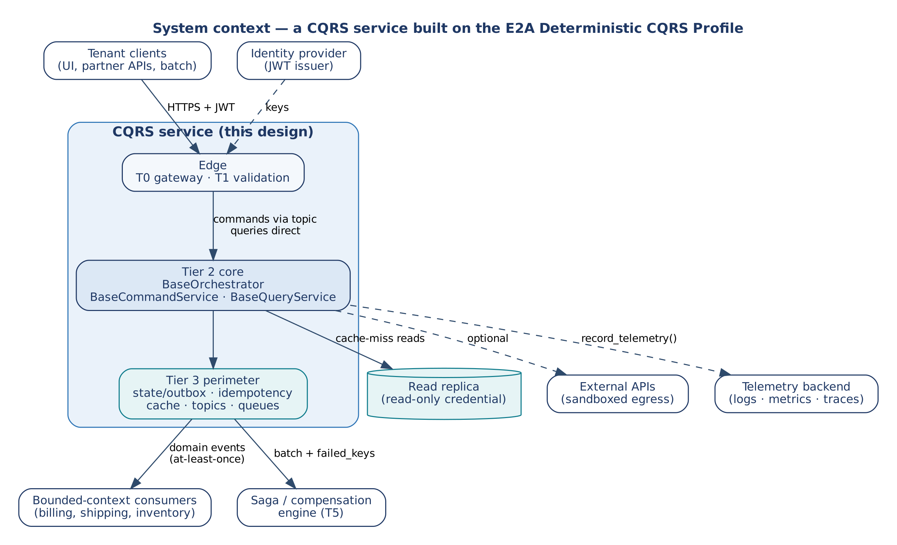

*Figure 1 — System context of a service built on the CQRS profile*

### 5.2 Zones and tiers

The profile reuses the three network zones and six compute tiers of the agentic landing zone. Tier numbers are load-bearing identifiers shared across all E2A HLDs and LLDs; the agentic Tier 2b inference gateway is simply not provisioned.

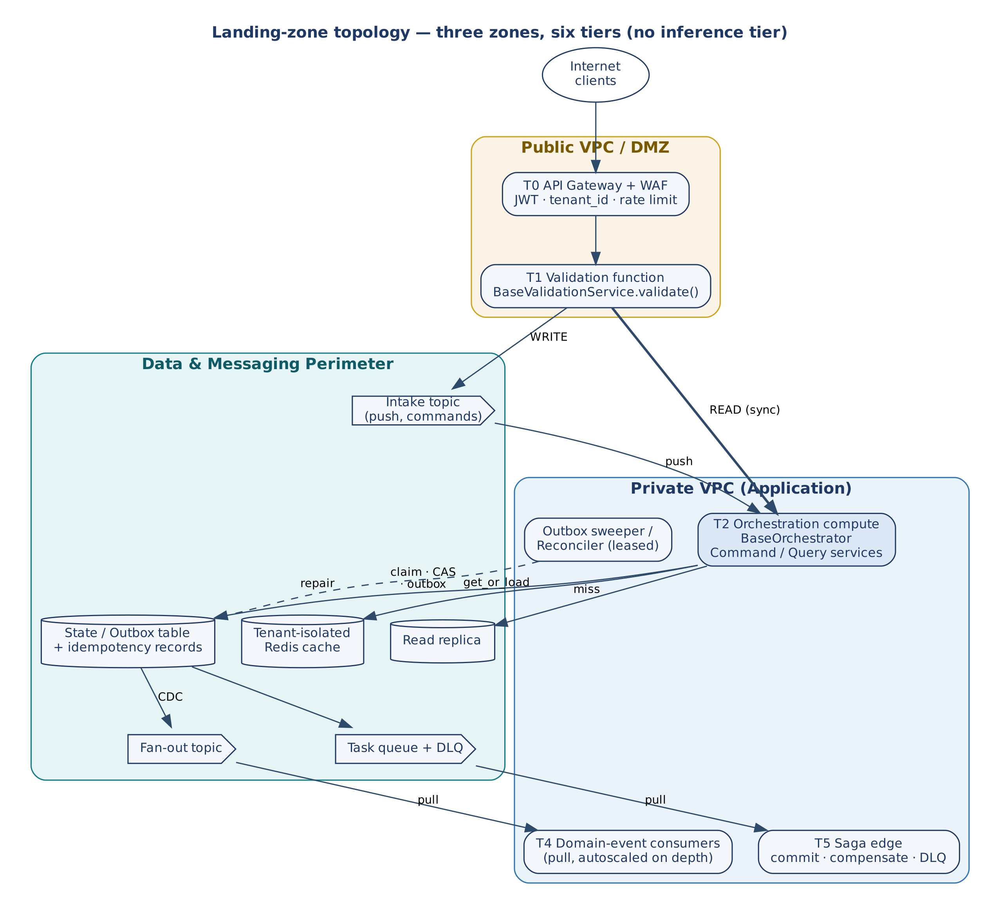

*Figure 2 — Landing-zone topology: three zones, six tiers, command and query paths*

**Table 8 — Zones and trust boundaries**

| Zone | Contains | Trust boundary |
|---|---|---|
| Public VPC / DMZ | T0 API gateway and WAF; T1 validation function | Only zone with an internet route. No tenant data at rest, no business logic. |
| Data & Messaging Perimeter | T3 intake topic, state/outbox and idempotency table, tenant-isolated cache, read replica, fan-out topic, task queue and DLQ | No route from the DMZ or the internet; private connectivity only. |
| Private VPC (Application) | T2 orchestration compute; T4 domain-event consumers; T5 Saga edge; leased sweeper and reconciler jobs | No inbound internet route; invoked by push (T2) or pull (T4, T5). |

**Table 9 — Tier responsibilities**

| Tier | Component | Responsibility |
|---|---|---|
| T0 | API gateway + WAF | JWT verification, route inspection, rate limiting; extracts the verified `tenant_id`. |
| T1 | Validation function | `BaseValidationService.validate()`: schema and business rules, intent classification, `correlation_id` origination. Writes go to the intake topic (202 Accepted); reads invoke T2 synchronously. |
| T2 | Orchestration compute | `BaseOrchestrator`, `BaseCommandService`, `BaseQueryService`; governance inline; telemetry and DLQ hand-off in `finally`. |
| T3 | Data & messaging | Intake topic, state/outbox and idempotency records, tenant cache, read replica, fan-out topic, task queue, DLQ. |
| T4 | Domain-event consumers | Pull-based, per-bounded-context, autoscaled on queue depth; apply events through their own idempotency claim. |
| T5 | Saga edge | Command path only: commit a clean batch, or isolate, compensate and dead-letter failed items. |

### 5.3 Structural isomorphism

Each LLD class has exactly one home in the HLD. This is what lets a reviewer read a security zone, a scaling unit or an on-call boundary straight off the class diagram.

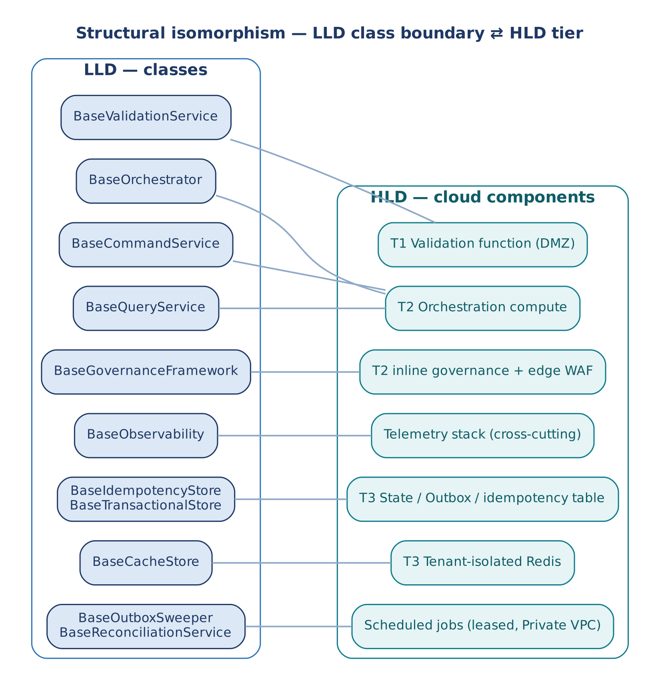

*Figure 3 — Class-to-tier mapping*

### 5.4 Request paths at a glance

**Command (write) path.** T0/T1 validate and return 202 → intake topic pushes to T2 → atomic claim → governance gate → `mutate()` (DTO, commit gate, deadline, business logic, conditional commit, outbox, cache sync) → claim settled, telemetry shipped → CDC fans the event out to T4 → task queue feeds T5.

**Query (read) path.** T0/T1 validate → synchronous invoke of T2 (no topic hop, no claim) → governance gate → `fetch()` → cache hit returns immediately; a miss performs one single-flight read against the read replica and hydrates the cache.

### 5.5 Capacity, ordering and consistency per boundary

**Table 10 — Capacity, ordering and consistency**

| Component | Capacity bound | Ordering | Consistency |
|---|---|---|---|
| Command admission (T2) | Claim costs one store round trip; `db_pool_size` bounds concurrent commits; `deadline` bounds every wait | None across commands | Strong: one winner per key, one writer per aggregate version |
| State/outbox + idempotency store | `replicas × db_pool_size` below the database connection limit | Per aggregate via version | Strong for claim and conditional commit (single item / partition) |
| Query path (T2) | Separate read pool so reads never starve commands | None | Eventual via cache-aside; read-after-own-write via `_synchronize_cache()` |
| Tenant cache | Distinct keys × value size × TTL (single-flight collapses misses) | None | Advisory; expiry is an explicit field, provider TTL is GC only |
| Read replica | Read pool separate from write pool | None | Stale by replication lag + cache TTL |
| Intake topic | Durable backlog; DLQ after max receives | Not needed — claim absorbs duplicates | At-least-once |
| Fan-out topic / queues | Depth drives consumer scale-out | Per partition (tenant + aggregate) | At-least-once; consumers apply through a claim |
| T4 consumers | `worker_concurrency` ≤ `db_pool_size`; `worker_prefetch` ≥ `worker_concurrency` | Per partition | Effectively-once material effects |
| Sweeper / reconciler | One leader by lease; renew < TTL; fencing token on publish | None | Stale leaders rejected downstream |

### 5.6 Vendor mapping

**Table 11 — Generic component to cloud service**

| Generic component | AWS | GCP | Azure |
|---|---|---|---|
| API gateway / WAF | API Gateway + WAF | API Gateway / Cloud Endpoints | API Management |
| Validation function | Lambda | Cloud Run functions | Azure Functions |
| Orchestration compute | ECS Fargate / EKS | Cloud Run | Container Apps |
| Intake topic (push) | SNS → Fargate | Pub/Sub push subscription | Service Bus topic |
| Fan-out consumers | SNS → SQS queues | Pub/Sub subscriptions | Service Bus subscriptions |
| State / outbox / idempotency | DynamoDB (conditional writes) | Firestore / Cloud SQL (preconditions) | Cosmos DB (ETag `If-Match`) |
| Tenant cache | ElastiCache (Redis) | Memorystore (Redis) | Azure Cache for Redis |
| Read replica | RDS read replica | Cloud SQL read replica | Azure SQL read replica |
| Task queue + DLQ | SQS FIFO + DLQ | Pub/Sub pull + DLQ | Service Bus queue + DLQ |
| Saga processor | Step Functions | Workflows | Logic Apps |
| Partition ordering | SQS FIFO message group | Pub/Sub ordering key | Service Bus session |
| Lease store / scheduler | Versioned item + EventBridge Scheduler | Versioned document + Cloud Scheduler | Blob lease + Container Apps job |
| Observability | CloudWatch + X-Ray | Cloud Monitoring + Cloud Trace | Azure Monitor + App Insights |

### 5.7 End-to-end command sequence

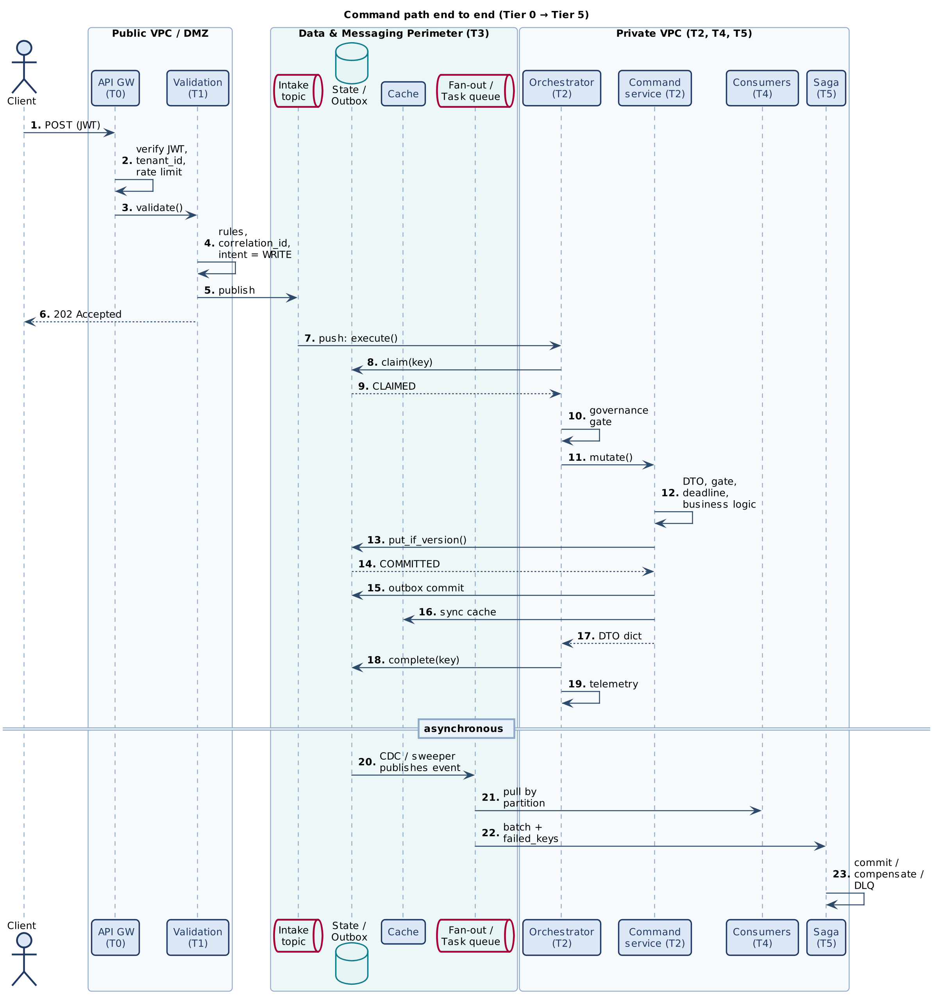

*Figure 4 — Command path end to end, Tier 0 to Tier 5*

## 6. Data and Propagation Contracts

### 6.1 Cross-class propagation fields

Six fields are shared with every E2A profile; three are additive for concurrency. None is ever stored on `self`.

**Table 12 — Propagation fields**

| Field | Dir. | Origin | Purpose |
|---|---|---|---|
| `correlation_id` | In | `BaseValidationService.validate()`; `execute()` mints one if absent | Joins every log, metric and trace of one logical transaction; also the claim `owner`. |
| `tenant_id` | In | Verified JWT claim at T0; required in `state` | Cache-key namespace, idempotency scope, data partition / silo routing. |
| `idempotency_key` | In | Client key, else `_generate_idempotency_key()` | Claim key on the command path; appended to `failed_keys` on failure. |
| `io_config` | In | `_resolve_io_config()` — config entries with the `io_` prefix | Endpoint and quota configuration kept apart from behavioural config. |
| `message_log` | Out | Empty list per request | Ordered structured events; shipped once to observability. |
| `failed_keys` | Out | Empty list per request | Command-path failures for the DLQ and Saga; never forwarded from reads. |
| `deadline` | In | Inbound `Deadline` / remaining ms, else `request_deadline_seconds` | Bounds every wait; travels as remaining milliseconds across processes (`x-e2a-deadline-ms`). |
| `expected_version` | In | Caller (kwargs or `state`) | Advisory fast-fail in `_commit_gate()`; authoritative in `put_if_version`. |
| `fencing_token` | In | Caller holding a lease | Lets the store reject a superseded writer (`FENCED`). |

Inside `execute()` these are bundled into a `common` dict and passed as keyword arguments to the governance gate and to `mutate()` / `fetch()`.

### 6.2 Request state keys

`state` is a plain dict. The base classes read and write the following keys; everything else belongs to the concrete subclass and its DTOs.

**Table 13 — State keys read or written by the base classes**

| Key | R/W | Meaning |
|---|---|---|
| `tenant_id` | R | Mandatory; `ValueError` if missing. |
| `correlation_id`, `idempotency_key` | R | Optional caller-supplied values (kwargs win). |
| `action` / `resource` | R | Passed to `_get_command_service()` / `_get_query_service()` for routing. |
| `expected_version`, `fencing_token` | R | OCC and lease evidence, copied into `common` if present. |
| `requires_manual_approval`, `approval_granted` | R | Trigger dehydration in the governance gate. |
| `pending_external_call` | R | Triggers `_verify_sandbox_profile()`. |
| `cumulative_requests_in_window` | R | Current tenant usage compared against `io_config['max_requests_per_window']`. |
| `outcome` | R | A `PhysicalOutcome`; `UNKNOWN` parks the claim. |
| `result` | R | Included in the replayable result. |
| `status` | W | Terminal status (Table 14). |
| `conflict`, `idempotency_status`, `replayed` | W | Conflict detail, raw claim status, replay marker. |
| `message_log`, `failed_keys` | W | Always written back on exit (except short-circuit, which writes an empty `failed_keys`). |

> **Note — the state is replaced by the DTO.** On the normal path `execute()` assigns `state = service.mutate(...)` (or `fetch(...)`), so the returned dict is the service's output DTO plus `message_log` and `failed_keys`. An output DTO that should replay meaningfully must expose `result` and/or `outcome` fields, because `_replayable_result()` keeps only those two keys.

### 6.3 Status vocabulary

**Table 14 — Values of `state['status']` set by the base classes**

| Status | Set when | Caller action |
|---|---|---|
| *(service-defined)* | Normal completion; the DTO decides | Use the result. |
| `blocked` | `_commit_gate()` rejected the key (output DTO with `reason='commit_gate_rejection'`) | Investigate the batch / version. |
| `REPLAYED` | Claim returned `REPLAY` | Use the stored result; the effect already happened. |
| `IN_PROGRESS` | Another owner holds an unexpired claim | Retry later. |
| `CONFLICT` | Fingerprint mismatch on claim, or `ConcurrencyConflict` from the store | Reload, re-evaluate, resubmit (new key for a new payload). |
| `RECOVERY_REQUIRED` | Prior owner's lease expired or outcome `UNKNOWN` | Wait for the reconciler. |
| `FAILED_FINAL` | A deterministic failure is on record | Submit a corrected request with a new key. |
| `AWAITING_WEBHOOK` | `DehydrationInterrupt` | Resume after approval webhook. |

### 6.4 Configuration keys

All keys resolve through `resolve_config(key, config, kwargs, scope=None)` from the central registry (`e2a/config.py`, re-exported by `e2a_base`). This profile adds no keys of its own; its one profile-specific default is `max_latency` = 1.0 s under scope `CQRS`.

**Table 15 — Configuration consumed by the CQRS path**

| Key | Default | Used by |
|---|---|---|
| `observability_engine` | — | `execute()` `finally`; absent → local structured logging. |
| `governance_engine` | — | `execute()`; absent → gate skipped (fail-open — bind in production). |
| `idempotency_store` | — | `execute()` claim; absent → no claim (bind in production). |
| `transactional_store` | — | `_commit_versioned()`; absent or no `_entity_key()` → no OCC. |
| `cache_store` | — | `fetch()` single-flight; absent → `_read_from_cache()` / `_write_to_cache()` hooks. |
| `io_config_prefix` | `io_` | `_resolve_io_config()`. |
| `commit_gate_enabled` | `True` | `_commit_gate()` (CQRS mixin reads kwargs/config only — see Section 15). |
| `dlq_queue_url` | none | `_send_to_dlq()`. |
| `strict_mode` | `True` | `validate()`: no validator registered → invalid. |
| `max_latency` | 1.0 s (scope CQRS) | Latency SLO at the end of `mutate()` and `fetch()`. |
| `request_deadline_seconds` | 0 (none) | Origin of `deadline`. |
| `idempotency_lease_seconds` | 300 | `IN_PROGRESS` claim expiry. |
| `idempotency_ttl_seconds` | 86 400 | Retention of settled keys for replay (GC only). |
| `cache_fill_timeout_seconds` | 5.0 | Follower wait in `get_or_load()`. |
| `cache_fill_on_timeout` | `load` | Follower policy: `load`, `stale` or `raise`. |
| `db_pool_size`, `worker_concurrency`, `worker_prefetch`, `drain_timeout_seconds` | 20, 8, 16, 20.0 | Capacity gate (`validate_capacity()`) and consumer runtime. |
| `lease_ttl_seconds`, `lease_renew_interval_seconds` | 60, 20 | Sweeper and reconciler leases. |

## 7. Low-Level Design — Class Model

### 7.1 Module structure

**Table 16 — Modules**

| Module | Contents |
|---|---|
| `reference/e2a_cqrs_base.py` | `DehydrationInterrupt`, `NFRViolationError`, `_PropagationMixin`, `BaseObservability`, `BaseGovernanceFramework`, `ValidationResult`, `BaseValidationService`, `BaseOrchestrator`, `BaseCommandService`, `BaseQueryService`. "Drop into `src/`, import and subclass — never modify." |
| `reference/e2a_base.py` (imported) | `resolve_config`, `Deadline`, `ClaimStatus`, `ClaimResult`, `CommitResult`, `PhysicalOutcome`, `ConcurrencyConflict`, `DeadlineExceeded`, `AdmissionTimeout`, `_DETERMINISTIC_ERRORS`, `BaseIdempotencyStore`, `BaseTransactionalStore`, `BaseCacheStore`; also the repair classes `BaseDistributedLock`, `BaseOutboxSweeper`, `BaseReconciliationService`. |
| `reference/e2a_inmemory_adapters.py` | Test doubles: `InMemoryIdempotencyStore`, `InMemoryTransactionalStore`, `InMemoryCacheStore`, `InMemoryLease`. |
| `src/…` (project) | Concrete orchestrator, command and query services, validators, governance and observability engines, store adapters. |

### 7.2 Class catalogue

**Table 17 — Classes in scope**

| Class | Module | Status | Role |
|---|---|---|---|
| `BaseOrchestrator` | cqrs | Implemented (ABC) | Tier 2 single entry point; admission, routing, settlement. |
| `BaseCommandService` | cqrs | Implemented (ABC) | Write path: DTO, gate, logic, conditional commit, outbox, cache sync, SLO. |
| `BaseQueryService` | cqrs | Implemented (ABC) | Read path: cache-aside with single-flight, SLO. |
| `_PropagationMixin` | cqrs | Implemented | Shared helpers: io_config, log, DLQ, commit gate. |
| `BaseValidationService` | cqrs | Implemented (ABC) | Tier 1 validator registry and result builder. |
| `ValidationResult` | cqrs | Implemented | HTTP-400-serialisable dict. |
| `BaseGovernanceFramework` | cqrs | Implemented (ABC) | Quota, dehydration, sandbox, firewall; CQRS-adapted. |
| `BaseObservability` | cqrs | Implemented (ABC) | Enrich, derive metrics, ship logs/metrics/traces. |
| `DehydrationInterrupt`, `NFRViolationError` | cqrs | Implemented | Signal and NFR-breach exceptions (CQRS-local definitions). |
| `Deadline`, `ClaimStatus`, `ClaimResult`, `CommitResult`, `PhysicalOutcome` | base | Implemented | Shared concurrency value types. |
| `BaseIdempotencyStore`, `BaseTransactionalStore`, `BaseCacheStore` | base | Implemented (ABC ports) | Claim, conditional commit, cache with single-flight. |
| `ConcurrencyConflict`, `DeadlineExceeded`, `AdmissionTimeout` | base | Implemented | Typed concurrency outcomes. |
| `BaseOutboxSweeper`, `BaseReconciliationService`, `BaseDistributedLock` | base | Implemented (ABC) | Scheduled repair under a lease (Section 11). |
| Tier 4 consumer | — | Runtime obligation | Partitioned handler loop (Section 11.1). |

### 7.3 Orchestration layer

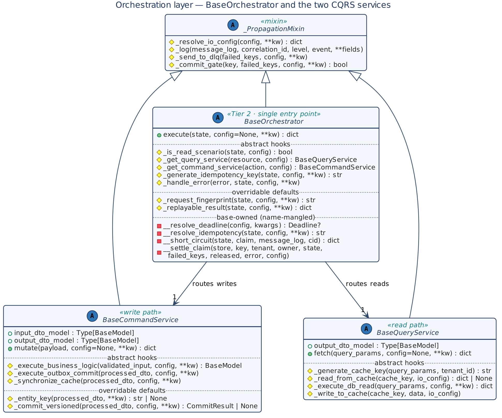

*Figure 5 — Orchestration layer: BaseOrchestrator, BaseCommandService and BaseQueryService*

UML notation: `+` public, `#` protected hook, `-` name-mangled base-owned step; *italic* members are abstract.

### 7.4 Cross-cutting classes

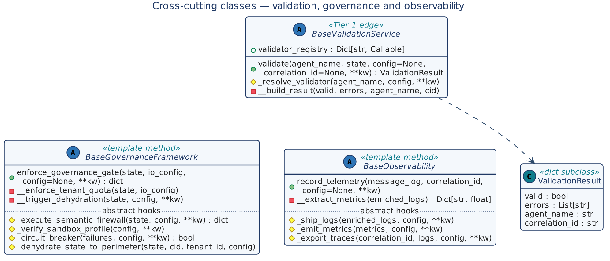

*Figure 6 — Validation, governance and observability*

### 7.5 Collaborations and injected ports

All collaborators except the two services are injected through `config`, never constructed by the base classes. This keeps the scaffold vendor-neutral and lets tests bind in-memory doubles.

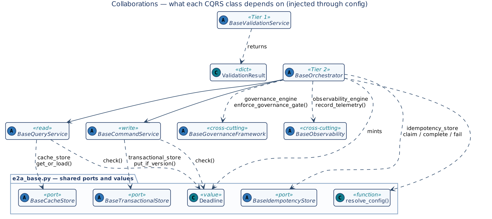

*Figure 7 — Collaborations injected through config*

### 7.6 Shared contracts imported from e2a_base.py

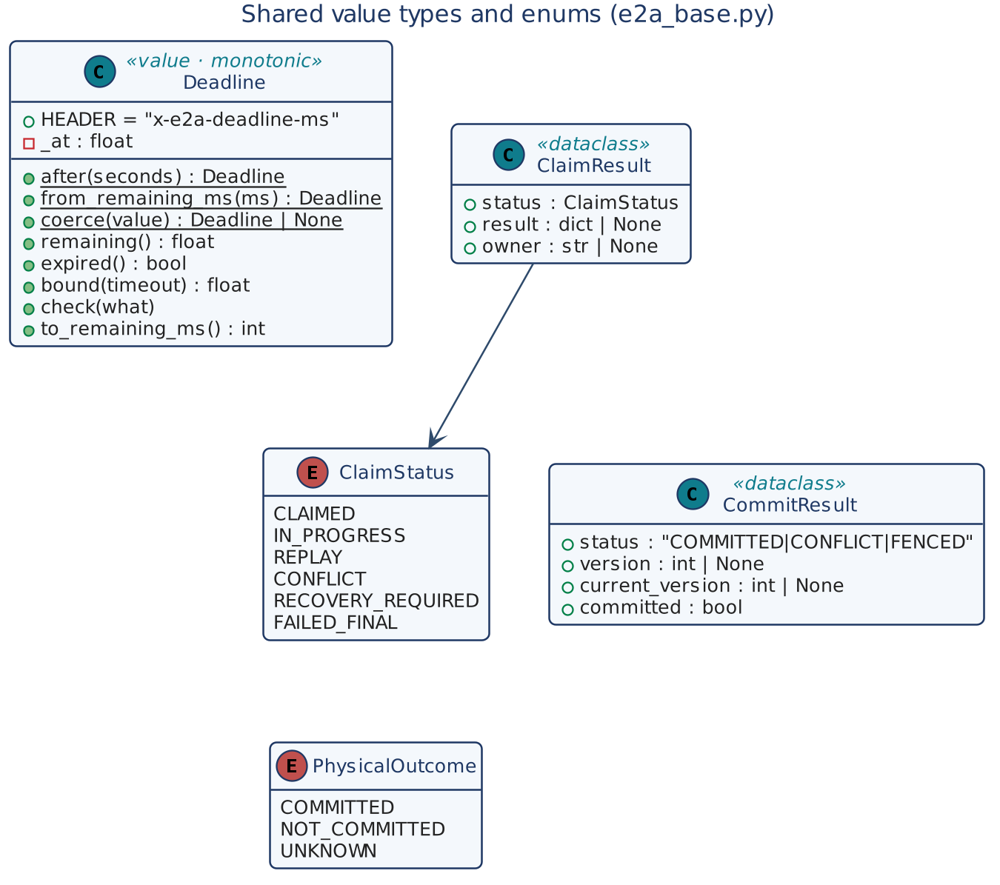

*Figure 8 — Shared value types and enums*

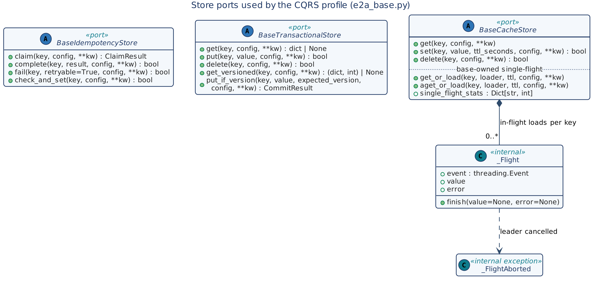

*Figure 9 — Store ports used by the CQRS profile*

### 7.7 Exception taxonomy

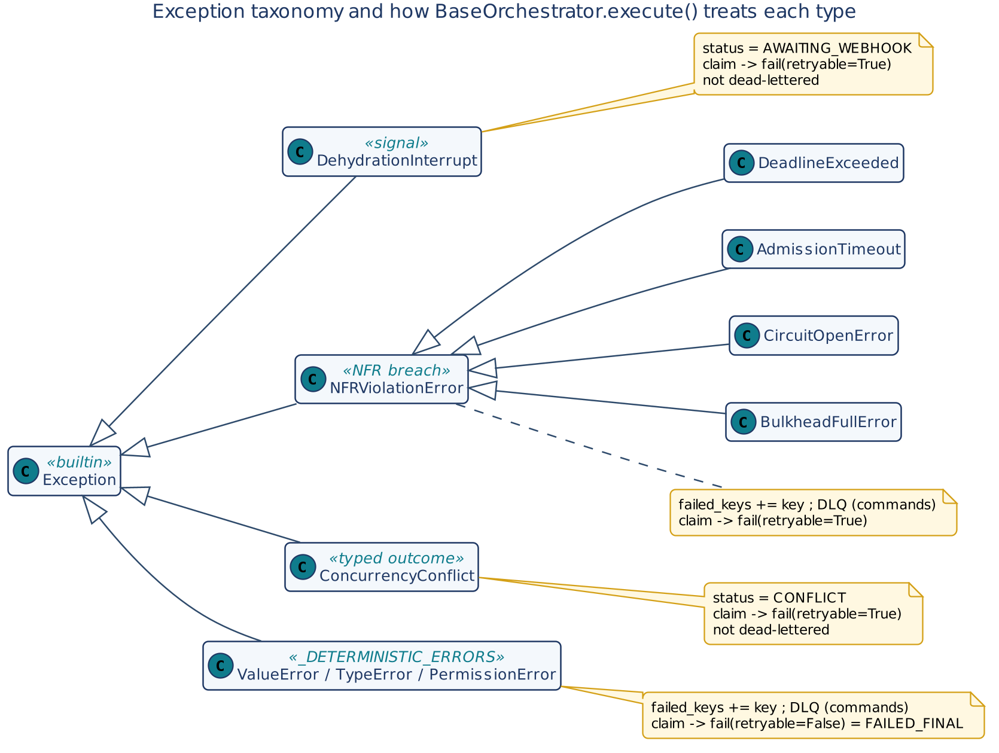

*Figure 10 — Exception taxonomy and orchestrator handling*

## 8. Low-Level Design — Class Contracts

Each contract card lists the class's purpose, its collaborators and invariants, followed by a method table. *Kind* is one of: **entry** (the single public method), **template** (base-owned step), **hook** (abstract, must be implemented), **default** (protected, may be overridden), **helper** (inherited utility).

### 8.1 BaseOrchestrator

| Aspect | Detail |
|---|---|
| Stereotype | Abstract base class; Tier 2 lifecycle manager; replaces `BaseWorkflow` |
| Inherits | `ABC`, `_PropagationMixin` |
| Responsibility | Resolve propagation fields; claim the idempotency key for commands; run governance; route to a command or query service; translate exceptions into statuses; settle the claim; ship telemetry; dead-letter command failures. |
| Collaborators | `BaseIdempotencyStore`, `BaseGovernanceFramework`, `BaseObservability` (all via `config`); `BaseCommandService` / `BaseQueryService` (via hooks); `Deadline`; `resolve_config` |
| Thread safety | Stateless between requests; all request data are locals or arguments. One instance may serve concurrent requests. |
| Invariants | INV-01 to INV-09 |

**Table 18 — BaseOrchestrator methods**

| Method | Kind | Signature → returns | Contract |
|---|---|---|---|
| `execute` | entry | `(state: dict, config: dict = None, **kwargs) → dict` | **Pre:** `state['tenant_id']` present, else `ValueError`. **Steps:** resolve `correlation_id` (kwargs › state › uuid4), `io_config`, `deadline`, `idempotency_key`; classify read/write; for commands with an idempotency store, `claim()` and short-circuit unless `CLAIMED`; governance gate; route; map exceptions (Table 25); in `finally` ship telemetry, settle the claim, dead-letter command failures, write back `message_log` / `failed_keys`. **Never raises** for service errors — they are converted to state and passed to `_handle_error()`. |
| `_is_read_scenario` | hook | `(state, config) → bool` | Return `True` for queries. Must be pure and cheap; drives claim, routing and DLQ policy. |
| `_get_query_service` | hook | `(resource: str, config) → BaseQueryService` | Resolve the read service for `state['resource']`. May return a shared instance. |
| `_get_command_service` | hook | `(action: str, config) → BaseCommandService` | Resolve the write service for `state['action']`. |
| `_generate_idempotency_key` | hook | `(state, config, **kwargs) → str` | Mint a deterministic key from business content when the client supplied none. Must be stable across redeliveries of the same request. |
| `_handle_error` | hook | `(error, state, config, **kwargs) → None` | Map a failure to a caller-visible error shape (for example HTTP status). Called after `failed_keys` is appended; must not raise. |
| `_request_fingerprint` | default | `(state, config=None, **kwargs) → str` | SHA-256 of `state` minus volatile keys (`correlation_id`, `idempotency_key`, `message_log`, `failed_keys`, `deadline`, `status`, `result`, `outcome`, `conflict`), JSON with sorted keys. Override to fingerprint a canonical DTO instead. |
| `_replayable_result` | default | `(state, config=None, **kwargs) → dict` | Subset of `state` stored on `complete()` and returned on `REPLAY`: keys `result` and `outcome`. Must be post-redaction. |
| `__resolve_deadline` | template | `(config, kwargs) → Deadline \| None` | Pops `deadline` from kwargs and coerces it; else `Deadline.after(request_deadline_seconds)` when > 0; else `None`. |
| `__resolve_idempotency` | template | `(state, config=None, **kwargs) → str` | Client key (kwargs › state) wins; else `_generate_idempotency_key()`. Derives the key only — ownership is the claim. |
| `__short_circuit` | template | `(state, claim, message_log, correlation_id) → dict` | Map claim status to `state['status']` (Table 14), copy `result`/`outcome` on `REPLAY`, log `idempotent_short_circuit`, return with empty `failed_keys`. No service, governance or telemetry call. |
| `__settle_claim` | template | `(store, key, tenant_id, owner, state, failed_keys, released, error, config) → None` | Exactly one of `complete()` / `fail()` per owned claim (Figure 15). |

### 8.2 BaseCommandService

| Aspect | Detail |
|---|---|
| Stereotype | Abstract base class; Tier 2 write path; with `BaseQueryService`, replaces `BaseAgent` |
| Inherits | `ABC`, `_PropagationMixin` |
| Class attributes | `input_dto_model: Type[BaseModel]`, `output_dto_model: Type[BaseModel]` (pydantic) |
| Responsibility | Validate the payload into a typed DTO; apply the advisory commit gate; check the deadline; run business logic; commit the aggregate conditionally; write the outbox; synchronise the cache; enforce the latency SLO. |
| Collaborators | `BaseTransactionalStore` (`config['transactional_store']`), `Deadline`, `resolve_config` |
| Ordering guarantee | logic → conditional commit → outbox → cache sync → SLO check (INV-05, INV-12) |

**Table 19 — BaseCommandService methods**

| Method | Kind | Signature → returns | Contract |
|---|---|---|---|
| `mutate` | entry | `(payload: dict, config: dict = None, **kwargs) → dict` | Pops `failed_keys` from kwargs. `input_dto_model(**payload)`; pydantic `ValidationError` → logs `dto_validation_failed` and raises `ValueError` (deterministic). If a key exists and `_commit_gate()` rejects → returns `output_dto_model(status='blocked', reason='commit_gate_rejection').dict()`. `deadline.check()` → `DeadlineExceeded`. Then the fixed write order. Measures latency; > `max_latency` (scope CQRS) → `NFRViolationError`. Returns `processed_dto.dict()`. |
| `_execute_business_logic` | hook | `(validated_input: BaseModel, config, **kwargs) → BaseModel` | Pure domain decision producing the output DTO. No I/O to the outbox or cache. May set `outcome` on the DTO for external side effects. |
| `_entity_key` | default | `(processed_dto, **kwargs) → str \| None` | Durable aggregate key. `None` (default) opts out of OCC. Return e.g. `f"{tenant}:order:{id}"` to opt in. |
| `_commit_versioned` | default | `(processed_dto, config, **kwargs) → CommitResult \| None` | With an entity key and a bound `BaseTransactionalStore`: `put_if_version(key, dto.dict(), expected_version, config, fencing_token=…)`. `CONFLICT` / `FENCED` → `ConcurrencyConflict`. Override to commit aggregate and outbox in one store transaction. |
| `_execute_outbox_commit` | hook | `(processed_dto, config, **kwargs) → None` | Write the domain event to the outbox in the same local transaction scope as the state change. Must not publish to Tier 4 itself — CDC / sweeper owns that hop. Should be idempotent if not transactional with the aggregate. |
| `_synchronize_cache` | hook | `(processed_dto, config, **kwargs) → None` | Evict or hydrate the affected tenant-scoped cache key synchronously, before `mutate()` returns (read-after-write). |
| `_commit_gate` | helper | `(key, failed_keys, config, **kwargs) → bool` | From the mixin: blocks keys already in `failed_keys`; advisory OCC check against `actual_version_lookup` when `expected_version` is supplied; disabled by `commit_gate_enabled=False`. |

### 8.3 BaseQueryService

| Aspect | Detail |
|---|---|
| Stereotype | Abstract base class; Tier 2 read path (Tier 3 cache-aside) |
| Inherits | `ABC`, `_PropagationMixin` |
| Class attributes | `output_dto_model: Type[BaseModel]` |
| Responsibility | Check the deadline; build a tenant-scoped cache key; serve from cache or perform one single-flight database read; enforce the latency SLO; marshal into the output DTO. |
| Collaborators | `BaseCacheStore` (`config['cache_store']`), read replica (via hook), `Deadline` |
| Side effects | None on the system of record. Never claims a key, never dead-letters. |

**Table 20 — BaseQueryService methods**

| Method | Kind | Signature → returns | Contract |
|---|---|---|---|
| `fetch` | entry | `(query_params: dict, config: dict = None, **kwargs) → dict` | `deadline.check()`; `cache_key = _generate_cache_key(params, tenant_id)`. **With `cache_store`:** `get_or_load(cache_key, _load, None, config, deadline=deadline)` where `_load` logs `query_cache_miss` and calls `_execute_db_read()`; a hit logs `query_cache_hit` and returns immediately. **Without:** `_read_from_cache()` → hit returns; miss → `_execute_db_read()` → `_write_to_cache()` if data. Then SLO check (`NFRViolationError`), log `query_fetch_complete`, return `output_dto_model(**db_data).dict()`. |
| `_generate_cache_key` | hook | `(query_params: dict, tenant_id: str) → str` | Must include `tenant_id` (INV-11), e.g. `TENANT:acme:ORDER:123`. Deterministic for equal params. |
| `_read_from_cache` | hook | `(cache_key, io_config) → dict \| None` | Fallback cache read when no `cache_store` is bound; also the place for a custom stampede guard. |
| `_execute_db_read` | hook | `(query_params, config, **kwargs) → dict` | Read through the read-only replica credential, so a write attempt fails at the driver. Should return a dict compatible with `output_dto_model` (see Section 15 on empty results). |
| `_write_to_cache` | hook | `(cache_key, data, io_config) → None` | Fallback cache hydrate; unused when `cache_store` is bound (`get_or_load` sets the value). |

### 8.4 _PropagationMixin

| Aspect | Detail |
|---|---|
| Stereotype | Mixin of base-owned helpers; identical in intent to the agentic mixin (CQRS-local copy) |
| Used by | `BaseOrchestrator`, `BaseCommandService`, `BaseQueryService`, `BaseValidationService` |

**Table 21 — _PropagationMixin methods**

| Method | Signature → returns | Contract |
|---|---|---|
| `_resolve_io_config` | `(config=None, **kwargs) → dict` | Entries of `config` whose key starts with `io_config_prefix` (default `io_`). |
| `_log` | `(message_log, correlation_id, level, event, **fields) → None` | Append `{timestamp, correlation_id, level, event, class, **fields}`; no-op when `message_log is None`. |
| `_send_to_dlq` | `(failed_keys, config=None, **kwargs) → None` | Resolve `dlq_queue_url`; scaffold logs a warning — a concrete runtime binds the queue client. |
| `_commit_gate` | `(key, failed_keys, config=None, **kwargs) → bool` | `False` if the key is already failed in this batch, or if `expected_version` differs from `actual_version_lookup(key, config)`; `True` when disabled. Advisory only. |

### 8.5 BaseGovernanceFramework (CQRS-adapted)

| Aspect | Detail |
|---|---|
| Stereotype | Abstract base class; template method; injected as `config['governance_engine']` |
| Runs | Inside `execute()` after the claim and before routing, identically for commands and queries |
| Adaptation | Tenant request quota replaces LLM token budget; external-API isolation replaces MCP tool sandboxing; dehydration unchanged |

**Table 22 — BaseGovernanceFramework methods**

| Method | Kind | Signature → returns | Contract |
|---|---|---|---|
| `enforce_governance_gate` | entry | `(state, io_config, config=None, **kwargs) → dict` | Order: quota → dehydration (if `requires_manual_approval` and not `approval_granted`) → sandbox check (if `pending_external_call`) → semantic firewall. Returns the sanitised state. |
| `__enforce_tenant_quota` | template | `(state, io_config) → None` | `state['cumulative_requests_in_window'] ≥ io_config['max_requests_per_window']` → `NFRViolationError`. |
| `__trigger_dehydration` | template | `(state, config, **kwargs) → None` | Calls `_dehydrate_state_to_perimeter()` then raises `DehydrationInterrupt`. |
| `_execute_semantic_firewall` | hook | `(state, config, **kwargs) → dict` | Detect injection patterns; redact PII before business logic. |
| `_verify_sandbox_profile` | hook | `(config, **kwargs) → None` | Assert the outbound call runs inside an isolated egress / IAM boundary; raise if not. |
| `_circuit_breaker` | hook | `(failures: int, config, **kwargs) → bool` | Trip on repeated downstream failures. Declared but not called by the base gate — call it from service hooks (Section 15). |
| `_dehydrate_state_to_perimeter` | hook | `(state, correlation_id, tenant_id, config) → None` | Persist resumable state to the Tier 3 perimeter before the interrupt. |

### 8.6 BaseObservability (CQRS-adapted)

| Aspect | Detail |
|---|---|
| Stereotype | Abstract base class; template method; injected as `config['observability_engine']`; one instance shared by both paths |
| Runs | In `execute()`'s `finally` for every non-short-circuited request |

**Table 23 — BaseObservability methods**

| Method | Kind | Signature → returns | Contract |
|---|---|---|---|
| `record_telemetry` | entry | `(message_log, correlation_id, config=None, **kwargs) → None` | Enrich each entry with `correlation_id`, `tenant_id`, `host_epoch_ms`, `framework_version='e2a-cqrs-v1.0'`; derive metrics; call the three hooks; on any exception log the error and fall back to local logging. Never raises. |
| `__extract_metrics` | template | `(enriched_logs) → dict` | `command_count`, `query_count`, `cache_hit_count`, `cache_miss_count`, `error_count` derived from event names and `ERROR` level. |
| `_ship_logs` | hook | `(enriched_logs, config, **kwargs)` | Send structured logs to the backend. |
| `_emit_metrics` | hook | `(metrics, config, **kwargs)` | Publish counters. |
| `_export_traces` | hook | `(correlation_id, logs, config, **kwargs)` | Export spans; forward W3C `traceparent` if a trace context is present. |

### 8.7 BaseValidationService and ValidationResult

| Aspect | Detail |
|---|---|
| Stereotype | Abstract base class; Tier 1 edge; reused unmodified from the agentic profile |
| Class attribute | `validator_registry: Dict[str, Callable[[state, config, **kw], (bool, List[str])]]` |
| Profile responsibility | Also classifies intent (read vs write) so T1 can publish commands and invoke queries directly |

**Table 24 — BaseValidationService methods**

| Method | Kind | Signature → returns | Contract |
|---|---|---|---|
| `validate` | entry | `(agent_name, state, config=None, correlation_id=None, **kwargs) → ValidationResult` | Resolve validator; none → invalid in `strict_mode` (default) else valid; run validator → `(valid, errors)`. `correlation_id` from argument › state › uuid4. |
| `_resolve_validator` | default | `(agent_name, config=None, **kwargs)` | Registry lookup; override for dynamic resolution. |
| `__build_result` | template | `(valid, errors, agent_name, correlation_id) → ValidationResult` | Build the dict result. |

`ValidationResult` is a `dict` subclass with keys `valid`, `errors`, `agent_name`, `correlation_id`, directly serialisable as an HTTP 400 body.

### 8.8 Exceptions

**Table 25 — Exceptions and their handling in execute()**

| Exception | Raised by | Handling |
|---|---|---|
| `ValueError` (missing tenant) | `execute()` pre-check | Propagates to the caller (no claim taken). |
| `DehydrationInterrupt` | Governance gate | `status = AWAITING_WEBHOOK`; claim `fail(retryable=True)`; no DLQ. |
| `ConcurrencyConflict` | `_commit_versioned()` | `status = CONFLICT`; `conflict` set; claim `fail(retryable=True)`; no DLQ. |
| `NFRViolationError` (quota, latency) | Governance gate, `mutate()`, `fetch()` | Generic branch: `failed_keys += key`; `_handle_error()`; claim `fail(retryable=True)`; DLQ for commands. |
| `DeadlineExceeded` | `Deadline.check()` | As `NFRViolationError` (subclass). |
| `AdmissionTimeout` | `get_or_load()` follower with policy `raise` | As `NFRViolationError` (query path: no DLQ). |
| `ValueError` / `TypeError` / `PermissionError` | DTO validation, hooks | Generic branch; claim `fail(retryable=False)` → `FAILED_FINAL`; DLQ for commands. |
| Any other `Exception` | Hooks, stores | Generic branch; claim `fail(retryable=True)`; DLQ for commands. |

### 8.9 Shared concurrency contracts (summary)

These are defined in `e2a_base.py` (since v1.2 defined in the `e2a` package and re-exported unchanged by `e2a_base`) and documented in full in the E2A Framework Design Document; the CQRS profile uses them as follows.

**Table 26 — Imported contracts and their use in this profile**

| Contract | Key members | Use in CQRS |
|---|---|---|
| `Deadline` | `after`, `from_remaining_ms`, `coerce`, `remaining`, `expired`, `bound`, `check`, `to_remaining_ms`, `HEADER` | Minted in `execute()`; checked in `mutate()` / `fetch()`; bounds the single-flight follower wait. |
| `BaseIdempotencyStore` | `claim(key, tenant_id, fingerprint, owner, lease_seconds, ttl_seconds, recover)`, `complete(key, result, tenant_id, owner)`, `fail(key, retryable, tenant_id, owner, outcome)` | Command admission and settlement in `execute()`; consumer and reconciler admission. |
| `ClaimResult` / `ClaimStatus` | `status`, `result`, `owner` | Drives `__short_circuit()`. |
| `BaseTransactionalStore` | `get`, `put`, `delete`, `get_versioned`, `put_if_version(key, value, expected_version, fencing_token)` | Authoritative OCC in `_commit_versioned()`. `expected_version=None` means create-if-absent. |
| `CommitResult` | `status` (`COMMITTED`/`CONFLICT`/`FENCED`), `version`, `current_version`, `committed` | Loser detection. |
| `BaseCacheStore` | `get`, `set`, `delete`, `get_or_load`, `aget_or_load`, `single_flight_stats` | Single-flight read path. |
| `PhysicalOutcome` | `COMMITTED`, `NOT_COMMITTED`, `UNKNOWN` | `UNKNOWN` parks the claim. |
| `_DETERMINISTIC_ERRORS` | `(ValueError, TypeError, PermissionError)` | Selects `FAILED_FINAL`. |

## 9. Dynamic Behaviour

### 9.1 Orchestrator admission, routing and settlement

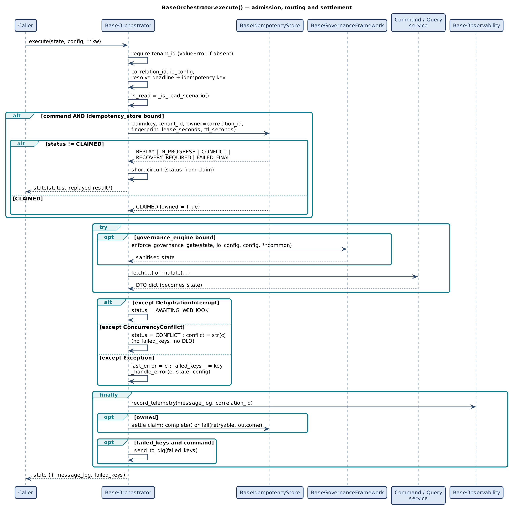

*Figure 11 — BaseOrchestrator.execute(): admission, routing and settlement*

Key points: the claim happens *before* governance, so a duplicate never consumes quota or reaches business logic; the short-circuit returns before the `try` block, so no service, settlement or telemetry call is made for duplicates; everything in `finally` runs even when the service raised.

### 9.2 Command write path internals

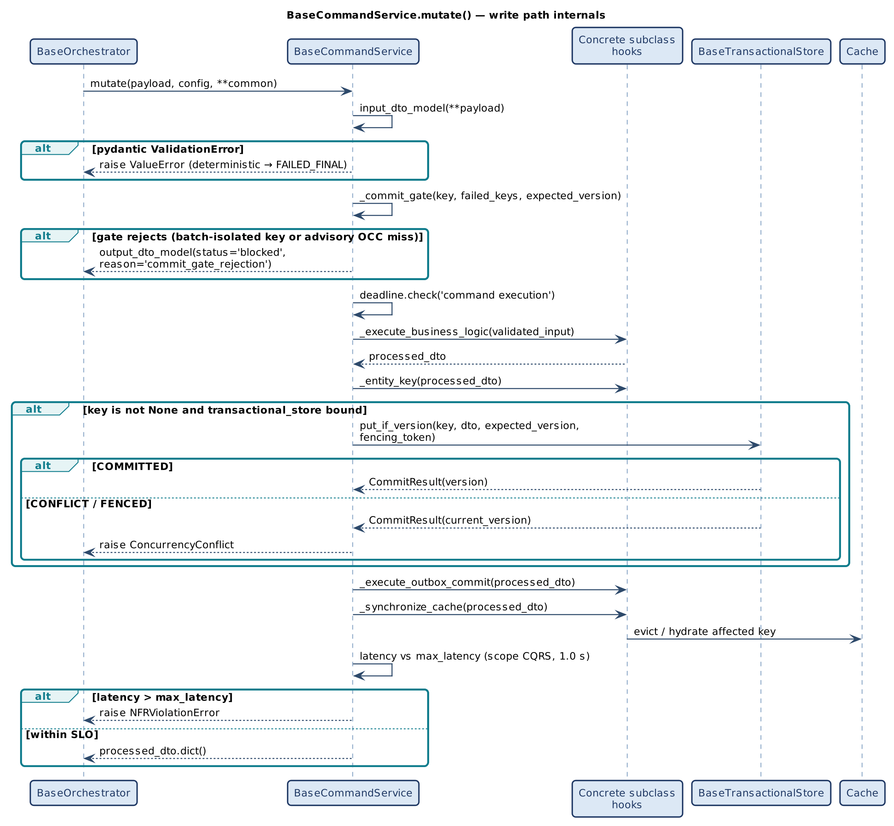

*Figure 12 — BaseCommandService.mutate(): write-path internals*

### 9.3 Query read path with single-flight

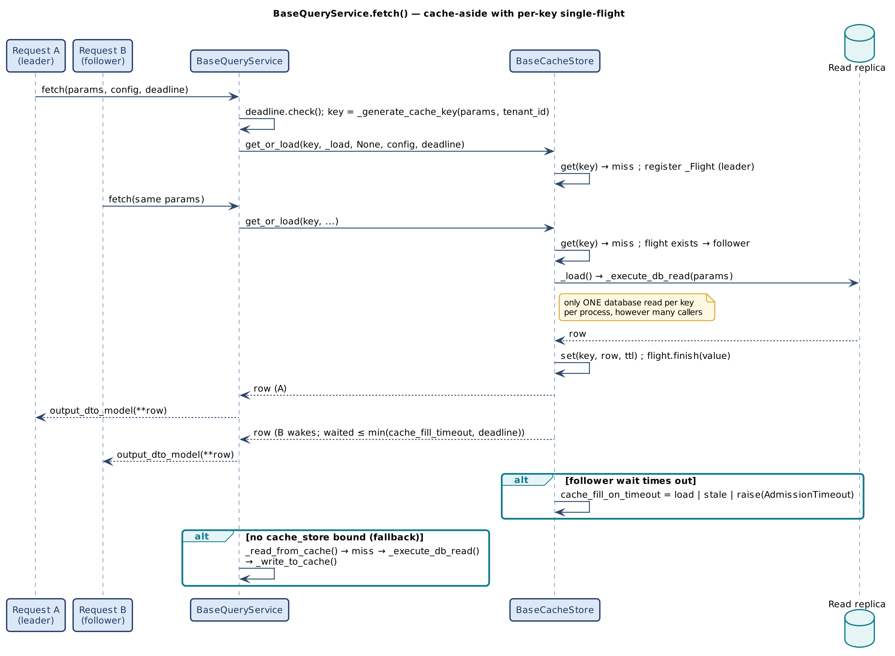

*Figure 13 — BaseQueryService.fetch(): cache-aside with per-key single-flight*

A follower waits at most `min(cache_fill_timeout_seconds, deadline.remaining())` and then applies `cache_fill_on_timeout`: `load` (run its own read — freshest), `stale` (return the last cached value — protects the database) or `raise` (`AdmissionTimeout` — strictest). A loader exception propagates to every waiter and is never cached. If the leader is cancelled, followers receive `_FlightAborted` internally and fall back rather than inheriting the cancellation.

### 9.4 Idempotency record life cycle

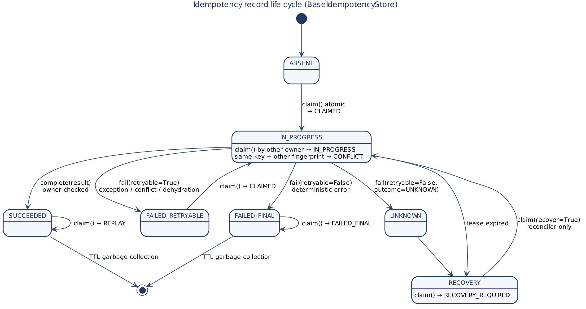

*Figure 14 — Idempotency record life cycle*

**Table 27 — Claim result to caller outcome**

| Claim result | `state['status']` | Caller receives / guidance |
|---|---|---|
| `CLAIMED` | (proceeds) | The command runs. |
| `REPLAY` | `REPLAYED` | Stored `result` / `outcome`, `replayed = True`. Do not retry. |
| `IN_PROGRESS` | `IN_PROGRESS` | No result; retry later. |
| `CONFLICT` | `CONFLICT` | Same key, different payload — a client bug; do not retry unchanged. |
| `RECOVERY_REQUIRED` | `RECOVERY_REQUIRED` | Only the reconciler may take over. |
| `FAILED_FINAL` | `FAILED_FINAL` | A corrected request needs a new key. |

### 9.5 Claim settlement

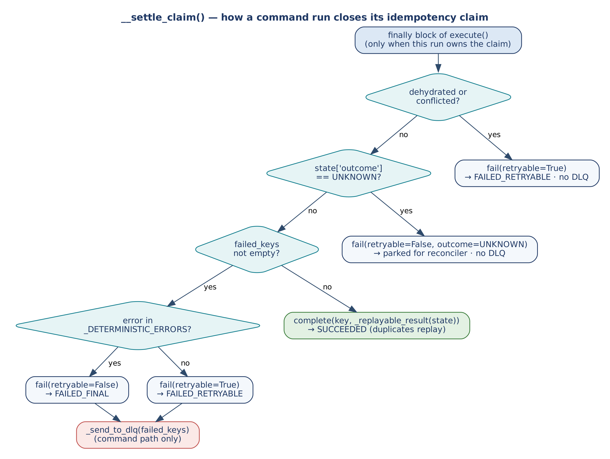

*Figure 15 — __settle_claim(): closing an owned claim*

### 9.6 Saga decision flow

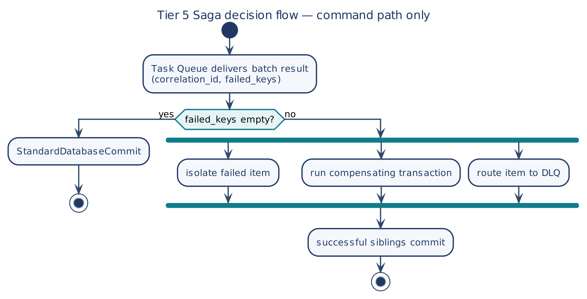

*Figure 16 — Tier 5 Saga decision flow, command path only*

Only the command path populates `failed_keys` destined for Tier 5. A clean batch goes to the standard commit; any failed key sends the batch to a parallel isolate / compensate / dead-letter branch while successful siblings commit.

## 10. Concurrency, Consistency and Failure Model

### 10.1 Ownership of concurrency risks

Each risk has exactly one owner. No global concurrency manager exists, and none should be added.

**Table 28 — Concurrency risk ownership**

| Risk | Owner | Mechanism |
|---|---|---|
| Duplicate command execution | `BaseOrchestrator` + `BaseIdempotencyStore` | Atomic, tenant-scoped claim with fingerprint; replay of stored result. |
| Lost update | `BaseCommandService._commit_versioned` + `BaseTransactionalStore` | `put_if_version` compare-and-set; typed `ConcurrencyConflict`. |
| Stale writer after lease loss | `BaseTransactionalStore` | `fencing_token` → `FENCED`. |
| Cache stampede | `BaseCacheStore.get_or_load` | Per-key single-flight; bounded follower wait. |
| Stale read after own write | `BaseCommandService._synchronize_cache` | Synchronous evict/hydrate inside the command. |
| Unbounded waits | `Deadline` | Checked before work; bounds every wait. |
| Orphaned in-progress work | `idempotency_lease_seconds` + reconciler | Expired lease → `RECOVERY_REQUIRED`; `claim(recover=True)`. |
| Unknown commit | `PhysicalOutcome.UNKNOWN` + reconciler | Park; confirm physical truth; replay `NOT_COMMITTED` once. |
| Pool exhaustion | `validate_capacity()` + config | `worker_concurrency ≤ db_pool_size`; fleet connections below DB limit. |
| Duplicate scheduled jobs | `BaseDistributedLock` | Lease + renew + fencing token. |

### 10.2 Conflict and replay matrix

**Table 29 — Command conflict and replay semantics**

| Situation | Detected by | Outcome | DLQ |
|---|---|---|---|
| Same key, same payload, already succeeded | Claim | `REPLAYED`; nothing re-run | No |
| Same key, same payload, running elsewhere | Claim | `IN_PROGRESS` | No |
| Same key, different payload | Fingerprint | `CONFLICT` | No |
| Two writers, same `expected_version` | `put_if_version` | One commits; loser `CONFLICT`, key `FAILED_RETRYABLE` | No |
| Writer with superseded lease | `put_if_version` + fencing token | `CONFLICT` (`FENCED`) | No |
| Deadline already expired | `Deadline.check()` | Failure | Yes |
| Commit outcome unknown | `state['outcome'] == UNKNOWN` | Parked for reconciliation | No |
| Deterministic error | `_DETERMINISTIC_ERRORS` | `FAILED_FINAL` | Yes |

### 10.3 Consistency model

- **Command side — strong per aggregate.** One winner per idempotency key; one writer per aggregate version. Single-item (or single-partition) scope: an invariant spanning items must be confined to one item or use a store transaction.
- **Query side — eventual, with read-your-writes.** Reads are stale by at most replica lag plus cache TTL, except that `_synchronize_cache()` guarantees a read after a write to the same resource sees the write.
- **Events — at-least-once, effectively-once effects.** Consumers apply through their own claim; ordering is per partition only.
- **Cache — advisory.** Freshness is decided by the value's own expiry field, not by key presence (provider TTL deletion can lag).

### 10.4 Error routing summary

`execute()` handles three exception families separately and treats everything else uniformly. Command-path failures reach the DLQ and the Saga; query-path failures terminate at Tier 2 as an error response. `NFRViolationError` (quota, latency, deadline) is not a special branch — it is an ordinary failure.

## 11. Asynchronous Paths: Consumers and Scheduled Repair

### 11.1 Tier 4 consumer model (runtime obligation)

The scaffold deliberately ships no consumer base class. A domain-event consumer is a thin runtime around existing contracts — `claim`, `complete`, `fail`, `Deadline`, `ResiliencePolicy` — and must meet the obligations below.

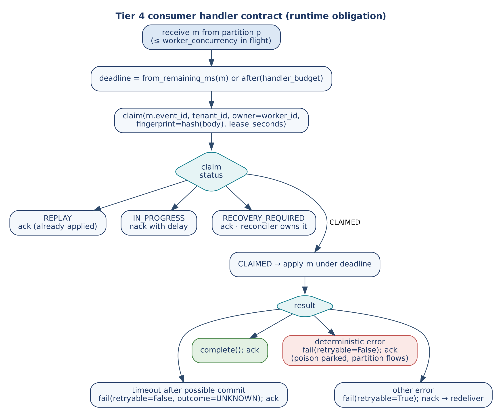

*Figure 17 — Tier 4 consumer handler contract*

- **Ordering.** Partition by `tenant_id` + the aggregate key returned by `_entity_key()`. Never assume order across partitions.
- **Bounded in-flight work.** `worker_concurrency` messages per instance, `worker_prefetch ≥ worker_concurrency`, and `worker_concurrency ≤ db_pool_size`. `validate_capacity()` checks these at start-up.
- **Poison messages.** Settle deterministic failures as `FAILED_FINAL` and acknowledge, so the partition keeps flowing. Broker behaviour differs: SQS FIFO blocks the message group until the message reaches the DLQ; Pub/Sub with ordering redelivers the key's tail; Service Bus dead-letters and moves the session on.
- **Replay.** Redelivery is harmless (`REPLAY`). A dead-lettered message is replayed only by the reconciler, never by hand.
- **Graceful shutdown.** Stop polling, drain for at most `drain_timeout_seconds`, nack the rest. The drain bound must be shorter than the platform's termination grace (about 10 s on Cloud Run, 30 s default on ECS, 30 s on Container Apps).

### 11.2 Outbox sweeper and reconciler

`BaseOutboxSweeper.sweep()` republishes outbox records stuck in `PENDING`; `BaseReconciliationService.reconcile()` repairs parked and dead-lettered keys. Both run on a schedule, each as a single leader holding a lease from `BaseDistributedLock` (`acquire` → `LeaseHandle(owner_token, fencing_token, expires_at)`, `renew`, owner-checked `release`).

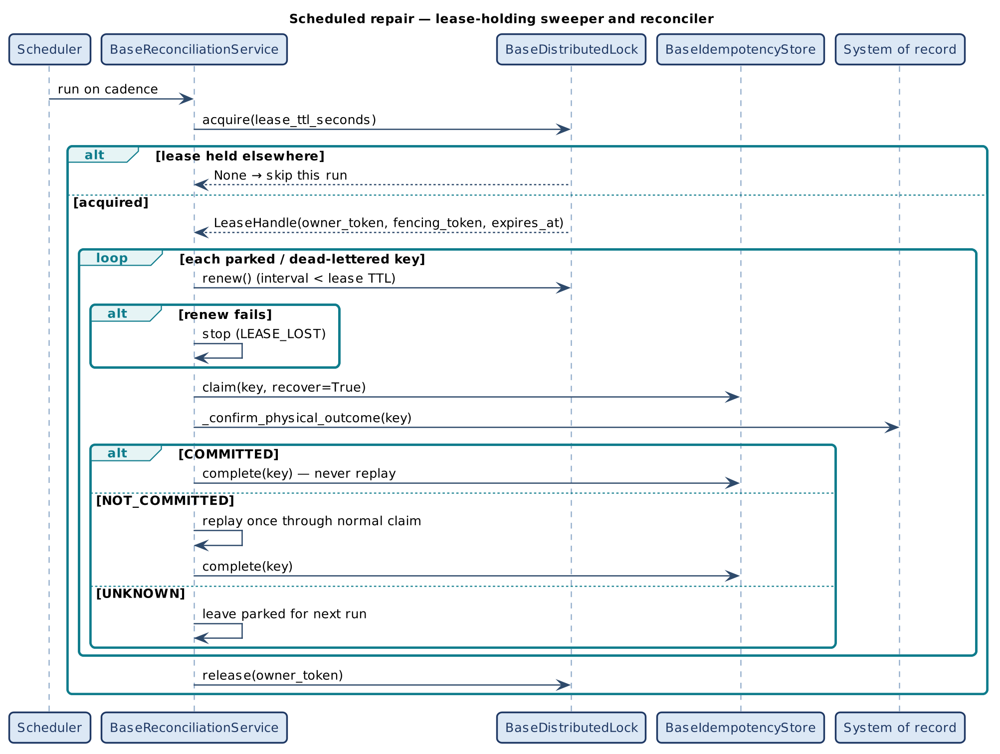

*Figure 18 — Scheduled repair under a lease*

- **Lease, not lock.** Renew interval below `lease_ttl_seconds`; a worker that cannot renew stops (`LEASE_LOST`).
- **Fencing where a stale writer can commit.** The sweeper passes the lease's `fencing_token` on every publish. Providers have no native fencing token, so the store adapter issues one from a versioned counter.
- **Confirm before acting.** The reconciler claims with `recover=True`, calls `_confirm_physical_outcome()` (default `UNKNOWN`), then: `COMMITTED` → mark done, never replay; `NOT_COMMITTED` → replay once through the normal claim; `UNKNOWN` → leave parked.

## 12. Non-Functional Design

### 12.1 Performance targets

Baseline load reuses the agentic landing zone: 20,000 daily active tenants × 5,000 operations ≈ 1,157 RPS average, ≈ 3,472 RPS design peak (3.0× surge). The CQRS split changes the distribution, not the total.

**Table 30 — Performance targets**

| Metric | Basis | Target |
|---|---|---|
| Read : write ratio | Typical CQRS workload | 80 : 20 (planning assumption) |
| Query P99, cache hit | Redis round trip + DTO marshal | < 25 ms |
| Query P99, cache miss | Single-flight replica read + hydrate | < 150 ms |
| Command P99, accepted | T0/T1 synchronous portion (202) | < 200 ms |
| Command end to end | Outbox + fan-out + Saga | < 5 s |
| In-code SLO | `max_latency`, scope CQRS | 1.0 s per `mutate()` / `fetch()` |

P99 targets are ceilings measured in the platform; the only self-enforcing limit in code is `max_latency`.

### 12.2 Capacity sizing

Little's Law: in-flight commands = command rate × mean handler time. At the design peak, commands are ≈ 694/s; at an assumed 0.5 s handler time that is ≈ 347 in flight across the fleet, which `instances × worker_concurrency` and the database connection limit must cover. Replace the assumption with measured handler time. Four checks apply: (1) `worker_concurrency ≤ db_pool_size` and `replicas × db_pool_size` below the connection limit; (2) read pool sized apart from the write pool; (3) cache capacity follows distinct keys × TTL, not request rate; (4) `drain_timeout_seconds` below the termination grace.

### 12.3 Security and tenant isolation

**Table 31 — Security controls by construction**

| Control | Where it lives |
|---|---|
| Authenticated tenant identity | `tenant_id` from the verified JWT at T0; mandatory in `execute()`. |
| Network isolation | Data perimeter unreachable from the DMZ or internet; T2/T4/T5 have no inbound internet route. |
| Payload firewall and PII redaction | `_execute_semantic_firewall()` before any business logic, both paths. |
| Egress isolation | `_verify_sandbox_profile()` before external calls (`pending_external_call`). |
| Tenant-scoped data | Claim keys scoped by `tenant_id`; cache keys must include it; storage pool or silo per tenant tier. |
| Read-only reads | `_execute_db_read()` uses the replica's read-only credential. |
| Fair use | Tenant request quota in the governance gate; gateway rate limiting at T0. |
| Human approval | Dehydration for commands above a policy threshold. |

### 12.4 Observability

**Table 32 — Structured log events emitted by the base classes**

| Event | Emitted by | Meaning |
|---|---|---|
| `routing_to_command_service` | `execute()` | Command routed (→ `command_count`). |
| `routing_to_query_service` | `execute()` | Query routed (→ `query_count`). |
| `idempotent_short_circuit` | `__short_circuit()` | Duplicate / in-progress / conflict short-circuit (`claim_status`). |
| `orchestrator_dehydrated` | `execute()` | Awaiting approval webhook. |
| `concurrency_conflict` (WARN) | `execute()` | Lost OCC race. |
| `dto_validation_failed` (ERROR) | `mutate()` | Schema rejection. |
| `commit_gate_rejected` (WARN) | `mutate()` | Advisory gate blocked the key. |
| `command_mutation_complete` | `mutate()` | Includes `latency`. |
| `query_cache_hit` / `query_cache_miss` | `fetch()` | Cache effectiveness. |
| `query_fetch_complete` | `fetch()` | Includes `latency`. |

Platform metrics from the shared catalogue that matter most for this profile: `e2a.occ.conflicts_total`, `e2a.idempotency.replays_total`, `e2a.fencing.rejections_total`, `e2a.cache.single_flight_followers_total`, `e2a.lease.lost_total`, `e2a.queue.depth`, `e2a.queue.oldest_age_seconds`, `e2a.admission.rejected_total`. Alarm on DLQ depth and oldest-message age (Service Bus has no native oldest-age metric — derive it from the enqueue time of a peeked message).

## 13. Extension Guide

### 13.1 Building a concrete service

1. **Define DTOs.** A pydantic input model and output model per command; one output model per query. Give command output models `result` and/or `outcome` fields if replay should return data, and `status` / `reason` fields if the commit gate is enabled.
2. **Implement the command service.** Subclass `BaseCommandService`; implement `_execute_business_logic`, `_execute_outbox_commit`, `_synchronize_cache`. Override `_entity_key` to opt in to OCC.
3. **Implement the query service.** Subclass `BaseQueryService`; implement the four hooks; fold `tenant_id` into the cache key; read through the replica credential.
4. **Implement the orchestrator.** Subclass `BaseOrchestrator`; implement read classification, the two service resolvers, deterministic key generation and error mapping.
5. **Bind engines and ports in config.** `idempotency_store`, `transactional_store`, `cache_store`, `governance_engine`, `observability_engine`. All five should be bound in production.
6. **Register validators.** Add per-intent validators to `BaseValidationService.validator_registry`; keep `strict_mode` on.
7. **Register project config keys** with `register_config_key()` in `src/settings.py` — never edit the scaffold.
8. **Run the scaffold-compliance gate**, including `validate_capacity()`, before deploy.

### 13.2 Skeleton

```python
class PlaceOrder(BaseCommandService):
    input_dto_model, output_dto_model = PlaceOrderIn, PlaceOrderOut
    def _entity_key(self, dto, **kw):            return f"{kw['tenant_id']}:order:{dto.order_id}"
    def _execute_business_logic(self, v, config, **kw):  ...  # pure decision -> PlaceOrderOut
    def _execute_outbox_commit(self, dto, config, **kw):  ...  # same transaction scope as the aggregate
    def _synchronize_cache(self, dto, config, **kw):      ...  # evict TENANT:<t>:ORDER:<id>

class GetOrder(BaseQueryService):
    output_dto_model = OrderView
    def _generate_cache_key(self, q, tenant_id): return f"TENANT:{tenant_id}:ORDER:{q['order_id']}"
    def _read_from_cache(self, key, io): ...
    def _execute_db_read(self, q, config, **kw): ...    # read-only replica credential
    def _write_to_cache(self, key, data, io): ...

class OrderOrchestrator(BaseOrchestrator):
    def _is_read_scenario(self, state, config):   return state.get('intent') == 'READ'
    def _get_query_service(self, resource, config): return GetOrder()
    def _get_command_service(self, action, config): return PlaceOrder()
    def _generate_idempotency_key(self, state, config, **kw): return f"{state['tenant_id']}:{state['client_ref']}"
    def _handle_error(self, error, state, config, **kw): state['http_status'] = 400 if isinstance(error, ValueError) else 500
```

### 13.3 Rules and anti-patterns

**Table 33 — Do and do not**

| Do | Do not |
|---|---|
| Call only the public entry point of another class. | Call `_execute_business_logic()` or other hooks from outside the class. |
| Pass request data as arguments / kwargs. | Store `correlation_id`, `tenant_id` or keys on `self`. |
| Raise `ValueError` / `TypeError` / `PermissionError` for permanent errors. | Raise generic exceptions for validation failures (they become retryable). |
| Set `state['outcome'] = UNKNOWN` when a side effect may or may not have landed. | Retry or dead-letter an ambiguous commit. |
| Use `put_if_version` for competing writers. | Treat `_commit_gate()`'s version check as the authority. |
| Keep `_synchronize_cache()` synchronous. | Defer cache invalidation to an async handler. |
| Let the CDC / sweeper publish outbox events. | Publish to Tier 4 from inside `_execute_outbox_commit()`. |
| Add config keys with `register_config_key()`. | Read `os.getenv()` in a subclass or edit the scaffold. |

## 14. Verification

Tests below run against the in-memory doubles in `e2a_inmemory_adapters.py`. Rows marked *runtime* need the consumer runtime or a load environment and are not claimed as passed by the scaffold.

**Table 34 — Race and saturation test matrix**

| ID | Scenario | Expected | Evidence |
|---|---|---|---|
| T-01 | Duplicate command, same key and payload | `REPLAYED`; logic and outbox run once | `smoke_test_cqrs_concurrency.py` |
| T-01 | 20 concurrent claimers on one key | Exactly one wins | `smoke_test_concurrency.py` |
| T-01 | Same key, different payload | `CONFLICT`; nothing executed | `smoke_test_concurrency.py` |
| T-02 | Two writers, same `expected_version` | One commits; loser typed `CONFLICT`, not DLQ; key claimable | `smoke_test_cqrs_concurrency.py` |
| T-09 | Writer with superseded lease | `FENCED` → `CONFLICT` | `smoke_test_cqrs_concurrency.py` |
| T-03 | 15 concurrent cold reads, one key | One database read | `smoke_test_cqrs_concurrency.py` |
| T-03 | Loader failure during shared fill | Propagates; not cached | `smoke_test_concurrency.py` |
| — | Warm read | Served from cache | `smoke_test_cqrs_concurrency.py` |
| T-10 | Expired deadline | Rejected before work; dead-lettered | `smoke_test_cqrs_concurrency.py` |
| T-12 | Outcome `UNKNOWN` | Parked; no replay | `smoke_test_concurrency.py` |
| T-12 | Reconciler, `NOT_COMMITTED` | Replayed once, then `SUCCEEDED` | `smoke_test_concurrency.py` |
| — | Lease held by another sweeper | Second sweeper skips | `smoke_test_concurrency.py` |
| — | Mis-sized consumer or pool | Capacity gate fails start-up | `smoke_test_concurrency.py` |
| — | Same-partition ordering under redelivery | Applied in order, once | *runtime* |
| — | Poison message on a FIFO group | Parked `FAILED_FINAL`; partition proceeds | *runtime* |
| — | Consumer saturation | Prefetch holds; pool not exhausted | *runtime* |
| — | Rolling deploy under load | Drain within bound; no key left `IN_PROGRESS` past lease | *runtime* |

Recommended additions, derived from the observations in Section 15: a latency-SLO breach after a successful commit; an empty query result; a short-circuited request reaching the telemetry backend.

## 15. Implementation Reality, Gaps and Design Observations

The following were found by reading the reference implementation against this design and, for O-1 and O-2, reproduced with the in-memory adapters. They are recorded here so implementers can guard against them; none changes the public contract.

**Table 35 — Design observations**

| ID | Observation | Effect | Recommendation |
|---|---|---|---|
| O-1 | `mutate()` checks the latency SLO **after** the aggregate, outbox and cache writes. | A slow but successful command raises `NFRViolationError`: its key is dead-lettered and settled `FAILED_RETRYABLE`, so a redelivery executes it again. Without `_entity_key()` OCC this duplicates the outbox record (reproduced). | Record the breach as a metric / log after commit instead of raising, or set `state['outcome'] = COMMITTED` before the check so settlement completes the claim. |
| O-2 | `fetch()` calls `output_dto_model(**db_data)` even when `_execute_db_read()` returns `None`. | A not-found read raises `TypeError` instead of a typed not-found (reproduced on both cache paths). | Return an empty-but-valid dict from the hook, or treat `None` as not-found before marshalling. |
| O-3 | `__short_circuit()` returns before the `try`/`finally`. | Replays, in-progress and conflict short-circuits are logged into `state['message_log']` but never shipped to `observability_engine`. | Ship telemetry on the short-circuit path, or count replays in the store adapter (`e2a.idempotency.replays_total`). |
| O-4 | `_circuit_breaker()` is abstract but never called by the base gate. | Circuit breaking only happens if a subclass calls it from a hook. | Call it from service hooks around dependency calls, or use `ResiliencePolicy` from `e2a_base.py`. |
| O-5 | The tenant quota compares `state['cumulative_requests_in_window']`, which the framework never maintains. | Quota is only as good as the counter the edge supplies. | Populate the counter at T0/T1 from a shared rate-limit store. |
| O-6 | The CQRS `_commit_gate()` reads `commit_gate_enabled` from kwargs/config only; the agentic mixin uses `resolve_config()`. | The `COMMIT_GATE_ENABLED` environment variable is ignored on this profile. | Align with `resolve_config()`; the mixin is a CQRS-local copy and can drift. |
| O-7 | The commit-gate rejection returns `output_dto_model(status='blocked', reason=…)`. | Output DTOs without `status` / `reason` fields (or with required fields) fail with a validation error. | Give command output models these optional fields, as the smoke test does. |
| O-8 | When `cache_store` is bound, `_write_to_cache()` is never called, but remains abstract. | Subclasses must still implement a hook that is unused on the preferred path. | Implement as a no-op when a `cache_store` is always bound. |
| O-9 | Governance, idempotency and observability are fail-open when not bound. | A misconfigured deployment silently loses quota, claims or telemetry. | Assert all five ports and engines in the scaffold-compliance gate for production. |

## 16. E2A v1.2 and This Profile

E2A v1.2.0 changed the agentic core (E2A Framework Design Document, Section 15); this profile's classes are unchanged, and its tests pass unchanged.

**Table 36 — What v1.2 means for the CQRS profile**

| v1.2 change | Effect here |
|---|---|
| The `e2a` package; `e2a_base` re-exports every v1.1 name | `e2a_cqrs_base.py` still imports from `e2a_base`; the imported objects are the same. The traceability anchors (Appendix B) point at the package modules. |
| Governed entry points | Already satisfied: each CQRS class has one capability and one public method. `python -m e2a.conformance` can check a CQRS project; rule R1 protects the framework-owned public methods of the e2a classes it subclasses. |
| Request context, `io_read` / `io_modify`, stages, declared steps | Agentic-core contracts. A CQRS service keeps its own `BaseGovernanceFramework` (tenant quota, latency) and its command / query split, which already separates reads from material writes. |
| Typed governance refusals | Not used by this profile: its gate raises `NFRViolationError` and the deterministic errors, as before. |

An agentic service and a CQRS service still meet at the shared contracts (claims, outcomes, deadlines, stores), which v1.2 did not change.

## Appendix A. Glossary

**Table 37 — Glossary**

| Term | Definition |
|---|---|
| Claim | Atomic `ABSENT → IN_PROGRESS` transition on a tenant-scoped idempotency key that grants one owner the right to execute. |
| Fingerprint | Hash of a request's business content; distinguishes a replay from a key collision. |
| OCC | Optimistic concurrency control: write succeeds only if the stored version equals the expected version. |
| Fencing token | Monotonic number issued with a lease; a store rejects writes carrying an older token. |
| Single-flight | Deduplication of concurrent loads of the same key into one loader call. |
| Dehydration | Persisting request state and halting (scaling compute to zero) until an external webhook resumes it. |
| Outbox | Table written in the same transaction as state; events are published from it by CDC or a sweeper. |
| Physical outcome | Whether a material side effect actually committed in the system of record (`COMMITTED`, `NOT_COMMITTED`, `UNKNOWN`). |
| Structural isomorphism | One-to-one mapping between LLD class boundaries and HLD tiers. |

## Appendix B. Traceability

**Table 38 — Requirement → design element → code anchor**

| Requirement / HLD element | Class / method | Code anchor (`reference/`) |
|---|---|---|
| G-1, UC-1/2, INV-02/03 | `BaseOrchestrator.execute` claim; `_request_fingerprint` | `e2a_cqrs_base.py` L265–299, L358 |
| INV-04 | `__settle_claim` | `e2a_cqrs_base.py` L395 |
| G-2, UC-3, INV-05 | `BaseCommandService._commit_versioned` | `e2a_cqrs_base.py` L456; `e2a/ports.py` `put_if_version` L87 |
| G-3, UC-4 | `BaseQueryService.fetch`; `BaseCacheStore.get_or_load` | `e2a_cqrs_base.py` L489; `e2a/ports.py` L140 |
| UC-5 | `_synchronize_cache` | `e2a_cqrs_base.py` L480 |
| G-4, INV-10 | `__resolve_deadline`; `Deadline` | `e2a_cqrs_base.py` L370; `e2a/core.py` L64 |
| G-5, UC-7, INV-08 | `__settle_claim` UNKNOWN branch; `BaseReconciliationService` | `e2a_cqrs_base.py` L400; `e2a/ports.py` L480 |
| UC-6 | `BaseGovernanceFramework.__trigger_dehydration` | `e2a_cqrs_base.py` L192 |
| INV-06/07 | `execute` except branches; DLQ guard | `e2a_cqrs_base.py` L315–341 |
| G-6 | `BaseGovernanceFramework`, `BaseObservability` | `e2a_cqrs_base.py` L92, L159 |
| T1 edge | `BaseValidationService.validate` | `e2a_cqrs_base.py` L234 |
| Central config | `resolve_config` | `e2a/config.py` L231 |
| Capacity gate | `validate_capacity` | `e2a/resilience.py` L242 |
| Scheduled repair | `BaseOutboxSweeper`, `BaseDistributedLock` | `e2a/ports.py` L422, L322 |
