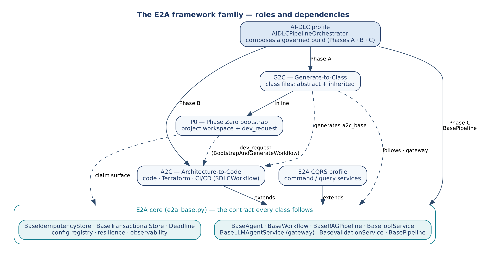
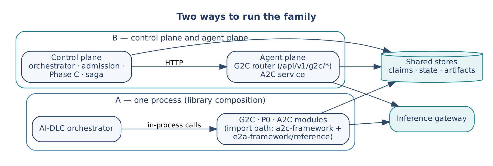
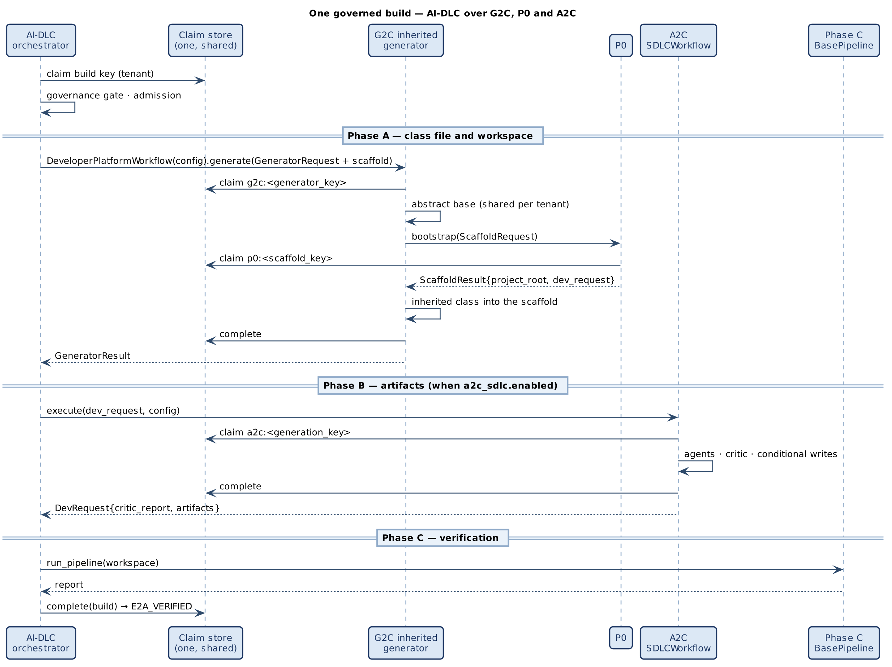
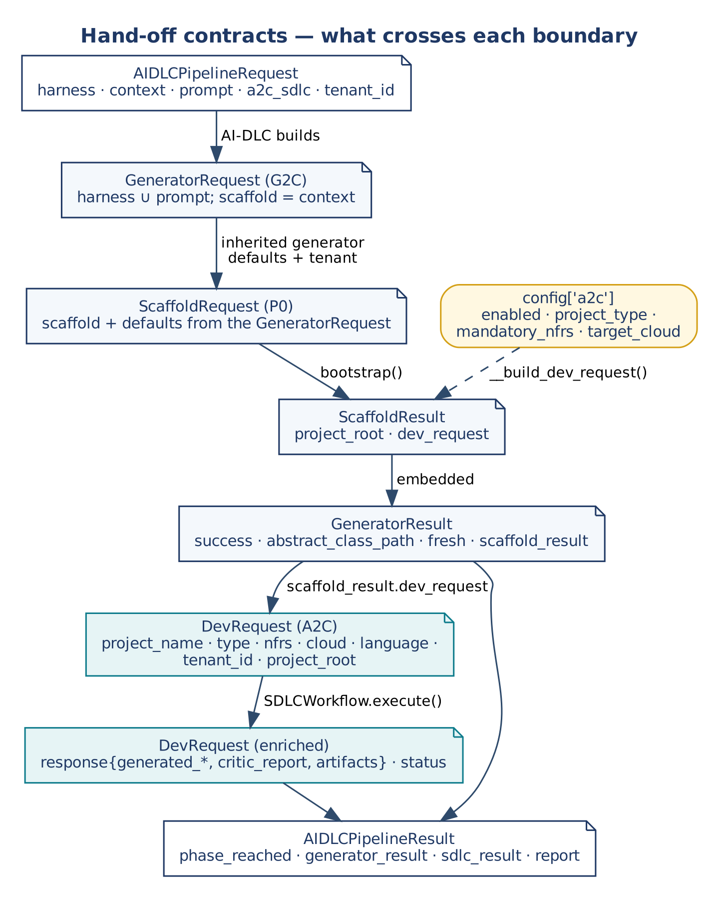
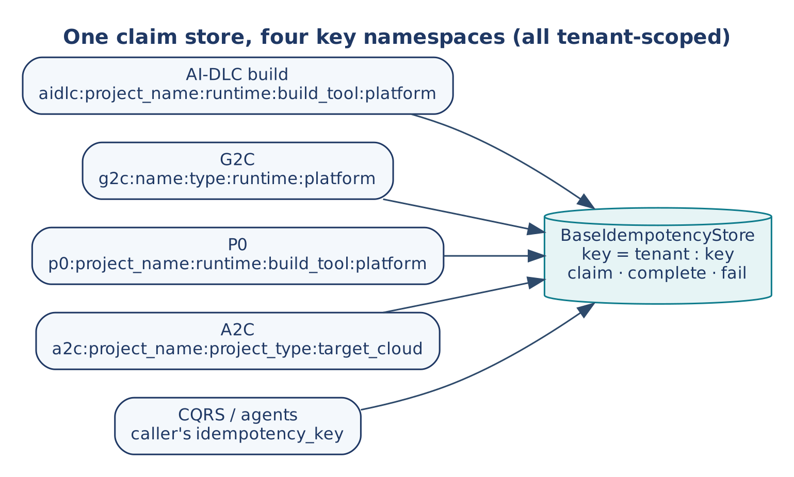
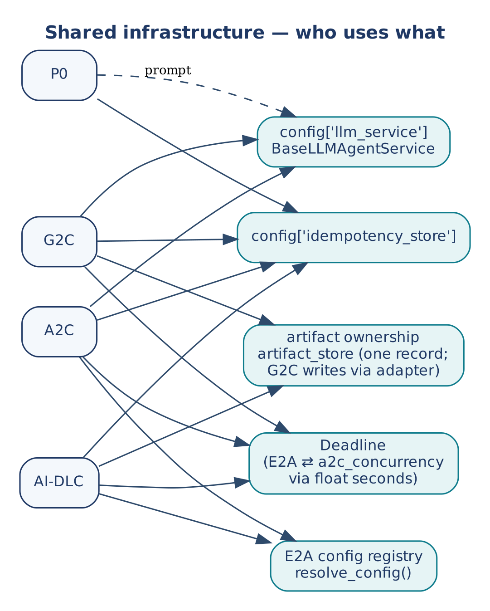
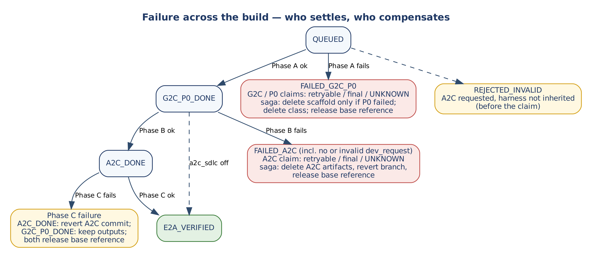

# E2A Framework Family System Design

### How E2A, P0, G2C, A2C and AI-DLC compose into one governed build

*The per-framework design documents describe each framework from the inside. This document describes the family from the outside — what each framework is for, who may call whom, what crosses each boundary, how identity, idempotency, deadlines and failure behave across those boundaries, and which defects exist only between frameworks. It is the document to read before changing any interface between two frameworks.*

| | |
|---|---|
| Framework | E2A framework family — E2A core, CQRS profile, P0, G2C, A2C, AI-DLC profile |
| Document type | System Design Document (cross-framework HLD + interface contracts) |
| Author | Subham Gupta, Principal Platform Architect |
| Source baseline | `subhamviky/e2a-framework` `v1.2.0` (`reference/`); `subhamviky/a2c-framework` `v1.2.0`; baseline of the v1.1 sections: e2a-framework @ db49af1, a2c-framework @ 0caa2ac |
| Date | 13 November 2026 (E2A v1.2.0, A2C v1.2.0; baseline 7 November 2026) |
| Status | Baseline system design; cross-framework behaviour verified by an integration test over the real modules |

## 1. Introduction

### 1.1 Purpose

The E2A family is five cooperating frameworks and one deployment profile. Each has its own design document with HLD, LLD and method contracts. None of those documents owns the space *between* the frameworks: the request that becomes another framework's request, the key that two frameworks claim in one store, the failure in one phase that another phase must compensate. Every cross-framework defect found so far lived in that space:

- a P0 claim key with the same shape as the AI-DLC build key, so every real AI-DLC build failed with a conflict;
- a replayed result that shared an object with a live result another framework mutated;
- an orchestrator constructing `DeveloperPlatformWorkflow(config=...)` against a class that took no arguments;
- an orchestrator importing `SDLCWorkflow` from a module that did not exist;
- a build that reported `E2A_VERIFIED` without running A2C;
- a tenant that never reached Phase A.

This document makes that space explicit.

### 1.2 Audience

| Reader | Read first | Use the document to |
|---|---|---|
| Platform architect | Sections 2, 4, 5 | Understand the family as one system and choose a composition pattern. |
| Framework author | Sections 7, 8, 12 | Change an interface without breaking a neighbour. |
| Platform engineer | Sections 5.4, 9, 10, 11 | Wire shared stores, the gateway, leases and deadlines. |
| Reviewer | Sections 4.2, 13, 14 | Check system invariants and open cross-framework gaps. |

### 1.3 Sources and status

| Source | Role |
|---|---|
| Per-framework design documents (E2A, CQRS, AI-DLC, P0, G2C, A2C) | Internal contracts; this document does not repeat them. |
| `e2a-framework/reference`, branch `fix/aidlc-cross-framework` | E2A core, CQRS, AI-DLC orchestrator. |
| `a2c-framework` branch `fix/g2c-p0-a2c-contracts` | P0, G2C, A2C, `a2c_concurrency`. |
| `smoke_test_aidlc_integration.py` and the probes in Section 13 | Evidence for cross-framework behaviour. |

Statements about behaviour across boundaries are verified by the integration test or a reproduction unless marked **derived** (follows from the published contracts but cannot be reproduced with reference hooks that perform no side effect).

### 1.4 Related documents

| Document | Owns |
|---|---|
| E2A Framework Design Document | Base classes, gateway, stores, config registry, `Deadline`. |
| E2A CQRS Design Document | Command/query services and outbox. |
| E2A AI-DLC Profile Design Document | Orchestrator, admission, Phase C, saga. |
| P0 / G2C / A2C Framework Design Documents | Their own classes and contracts. |
| Vendor companion documents (e.g. Azure binding) | Mapping to a specific cloud; kept out of this vendor-neutral document. |

## 2. Problem Statement and Motivation

### 2.1 Why a system view is needed

Each framework is correct against its own contract and its own tests. The family can still be wrong, because:

- **Requests are translated at every boundary.** An AI-DLC request becomes a `GeneratorRequest`, which carries a `ScaffoldRequest`, which produces a `DevRequest`. A field that is not carried across simply disappears (the build's tenant did, until it was copied explicitly).
- **Idempotency is nested.** One build holds a claim while G2C, P0 and A2C each take their own claims in the same store. Key shapes, replay semantics and settlement have to agree across the nesting.
- **Failure crosses layers.** A failure in Phase B is settled by A2C's claim, recorded in AI-DLC's phase state and compensated by AI-DLC's saga. Each part is correct alone; together they decide whether a retry is safe.
- **Shared infrastructure has one owner per concern.** One gateway, one claim store, one configuration registry, one deadline — or the family behaves differently depending on which framework a call enters through.

### 2.2 Design goals

| ID | Goal |
|---|---|
| SG-1 | Every framework is usable alone and composable without wrappers. |
| SG-2 | Every boundary has one named contract, and each field's origin is known. |
| SG-3 | One claim store serves all frameworks without key collisions. |
| SG-4 | A retried build is safe: inner steps replay or re-run according to their own settled state. |
| SG-5 | Tenant, correlation and deadline reach every step of a build. |
| SG-6 | One gateway bounds all model capacity. |
| SG-7 | A build never reports success for a phase that did not run. |

## 3. System Use Cases

**Table 1 — System use cases**

| ID | Use case | Frameworks involved |
|---|---|---|
| SUC-1 | Full governed build from one request | AI-DLC → G2C (+ P0 inline) → A2C → E2A `BasePipeline` |
| SUC-2 | Class generation without a pipeline | G2C (+ P0 inline) via API or `DeveloperPlatformWorkflow` |
| SUC-3 | Scaffold then generate artifacts | P0 → A2C via `BootstrapAndGenerateWorkflow` |
| SUC-4 | Workspace only | P0 alone |
| SUC-5 | Business service at runtime | Generated classes running on E2A core / CQRS |
| SUC-6 | Duplicate build request | Outer build claim replays; inner claims never reached |
| SUC-7 | Retry after a failed phase | Outer claim retryable; inner claims replay what succeeded and re-run what failed |
| SUC-8 | Many tenants building at once | AI-DLC admission + gateway permits/quotas, shared by every phase |

## 4. Principles and System Invariants

### 4.1 Principles

| Principle | Meaning across the family |
|---|---|
| One contract style | Every class follows E2A's three-layer method contract: governed entry points (a public method per genuine capability, usually one), protected hooks, private steps; checked by `e2a.conformance` since v1.2. |
| Composition without wrappers | Composers call public entry points directly: `DeveloperPlatformWorkflow.generate()`, `bootstrap()`, `SDLCWorkflow.execute()`, `BasePipeline.run_pipeline()`. |
| Composable siblings | P0 and A2C do not depend on each other; `BootstrapAndGenerateWorkflow` and AI-DLC compose them. |
| Shared infrastructure by injection | Gateway, stores, registries and limits arrive in `config`; no framework creates its own. |
| Typed outcomes, never silent ones | Every framework returns a typed status for duplicates, overload, conflict and failure. |
| Class files and artifacts are different products | G2C produces class files; A2C produces code, IaC and CI/CD; the second phase is always explicit. |

### 4.2 System invariants

| ID | Invariant | Holds today |
|---|---|---|
| SI-01 | Claim keys of different frameworks never collide in a shared store. | Yes: `aidlc:`, `g2c:`, `p0:`, `a2c:`. |
| SI-02 | A replay returns what was settled, never a later mutation. | Yes (deep copy at settlement in P0, G2C and A2C). |
| SI-03 | Every step of a build sees the build's `tenant_id`. | Yes: copied into the G2C request and the `dev_request`. |
| SI-04 | Every step of a build is bounded by the build's deadline. | Yes for Phases A and the phase boundaries (`deadline_ms` into G2C); A2C runs under `BaseWorkflow`'s own deadline. |
| SI-05 | All model calls of a build go through one gateway. | Yes. |
| SI-06 | A build reports `E2A_VERIFIED` only if every requested phase ran. | Yes: impossible requests are `REJECTED_INVALID`; a missing `dev_request` fails Phase B. |
| SI-07 | Inputs are validated by a `BaseValidationService` before any workflow runs. | Yes: AI-DLC validates the `dev_request` before Phase B. |
| SI-08 | No step replays an output that compensation removed. | Yes: compensation keeps outputs of succeeded claims by default; P0 and G2C return `recovery_required` for a replay whose output is missing. |
| SI-09 | A shared abstract class is deleted only by its creator after the last reference is released. | Yes: one record, written by G2C with its key; deletion opt-in. |
| SI-10 | Every claim's lease exceeds the longest legitimate hold. | Build claim: lease ≥ deadline + 60 s when a deadline is set; without a deadline the configured lease applies (X-7). |

## 5. Architecture

### 5.1 The family

*Figure 1 — The E2A framework family: roles and dependencies*

**Table 2 — Roles**

| Framework | Produces | Entry point | Depends on |
|---|---|---|---|
| E2A core | The contract and runtime of governed services | `run()`, `execute()`, `retrieve()`, `process_inference()`, `run_pipeline()` | — |
| CQRS profile | Command/query services with outbox | `BaseOrchestrator`, `BaseCommandService`, `BaseQueryService` | E2A core |
| P0 | A project workspace and a `DevRequest` | `bootstrap()` | Claim surface (shape only); optional gateway |
| G2C | Class files (abstract and inherited) | `DeveloperPlatformWorkflow.generate()`, `generate()` | Gateway, claim surface, P0 |
| A2C | Code, Terraform, CI/CD in the workspace | `SDLCWorkflow.execute()` | E2A core (imports `e2a_base`) |
| AI-DLC | A governed, verified build | `execute_pipeline()` | G2C, A2C, E2A core |

### 5.2 Who may call whom

| Caller | May call | Never |
|---|---|---|
| AI-DLC | `DeveloperPlatformWorkflow`, `SDLCWorkflow`, `BasePipeline.run_pipeline()` | P0 directly (P0 runs inside G2C); protected hooks of any class |
| G2C inherited generators | P0 `ProjectBootstrapperFactory` / `bootstrap()`; abstract generators | A2C's workflow (the second phase belongs to the caller) |
| `BootstrapAndGenerateWorkflow` | P0, `DevPlatformValidationService`, `SDLCWorkflow` | G2C |
| A2C | Gateway, tools, writer | P0, G2C |
| Generated services | E2A core / CQRS | The generators |

### 5.3 Composition patterns

| Pattern | Composer | Chain | When |
|---|---|---|---|
| Standalone | — | One framework | A workspace (P0) or a class (G2C) alone. |
| Bootstrap and generate | `BootstrapAndGenerateWorkflow` | P0 → validate → A2C | Workspace plus artifacts without class generation. |
| Governed build | `AIDLCPipelineOrchestrator` | G2C (+P0) → A2C → verification | One request to a verified repository. |

### 5.4 Deployment

*Figure 2 — Two ways to run the family*

Two shapes are supported by the code. **In-process** composition imports the G2C, P0 and A2C modules next to the orchestrator; the import path holds `a2c-framework` and `e2a-framework/reference`. A **split** deployment keeps a control plane (orchestrator, admission, Phase C, saga — no model calls) apart from an agent plane (G2C behind its FastAPI router, A2C as a service), and the two talk over HTTP. Both share the claim, state and artifact stores and the inference gateway. Vendor bindings are in the companion documents.

## 6. End-to-End Build

### 6.1 Sequence

*Figure 3 — One governed build over G2C, P0 and A2C*

### 6.2 Step table

**Table 3 — A full build, step by step**

| # | Step | Claim taken | Typed outcomes | Settled by |
|---|---|---|---|---|
| 1 | AI-DLC governance gate, claim, admission | build key (tenant) | `SKIPPED_IDEMPOTENT`, `SKIPPED_IN_PROGRESS`, `REJECTED_CONFLICT`, `REJECTED_OVERLOAD` | AI-DLC, in `finally` |
| 2 | Phase A: `DeveloperPlatformWorkflow.generate()` | `g2c:<generator_key>` | `replay`, `in_progress`, `conflict`, `critic_threshold_not_met`, `scaffold_failed`, … | `BaseGeneratorAgent` |
| 2a | Abstract base (shared per tenant) | `g2c:<base key>` | as above | abstract generator |
| 2b | P0 inline | `p0:<scaffold_key>` | `replay`, `in_progress`, `conflict`, `recovery_required`, `failed_final` | `bootstrap()` |
| 2c | Inherited class written into the scaffold | — (inside 2) | — | — |
| 3 | Phase B: `SDLCWorkflow.execute(dev_request)` | `a2c:<generation_key>` | `REPLAYED`, `IN_PROGRESS`, `CONFLICT`, `CRITIC_THRESHOLD_NOT_MET`, `ARTIFACT_CONFLICT` | `BaseWorkflow` |
| 4 | Phase C: `run_pipeline()` | — | stage report | AI-DLC |
| 5 | Build complete | build key → `SUCCEEDED` | `E2A_VERIFIED` | AI-DLC |

Each inner claim is independent: a retried build re-enters step 2, where G2C replays if its key succeeded, and step 3, where A2C re-claims if its key failed retryably. This is what makes SG-4 possible.

## 7. Hand-off Contracts

*Figure 4 — What crosses each boundary*

### 7.1 AI-DLC → G2C

| `GeneratorRequest` field | Source in `AIDLCPipelineRequest` |
|---|---|
| everything in `harness` | `harness` (copied) |
| prompt fields (`user_prompt`, …) | `prompt` (merged over the harness) |
| `scaffold` | `context` |
| `tenant_id` | the build's `tenant_id` (unless the harness sets one) |
| `deadline_ms` | the build deadline's remaining milliseconds |
| `config['a2c']` | built from `a2c_sdlc` (`enabled`, `project_type`, `mandatory_nfrs`, `target_cloud`) |

`config['artifact_registry']` is an adapter over the build's `artifact_store`, so G2C records its references in the build's ownership records. A request that enables A2C must use an inherited generator; otherwise it is `REJECTED_INVALID` before the claim. AI-DLC reads back `success`, `generator_key`, `scaffold_result.dev_request`, `abstract_class_path`, `abstract_class_generated_fresh` from the flat `GeneratorResult`.

### 7.2 G2C → P0

| `ScaffoldRequest` field | Source |
|---|---|
| fields in `scaffold` | `GeneratorRequest.scaffold` (wins) |
| `runtime`, `platform`, `output_path`, `tenant_id` | `GeneratorRequest` defaults |
| `build_tool` | poetry / maven / npm / go_modules by runtime |
| `project_name`, Python `package_name` | `<agent_name>Service`, its snake case |
| Java `group_id`, `artifact_id`, `project_type` | must be supplied in `scaffold` |

### 7.3 P0 → A2C

| `DevRequest` field | Source |
|---|---|
| `project_name`, `language`, `target_cloud` | `ScaffoldRequest` (`runtime` → language, `platform` → cloud) |
| `project_type`, `mandatory_nfrs`, `context` | `config['a2c']` (project type falls back to the scaffold's) |
| `tenant_id` | `ScaffoldRequest.tenant_id`, else `config.tenant_id` |
| `project_root` | P0's resolved workspace |

A2C requires `tenant_id`. `DevRequest` and `GeneratorRequest` are never interchanged.

### 7.4 AI-DLC → A2C and back

AI-DLC sets the build's `tenant_id` on the `dev_request`, validates it with `DevPlatformValidationService` (or `config['a2c_validation_service']`), and passes A2C a deep copy. It reads `errors` and `critic_report` from the returned `DevRequest`. On a replay `BaseWorkflow` restores only `response`, so A2C keeps every artifact, the critic report and its status inside `response` as well. A consumer that must work on both paths reads `response`.

## 8. Identity, Keys and Idempotency

### 8.1 Key namespaces

*Figure 5 — One claim store, four key namespaces*

**Table 4 — Claim keys**

| Framework | Key | Fingerprint | Scope |
|---|---|---|---|
| AI-DLC | `aidlc:<build_key>`, where `build_key` = `project_name:runtime:build_tool:platform` | Build request | tenant |
| G2C | `g2c:<name>:<type>:<runtime>:<platform>` | Request minus volatile fields (abstract chain also minus `output_path`) | tenant |
| P0 | `p0:<project_name>:<runtime>:<build_tool>:<platform>` (`#rescaffold` for deliberate re-runs) | Request minus written fields | tenant |
| A2C | `a2c:<project_name>:<project_type>:<target_cloud>` | `DevRequest` | tenant |

The P0 and AI-DLC keys have the same shape; before P0 was prefixed, P0's claim inside every real build returned `CONFLICT` against the orchestrator's own claim. All four namespaces now differ. The AI-DLC result exposes `build_key`; its `generator_key` field is a deprecated alias of the build key and is not G2C's `generator_key`.

### 8.2 Nested claims and replay

| Situation | Outer (build) | Inner (G2C / P0 / A2C) |
|---|---|---|
| Duplicate while running | `SKIPPED_IN_PROGRESS` | not reached |
| Duplicate after success | `SKIPPED_IDEMPOTENT` | not reached |
| Retry after `FAILED_A2C` | re-claimed (retryable) | G2C and P0 replay; A2C re-claims |
| Retry after `FAILED_G2C_P0` (critic) | re-claimed | P0 replays its workspace (kept by compensation); G2C regenerates if retryable, else `failed_final` |
| Replay of an output that was removed | — | `recovery_required` (P0: workspace missing; G2C: a generated file missing) |
| Worker lost | `RECOVERY_REQUIRED` | inner claims may be `UNKNOWN`; reconcile before rebuilding |

Settled results are stored as deep copies, so a caller that enriches a returned object (A2C enriching `dev_request`) cannot change a later replay.

## 9. Shared Infrastructure

*Figure 6 — Shared infrastructure: who uses what*

**Table 5 — Shared infrastructure**

| Concern | Owner | Rule across the family |
|---|---|---|
| Model calls | `config['llm_service']` (E2A `BaseLLMAgentService`) | The only path to a model: generation (G2C), prompt resolution (P0), every A2C agent. Tenant/pod permits, RPM/TPM quota and per-call timeouts live here; no framework adds its own limiter. |
| Claims | `config['idempotency_store']` | One store; claim/complete/fail surface; tenant-scoped; namespaced keys. P0 and G2C accept any object with the surface (`a2c_concurrency` mirrors E2A value-for-value). |
| Build capacity | AI-DLC `_BuildAdmission` | Per-tenant and per-instance build permits, bounded wait, typed overload. |
| Artifact ownership | AI-DLC `artifact_store` (G2C writes through `_ArtifactRegistryAdapter`) | One record per abstract class `{refs, created_by, deleted}`, compare-and-set, identity = G2C `generator_key`. |
| Configuration | E2A config registry | A2C registers its keys; P0 and G2C resolve config › env › default without importing E2A (they must run standalone). |
| Deadline | E2A `Deadline`; `a2c_concurrency.Deadline` | Bridged through float seconds (`float(deadline)` = remaining time), so either type can be passed to the gateway. |

### 9.1 Propagation fields

| Field | AI-DLC | G2C | P0 | A2C |
|---|---|---|---|---|
| `tenant_id` | request (JWT) | from the build | from G2C; into `dev_request` | from the build; required |
| `correlation_id` | minted / validated | `trace_id` per call | `trace_id` per call | from `BaseWorkflow` |
| `deadline` | request or config | `deadline_ms` from the build | — | from `BaseWorkflow` |
| `idempotency_key` | `aidlc:` key | `g2c:` key | `p0:` key | `a2c:` key |
| `message_log`, `failed_keys` | per build | — | — | per workflow run |

## 10. Failure and Compensation

*Figure 7 — Who settles, who compensates*

**Table 6 — Status mapping into the build**

| Inner outcome | `phase_reached` | Saga action (AI-DLC) |
|---|---|---|
| G2C `generated` | `G2C_P0_DONE` | — |
| G2C any failure, P0 failure (`scaffold_failed`) | `FAILED_G2C_P0` | Delete the scaffold only if P0 did not succeed; delete the inherited class; release the base reference |
| A2C requested but impossible | `REJECTED_INVALID` (before the claim) | none |
| No `dev_request`, or invalid `dev_request` | `FAILED_A2C` | As below |
| A2C `GENERATED` | `A2C_DONE` | — |
| A2C errors (`AGENT_FAILED`, `CRITIC_THRESHOLD_NOT_MET`, `ARTIFACT_CONFLICT`) | `FAILED_A2C` | Delete A2C artifacts, revert branch, release the base reference |
| Phase C failure after `A2C_DONE` | `A2C_DONE` | Revert the A2C commit, release the base reference |
| Phase C failure after `G2C_P0_DONE` | `G2C_P0_DONE` | Release the base reference; keep scaffold and classes |
| Exception before Phase A completes | `QUEUED` | As `FAILED_G2C_P0` |

Compensation never deletes an output whose producing claim settled `SUCCEEDED`. Deleting an orphaned abstract class is opt-in (`compensation_delete_orphan_abstract`) and allowed only to the build whose G2C key created it fresh, after the last reference is released; afterwards, any replay of that base returns `recovery_required` rather than a missing path.

Settlement and compensation are separate mechanisms: each framework settles its own claim (retryable, final, or `UNKNOWN` after a side effect), and AI-DLC compensates by phase. Section 14 lists where the two disagree.

## 11. System-Level Non-Functional Design

### 11.1 Time budget of one build

**Table 7 — Upper bounds per phase (configured limits)**

| Step | Calls | Bound |
|---|---|---|
| G2C abstract base (first build of a tenant) | 1–3 model calls | 60 s SLO per generation (warning, not enforced) |
| G2C inherited class | 1–3 model calls | 60 s SLO (warning) |
| P0 | 0 (inline), 1 (prompt source) | 10 s SLO (warning) |
| A2C, NFR-first | 7 agent calls; up to 11 with 2 regenerations | 30 s per agent call (enforced) → up to 330 s |
| Phase C | stage hooks | deployment-specific |

The AI-DLC build claim lease defaults to 300 s, below A2C's own worst case. When the build has a deadline the orchestrator now leases for at least the deadline plus 60 s; without a deadline the configured lease applies, so set `request_deadline_seconds` (X-7).

### 11.2 Capacity

Build concurrency is bounded once, by `_BuildAdmission`; model concurrency is bounded once, by the gateway. Every phase draws from the same gateway quota, so fleet sizing must include G2C regenerations and A2C's 7–11 calls per build.

### 11.3 Security

Tenant isolation rests on `tenant_id` reaching every claim and every gateway call (SI-03). Credentials exist only at the gateway and the stores. Validation and entitlement run in `BaseValidationService` before workflows (SI-07).

## 12. Rules for Changing an Interface

| # | Rule |
|---|---|
| 1 | A new framework or phase namespaces its claim key (`<name>:`) and scopes it by tenant. |
| 2 | It accepts `tenant_id` and a deadline, and passes both to every inner call. |
| 3 | It returns a flat, typed result; duplicates, overload and conflict are statuses, not exceptions. |
| 4 | It settles its claim on every exit path and stores a deep copy. |
| 5 | It keeps no semaphore, rate limiter or provider SDK; capacity comes from the gateway and admission. |
| 6 | A composer validates the next framework's input with its `BaseValidationService` before calling it. |
| 7 | A field added to a hand-off is added to Section 7 and to the integration test. |
| 8 | Compensation that undoes a step also invalidates that step's settled claim. |

## 13. Verification

**Table 8 — Cross-framework evidence**

| Evidence | Result |
|---|---|
| `smoke_test_aidlc_integration.py` (15 checks) | AI-DLC over the real G2C, P0 and A2C: flat result; P0 inline without claim collision; A2C writes six artifacts; `E2A_VERIFIED`; tenant given only on the build request reaches G2C, P0 and A2C; one ownership record under G2C's key; `aidlc:` build claim; A2C works on a copy; abstract-only harness with A2C → `REJECTED_INVALID`; Phase C failure keeps the scaffold; opt-in deletion of the creator's orphaned base; retry replays truthfully; a new project gets `recovery_required` for the deleted base. |
| `smoke_test_a2c.py` (P0 → A2C part) | `BootstrapAndGenerateWorkflow` validates and runs `SDLCWorkflow`; artifacts land in the workspace. |
| Per-framework suites | `e2a-framework`: AI-DLC (26), concurrency (48), CQRS (9), LLM service (37), multimodal (6). `a2c-framework`: P0/G2C concurrency (55), G2C contract (35), A2C (25). All passing. |
| Reproduction X-1 (fixed) | `a2c_sdlc.enabled`, abstract-only harness → was `E2A_VERIFIED` with A2C never run; now `REJECTED_INVALID`. |
| Reproduction X-2 (fixed) | `tenant_id` only at the top of the AI-DLC request with a gateway → Phase A failed ("tenant_id is required when generating through llm_service"); now the build is verified. |
| Reproduction (fixed) | Before namespacing, P0's claim inside a real build returned `CONFLICT`; before deep copies, a replay returned A2C's later edits. |

All evidence uses in-memory stores and a gateway test double.

## 14. Cross-Framework Gaps and Design Observations

Fixed on the current branches: the missing `a2c_concurrency` module; `DeveloperPlatformWorkflow` constructor and result shape; the missing `a2c_base`; the P0/AI-DLC claim collision; replay aliasing; and, in the AI-DLC orchestrator, X-1 (silent Phase B skip), X-2 (tenant and deadline not carried into Phase A), X-3 (no validation before Phase B), X-4 (unprefixed build key), X-5 (two ownership registries), X-6 (compensation vs replay), X-8 (A2C enriching the build's `dev_request`) and X-11 (no compensation after `G2C_P0_DONE`); X-7 is fixed when the build has a deadline. The orchestrator's earlier orphan rule, which let any build releasing the last reference delete a base it did not create, is replaced by the creator-only rule.

**Table 9 — Remaining cross-framework gaps**

| ID | Gap | Effect | Recommendation |
|---|---|---|---|
| X-6a | A replay whose output was removed returns `recovery_required`, but nothing reconciles it. | After an opt-in orphan deletion, new projects of that tenant cannot generate the base until an operator intervenes. | Add a reconciler that re-opens a claim whose recorded output is gone (needs a store operation beyond claim/complete/fail), or keep orphan deletion off. |
| X-7 | Without a request deadline the build lease is the configured 300 s, below A2C's worst case. | A long build can lose its claim. | Set `request_deadline_seconds`, or raise `idempotency_lease_seconds` for AI-DLC deployments. |
| X-9 | A governance violation inside an agent settles retryable (E2A workflow settlement); AI-DLC also settles every failed build retryable. | Redelivery repeats a request that cannot pass. | Classify `GovernanceViolationError` and validation failures as final. |
| X-10 | Business keys do not line up: P0 and the build include `build_tool`, A2C omits runtime, G2C is per class. | Python and Java variants of one project share an A2C key. | Add `language` to A2C's key; document the mapping in Table 4. |
| X-12 | Two `Deadline` types, bridged by float seconds. | Works, but two implementations of one concept. | Use E2A's type when `e2a_base` is present. Since A2C v1.2.0, E2A is a declared dependency (`e2a-framework` v1.2.0), so it always is. |
| X-13 | The AI-DLC result keeps `generator_key` as an alias of the build key. | Readers can still confuse it with G2C's key. | Remove the alias after consumers move to `build_key`. |

## 15. The Family at v1.2

**Table 10 — Versions and how they fit**

| Framework | Version | Depends on | v1.2 in one line |
|---|---|---|---|
| E2A core | `v1.2.0` (docs `v1.2.1`) | — | The `e2a` package; request context and accessors; governance stages; declared steps and `resume()`; RAG ports; conformance kit. v1.1 code runs unchanged with deprecation warnings. |
| CQRS profile | in E2A `v1.2.0` | E2A shared contracts | Unchanged. |
| AI-DLC profile | in E2A `v1.2.0` | E2A, A2C | Unchanged phases; the contract check runs `e2a.conformance`. |
| A2C | `v1.2.0` | E2A `v1.2.0` | Declarations instead of patches (settings, contracts, Maven coordinates, monorepo), upgrades with a manifest; no application-service module. |
| G2C | in A2C `v1.2.0` | E2A, A2C, P0 | Generates E2A v1.2 code, several agents per request (Python). |
| P0 | in A2C `v1.2.0` | — | New request fields; a generated Python project depends on `e2a-framework` when its code imports `e2a`. |

**Interfaces that changed.** A generated Python service now imports `e2a` (not a copied `common/e2a_base.py`), so the E2A version is pinned in its `pyproject.toml`; the G2C critic checks generated code with `e2a.conformance`. Every other hand-off contract in Section 7 is unchanged. Following Section 12's rules, the v1.1 adapters stay until v1.3.

## Appendix A. Glossary

| Term | Definition |
|---|---|
| Build | One `AIDLCPipelineOrchestrator.execute_pipeline()` call. |
| Phase A / B / C | G2C + P0; A2C; verification by `BasePipeline`. |
| Hand-off | A request or result that crosses a framework boundary. |
| Namespace | The prefix that separates one framework's claim keys from another's. |
| Nested claim | An inner framework's claim taken while the build's claim is held. |
| Derived | Follows from the contracts; not reproducible with the reference hooks. |

## Appendix B. Where each concern is specified

| Concern | Specified in |
|---|---|
| Method contracts of a class | That framework's design document, Section 8 |
| Claim mechanics (state machine, settlement) | E2A design document; `a2c_concurrency` in the G2C document |
| Key namespaces, nested claims, hand-offs | This document, Sections 7–8 |
| Admission, phases, saga | AI-DLC design document |
| Generation order, critic rules | A2C and G2C design documents |
| Cross-framework gaps | This document, Section 14 |
